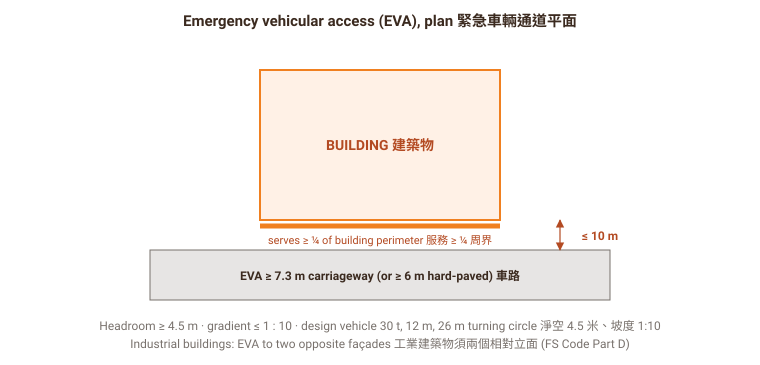
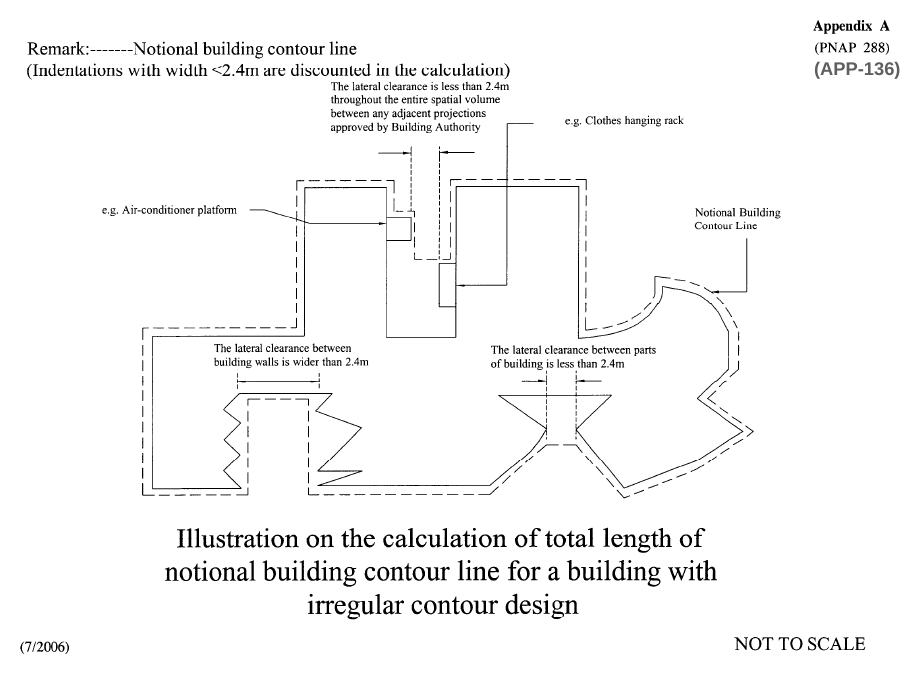
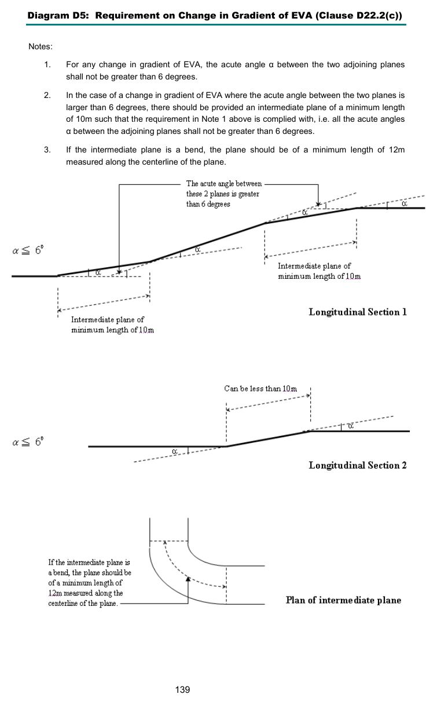
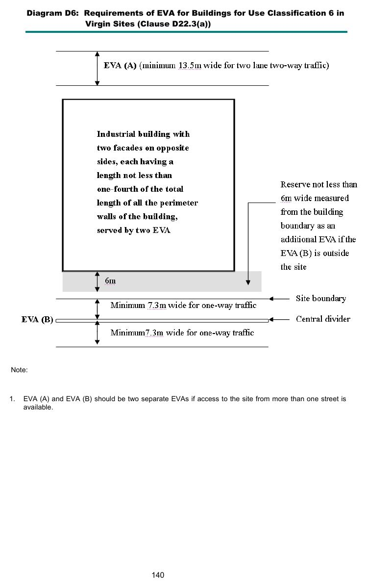

---
tags:
  - PNAP
  - APP series
  - EVA 緊急車輛通道
  - Fire safety 消防安全
  - Means of access 救援通道
  - Curtain wall & façade 幕牆及外牆
  - Balcony & utility platform 露台及工作平台
  - Domestic 住用
  - Plan submission & approval 呈交及審批
  - Foundation 地基
summary: "New buildings need an EVA to FS Code Part D serving at least a quarter of the perimeter; show it on a separate EVA plan; exemptions on Form BA16, with Appendix B relaxations."
keywords: EVA, emergency vehicular access, 緊急車輛通道, 消防車通道, B(P)R 41D, major façade, 主要立面, crash gate, 緊急閘, PNAP 288, MOA Code, fire engine access
---

# APP-136 Emergency Vehicular Access <small>《建築物(規劃)規例》第41D條－緊急車輛通道</small>

!!! info "Document info 文件資料"
    | | |
    |---|---|
    | **Type 類別** | PNAP (APP series), previously PNAP 288 舊編號 PNAP 288 |
    | **Issued by 發出機構** | Buildings Department 屋宇署 |
    | **First issue 首次發出** | May 2005 |
    | **Version summarised 本摘要版本** | July 2006 |
    | **Official language 官方語言** | English and Chinese 中英文版 |
    | **Source 原文** | [English (PDF)](https://www.bd.gov.hk/doc/en/resources/codes-and-references/practice-notes-and-circular-letters/pnap/APP/APP136.pdf) · [中文 (PDF)](https://www.bd.gov.hk/doc/tc/resources/codes-and-references/practice-notes-and-circular-letters/pnap/APP/APP136.pdf) |
    | **Legal basis 法律依據** | [B(P)R 41D](../regulations/bpr-39-49e.md); now [FS Code Part D](../codes/fsc-part-d-means-of-access.md) (the PNAP still cites the 2004 MOA Code Part VI) |
    | **Last checked 最後核對** | 2026-11-21 against the July 2006 version |

!!! note "Older code reference 舊守則引用"
    APP-136 refers to the **MOA Code 2004, Part VI**. EVA standards are now in **FS Code 2011 Part D, Section 6** (see [FS Code Part D](../codes/fsc-part-d-means-of-access.md)); the EVA plan and exemption guidance here remain in use.
    APP-136 引用 2004 年《消防和救援進出途徑守則》第 VI 部，現已納入《2011 年消防安全守則》D 部第 6 節。

## At a glance 重點摘要 {#at-a-glance}

=== "English"

    - **B(P)R 41D** (from **31 Dec 2004**) requires an **emergency vehicular access (EVA)** for **all new buildings** (para. 1). Not for works under way or consented by that date, i.e. usually the **foundation consent** (para. 2).
    - Design to the BA's specified standard (para. 3): then **MOA Code Part VI**, now **[FS Code 2011 Part D, Section 6](../codes/fsc-part-d-means-of-access.md)**: carriageway **7.3 m** (or **6 m** hard-paved), headroom **4.5 m**, gradient **≤ 1:10**, a **30 t / 12 m** appliance, serving **≥ ¼ of the perimeter** within **10 m** of the façade.
    - **GBP must include a separate EVA plan** (para. 4) showing: (a) extent, coloured; (b) width, turning radii, loading and gradient; (c) signs and crash gates; (d) headroom sections under overhead structures; (e) the **major façade**, coloured; (f) a **calculation of the façade length served** as a % of the total perimeter; (g) any **grass paving**. A **public street** EVA needs only (a), (b) (serving portion, no loading), (e) and (f) (para. 5).
    - **Major façade = ¼ of the perimeter**, using the actual perimeter for simple shapes, or the **notional building contour line** (Appendix A) for complicated ones (para. 6). Accepted projections are ignored, except JPN 1 / JPN 2 **balconies and utility platforms** (para. 4(f)).
    - **Exemption** (B(P)R 41D(3)): compliance **impracticable** because of **topography**, or **unwarranted** because of **low fire risk** (para. 7). Apply on **Form BA16**, with a **fire safety report** where needed; decided with the **FSD** (para. 8). **Appendix B** lists relaxations that normally need **no** fire safety report (para. 9).

=== "中文"

    - **《建築物（規劃）規例》第 41D 條**（**2004 年 12 月 31 日**起）規定**所有新建築物**須設**緊急車輛通道**（第 1 段）；該日已進行或已獲同意動工的工程（一般指**地基工程同意**）不適用（第 2 段）。
    - 按建築事務監督指明的標準設計（第 3 段）：當時為**《消防和救援進出途徑守則》第 VI 部**，現為**[《2011 年消防安全守則》D 部第 6 節](../codes/fsc-part-d-means-of-access.md)**：車路 **7.3 米**（或硬鋪面 **6 米**）、淨空 **4.5 米**、斜度 **≤ 1:10**、**30 噸／12 米**消防車，並須在立面 **10 米**內服務**最少 ¼ 周邊**。
    - **一般建築圖則須附獨立的緊急車輛通道圖**（第 4 段），列明：(a) 範圍並着色；(b) 闊度、轉彎半徑、承載力及斜度；(c) 標誌及緊急閘；(d) 上蓋結構下的淨空剖面；(e) **主要立面**並着色；(f) 所服務立面長度佔總周邊的**百分比計算**；(g) 如用**草地磚**須註明。以**公共街道**作通道只需 (a)、(b)（服務部分，毋須承載力）、(e) 及 (f)（第 5 段）。
    - **主要立面 = 周邊長度的 ¼**：簡單形狀用實際周邊，複雜形狀可用**假想建築物外形線**（附錄 A）（第 6 段）；計算時不計已獲接納的伸出物，但 JPN 1／JPN 2 的**露台及工作平台**除外（第 4(f) 段）。
    - **豁免**（第 41D(3) 條）：因**地形**令符合規定**不切實可行**，或因**火警風險低**而**無需要**（第 7 段）；以**表格 BA16** 申請，需要時附**消防安全報告**，由建築事務監督諮詢**消防處**後決定（第 8 段）；**附錄 B** 所列放寬一般**毋須**消防安全報告（第 9 段）。

!!! tip "Applies / does not apply 適用／不適用"
    **Applies**: every **new building** whose works were not under way or consented by **31 Dec 2004**. 2004 年 12 月 31 日後動工的所有新建築物。
    **Exemption possible**: topography makes it impracticable, or the use is **low fire risk** (e.g. unmanned transmitter stations, beach houses), with **enhanced fire safety provisions** (FS Code D25–D26). 地形限制或低火警風險可申請豁免，須加強消防措施。
    **Relaxation without a fire report** (Appendix B): dead ends, run-in points, domestic buildings of **3 storeys or below**, and redevelopment of Class A/B/C sites. 附錄 B 的情況一般毋須消防報告。

## Key clauses 主要條文 {#key-clause}

| Para. 段 | Rule 規定 |
|---|---|
| 1 | **B(P)R 41D** (Buildings (Amendment) Ordinance 2004, from **31 Dec 2004**): EVA for **all new buildings**. 所有新建築物須設通道。 |
| 2 | Not for works being carried out, or **consented**, as at **31 Dec 2004** (BO s.39(2)); "building works" generally means the **foundation works**. 過渡安排。 |
| 3 | Design to the BA's specified requirements (B(P)R 41D(2)): **MOA Code Part VI** (now FS Code Part D Section 6); compliance = compliance with 41D. 設計標準。 |
| 4 | **EVA plan** on GBP submissions: (a) extent and alignment, marked and coloured; (b) width, inner/outer turning radii, loading capacity, gradient; (c) signs and **crash gate**; (d) section showing **clear headroom** under overhead structures; (e) block plan with the **major façade** coloured; (f) **façade length served and % of total perimeter** (ignore accepted projections, but not JPN 1/2 balconies and utility platforms); (g) non-hard paving (e.g. **grass paving**). 緊急車輛通道圖內容。 |
| 5 | **Public street** as EVA: only (a), (b), (e), (f); (b) only for the portion serving the major façade, without loading capacity. 公共街道。 |
| 6 | Major façade = **¼ of the perimeter wall length** (MOA 24.2(e), now FS Code D22.2(e)): actual perimeter for simple shapes (square, rectangle, circle, triangle, L, cruciform); **notional building contour line** (Appendix A) for complicated shapes. 主要立面量度。 |
| 7 | **Exemption** (B(P)R 41D(3)) from any or all standards if compliance is (a) **impracticable** due to **topography**, or (b) **unwarranted** due to **low fire risk** use. 豁免理由。 |
| 8 | No EVA, or below standard: apply on **Form BA16** with full justification and, where appropriate, a **fire safety report** (MOA 27.2, now FS Code D25); BA consults the **Director of Fire Services**. 申請程序。 |
| 9 | **Appendix B** guidance on relaxations; these normally **do not need a fire safety report**, but enhanced fire safety measures may be required. 附錄 B 放寬。 |

## EVA plan checklist 緊急車輛通道圖核對表 (para. 4) {#eva-plan-checklist}

| Item 項目 | Show on the EVA plan 須在圖上顯示 | Public street EVA 公共街道 |
|---|---|---|
| (a) Extent and alignment 範圍及走線 | Marked "EVA" and **coloured** 標明並着色 | ✅ |
| (b) Geometry 幾何數據 | Width, inner and outer **turning radii**, **loading capacity**, **gradient** for the whole EVA 闊度、轉彎半徑、承載力、斜度 | ✅ (serving portion only, no loading) |
| (c) Signs 標誌 | All EVA signs and **crash gates** 標誌及緊急閘 | — |
| (d) Headroom 淨空 | **Section** under any overhead structure 上蓋結構剖面 | — |
| (e) Major façade 主要立面 | **Block plan**, façade coloured 方塊圖並着色 | ✅ |
| (f) Calculation 計算 | Façade length served ÷ **total perimeter** (%) 服務立面長度 ÷ 總周邊 | ✅ |
| (g) Paving 鋪面 | Any non-hard paving, e.g. **grass paving** 草地磚 | — |

## Current EVA standards 現行通道標準 (FS Code Part D, D22–D26) {#current-standards}

APP-136 still cites the 2004 MOA Code; the standards now applied are those in [FS Code Part D Section 6](../codes/fsc-part-d-means-of-access.md). APP-136 仍引用 2004 年守則，現行標準為消防安全守則 D 部第 6 節：

| Item 項目 | Virgin sites 未開發地盤 (D22) | Redevelopment sites 重建地盤 (D23) |
|---|---|---|
| Width 闊度 | Carriageway **7.3 m**; or hard-paved **6 m** 車路 7.3 米；硬鋪面 6 米 | UC 6: **7.3 m**; others: **6 m** 工業 7.3 米；其他 6 米 |
| Headroom 淨空 | **4.5 m** | **4.5 m** |
| Gradient 斜度 | ≤ **1:10** (≤ **1:6** where not serving a major façade); changes in gradient ≤ **6°**, intermediate plane ≥ **10 m** (12 m on bends) | Same 相同 |
| Design vehicle 設計車輛 | **30,000 kg**, **12 m** long, **26 m** turning circle; turning space at dead ends | Same 相同 |
| Façades served 服務立面 | ≥ **¼ of total perimeter** (major façade), within **10 m** of the EVA (not applied above **60 m**); EVA alongside the façade **uncovered** | Major façade per D22.2(e) |
| UC 6 industrial 工業 | **Two opposite façades**, each ≥ ¼; two-way **13.5 m** (or 2 × 7.3 m); **6 m** reserve area if the EVA is outside the site | One major façade, **7.3 m** |
| Signs 標誌 (D24) | Layout sign at entrance; EVA signs every **≤ 100 m**; "No Parking" every **≤ 50 m** | Same 相同 |
| Exemption 豁免 (D25) | Low fire risk or topography, with a **fire safety assessment report** | Same 相同 |
| Enhanced provisions 加強措施 (D26) | e.g. **sprinklers** in common areas, staircase **pressurisation**, **direct line** to FSCC, larger water tanks | Same 相同 |

## Diagrams 圖解 {#diagram}

<figure markdown>
  { width="760" loading=lazy }
  <figcaption>EVA plan: width, distance from façade and perimeter served. 緊急車輛通道平面。 Diagram prepared for this site.</figcaption>
</figure>

<figure markdown>
  { width="480" loading=lazy }
  <figcaption>Appendix A – Notional building contour line for complicated building shapes (para. 6). 附錄 A：假想建築物外形線。 <small>Source: PNAP APP-136, Buildings Department 資料來源：屋宇署</small></figcaption>
</figure>

<figure markdown>
  { width="560" loading=lazy }
  <figcaption>FS Code Diagram D5 — Change in gradient of an EVA 緊急車輛通道的斜度變化 <small>Source: Code of Practice for Fire Safety in Buildings 2011, Buildings Department 資料來源：屋宇署</small></figcaption>
</figure>

<figure markdown>
  { width="560" loading=lazy }
  <figcaption>FS Code Diagram D6 — EVA for industrial buildings on virgin sites 未開發地盤工業建築物的緊急車輛通道 <small>Source: Code of Practice for Fire Safety in Buildings 2011, Buildings Department 資料來源：屋宇署</small></figcaption>
</figure>

## Appendix B: relaxations in special circumstances 附錄 B：特殊情況放寬 {#key-table-appendix-b-relaxations-b}

| No. | Situation 情況 | MOA para. | Relaxation 放寬 |
|---|---|---|---|
| 1 | **Dead-end EVA** 盡頭通道 | 24.2(d), 25.2 | No turning space if fire appliances need not **reverse more than 30 m** 倒車不超過 30 米可免設迴車位 |
| 2 | **Run-in / run-out point** 出入口 | 24.2(a), 25.3(c) | EVA width may be relaxed to **≥ 4.5 m** 闊度可放寬至 4.5 米 |
| 3 | **Domestic buildings of 3 storeys or below**, incl. single-family buildings (MOE Code para. 5) 3 層或以下住用 | 24.2(a), 25.3(c) | Width **≥ 4.5 m** depending on topography 視乎地形闊度可放寬至 4.5 米 |
| 4 | Same as 3 同上 | 24.2(e), 25.3(c) | EVA **more than 10 m but within 30 m** from the façade, with **FSI enhancement**, e.g. a **hose reel** system 距立面 10–30 米，須加強消防裝置如消防喉轆 |
| 5 | Same as 3 同上 | 24.2(e) | EVA **more than 30 m** from the façade, with FSI enhancement such as **sprinklers**, depending on the scope, distance from the main road and water supply 超過 30 米，須加設花灑等 |
| 6 | **Redevelopment** of an original Class A, B or C site (not industrial, cinema or theatre) 重建 | 25.3(c) | Existing roads as EVA may be **≥ 4.5 m** wide; the **¼ perimeter** rule may be relaxed where topography prevents it, but for a **Class A** site the major façade served must be at least the **distance between the two side boundaries** within 10 m of the EVA; Class B and C follow 24.2(e) 現有道路 4.5 米；甲類地盤服務立面不少於兩側地界距離 |

## Explanation 淺白解釋 {#explanation}

=== "English"

    The EVA rule is about getting a **fire engine and its aerial ladder** close enough to a quarter of the building. The PNAP adds two practical things: what the **EVA plan** must show, so BD and FSD can check it quickly; and **how to measure** the quarter of the perimeter when the building has a jagged outline. For shapes with many small recesses, the **notional contour line** in Appendix A smooths out indentations so the perimeter is not inflated.

    When a full EVA is impossible (hillside sites, narrow lanes, small houses), first check **Appendix B**: those relaxations are routine and normally need no fire safety report. Anything beyond them needs a **BA16** with a fire safety assessment and usually **enhanced fire service installations**.

=== "中文"

    緊急車輛通道的目的是讓**消防車及雲梯**能接近建築物四分之一的周邊。本作業備考補充兩點實務：**緊急車輛通道圖**須顯示的資料，方便屋宇署及消防處迅速審核；以及建築物外形凹凸時如何**量度**四分之一周邊。外形有很多細小凹位時，可用附錄 A 的**假想外形線**拉直凹位，避免周邊被誇大。

    如未能提供完整通道（山坡地盤、窄巷、小型屋宇），先查**附錄 B**：所列放寬屬常規做法，一般毋須消防安全報告；超出附錄 B 的情況須以 **BA16** 申請，附消防安全評估，並通常須**加強消防裝置**。

## Worked example 例子 {#worked-example}

An office tower **45 m × 35 m** on a virgin site, 80 m high. 未開發地盤上一座 45 × 35 米、高 80 米的辦公大樓：

| Step 步驟 | Working 計算 |
|---|---|
| Perimeter 周邊 | 2 × (45 + 35) = **160 m** (simple rectangle: actual perimeter, para. 6) |
| Major façade required 所需主要立面 | ≥ ¼ × 160 = **40 m** |
| Proposal 方案 | 7.3 m carriageway along the **45 m** façade, kerb **≤ 10 m** from the façade, uncovered 沿 45 米立面設 7.3 米車路，距立面 10 米內，無上蓋 |
| Calculation on the EVA plan (item f) 圖上計算 | 45 ÷ 160 = **28.1 % ≥ 25 %** ✔ |
| Other items 其他 | Gradient ≤ 1:10, headroom 4.5 m under the podium bridge (section, item d), signs every ≤ 100 m, crash gate at the lot entrance (item c) 斜度、淨空剖面、標誌、緊急閘 |

If a 2.5 m deep, 2 m wide recess ran along the 45 m façade, the actual perimeter would grow by 5 m; for a **complicated** outline the notional contour line (Appendix A) may be used instead, so the required 25 % stays based on the smoothed outline. 如立面有凹位，外形複雜時可改用假想外形線計算。

## Common pitfalls 常見錯誤 {#common-pitfalls}

- No **separate EVA plan**, or the major façade and its **% calculation** missing (para. 4(e)–(f)). 沒有獨立通道圖或百分比計算。
- Counting **balconies and utility platforms** (JPN 1/2) as projections to ignore: they are **not** ignored (para. 4(f)). 把露台及工作平台當作可忽略的伸出物。
- Running the EVA **under a podium** where it serves the major façade: that stretch must be **uncovered** (FS Code D22.2(e)). 服務立面的通道設於平台下。
- Asking for exemption without a **BA16** and fire safety justification, when the case is not in Appendix B (para. 8). 未以 BA16 申請。
- Designing to the old **MOA Code** figures instead of **FS Code Part D**. 沿用舊守則數字。

## Related 相關文件 {#related}

| Document 文件 | Relationship 關係 |
|---|---|
| [FS Code Part D](../codes/fsc-part-d-means-of-access.md) | Current EVA standards 現行標準 |
| [B(P)R 41D](../regulations/bpr-39-49e.md) | Legal requirement 法例 |
| [BO s.29A](../regulations/bo-part-2-enforcement.md) | Owner's duty to maintain EVA 保養責任 |
| [JPN 1](jpn-1.md), [JPN 2](jpn-2.md) | Balconies / UPs counted in façade calculation 露台及工作平台 |

---
<small>Prepared by: _[name]_ · Checked by: _[name]_ · Quotes from the official English and Chinese versions; refer to the PNAP for the definitive text.</small>
