---
tags:
  - PNAP
  - APP series
  - RGE 註冊岩土工程師
  - Responsibilities 職責
  - Geotechnical 岩土
  - Registration 註冊
  - Structural 結構
summary: "Division of responsibilities between AP, RSE and RGE: mandatory RGE appointment since 2005, executive and advisory geotechnical duties, and signing of plans."
keywords: APP-141, AP RSE RGE responsibilities, 職責分工, registered geotechnical engineer, geotechnical elements, B(A)R 12
---

# APP-141 Division of Responsibilities between Authorized Person, Registered Structural Engineer and Registered Geotechnical Engineer <small>認可人士、註冊結構工程師與註冊岩土工程師的職責分工</small>

!!! info "Document info 文件資料"
    | | |
    |---|---|
    | **Type 類別** | PNAP (APP series), previously PNAP 294 舊編號 PNAP 294 |
    | **Issued by 發出機構** | Buildings Department 屋宇署 |
    | **Version summarised 本摘要版本** | February 2009 |
    | **Official language 官方語言** | English and Chinese 中英文版 |
    | **Source 原文** | [English (PDF)](https://www.bd.gov.hk/doc/en/resources/codes-and-references/practice-notes-and-circular-letters/pnap/APP/APP141.pdf) · [中文 (PDF)](https://www.bd.gov.hk/doc/tc/resources/codes-and-references/practice-notes-and-circular-letters/pnap/APP/APP141.pdf) |
    | **Legal basis 法律依據** | [BO s.4(1)(c)](../regulations/bo-part-1-registration.md); [B(A)R 12](../regulations/bar-123a.md) |
    | **Last checked 最後核對** | 2026-11-21 against the current BD version |

## At a glance 重點摘要 {#at-a-glance}

=== "English"

    - Since **31 Dec 2005** an **RGE must be appointed** for geotechnical elements (BO s.4(1)(c)) and takes statutory responsibility for them (paras. 2, 4).
    - RGE duties are **executive** or **advisory** depending on the geotechnical element (App. A) (para. 3).
    - Responsibilities follow the plans each party prepares and signs (**B(A)R 12**); the **AP remains co-ordinator**, the RSE covers structural elements, the RGE geotechnical (para. 4 onward).

=== "中文"

    - 自 **2005 年 12 月 31 日**起，岩土構件**必須委任註冊岩土工程師**（條例第 4(1)(c) 條），並由其承擔法定責任（第 2、4 段）。
    - 註冊岩土工程師的職責視乎岩土構件分為**執行**或**諮詢**角色（附錄 A）（第 3 段）。
    - 責任按各方須擬備及簽署的圖則劃分（**B(A)R 第 12 條**）；**認可人士仍為統籌人**，註冊結構工程師負責結構構件，註冊岩土工程師負責岩土構件（第 4 段起）。

## Relationship diagram 關係圖 {#relationship-diagram}

<figure markdown>
  { width="653" loading=lazy }
  <figcaption>Who is responsible for what. 各方職責關係。 Summary diagram prepared for this site; check the source text for exact wording.</figcaption>
</figure>

## Paragraph by paragraph (full) 逐段詳解 {#paragraph-detail}

Checked against the BD copy, revision February 2009 (paras 4 and 6 and Appendix A amended; Task 12 added). The PNAP still quotes **old PNAP numbers**. The current numbers are given in brackets below. 已按 2009 年 2 月版本核對，原文用舊編號，括號內為現行編號。

| Para. 段 | Content 內容 |
|---|---|
| 1–2 | Before 2004 the AP and/or RSE carried statutory responsibility for geotechnical work, even if a geotechnical sub-consultant did it. The Buildings (Amendment) Ordinance 2004 created the **RGE register** so the qualified geotechnical engineer is statutorily responsible. |
| 3 | RGE duties are either an **executive role** or an **advisory role** (Appendix A). |
| 4 | From **31 Dec 2005** an RGE must be appointed for geotechnical elements (BO s. 4(1)(c)). Responsibilities follow **B(A)R 12** (who prepares and signs which plans). The AP remains the **coordinator**. Read with PNAP 50 ([APP-12](app-12.md)), 75 ([APP-23](app-23.md)), 77 ([APP-24](app-24.md)), 83 ([APP-28](app-28.md)), 85 ([APP-30](app-30.md)), 132 ([APP-49](app-49.md)), 148 ([APP-57](app-57.md)), 161 ([APP-61](app-61.md)), 200 ([ADM-15](adm-15.md)), 283 ([APP-134](app-134.md)) and 284 ([APP-135](app-135.md)). |
| 5 | **Executive tasks** 2A, 2B, 4, 7A, 7B, 10, 11: the RGE prepares and signs the geotechnical plans and reports, and certifies that the works follow the approved plans and are **geotechnically safe**. Example: Task 11 monitoring reports on permanent anchors and horizontal drains. |
| 6 | **Advisory tasks** 1, 3, 5A, 5B, 6, 8, 12: the RGE prepares and signs the geotechnical report / supporting documents (the signature means he/she accepts responsibility). The AP or RSE signs the plans and the non-geotechnical documents. |
| 7 | RGEs face prosecution (BO s. 40) and disciplinary action (BO s. 7), like APs and RSEs. |

### Appendix B: who signs, supervises and certifies 附錄 B：簽署、監督及證明責任

| Task 工作 | Role 角色 | Plans 圖則 | Supporting documents 證明文件 | Supervision 監督 | Completion 完工證明 |
|---|---|---|---|---|---|
| **1** Demolition affecting slopes / retaining walls (BO s. 16(3)(bb), B(A)R 8(3), B(C)R 7) | Advisory | AP and RSE prepare and sign demolition plans | RGE: geotechnical reports. RSE: structural support calculations and assessment. RSE incorporates RGE's recommendations; differences resolved **before** submission | RGE: qualified supervision of geotechnical aspects (s. 17(1) item 6(e) condition). RSE: all other structural supervision | AP and RSE |
| **2A** GI in Scheduled Areas (B(A)R 8(1)(l), B(C)R 9, 24) | Executive | **RGE** signs GI plans (prescribed plans) | RGE | RGE: periodic supervision per the s. 39A technical memorandum supervision plan; qualified supervision per PNAP 132 ([APP-49](app-49.md)) | RGE |
| **2B** GI in non-scheduled areas (B(C)R 9, 24) | Executive | Plan submission not a statutory requirement | RGE | RGE: periodic supervision | RGE. *Foundation, site formation or ELS plans may be disapproved if the GI report is unacceptable, lacks the RSC(GIFW) or RGE certificate, or has no surveyed borehole record.* |
| **3** Geotechnical assessment at GBP stage (B(A)R 8(1)(ba)) | Advisory | N/A | RGE signs the assessment report ([APP-25](app-25.md)) | N/A | N/A |
| **4** Site formation (B(A)R 8(1)(bb), 11A; B(C)R 20) | Executive | AP: general layout, site location, extent and drainage connection. RGE: all other SF plans. RSE: structural details. In Scheduled Area 1, foundation plan submitted with SF plans | RGE: geotechnical reports; **performance review** reports on completed SF (s. 17(1) item 6(g)). RSE: structural calculations | RGE: periodic and qualified supervision (PNAP 83 / [APP-28](app-28.md)). RSE: structural | AP certifies SF works; RGE certifies geotechnical aspects; RSE certifies structural works. AP gets Lands Department permission if on Government land |
| **5A** Foundations in Scheduled Areas 1, 2, 4 and Northshore Lantau (B(A)R 8(1)(d), 11A; B(C)R 23) | Advisory | RSE signs | RGE: geotechnical reports, design assumptions schedule, anticipated problems; **performance review** reports for Scheduled Areas 1, 2 and 4. RSE: structural calculations. Northshore Lantau: PNAP 283 ([APP-134](app-134.md)) | RGE: qualified supervision of geotechnical aspects. RSE: other | AP and RSE |
| **5B** Foundations affecting slopes / retaining walls (B(C)R 23) | Advisory | RSE | RGE geotechnical reports; RSE calculations | As 5A | AP and RSE |
| **6** ELS (B(A)R 8(1)(bc); B(C)R 7, 20, 23) | Advisory | RSE signs (PNAP 148 / [APP-57](app-57.md)); includes design assumptions and a report on the effects of excavation and dewatering on neighbours | RGE geotechnical reports; RSE structural shoring design and assessment; RSE incorporates RGE's recommendations | RGE: geotechnical aspects. RSE: other | AP and RSE |
| **7A** Groundwater drainage in Scheduled Area 1 (BO s. 28A) | Executive | RGE. AP signs the general layout if works go beyond the site | RGE, including performance review reports | RGE: periodic and qualified supervision | AP (where involved) and RGE; AP gets permission for Government land or adjoining lots |
| **7B** Water supply and wells (B(C)R 85–89) | Executive | AP: layout, well location, extraction rate and duration. RGE: well details, nearby services, yield test proposal | RGE: assessment of the effect of extraction | RGE | AP and RGE |
| **8** Superstructure (B(A)R 8(1)(i)) | Advisory | RSE | RGE: report on **geotechnical design parameters**. RSE: calculations | RGE input as needed | AP and RSE |
| **9** Qualified supervision | — | Covered in the other tasks | | | |
| **10** Remedial works to dangerous hillsides (BO s. 27A orders) | Executive | AP*: general layout and drainage connection. RGE: remedial plans. RSE: structural details | RGE geotechnical reports; RSE structural calculations | RGE: periodic and qualified supervision. RSE: structural | AP* and RGE; RSE for structural works. *AP needed if works encroach on Government land or adjoining lots, or involve more than geotechnical and structural works.* |
| **11** Long-term monitoring after OP (PNAP 50 [APP-12](app-12.md) anchors; PNAP 137 [APP-51](app-51.md) horizontal drains) | Executive | No statutory requirement; reports not statutory **unless a s. 27A Dangerous Hillside Order** is issued | RGE signs reports, data interpretation and records | RGE supervises monitoring | N/A |
| **12** Hoardings, covered walkways and gantries affecting slopes / retaining walls (B(P)R 64(1), PNAP 75 [APP-23](app-23.md)) | Advisory | AP / RSE prepare and sign, submitted with the hoarding permit application | RGE geotechnical reports; RSE structural calculations; RSE incorporates RGE's recommendations. RGE certifies slope stability is not adversely affected under the streamlined processing (App. D) and renewal / minor amendment (App. E) of APP-23 | AP and RSE | N/A |

<!-- APSEC START -->
## APSEC clarifications 認可人士及註冊結構工程師委員會討論 {#apsec-clarifications}

BD's responses at the APSEC Discussion Forum that clarify this document, **newest first**. Where the same question came up more than once, only the **latest position** is listed. See [all APSEC items](../apsec/index.md). 屋宇署在討論會上就本文件作出的澄清，新者在前；同一問題只列最新立場。

- **[Signing of Site Formation Plan - PNAP APP-141](../apsec/2024.md#i2024080911)** <small>ADF 3/2024, 9 Aug 2024</small> BD advised that HKIA’s understanding was correct. The AP, RSE and RGE should sign the site formation plans in accordance with Table 4 of Appendix B of PNAP APP-141.
- **[Signature of ELS Plans by RGE](../apsec/2020.md#i202001105)** <small>ADF 1/2020, 10 Jan 2020</small> BD confirmed that PNAP APP-141 should follow and RGE would not need to sign on ELS plans. BD would remind GEO in their liaison meeting.

<!-- APSEC END -->

## Related 相關文件 {#related}

| Document 文件 | Relationship 關係 |
|---|---|
| [APP-140](app-140.md) | RGE registration 岩土工程師註冊 |

---
<small>Prepared by: _[name]_ · Checked by: _[name]_ · Quotes from the official English and Chinese versions; refer to the PNAP for the definitive text.</small>
