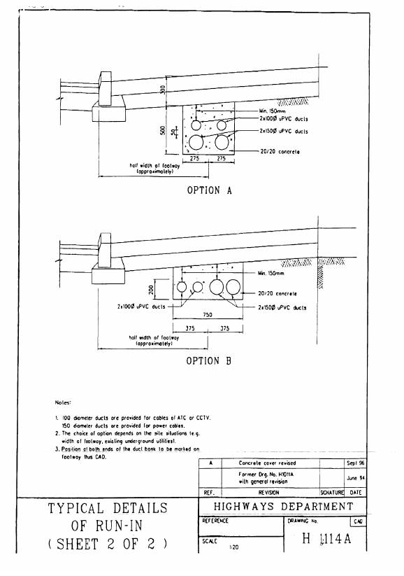
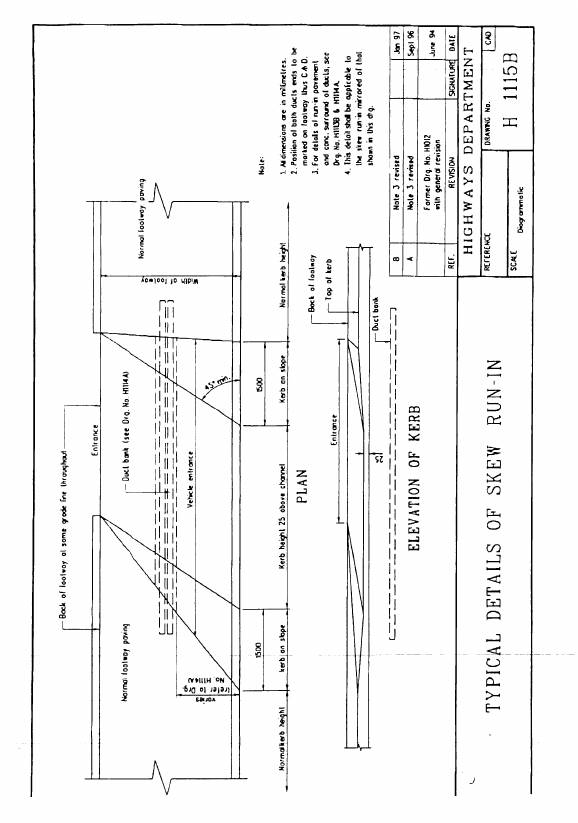
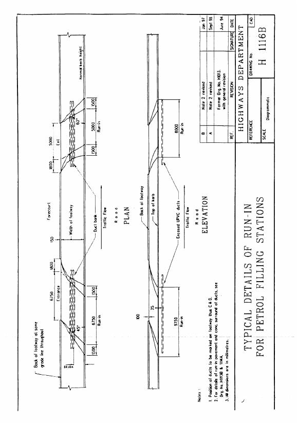
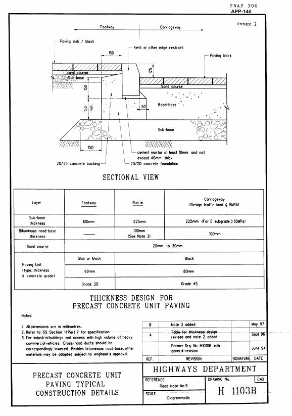
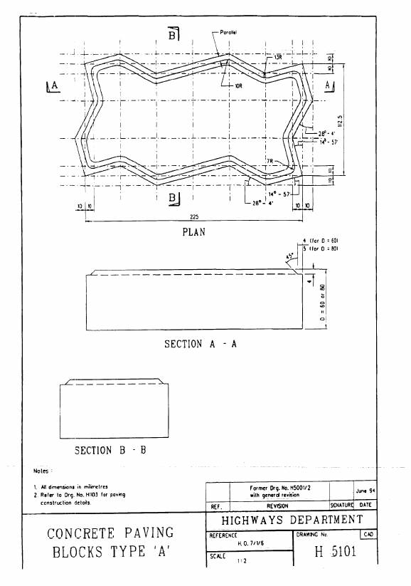
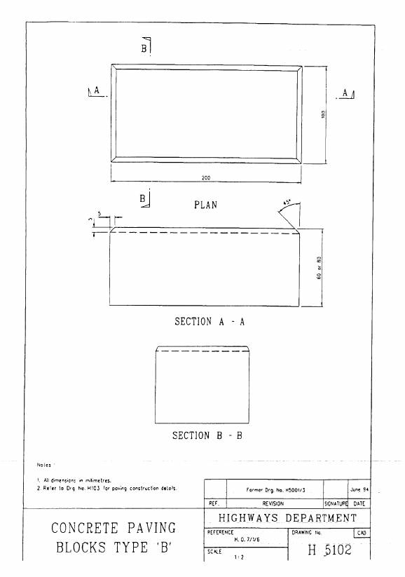
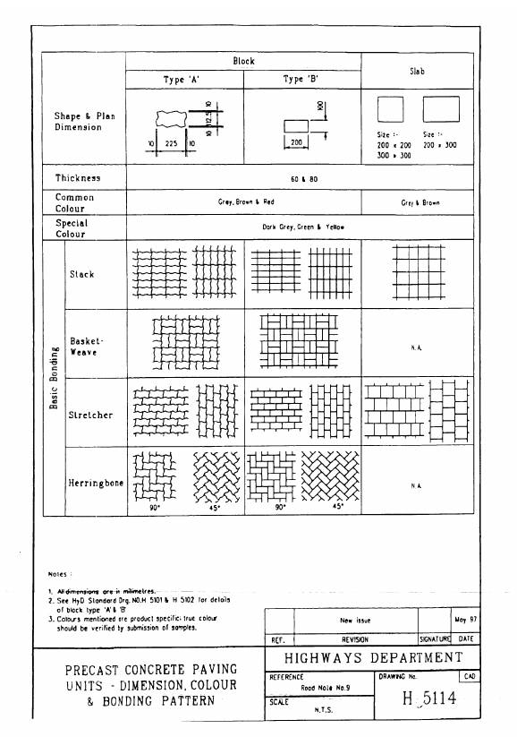
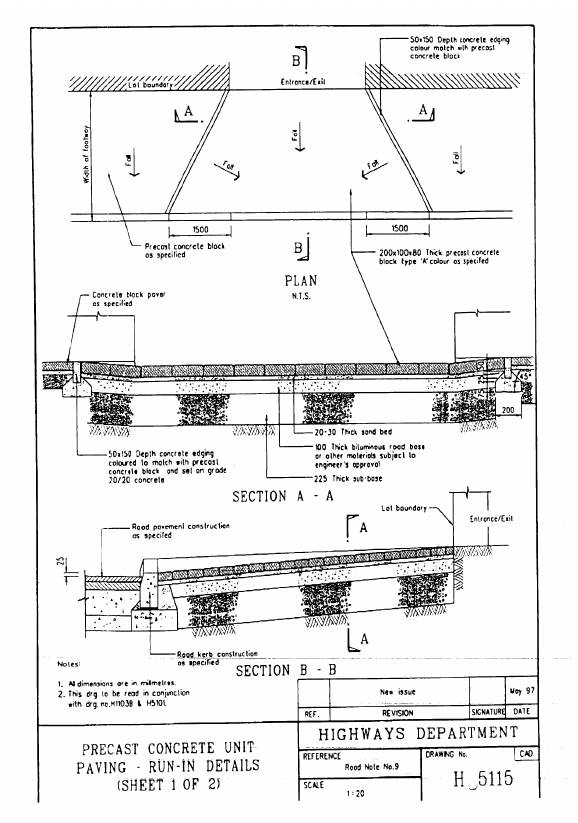
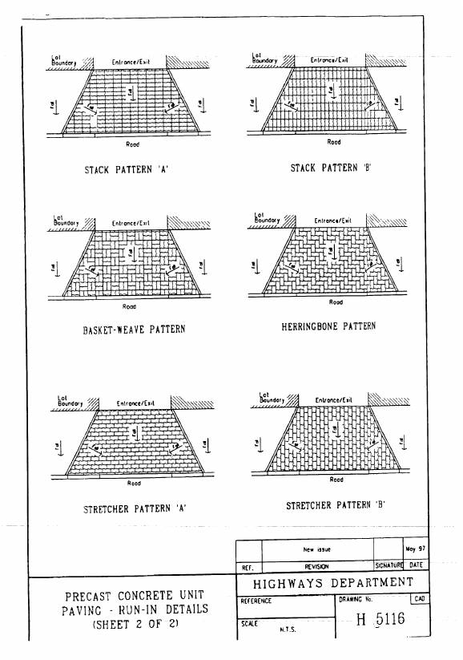

---
tags:
  - PNAP
  - APP series
  - Run-in 車輛進出口
  - Footpath 行人路
  - Concrete & materials 混凝土及物料
  - Occupation permit 佔用許可證
  - Excavation & ELS 挖掘
  - Car park 停車場
summary: "Vehicular run-ins and run-outs on public roads: HyD standards, saw-cut, utilities, completion certificate and HyD take-over before OP."
keywords: APP-144, run-in, 車輛出入口, run-out, vehicular access, 車輛通道, Highways Department, 路政署, excavation permit, 掘路許可證, paver
---

# APP-144 Design and Construction of Run-in and Run-out on Public Road <small>公用道路上車輛進出口通道的設計及建造事宜</small>

!!! info "Document info 文件資料"
    | | |
    |---|---|
    | **Type 類別** | PNAP (APP series), previously PNAP 300 舊編號 PNAP 300 |
    | **Issued by 發出機構** | Buildings Department 屋宇署 |
    | **Version summarised 本摘要版本** | September 2006 |
    | **Official language 官方語言** | English and Chinese 中英文版 |
    | **Source 原文** | [English (PDF)](https://www.bd.gov.hk/doc/en/resources/codes-and-references/practice-notes-and-circular-letters/pnap/APP/APP144.pdf) · [中文 (PDF)](https://www.bd.gov.hk/doc/tc/resources/codes-and-references/practice-notes-and-circular-letters/pnap/APP/APP144.pdf) |
    | **Last checked 最後核對** | 2026-11-21 against the current BD version |

## At a glance 重點摘要 {#at-a-glance}

=== "English"

    - Run-ins and run-outs required by the lease move to a **self-certification** system instead of special lease conditions (paras. 1–2).
    - Match the adjoining footpath: **concrete** next to concrete; **paver blocks** next to pavers, with **visual contrast or pattern change**; standards per App. A and HyD standard drawings; the AP ensures the footpath is made good (paras. 3–5).
    - Use **saw-cutting**; reinstate damage beyond the run-in (paras. 6–7).

=== "中文"

    - 地契規定的車輛進出口改以**自我核證**制度取代特別地契條款（第 1–2 段）。
    - 與毗鄰行人路配合：毗鄰混凝土用**混凝土**；毗鄰鋪路磚用**鋪路磚**，並須有**視覺對比或圖案變化**；標準按附錄 A 及路政署標準圖則；認可人士須確保行人路妥為修復（第 3–5 段）。
    - 須以**鋸切**方法施工；進出口範圍以外的損壞須修復（第 6–7 段）。

!!! tip "Does it apply? 是否適用"
    **Applies 適用**: **vehicular run-ins and run-outs** on public roads built by developers (from **1 Jan 2007**), under a **self-certification** system replacing lease conditions; design to **HyD** standards, completion certificate (App. B), then HyD inspection and take-over. 車輛出入口。

## Key clauses 條文一覽 {#key-clauses-table}

| Para. 段 | Rule 規定 |
|---|---|
| 1–2 | Lease conditions on run-ins replaced by **self-certification**; guidelines on standards and procedure. 自我核證。 |
| 3–4 | Match the adjoining footpath: **concrete** for concrete footpaths; **paver blocks** for paved ones, with **visual contrast / pattern change**, safe for vehicles and pedestrians. 物料與行人路一致。 |
| 5 | Standards in **Appendix A**; make good the adjoining footpath. 標準。 |
| 6–7 | **Saw-cut** to avoid damage; damage outside the run-in reinstated under a separate **Excavation Permit**. 鋸切。 |
| 8 | Check **utilities** and arrange diversions; show details on the **GBP** for HyD comment; get the **Excavation Permit** early; submit the **Certificate of Completion** (App. B) if done before the OP application. 程序。 |
| 9 | BD notifies **HyD**, who inspects and takes over; defects go to the AP; HyD objection may lead to OP refusal (**s.21(6)(a)**). 路政署驗收。 |
| 10–11 | If **HyD builds it**: submit the entrustment letter and fee receipt; OP may proceed with a safe **temporary** run-in; HyD resources are stretched, so APs are encouraged to build their own. 由路政署建造。 |
| 12–13 | In operation **1 Jan 2007**; similar note to contractors. 生效日期。 |

| Appendix A: standards 標準 | Detail 細節 |
|---|---|
| General | **General Specification for Civil Engineering Works**: s.9 carriageways (sub-base, bituminous), s.10 concrete carriageways, s.11 parts 5–7 footways |
| Concrete run-ins | HyD Standard Drawings **H1113–H1116**; GS clauses 6.68, 9.44, 16.58–16.62 |
| Paver run-ins | HyD Standard Drawings **H1103, H5101, H5102, H5114–H5116**; lab certificates from the contractor; colour chosen for contrast; latest HyD requirements on GBP |
| Utilities | **HyD TC 3/90**: minimum cover over underground utilities |

<small>Appendix B: Certificate of Completion, Part A by the AP (and ready for handover), Part B by the registered contractor. 附錄 B 完工證明書。</small>

??? abstract "Annexes 1–2: HyD standard drawings (as attached to the PNAP, 2006) 路政署標準圖"
    { loading=lazy }
    { loading=lazy }
    { loading=lazy }
    { loading=lazy }
    { loading=lazy }
    { loading=lazy }
    { loading=lazy }
    { loading=lazy }
    { loading=lazy }

    <small>Use the **latest** versions on HyD's website. Source: BD, PNAP APP-144. 請以路政署網站最新版本為準。</small>

## Whole picture 整體關係 {#whole-picture}

| Topic 主題 | Where 文件 |
|---|---|
| EVA and access roads 緊急車輛通道 | [APP-136](app-136.md) · [FS Code D22–D23](../codes/fsc-part-d-means-of-access.md#clause-by-clause) |
| Car parks and loading 停車場 | [APP-111](app-111.md) |
| Barrier free dropped kerbs 無障礙路緣 | [DMUA 2026](../codes/dmua-2026.md) |
| OP procedure 佔用許可證 | [APP-78](app-78.md) |
| Private streets 私家街 | [Cap. 123G](../regulations/bpsar-123g.md) |

## Related 相關文件 {#related}

| Document 文件 | Relationship 關係 |
|---|---|
| [APP-23](app-23.md) | Temporary vehicle access 臨時車輛通道 |

---
<small>Prepared by: _[name]_ · Checked by: _[name]_ · Quotes from the official English and Chinese versions; refer to the PNAP for the definitive text.</small>
