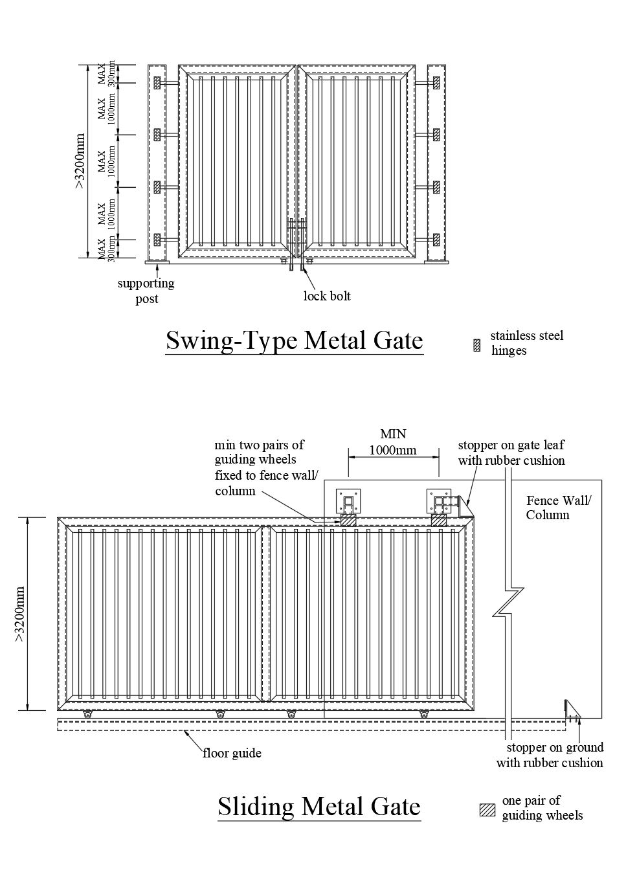

---
tags:
  - PNAP
  - APP series
  - Metal gate 金屬閘
  - Minor works 小型工程
  - Structural 結構
  - Wind 風力
  - Lift 升降機
  - Site supervision 地盤監督
summary: "Metal gates: structural plans above 3.2 m, design details, anchor pull-out and weld tests, hinge, wheel and stopper recommendations, 3-monthly maintenance."
keywords: APP-146, metal gate, 金屬閘, sliding gate, 趟閘, swing gate, 掩門, hinge, 鉸, stopper, anchor test, minor works
---

# APP-146 Metal Gates <small>金屬閘</small>

!!! info "Document info 文件資料"
    | | |
    |---|---|
    | **Type 類別** | PNAP (APP series), previously PNAP 304 舊編號 PNAP 304 |
    | **Issued by 發出機構** | Buildings Department 屋宇署 |
    | **Version summarised 本摘要版本** | March 2025 |
    | **Official language 官方語言** | English only for now 暫只有英文版 |
    | **Source 原文** | [English (PDF)](https://www.bd.gov.hk/doc/en/resources/codes-and-references/practice-notes-and-circular-letters/pnap/APP/APP146.pdf) |
    | **Legal basis 法律依據** | [B(C)R 3](../regulations/bcr-123q.md) |
    | **Last checked 最後核對** | 2026-11-21 against the current BD version |

## At a glance 重點摘要 {#at-a-glance}

=== "English"

    - Metal gates (manual or electric) are building works; show on GBP for new buildings; gates **> 3.2 m** high need **structural plans and calculations**, also in existing buildings (paras. 1–2). Many existing-building gates are **minor works** (APP-147) (para. 3).
    - Meet **B(C)R 3**; install under an **RGBC / RMWC** with inspection and trial operation (paras. 4–5).
    - Structural submission: **wind load** per Wind Code; framework, posts and foundation; connections; hinge pins; **end stoppers** for sliding gates; **anti-lift / anti-derailment** guides; decorative parts not needed (para. 6).
    - **Tests**: **≥ 5** drilled anchors of each type pull-out tested to **≥ 1.5 ×** recommended load (APP-169 App. B); **NDT of all support welds** and end stoppers; HOKLAS labs (paras. 8–10). Electric gates: EMSD Code of Practice (para. 11).

=== "中文"

    - 金屬閘（手動或電動）屬建築工程；新建築物須在一般建築圖則顯示；高度 **> 3.2 米**者須呈交**結構圖則及計算**，現有建築物亦然（第 1–2 段）；很多現有建築物的閘屬**小型工程**（APP-147）（第 3 段）。
    - 須符合 **B(C)R 第 3 條**；由**註冊一般建築承建商／註冊小型工程承建商**監督安裝，完成後須檢查及試運作（第 4–5 段）。
    - 結構圖則：按風力守則計算**風荷載**；框架、柱及基礎；連接；鉸栓；推拉閘設**末端止擋**；**防抬起／防出軌**導軌；裝飾部分毋須呈交（第 6 段）。
    - **測試**：每類錨栓 **≥ 5 個**作拉拔測試，須達 **≥ 1.5 倍**建議荷載（APP-169 附錄 B）；**支承處所有焊口**及末端止擋作非破壞性測試；由 HOKLAS 認可實驗所進行（第 8–10 段）；電動閘參考機電署守則（第 11 段）。

!!! tip "Does it apply? 是否適用"
    **Applies 適用**: **metal gates** (manual or electric) at fence walls and building entrances. Shown on building plans for new buildings; **structural plans** needed if **> 3.2 m** high (also for new gates in existing buildings); smaller works may be **minor works**. 金屬閘。

## Key clauses 條文一覽 {#key-clauses-table}

| Para. 段 | Rule 規定 |
|---|---|
| 1 | Metal gates are building works; design, installation and maintenance guidance. 屬建築工程。 |
| 2 | New buildings: on building plans; **> 3.2 m**: structural details and calcs too; existing buildings > 3.2 m: building and structural plans. 高於 3.2 米須結構圖。 |
| 3 | Some installations in existing buildings are **minor works** ([APP-147](app-147.md)). 小型工程。 |
| 4 | Suitable materials (**B(C)R 3**), recognised standards, sound and strong for their working life. 物料及設計。 |
| 5 | **Qualified supervision** by the RGBC or RMWC (except designated exempted works); inspect and **trial operate** on completion. 監督及試行。 |
| 6 | Structural details: (a) **wind load** per Wind Code; (b) framework, posts, foundations, stability in operation; (c) fixing and parent structure check; (d) **hinge pins** for swing gates; (e) **end stoppers** for sliding / multi-passing gates; (f) **anti-lift / anti-derail** guides; (g) no need for decorative parts. 結構細節。 |
| 7 | Appendix A recommendations; Appendix B standards. 附錄。 |
| 8 | Drilled-in anchors: pull-out test **≥ 5 per type and size** ([APP-169](app-169.md) App. B), **≥ 1.5 ×** manufacturer's recommended tensile load, no separation or deformation. 錨栓拉力測試。 |
| 9 | **NDT** of all welds at supports and mechanical end stoppers. 焊接無損檢測。 |
| 10 | Tests by **HOKLAS** / MRA labs, directed by AP / RSE, PBP (Class I minor works) or RGBC / RMWC (Class II, III). 認可實驗室。 |
| 11 | Electric gates: EMSD Code for electrically operated sliding gates, doors and shutters. 電動閘。 |
| 12 | Similar note to contractors. 承建商另有作業備考。 |

## Appendix A: safety recommendations 附錄 A：安全建議 {#appendix-a}

| Gate type 類型 | Recommendation 建議 |
|---|---|
| **Swing** 掩門 | Hinges **welded all round**; **≥ 3 hinges** per post; gates > 3.2 m: **stainless steel** hinges at **≤ 1,000 mm** centres and **≤ 300 mm** from top and bottom; one hinge pin **reversed** to stop lift-off |
| **Sliding** 趟閘 | Prevent fall, collapse, derailment; adequate guides and stoppers; **≥ 2 pairs of guide wheels ≥ 1,000 mm** apart at the end support; **≥ 1 stopper on the leaf** plus stopper(s) on ground / column / wall; **rubber cushions** |
| **Folding** 摺閘 | Same as above; anti-lift for hanging fittings |
| Installation and use 安裝及使用 | Visual check before installing; keep hinge welds **visible**; user notices (no hanging loads, push / pull direction, use handles); alternative wicket door |
| Maintenance 保養 | Documentation by AP with RGBC / RMWC for owners; repair defective hinges, wheels, tracks, stoppers, corroded steel; routine checks and lubrication **every 3 months** |

<figure markdown>
  { width="560" loading=lazy }
  <figcaption>Annex 1 to Appendix A – illustrative diagrams for swing-type and sliding metal gates. 掩門及趟閘建議圖示。Source: BD, PNAP APP-146.</figcaption>
</figure>

<small>Appendix B lists standards: BS 4092-1; BS EN 12433-1/-2, 12604, 12453, 13241; BS EN ISO 1461, 12944, 14713; BS EN 1176-1. 附錄 B 標準。</small>

## Whole picture 整體關係 {#whole-picture}

| Topic 主題 | Where 文件 |
|---|---|
| Wind loads 風力 | [Wind Code](../codes/wind-2019.md) |
| Anchors testing 錨栓測試 | [APP-169](app-169.md) |
| Minor works 小型工程 | [APP-147](app-147.md) · [Minor works guide](../guides/minor-works.md) |
| Steel design 鋼結構 | [Steel Code](../codes/steel-2011.md) |
| Grilles and louvres 格柵及百葉 | [APP-166](app-166.md) |

## Related 相關文件 {#related}

| Document 文件 | Relationship 關係 |
|---|---|
| [APP-147](app-147.md) | Minor works 小型工程 |
| [B(MW)R](../regulations/bmwr-123n.md) | Gate items 閘項目 |

---
<small>Prepared by: _[name]_ · Checked by: _[name]_ · English only for now; Chinese text is an unofficial translation (中譯（非官方）).</small>
