---
tags:
  - PNAP
  - APP series
  - Minor works 小型工程
  - A&A works 改動及加建工程
  - Validation scheme 檢核計劃
  - Plan submission & approval 呈交及審批
  - Signboard 招牌
  - Site supervision 地盤監督
  - Structural 結構
  - Statutory period 法定期限
  - Staircase 樓梯
  - Registration 註冊
  - Curtain wall & façade 幕牆及外牆
  - Green & amenity features 環保及適意設施
  - Geotechnical 岩土
  - Excavation & ELS 挖掘
  - Drainage 排水
summary: "187 minor works items in Classes I–III use simplified notices instead of approval and consent: Class I/II notice 7 days before and certificate within 14 days; Class III one submission within 14 days."
keywords: minor works, 小型工程, MWCS, 小型工程監管制度, Class I, Class II, Class III, simplified requirements, 簡化規定, MW01, MW05, HMWVS, MAFVS, validation scheme, 檢核計劃, PBP, PRC
---

# APP-147 Minor Works Control System <small>小型工程監管制度</small>

!!! info "Document info 文件資料"
    | | |
    |---|---|
    | **Type 類別** | PNAP (APP series) |
    | **Issued by 發出機構** | Buildings Department 屋宇署 |
    | **First issue 首次發出** | December 2010 |
    | **Version summarised 本摘要版本** | September 2021 (paras. 14–16 and Appendices A & C amended) |
    | **Official language 官方語言** | English and Chinese 中英文版 |
    | **Source 原文** | [English (PDF)](https://www.bd.gov.hk/doc/en/resources/codes-and-references/practice-notes-and-circular-letters/pnap/APP/APP147.pdf) · [中文 (PDF)](https://www.bd.gov.hk/doc/tc/resources/codes-and-references/practice-notes-and-circular-letters/pnap/APP/APP147.pdf) |
    | **Legal basis 法律依據** | Building (Minor Works) Regulation B(MW)R, Schedules 1 and 3; BO s.39C |
    | **Last checked 最後核對** | 2026-11-20 against the September 2021 version |

## At a glance 重點摘要 {#at-a-glance}

=== "English"

    - The **MWCS** lets owners carry out **small-scale building works** lawfully under **simplified requirements**, **without prior approval and consent** from the BA (para. 1).
    - **187 items** in **three classes** (B(MW)R Schedule 1) (para. 2): **Class I** (**58** items, more complex, e.g. internal staircase between two floors), **Class II** (**68**, e.g. external wall repair), **Class III** (**61**, household, e.g. A/C supporting frames).
    - **Class I**: appoint a **prescribed building professional** (AP, plus RSE/RGE, or RI) to design and supervise, and a **prescribed registered contractor** to carry out. **Class II/III**: the **contractor** handles everything. Notice of commencement **≥ 7 days** before works (Class I & II), and completion certificate **within 14 days** (paras. 4–5).
    - **No referral** to other departments (consult them yourself), except MTRCL for foundations / excavation / underground drainage in **Scheduled Area No. 3** (paras. 17–18). **No fee** (para. 19).
    - **Validation schemes**: **HMWVS** (A/C frames, drying racks, small canopies built before 31 Dec 2010), **MAFVS** (21 more amenity items, since 1 Sep 2021), and the **Signboard Validation Scheme** (APP-155). Once certified safe, there is no enforcement unless conditions change (paras. 14–16).

=== "中文"

    - **小型工程監管制度**讓業主按**簡化規定**合法進行**小規模建築工程**，**毋須事先取得**建築事務監督的批准及同意（第 1 段）。
    - **187 個項目**分為**三個級別**（B(MW)R 附表 1）（第 2 段）：**第 I 級別**（**58** 項，較複雜，例如連接兩層的室內樓梯）、**第 II 級別**（**68** 項，例如修葺外牆）、**第 III 級別**（**61** 項，家居，例如冷氣機支架）。
    - **第 I 級別**：委任**訂明建築專業人士**（認可人士，以及結構／岩土工程師或註冊檢驗人員）設計及監督，並委任**訂明註冊承建商**施工；**第 II／III 級別**：由**承建商**負責。第 I 及 II 級別須在動工**最少 7 天前**呈交展開通知書，並在完工後 **14 天內**呈交完工證明書（第 4–5 段）。
    - **不會轉交**其他部門（須自行諮詢），但在**附表區第 3 號**涉及地基／挖掘／地下排水的工程會轉交港鐵公司（第 17–18 段）；**毋須費用**（第 19 段）。
    - **檢核計劃**：**家居小型工程檢核計劃**（2010 年 12 月 31 日前建成的冷氣機支架、晾衣架、小型簷篷）、**小型適意設施檢核計劃**（另外 21 項，2021 年 9 月 1 日起）及**招牌檢核計劃**（APP-155）；經證明安全後，除非狀況改變，否則不會採取執法行動（第 14–16 段）。

!!! tip "Applies / does not apply 適用／不適用"
    **Applies**: the **187 items** in **B(MW)R Schedule 1**, within each item's size, location and criteria; validation of existing unauthorised minor structures under the **HMWVS**, **MAFVS** and **Signboard Validation Scheme**. 適用於附表 1 所列 187 個項目及三個檢核計劃。
    **Does not apply**: works **beyond** an item's limits, which need **approval and consent** under BO s.14 ([submission guide](../guides/submission-to-op.md)); **designated exempted works** (Schedule 2), which need no submission ([minor works guide](../guides/minor-works.md)). 超出項目範圍須事先批准及同意；指定豁免工程毋須呈交。

## Key clauses 主要條文 {#key-clauses}

| Para. 段 | Rule 規定 |
|---|---|
| 1 | MWCS: small works done safely and lawfully by **simplified requirements**, **without prior approval and consent**. 簡化規定，毋須事先批准。 |
| 2 | **187 items** in 3 classes: **Class I 58** (e.g. internal staircase between two floors), **Class II 68** (e.g. repair of external walls), **Class III 61** (household, e.g. A/C supporting frames). 三個級別。 |
| 3 | Size, location and criteria of each item: **B(MW)R Schedule 1** (and the [Technical Guidelines](../regulations/mw-technical-guidelines.md)). 項目準則。 |
| 4 | Class I: **PBP** (AP, + RSE/RGE if needed, or RI for prescribed repair) designs and supervises, **PRC** builds; notice of commencement and certificate of completion. Class II: **PRC** only; notice and certificate. Class III: PRC; **one notice and certificate** after completion. 簡化規定。 |
| 5–6 | Workflow and documents (Appendix A); plan and photo guidance (Appendix B); forms (Appendix C). 流程及文件。 |
| 7 | Class I: AP/RI gives the PRC copies of the plans, details and **supervision plan** to keep **on site**, with BD's **acknowledgement letter** (B(MW)R s.55). 地盤存放文件。 |
| 8 | **Common parts**: remind the person arranging the works about **DMC** liabilities; notify the management office, OC or owners. 公用部分。 |
| 9 | Proper disposal of **construction waste**. 廢料處置。 |
| 10 | Supervision plans to the **TM** and the [Site Supervision Code](../codes/site-supervision-2009.md). 監督計劃。 |
| 11 | PBP ceasing: notify the BA **within 7 days** (MW31); PRC ceasing: form to the AP/RI within **7 days**, AP/RI to the BA within **7 days** (MW10). 停止委任。 |
| 12 | **Signboards**: display the **minor works submission number** (Appendix D); similar for approved signboards ([APP-126](app-126.md)). 招牌編號。 |
| 13 | **Radio base stations, antennas, transceivers**: Appendix E. 無線電基站。 |
| 14 | **HMWVS**: A/C or cooling tower frames, drying racks and small canopies built **before 31 Dec 2010** (Sch. 3 Part 2). **MAFVS** (from **1 Sep 2021**): **21 more items** built before they became minor works on **1 Sep 2020** (Sch. 3 Part 4). 檢核計劃。 |
| 15 | An AP, RSE, RI, RGBC or RMWC inspects and **certifies** the structure safe (BO s.39C; B(MW)R ss.62, 62A); then **no enforcement** unless its condition changes; strengthening may come first. 檢核後不執法。 |
| 16 | **Signboard Validation Scheme** from **2 Sep 2013** (Sch. 3 Part 3): see [APP-155](app-155.md). 招牌檢核。 |
| 17 | Submissions are **not referred** to other departments: get their approvals yourself. 不會轉介。 |
| 18 | Class I/II with footings, excavation or underground drainage in **Scheduled Area No. 3** (railway): BD sends to **MTRCL**; get MTRCL's agreement before starting ([APP-24](app-24.md)). 鐵路保護。 |
| 19 | **No fee** for minor works or validation submissions. 免費。 |
| 20 | Detailed guidance: **Technical Guidelines on MWCS**. 技術指引。 |
| 21 | A similar note is issued to registered contractors. 承建商作業備考。 |

## Workflow / timeline 流程及時間表 {#workflow-timeline}

<figure markdown>
  { width="760" loading=lazy }
  <figcaption>Minor works: who does what, and when. 小型工程：負責人及時限。 Summary diagram prepared for this site; check the source text for exact wording.</figcaption>
</figure>

## Key table: the three classes and simplified requirements 三個級別及簡化規定 {#key-table-the-three-classes-and-simplified-requirements}

| | **Class I** 第 I 級別 | **Class II** 第 II 級別 | **Class III** 第 III 級別 |
|---|---|---|---|
| Items 項目 | **58** | **68** | **61** |
| Nature 性質 | More complicated (e.g. internal staircase connecting two floors) 較複雜 | Less complex (e.g. external wall repair) 較簡單 | Small-scale household (e.g. A/C supporting frames) 家居 |
| Who designs / supervises 設計及監督 | **PBP**: AP (+ RSE / RGE if required), or RI for prescribed repair 訂明建築專業人士 | **PRC** | **PRC** |
| Who carries out 施工 | **PRC**: RGBC, registered specialist contractor or RMWC 訂明註冊承建商 | **PRC** | **PRC** |
| Submissions by 由誰呈交 | AP / RI / PRC | PRC | PRC |
| Documents 文件 | **Notice of commencement** (≥ 7 days before) + **certificate of completion** (within 14 days) 展開通知書 + 完工證明書 | Notice of commencement + certificate of completion | **Notice and certificate of completion** (after works) 完工通知書及證明書 |
| Supervision plan 監督計劃 | Where required (Technical Memorandum; Code of Practice for Site Supervision) 如需要 | Where required | — |

<small>Item details (size, location, criteria) are in **Schedule 1 to the B(MW)R**. Take "before" and "after" photos from the same angle (Appendix B). Signboards: display the minor works submission number (Appendix D). 各項目詳情見 B(MW)R 附表 1；須拍攝施工前後照片；招牌須展示小型工程呈交編號。</small>

## Key clause 主要條文 {#key-clause}

!!! quote "Para. 2 — Classification 分類"
    A total of 187 items of minor building works have been designated as minor works under the MWCS. These minor works are classified into three classes according to their nature, scale and complexity as well as the risk to safety they pose: (a) Class I minor works (a total of 58 items) are relatively more complicated minor works, e.g. installation of internal staircases connecting two floors; (b) Class II minor works (a total of 68 items) are comparatively less complex works, e.g. repair of external walls; and (c) Class III minor works (a total of 61 items) cover small-scale minor works, mostly carried out in household settings, e.g. erection of supporting frames for air-conditioners.

    **官方中文本：** 在小型工程監管制度下，共187項小型建築工程已被指定為小型工程。這些小型工程按其性質、規模、複雜程度及引致的安全風險，分為3個級別：(a) 第I級別小型工程（共58個項目）是較為複雜的小型工程，例如興建室內樓梯連接兩個樓層；(b) 第II級別小型工程（共68個項目）是複雜程度相對較低的小型工程，例如修葺外牆；及 (c) 第III級別小型工程（共61個項目）涵蓋小規模的小型工程，主要為一般的家居裝置，例如豎設支承空調機的支架。

## Key table: validation schemes 檢核計劃 {#key-table-validation-schemes}

| Scheme 計劃 | What can be validated 可檢核項目 | Since 開始 |
|---|---|---|
| **Household Minor Works Validation Scheme (HMWVS)** 家居小型工程檢核計劃 | Unauthorised **A/C / water cooling tower supporting frames, drying racks, small canopies** built **before 31 Dec 2010** (Sch. 3 Part 2) 冷氣機支架、晾衣架、小型簷篷 | Full MWCS implementation 全面實施時 |
| **Signboard Validation Scheme** 招牌檢核計劃 | Certain unauthorised **signboards** (Sch. 3 Part 3; see APP-155) 招牌 | 2 Sep 2013 |
| **Minor Amenity Feature Validation Scheme (MAFVS)** 小型適意設施檢核計劃 | **21 more items**, e.g. supports / casings for building services, RBS supports, light fitting frames, fence walls, railings, poles, metal gates, canopies, awnings, trellises, metal ventilation ducts, built before they became minor works on 1 Sep 2020 (Sch. 3 Part 4) 另外 21 項 | 1 Sep 2021 |

<small>An AP, RSE, RI, RGBC or RMWC inspects and **certifies** the works as structurally safe and BO-compliant (BO s.39C; B(MW)R 62, 62A). Strengthening may be needed first. 由專業人士或承建商檢查並證明結構安全。</small>

## Documents to submit 須呈交文件 (Appendix A) {#documents}

| Class 級別 | Submission 呈交 | Contents 內容 |
|---|---|---|
| **I & II** | **Notice of commencement** (≥ **7 days** before) 展開工程通知 | Specified form (**MW01** with PBP / **MW03** without); **"before" photographs**; **coloured prescribed plans** and details; **supervision plan** (Class I, if the TM requires); other documents (GI report, calculations, tests) |
| **I & II** | **Certificate of completion** (within **14 days**) 完工證明書 | **MW02** / **MW04**; "after" photographs; revised coloured plans showing **minor deviations**; other documents (materials schedule, test reports) |
| **III** | **Notice and certificate of completion** (within **14 days**) 通知及完工證明書 | **MW05**; photographs; coloured plans **or** a description; other documents |

- BD checks **completeness and registration** only, then issues an acknowledgement with a **submission number** (e.g. MW101200001) for all later correspondence. 只作初步審查並發出編號。
- Keep site records, calculations, tests and certificates, and provide them on request (B(MW)R s.56). 保存紀錄。
- **Minor deviations** that keep the design assumptions and item description (including **fewer** items): show on the completion plans. Changes to design assumptions, **more** items or **new** items: a new notice (**MW11 / MW12**) **≥ 7 days** before those works (App. A paras. 2–3). 偏差及新增項目。
- [ADM-14](adm-14.md) minor amendment procedures do **not** apply; small corrections may be arranged at BD (App. A para. 5). ADM-14 不適用。

## Validation of existing structures 現有構築物檢核 (Appendix A, para. 4) {#validation-flow}

<figure markdown>
  { width="760" loading=lazy }
  <figcaption>Inspection and certification of prescribed building works (HMWVS, MAFVS). 檢核計劃下的檢驗及證明程序。</figcaption>
</figure>

| Scheme / item 計劃／項目 | Who may inspect and certify 檢驗及證明人士 |
|---|---|
| HMWVS (Class III items) | AP, RSE, RI, or an **RGBC / RMWC** registered for that Class III type or item |
| MAFVS, Class I item, a **specified construction** (B(MW)R s.37(4)) | **AP** |
| MAFVS, Class I item, **not** a specified construction | **AP and RSE** |
| MAFVS, Class II or III item | AP, RSE, RI, or an RGBC / RMWC registered for that class and type or item |
| Strengthening works 加固工程 | **RGBC or RMWC** for that class; Class I/II strengthening needs **MW01 / MW03 ≥ 7 days** before |
| Certification 證明 | **MW06-1 / 06-2 / 06-3** within **14 days** after inspection (or after the strengthening works) |

<small>Non-concrete canopies projecting **≤ 750 mm** that fail the check can be strengthened and re-inspected; otherwise the scheme does not apply. 非混凝土簷篷伸出不超過 750 毫米可加固後重新檢驗。</small>

## Plans, photographs and forms 圖則、相片及表格 (Appendices B–C) {#forms}

- Plans and sections at **≥ 1:100**, block plans **≥ 1:500** (B(MW)R s.38); coloured, preferably **≤ A3**. 比例。
- **"Before" and "after" photographs** from the **same angle**, marked on plan; **4R** size is fine; wide-angle views for whole-building repairs. 前後相片同一角度。
- Use the address on the **Rates demand**; supplementary documents with **MW33**; drawing standards per [ADM-10](adm-10.md). 地址及補充文件。

| Form 表格 | Use 用途 |
|---|---|
| **MW01 / MW02** | Notice of commencement / certificate of completion **with PBP** (Class I) |
| **MW03 / MW04** | Same, **without PBP** (Class II) |
| **MW05** | Class III notice and certificate |
| **MW06-1 / -2 / -3** | Validation (MAFVS Class I / II; HMWVS or MAFVS Class III) |
| **MW07 / MW08** | Change of RSE, RGE or PRC / of AP or RI |
| **MW09** | Temporary nomination of another PBP ([APP-3](app-3.md)) |
| **MW10 / MW31** | PRC / PBP ceasing to be appointed |
| **MW11 / MW12** | Additional minor works items (with / without PBP) |
| **MW32** | Submission number request for a Class III signboard |
| **MW33** | Supplementary documents |
| **PR1–PR6** | Attachments: photographs, A3 / A4 plans, calculations, supervision plan, safety report |

## Signboards and radio base stations 招牌及無線電基站 (Appendices D–E) {#signboards-rbs}

| Item 項目 | Requirement 要求 |
|---|---|
| Number shown 顯示編號 | Minor works submission number (e.g. **MW101212345**) or BD reference (e.g. **BD 2/9876/10**) for approved signboards; remove old numbers after alteration |
| Colours 顏色 | **Black on white**; **black on yellow** where only the display surface of an unauthorised signboard is altered or replaced |
| Size and font 大小及字體 | Block capitals, **Arial**, at least **35 mm** high, on durable material |
| Where visible 可見位置 | From the nearest pavement (projecting / under-canopy signs), nearest or opposite pavement (wall signs), main roof (roof signs) |
| Radio base stations 無線電基站 | Items **1.14, 1.28, 1.50, 2.12, 2.31, 2.49, 3.2, 3.8, 3.26, 3.27, 3.50**; operator also needs OFTA, TPB, BD and LandsD approvals; the AP declares compliance to **OFTA**; removal may also be minor works |

## Worked example 例子 {#worked-example}

| Proposal 工程 | Route 途徑 | What to do 做法 |
|---|---|---|
| New **internal staircase** between two floors of a flat 單位內新增樓梯 | **Class I** (check the TG item limits) | Appoint an **AP and RSE** and a **PRC**; **MW01** with coloured plans, calculations and supervision plan **≥ 7 days** before; keep the acknowledgement on site; **MW02** within **14 days** of completion |
| **Repair of external walls** of a building 修葺外牆 | **Class II** | **PRC** submits **MW03** ≥ 7 days before; tell the OC and management (common parts, para. 8); **MW04** within 14 days |
| New **A/C supporting frame** outside a flat 新冷氣機支架 | **Class III** | **RMWC** does the work; **MW05** with before/after photos within **14 days** after completion |
| Old drying rack put up in 2008 2008 年已有晾衣架 | **HMWVS** | An RMWC (or AP / RSE / RI) inspects; strengthen if needed; **MW06-3** within 14 days → no enforcement unless it deteriorates |
| Footing for a garden structure in **railway protection Area No. 3** 鐵路保護範圍 | Class I/II + MTRCL | BD forwards to **MTRCL**; get MTRCL's agreement before starting (para. 18, [APP-24](app-24.md)) |

## Explanation 淺白解釋 {#explanation}

=== "English"

    Before 2010, almost any building work needed full plan approval, so many small works were simply done **illegally** (UBW). The MWCS created a **lighter, legal route** for small works. Professionals and registered contractors **take responsibility** and file notices, instead of waiting for BD approval. BD checks by **audit**, not by prior approval.

    For practice: check whether the work is listed in **B(MW)R Schedule 1** (exact size and location limits). If it is, choose the right **class**, appoint the right people, and **submit the notices on time**. Remember the **DMC**, other departments and lease consents still apply.

=== "中文"

    2010 年以前，幾乎所有建築工程都要經過完整的圖則審批，因此很多小型工程乾脆**非法**進行（僭建）。小型工程監管制度為小型工程提供**較簡便的合法途徑**：由專業人士及註冊承建商**承擔責任**並呈交通知，而毋須等待屋宇署批准；屋宇署以**抽查**而非事先批准作監管。

    實務上：核對工程是否列於 **B(MW)R 附表 1**（準確的尺寸及位置限制）；如是，選擇正確**級別**、委任合適人士，並**按時呈交通知**。須記住**公契**、其他部門及地契同意仍然適用。

## Practical notes 實務提示 {#practical-notes}

=== "English"

    !!! tip "Common pitfalls"
        - Starting Class I or II works **less than 7 days** after the notice of commencement.
        - Missing the **14-day** deadline for the completion certificate.
        - Works **exceeding the Schedule 1 size or location limits**. These are no longer minor works and need full approval.
        - Forgetting **other departments' consents** (no referral under MWCS), and **MTRCL** in Scheduled Area No. 3.
        - Not keeping plans, the supervision plan and BD's **acknowledgement letter on site** (para. 7).
        - Not informing the **management office / IO** for works in common parts (para. 8).

=== "中文"

    !!! tip "常見錯誤"
        - 呈交展開通知書後**不足 7 天**便開始第 I 或 II 級別工程。
        - 錯過完工證明書的 **14 天**期限。
        - 工程**超出附表 1 的尺寸或位置限制**：已不屬小型工程，須完整審批。
        - 忘記**其他部門的同意**（小型工程不會轉交），以及附表區第 3 號的**港鐵公司**。
        - 沒有在**地盤存放**圖則、監督計劃及屋宇署的**認收信**（第 7 段）。
        - 公用部分的工程沒有通知**管理處／業主立案法團**（第 8 段）。

## Related 相關文件 {#related}

| Document 文件 | Relationship 關係 |
|---|---|
| [ADM-19](adm-19.md) paras. 37–43 | Minor works for curtain wall repairs, dampers, ducts 幕牆維修、防火閘、風管 |
| [APP-37](app-37.md) para. 8 | Curtain wall / window minor works 幕牆／窗小型工程 |
| [APP-42](app-42.md) paras. 39, 45 | Radio base stations; outdoor prefabricated structures 無線電基站 |
| [APP-148](app-148.md), [APP-149](app-149.md) | Minor works contractors; Authorized Signatories 小型工程承建商；獲授權簽署人 |
| [APP-155](app-155.md), [APP-126](app-126.md) | Signboard validation; signboards 招牌檢核；招牌 |
| [B(MW)R Cap. 123N](../regulations/bmwr-123n.md), [Cap. 123O](../regulations/bmwfr-123o.md) | The regulation; registration fees 法例；註冊費用 |
| [MW Technical Guidelines](../regulations/mw-technical-guidelines.md) | Item-by-item limits and details 項目門檻及詳圖 |
| [APP-60](app-60.md) | All specified forms 指定表格 |
| [APP-24](app-24.md) | Railway protection (para. 18) 鐵路保護 |
| [Site Supervision Code](../codes/site-supervision-2009.md) | Supervision plans for Class I 監督計劃 |
| [Minor works guide](../guides/minor-works.md) | The whole picture: DEW, classes, contractors, schemes 小型工程專題 |
| [ADV-35](adv-35.md), [ADV-31](adv-31.md) | Greening and external tiles as minor works 綠化及外牆瓷磚 |
| Technical Guidelines on Minor Works Control System | Detailed guidance 技術指引 |

---
<small>Prepared by: _[name]_ · Checked by: _[name]_ · Quotes from the official English and Chinese versions; refer to the PNAP for the definitive text.</small>
