---
tags:
  - PNAP
  - APP series
  - Minor works 小型工程
  - Contractor registration 承建商註冊
  - Registration 註冊
summary: "Minor works contractors register as individuals (Class III items) or companies (types and classes); Class I applications need an MWCRC interview and recommendation."
keywords: RMWC, registered minor works contractor, 註冊小型工程承建商, MWCRC, authorized signatory, AS, 獲授權簽署人, technical director, TD, 技術董事, Class III, PNRC 69
---

# APP-148 Minor Works Contractors Registration <small>小型工程承建商的註冊事宜</small>

!!! info "Document info 文件資料"
    | | |
    |---|---|
    | **Type 類別** | PNAP (APP series) |
    | **Issued by 發出機構** | Buildings Department 屋宇署 |
    | **Version summarised 本摘要版本** | September 2020 |
    | **Official language 官方語言** | English and Chinese 中英文版 |
    | **Source 原文** | [English (PDF)](https://www.bd.gov.hk/doc/en/resources/codes-and-references/practice-notes-and-circular-letters/pnap/APP/APP148.pdf) · [中文 (PDF)](https://www.bd.gov.hk/doc/tc/resources/codes-and-references/practice-notes-and-circular-letters/pnap/APP/APP148.pdf) |
    | **Legal basis 法律依據** | [BO s.8A(1)(c)](../regulations/bo-part-1-registration.md); [B(MW)R 10](../regulations/bmwr-123n.md) |
    | **Last checked 最後核對** | 2026-11-21 against the current BD version |

## At a glance 重點摘要 {#at-a-glance}

=== "English"

    - B(MW)R Schedule 1 lists **187 minor works items**, of which **61 are Class III**; contractors must be registered (para. 1).
    - BA keeps the **minor works contractors' register** (BO s.8A(1)(c)): **RMWC (Individual)**, self-employed workers for Class III items (B(MW)R 10(1)(a)); **RMWC (Company)** for various classes and types (10(1)(b)) (paras. 2–3).
    - Names, items, expiry dates and Authorized Signatories are gazetted annually and posted online (para. 4). **RMWC (Ind)** needs qualifications, skills and a **recognised Class III course** (para. 8); **RMWC (Co)** needs qualified key personnel, plant, management and an **AS** (and a **TD** for companies) (paras. 10–13); AS / TD cannot serve another firm (para. 14); **Class I** applications go to the **MWCRC** for interview, and the BA cannot approve without its recommendation (paras. 19–23).

=== "中文"

    - B(MW)R 附表 1 列出 **187 項小型工程**，其中 **61 項屬第 III 級**；承建商必須註冊（第 1 段）。
    - 建築事務監督備存**小型工程承建商名冊**（條例第 8A(1)(c) 條）：**註冊小型工程承建商（個人）**為進行第 III 級項目的自僱工人（B(MW)R 第 10(1)(a) 條）；**註冊小型工程承建商（公司）**可進行不同級別及類型的工程（第 10(1)(b) 條）（第 2–3 段）。
    - 姓名、項目、屆滿日期及獲授權簽署人每年刊憲並在網站公布（第 4 段）。**個人註冊**須具資歷、技能及完成**認可第 III 級別課程**（第 8 段）；**公司註冊**須有合資格主要人員、機械、管理及**獲授權簽署人**（公司另須**技術董事**）（第 10–13 段）；獲授權簽署人／技術董事不得兼任其他公司（第 14 段）；**第 I 級別**申請須交**小型工程承建商註冊事務委員會**面試，未獲其推薦不得批准（第 19–23 段）。

## Diagram 圖解 {#diagram}

<figure markdown>
  { width="760" loading=lazy }
  <figcaption>The three contractor registers. 三份承建商名冊。 Diagram prepared for this site; check the source text for exact wording.</figcaption>
</figure>

## Key clauses 主要條文 {#key-clauses}

| Para. 段 | Rule 規定 |
|---|---|
| 1 | **187** minor works items, **61** of them Class III; contractors must be registered. 187 項，其中 61 項第 III 級別。 |
| 2–3 | BA keeps the register (BO s.8A(1)(c)). **RMWC (Ind)**: individual for Class III items (B(MW)R 10(1)(a)); **RMWC (Co)**: company for types and classes (10(1)(b)). 名冊類別。 |
| 4 | Names, items/types/classes, expiry and registration numbers **gazetted annually**; AS details on the BD website. 每年刊憲。 |
| 5–7 | Apply for **items** (Ind) or **types and classes** (Co); the register shows only what the applicant is found qualified for. 申請範圍。 |
| 8 | RMWC (Ind) (B(MW)R 11(2)): qualifications and experience, ability to **personally** do the works, a **recognised Class III training course**, suitability. 個人註冊要求。 |
| 9 | An RMWC (Ind) may be a firm's **AS** but not its sole proprietor, partner or TD at the same time. 個人兼任限制。 |
| 10 | RMWC (Co) (B(MW)R 12(5)): key personnel, **plant and resources**, adequate management, understanding of the works and statutory basics, suitability. 公司註冊要求。 |
| 11–13 | At least **one AS**; corporations also at least **one TD** (a director) with authority over plant, finance and supervision; one person may be both AS and TD. 獲授權簽署人及技術董事。 |
| 14 | AS / TD of one RMWC (Co) **cannot** be key personnel of another firm. 不得兼任。 |
| 15 | Incomplete applications may be **refused**. 資料不全可拒絕。 |
| 16–18 | **MWCRC** (B(MW)R s.6–7): BA nominee, an AP or RSE, and one other; examines, interviews, advises; elects its own chair. 註冊事務委員會。 |
| 19–20 | Applications involving **Class I** (new Co, added works, added AS/TD) go to the MWCRC; the AS (or TD) attends the **interview**; others only in special cases. 第 I 級別須面試。 |
| 21–22 | MWCRC may advise on renewal and restoration; need for and scope of interviews at the BA's and MWCRC's discretion. 續期及面試。 |
| 23 | For referred applications the BA **must not approve** unless the MWCRC recommends. 須獲委員會推薦。 |
| 24–25 | Review of decisions by a **different** MWCRC on request and fee (B(MW)R s.26). 覆核。 |
| 26 | Procedures in **PNRC 69**. 申請程序。 |

<!-- APSEC START -->
## APSEC clarifications 認可人士及註冊結構工程師委員會討論 {#apsec-clarifications}

BD's responses at the APSEC Discussion Forum that clarify this document, **newest first**. Where the same question came up more than once, only the **latest position** is listed. See [all APSEC items](../apsec/index.md). 屋宇署在討論會上就本文件作出的澄清，新者在前；同一問題只列最新立場。

- **[PNAP ADM-8](../apsec/2018.md#i2018011914)** <small>ADF 1/2018, 19 Jan 2018</small> Members noted and would assist to facilitate BD’s review.

<!-- APSEC END -->

## Related 相關文件 {#related}

| Document 文件 | Relationship 關係 |
|---|---|
| [APP-147](app-147.md) | Minor works 小型工程 |
| [APP-96](app-96.md) | RGBC / RSC registration 承建商註冊 |

---
<small>Prepared by: _[name]_ · Checked by: _[name]_ · Quotes from the official English and Chinese versions; refer to the PNAP for the definitive text.</small>
