---
tags:
  - PNAP
  - APP series
  - GFA 總樓面面積
  - GFA concession 樓面面積寬免
  - Sustainability 可持續發展
  - BEAM Plus 綠建環評
  - Domestic 住用
  - Plant rooms 機房
  - Sustainable building design 可持續建築設計
  - Green & amenity features 環保及適意設施
  - Balcony & utility platform 露台及工作平台
  - Lift 升降機
  - Hotel 酒店
  - Structural 結構
  - Refuse 垃圾
  - Plan submission & approval 呈交及審批
  - Car park 停車場
  - Energy efficiency 能源效率
  - Staircase 樓梯
  - Registration 註冊
---

# APP-151 Building Design to Foster a Quality and Sustainable Built Environment <small>優化建築設計 締造可持續建築環境</small>

!!! info "Document info 文件資料"
    | | |
    |---|---|
    | **Type 類別** | PNAP (APP series) 認可人士、註冊結構工程師及註冊岩土工程師作業備考 |
    | **Issued by 發出機構** | Buildings Department 屋宇署 |
    | **First issue 首次發出** | January 2011 |
    | **Version summarised 本摘要版本** | July 2025 (Appendices A and C amended) |
    | **Official language 官方語言** | English only (Chinese version not available) 只有英文版 |
    | **Source 原文** | [APP-151 (PDF)](https://www.bd.gov.hk/doc/en/resources/codes-and-references/practice-notes-and-circular-letters/pnap/APP/APP151.pdf) |
    | **Last checked 最後核對** | 2026-11-20 against the July 2025 version |

## At a glance 重點摘要

=== "English"

    - Sets the **package of measures** for a quality and sustainable built environment: **SBD Guidelines**, **GFA concessions** and **energy efficiency**.
    - GFA concessions for green/amenity features and non-mandatory/non-essential plant rooms are granted **only if pre-requisites are met** (para. 6).
    - Pre-requisites include: compliance with **APP-152 (SBD Guidelines)**, **APP-156** energy efficiency (domestic/composite), **BEAM Plus NB** registration and a target rating, and energy-performance submissions.
    - Most of these concessions are subject to an **overall cap of 10% of the total GFA** (para. 4). Domestic and non-domestic parts are capped **separately**.
    - Some items are **outside the cap**, e.g. carparks, mandatory plant rooms, podium/sky gardens, hotel concessions (para. 5).

=== "中文"

    - 訂立一系列措施，以締造優質及可持續的建築環境，包括：**可持續建築設計指引**、**總樓面面積寬免**及**建築物能源效益**。
    - 綠化及康樂設施，以及非強制性／非必要機房及設施的總樓面面積寬免，**必須符合先決條件**才會獲批（第 6 段）。
    - 先決條件包括：符合 **APP-152（可持續建築設計指引）**、住用／綜合用途發展符合 **APP-156** 能源效益要求、完成**綠建環評新建建築**登記並訂明目標評級，以及提交能源表現資料。
    - 大部分寬免項目須受**整體上限所限，即發展項目總樓面面積的 10%**（第 4 段）。住用及非住用部分**分開計算**上限。
    - 部分項目**不受上限限制**，例如停車場、強制性機房、平台花園／空中花園、酒店寬免等（第 5 段）。

## Diagram 圖解

<figure markdown>
  { width="537" loading=lazy }
  <figcaption>GFA concessions: prerequisites and the 10% cap. 樓面面積寬免：先決條件及 10% 上限。 Diagram prepared for this site; check the source text for exact wording.</figcaption>
</figure>

## Key clauses 主要條文

!!! quote "Para. 4 — Overall cap 整體上限"
    "…an overall cap will be imposed on the total amount of GFA concessions for these features, except those features described in paragraph 5 below. This cap is set at 10% of the total GFA of the development. If a development comprises both domestic and non-domestic buildings or in the case of a composite building, GFA concessions for features serving the domestic part or the non-domestic part of the development will be calculated separately such that GFA concessions for each part will be capped at 10%, based on the total GFA of the respective part of the development."

    **中譯（非官方）：** 「……該等設施的總樓面面積寬免總量將設整體上限，惟下文第 5 段所述設施除外。上限定為發展項目總樓面面積的 10%。如發展項目同時包括住用及非住用建築物，或屬綜合用途建築物，則服務住用部分及非住用部分的設施的寬免會分開計算，使每部分的寬免均以該部分總樓面面積的 10% 為上限。」

!!! quote "Para. 5 — Features NOT subject to the cap 不受上限限制的設施"
    (a) Mandatory features and essential plant rooms such as refuse storage chambers, telecommunications and broadcasting rooms;
    (b) Communal podium gardens and sky gardens that improve permeability of a development to its neighbourhood;
    (c) Floor space used solely for parking motor vehicles and loading and unloading of motor vehicles…;
    (d) Voids in front of cinemas or in shopping arcades, etc. with operational needs in non-domestic developments;
    (e) Bonus GFA and/or GFA exemptions relating to dedication for public passage or surrender for road widening and building setback in accordance with the SBD Guidelines; and
    (f) Hotel concessions granted under regulation 23A of the Building (Planning) Regulations.

    **中譯（非官方）：**
    (a) 強制性設施及必要機房，例如垃圾房、電訊及廣播設備房；
    (b) 能提高發展項目對鄰近地區通透度的公用平台花園及空中花園；
    (c) 只用作停泊汽車及上落貨車的樓面空間；
    (d) 非住用發展中因運作需要而設於戲院或商場前的中空位置等；
    (e) 因撥作公眾通道或按可持續建築設計指引交回土地作道路擴闊及建築物後移而獲得的額外總樓面面積及／或寬免；及
    (f) 根據《建築物（規劃）規例》第 23A 條給予的酒店寬免。

!!! quote "Para. 6 — Pre-requisites (summarised) 先決條件（節錄）"
    | Item | Requirement 要求 |
    |---|---|
    | 6(a) | Comply with SBD Guidelines in **APP-152**, where applicable 符合 APP-152 可持續建築設計指引 |
    | 6(b) | Domestic / composite: comply with **APP-156** energy efficiency of residential buildings 住用／綜合用途：符合 APP-156 |
    | 6(c) | HKGBC letter confirming **BEAM Plus NB (v2.0 or above)** project registration 香港綠色建築議會確認完成綠建環評登記的信件 |
    | 6(d) | State target rating on GBP: **Gold**; or **Silver + 1** specific standard; or **Bronze + 2** specific standards (Appendix C) 於一般建築圖則訂明目標評級：金級；或銀級＋一項指定標準；或銅級＋兩項指定標準 |
    | 6(e) | Submissions before **consent** and at **OP** stage (PA credit summary, energy info in Appendix B form, CA result, APP-156 reports) 於申請動工同意書前及申請佔用許可證時提交資料 |
    | 6(f) | Comply with the **10% overall cap** 符合 10% 整體上限 |
    | 6(g) | Comply with acceptance criteria of each individual feature 符合個別設施的認可準則 |

## Key table: Appendix A — List of GFA concessions 附錄 A：總樓面面積寬免一覽

✅ in **Pre-req** = must meet the pre-requisites in paras. 6 & 7. ✅ in **10% cap** = counts towards the overall cap in para. 4.
「先決條件」欄 ✅ = 須符合第 6 及 7 段的先決條件；「10% 上限」欄 ✅ = 計入第 4 段的整體上限。

| No. | Feature 設施 | Practice note 作業備考 | Pre-req 先決條件 | 10% cap 上限 |
|---|---|---|:-:|:-:|
| **Disregarded GFA under B(P)R 23(3)(b)** | **根據 B(P)R 第 23(3)(b) 條不計算的總樓面面積** | | | |
| 1 | Carpark and loading/unloading area (excluding public transport terminus) 停車場及上落貨區（不包括公共交通交匯處） | APP-2, APP-111 | | |
| 2.1 | Mandatory feature / essential plant room, area **limited** by PNAP or regulation (lift machine room, TBE room, refuse storage and material recovery chamber…) 面積受限的強制性設施／必要機房（升降機機房、電訊及廣播設備房、垃圾及物料回收房等） | APP-35, APP-84 | | |
| 2.2 | Mandatory feature / essential plant room, area **not limited** (FSI room, meter room, transformer room, water tanks…) 面積不受限的強制性設施／必要機房（消防裝置機房、電錶房、變壓房、水缸等） | APP-2, APP-42 | | |
| 2.3 | Non-mandatory / non-essential plant room (A/C plant room, AHU room…) 非強制性／非必要機房（冷氣機房、空氣處理機房等） | APP-2, APP-42 | ✅ | ✅ |
| **Disregarded GFA under B(P)R 23A(3)** | **根據 B(P)R 第 23A(3) 條不計算的總樓面面積** | | | |
| 3 | Hotel pick-up / set-down area 酒店上落客區 | APP-40 | | |
| 4 | Supporting facilities for a hotel 酒店配套設施 | APP-40 | | |
| **Green features under JPNs** | **聯合作業備考下的環保設施** | | | |
| 5 | Balcony for residential buildings 住宅露台 | JPN1 | ✅ | ✅ |
| 6 | Wider common corridor and lift lobby 加闊公用走廊及升降機大堂 | JPN1 | ✅ | |
| 7 | Communal sky garden 公用空中花園 | JPN1 & 2, APP-122 | ✅ | |
| 8 | Communal podium garden for non-residential buildings 非住宅建築物的公用平台花園 | JPN1 | ✅ | |
| 9 | Acoustic fin 隔音鰭 | JPN1 | ✅ | |
| 10 | Wing wall, wind catcher and funnel 翼牆、捕風器及風斗 | JPN1 | ✅ | |
| 11 | Non-structural prefabricated external wall 非結構預製外牆 | JPN2 | ✅ | ✅ |
| 12 | Utility platform 工作平台 | JPN2 | ✅ | ✅ |
| 13 | Noise barrier 隔音屏障 | JPN2 | ✅ | |
| **Amenity features** | **適意設施** | | | |
| 14 | Caretakers' quarters, counter, office, store, guard room, lavatory for watchman/management staff, OC office 看更宿舍、管理處、業主立案法團辦事處等 | APP-42 | ✅ | ✅ |
| 15 | Residential recreational facilities (incl. void, plant room, pool filtration plant room, covered walkway serving them) 住客康樂設施 | APP-2, APP-42, APP-104 | ✅ | ✅ |
| 16 | Covered landscaped and play area; covered area at public open space 有蓋園景及遊樂場地 | APP-42 | ✅ | |
| 17 | Horizontal screen / covered walkway, trellis, shelter for outdoor seats, covered pick-up/set-down area 橫向遮光屏／有蓋走道、棚架等 | APP-42 | ✅ | |
| 17A | Horizontal / vertical extension for accessible lift at existing building 現有建築物無障礙升降機的擴建 | APP-42 | | |
| 18 | Larger lift shaft 較大的升降機槽 | APP-89 | ✅ | |
| 19 | Chimney shaft 煙囪管道 | APP-2 | ✅ | ✅ |
| 20 | Other non-mandatory / non-essential plant room (boiler room, SMATV room…) 其他非強制性／非必要機房 | APP-2 | ✅ | ✅ |
| 21 | Pipe duct, air duct, vertical riser for mandatory / essential plant 強制性／必要機房的管道 | APP-2, APP-84, APP-93 | | |
| 22 | Pipe duct, air duct for non-mandatory / non-essential plant 非強制性／非必要機房的管道 | APP-2 | ✅ | ✅ |
| 23 | Plant room, ducts for environmentally friendly system 環保系統機房及管道 | APP-2 | ✅ | |
| 24 | High headroom and void in front of cinema, shopping arcade (non-domestic) 戲院、商場前的高樓底及中空位置 | APP-2 | ✅ | |
| 25 | Void over main common entrance (prestige entrance), non-domestic 非住用主要公用入口上的中空位置 | APP-2, APP-42 | ✅ | ✅ |
| 26 | Void in duplex domestic flat and house 複式單位及屋宇內的中空位置 | APP-2 | ✅ | ✅ |
| 27 | Sunshade and reflector 遮陽篷及反光板 | APP-19, APP-67, APP-156 | | |
| 28 | Projecting planter, projecting window, minor projecting features (A/C box, A/C platform, window cill) 伸出式花槽、窗台、冷氣機箱等 | APP-19, APP-42 | | |
| 29 | Maintenance walkway and other projections not covered in APP-19 para. 3(b)&(c) 維修通道及其他伸出物 | APP-19 | ✅ | ✅ |
| **Other items** | **其他項目** | | | |
| 30 | Refuge floor (incl. refuge floor cum sky garden) 庇護層 | APP-2, APP-122 | | |
| 31 | Covered area under large projecting / overhanging feature 大型伸出物下的有蓋地方 | APP-19 | | |
| 32 | Public transport terminus 公共交通交匯處 | APP-2 | | |
| 33 | Party structure and common staircase 共用結構及公用樓梯 | ADM-2 | | |
| 34 | Staircase, lift shaft, vertical duct solely serving floor not accountable for GFA 只服務不計總樓面面積樓層的樓梯、升降機槽等 | APP-2 | | |
| 35 | Public passage 公眾通道 | APP-108 | | |
| 36 | Covered setback area 有蓋後移範圍 | APP-152 | | |
| 37 | Bonus GFA 額外總樓面面積 | APP-108 | | |
| 38 | Buildings adopting Modular Integrated Construction 採用「組裝合成」建築法的建築物 | JPN8 | | |

<small>Source: PNAP APP-151 Appendix A (July 2025). Feature names shortened; see the PNAP notes (1)–(9) for full definitions. 資料來源：APP-151 附錄 A；名稱經簡化，詳細定義見原文附註。</small>

## Explanation 淺白解釋

=== "English"

    **What is a "GFA concession"?** Some floor areas, such as balconies, utility platforms, A/C plant rooms and clubhouses, would normally count as GFA. The Building Authority (BA) can **exempt or disregard** them from GFA and/or site coverage. That gives the developer "free" floor area beyond the permitted plot ratio.

    **Why the cap?** Too many concessions made buildings bulkier than the plot ratio intended. Since 2011 the BA has (1) capped most concessions at 10% and (2) tied them to sustainability performance. If you want the concessions, the building must be "greener": SBD compliance, BEAM Plus and energy efficiency.

    **How to think about it:**

    1. List every feature you want to exempt and find it in **Appendix A**. The table tells you whether it is (i) subject to the pre-requisites and (ii) counted in the 10% cap.
    2. Check the **pre-requisites** early, at the scheme design stage. If you fail SBD (APP-152), you can lose **all** the green/amenity concessions, not just one.
    3. Add up the capped items and compare the total with **10% of total GFA**, separately for the domestic and non-domestic parts.

=== "中文"

    **甚麼是「總樓面面積寬免」？** 某些樓面面積，例如露台、工作平台、冷氣機房、會所等，一般須計入總樓面面積。建築事務監督可**豁免或不計算**這些面積的總樓面面積及／或上蓋面積，令發展商可在准許地積比率以外獲得額外樓面面積。

    **為何設上限？** 過往寬免過多，令建築物體積比地積比率原意更龐大。自 2011 年起，建築事務監督 (1) 將大部分寬免以 10% 為上限，及 (2) 把寬免與可持續表現掛鈎。若要取得寬免，建築物必須更「綠色」：符合可持續建築設計指引、綠建環評及能源效益要求。

    **思考步驟：**

    1. 列出所有擬申請寬免的設施，並在**附錄 A** 找出其分類。表內列明該設施 (i) 是否須符合先決條件，及 (ii) 是否計入 10% 上限。
    2. 於方案設計階段**及早核對先決條件**。若未能符合 APP-152 可持續建築設計指引，可能會失去**全部**綠化及康樂設施寬免，而不只是個別一項。
    3. 把受上限限制的項目加總，與**總樓面面積的 10%** 比較；住用及非住用部分須分開計算。

## Practical notes 實務提示

=== "English"

    **Examples from Appendix A** that are subject to both the pre-requisites **and** the 10% cap:
    balcony (residential), utility platform, non-structural prefabricated external wall, A/C plant room / AHU room, caretakers' quarters and management office, residential recreational facilities (clubhouse), chimney shaft, void in duplex flats.

    !!! example "Worked example 計算例子"
        A composite development has **40,000 m²** domestic GFA and **10,000 m²** non-domestic GFA.

        - Domestic cap = 10% × 40,000 = **4,000 m²**
        - Non-domestic cap = 10% × 10,000 = **1,000 m²**
        - The two caps are separate. Unused non-domestic allowance **cannot** be moved to the domestic part.
        - Carparks, refuse rooms and podium gardens are outside the cap (para. 5). Do not include them in the sum.

    !!! tip "Common pitfalls"
        - Forgetting that the **target BEAM Plus rating must be shown on the GBP** (template: sample drawing C042, PNAP ADV-33).
        - Submitting the consent application **before** the PA credit summary and energy info. Para. 7(c) says the modification **will be revoked**.
        - Applying the current version to old plans. Para. 10: GBP approved before the current revision refer to the **August 2022** version (Appendix D).

=== "中文"

    **附錄 A 中同時須符合先決條件及計入 10% 上限的例子：**
    住宅露台、工作平台、非結構預製外牆、冷氣機房／空氣處理機房、看更宿舍及管理處、住客康樂設施（會所）、煙囪管道、複式單位內的中空位置。

    !!! example "計算例子"
        某綜合用途發展有 **40,000 平方米**住用總樓面面積及 **10,000 平方米**非住用總樓面面積。

        - 住用上限 = 10% × 40,000 = **4,000 平方米**
        - 非住用上限 = 10% × 10,000 = **1,000 平方米**
        - 兩個上限分開計算，非住用部分未用的額度**不可**轉移至住用部分。
        - 停車場、垃圾房及平台花園不受上限限制（第 5 段），毋須計入。

    !!! tip "常見錯誤"
        - 忘記須在**一般建築圖則上註明綠建環評目標評級**（範本見 PNAP ADV-33 樣本圖則 C042）。
        - 在提交暫定評估分數摘要及能源資料**之前**申請動工同意書。第 7(c) 段訂明有關變通**會被撤銷**。
        - 把現行版本套用於舊圖則。第 10 段：本次修訂前已獲批的一般建築圖則，應參考 **2022 年 8 月**版本（附錄 D）。

<!-- APSEC START -->
## APSEC clarifications 認可人士及註冊結構工程師委員會討論 {#apsec-clarifications}

BD's responses at the APSEC Discussion Forum that clarify this document, **newest first**. Where the same question came up more than once, only the **latest position** is listed. See [all APSEC items](../apsec/index.md). 屋宇署在討論會上就本文件作出的澄清，新者在前；同一問題只列最新立場。

- **[Expiry of Modification on 29 June 2026 Granted for GFA Concession](../apsec/2026.md#i2026050819)** <small>ADF 2/2026, 8 May 2026</small> in Members noted. GBP or BA for 2024. 16(3)(d) on GFA of may be 16 of the of GFA for 29 with which, on or deemed BD deviated based and its of the in and not to Letter 17
- **[Registration of Letters of Undertaking in the Land Registry](../apsec/2026.md#i202605085)** <small>ADF 2/2026, 8 May 2026</small> BD advised that the understanding of the HKIA was correct. the Registration in the Land Registry for the following undertaking letters in was required before OP application and might be imposed in the condition of the modification/exemption granted, if applicable: (a) For surrender/dedication of land to permit the site coverage …
- **[GFA Exemption for better lift service](../apsec/2025.md#i202511218)** <small>ADF 4/2025, 21 Nov 2025</small> BD advised that newly built student hostels under the Scheme would be considered as hotels for the purposes of PNAP APP-89, provided that the criteria stipulated in PNAP APP-89 are met, which include the compliance with the pre-requisites under PNAP APP-151.
- **[PNAP APP-151 (August 2024 version)](../apsec/2025.md#i202511216)** <small>ADF 4/2025, 21 Nov 2025</small> BD advised that in accordance with Annex 1 of BD’s Circular Letter dated 31 December 2012, upon receiving an application for an extension of time (EOT) prior to the expiry of a Form BD106, BA would check whether there is any change in circumstances which may adversely affect the approved proposal. …
- **[Implementation of PNAP APP-151 and GFA concessions under](../apsec/2025.md#i202511214)** <small>ADF 4/2025, 21 Nov 2025</small> BD advised that the GFA concessions under the recently revised PNAPs APP-19, APP-42, APP-89 and JPN No.1 were applicable to all new buildings with works in progress, including those with GBP approved before 30 June 2024 and/or localised major revision, provided that the pre-requisites under the PNAP APP-151 and relevant …
- **[Exemption of Guard Houses/Kiosks in Existing Buildings from the Compliance with Pre-requisites in PNAP APP-151](../apsec/2025.md#i2025050916)** <small>ADF 2/2025, 9 May 2025</small> Recognising the constraints in A&A works, BD would take a pragmatic approach in considering grating GFA concessions for guard houses/kiosks that were commensurate with the development under the said case.
- **[Compliance Assessment under BEAM Plus NB – PNAP APP-151](../apsec/2023.md#i2023111714)** <small>ADF 4/2023, 17 Nov 2023</small> BD advised that AAP’s understanding was correct.
- **[GFA Exemption for Hot Water Boiler Room](../apsec/2023.md#i2023050514)** <small>ADF 2/2023, 5 May 2023</small> BD advised that HKIS’s understanding was correct. Boiler room for centralised hot water supply system in a hotel or clubhouse might be exempted from GFA calculation subject to the pre-requisites and overall cap under PNAP APP-151 and the limitations as stipulated in PNAP APP-40 and PNAP APP-104 for hotel development and …

??? note "14 more APSEC items 更多項目"

    - **[GFA Calculations of Fan Room serving Refuse Storage and Material Recovery Rooms (RS&MRR)](../apsec/2022.md#i202208124)** <small>ADF 4/2022, 12 Aug 2022</small> BD advised that subject to the merits of and justifications provided for each case, a centralised ventilation system plant room for the purpose of provision of mechanical ventilation and air purifying facilities for refuse storage and material recovery rooms under the Building (Refuse Storage and Material Recovery Chambers and …
    - **[GFA Concession for AC Plant Rooms](../apsec/2022.md#i2022051322)** <small>ADF 3/2022, 13 May 2022</small> BD advised that according to regulation 23(3)(b) of B(P)R, any floor space genuinely intended for AC might be disregarded from GFA calculation, subject to compliance with the pre-requisites and the overall cap on GFA concessions stipulated in PNAP APP-151. …
    - **[Covered Landscaped Area](../apsec/2022.md#i2022051311)** <small>ADF 3/2022, 13 May 2022</small> (i) BD confirmed that AAP’s understanding was correct. (ii) BD advised that according to paragraph 26 of PNAP APP-42, covered landscaped areas/children play areas should be open in design and not encumbered with structural elements. …
    - **[Regulation 23(3)(a) of Building (Planning) Regulations (B(P)R) and PNAP APP-2 - Voids in Main Common Entrance Lobbies of](../apsec/2022.md#i202203182)** <small>ADF 2/2022, 18 Mar 2022</small> According to paragraph 2(f) of PNAP APP-2 and paragraph 24 of PNAP APP-42, BD might favourably consider to grant modification of regulation 23(3)(a) of B(P)R to exempt voids over main common entrance lobbies of non-domestic buildings in prestige entrance design from GFA calculation subject to compliance with the pre-requisites …
    - **[Flexibility in Site Coverage and Open Space Provision for A&A Works – PNAP APP-132](../apsec/2022.md#i2022011414)** <small>ADF 1/2022, 14 Jan 2022</small> BD advised that the flexible site coverage under PNAP APP-132 was only applicable to new developments, subject to the pre-requisites set out under PNAP APP-151 and PNAP APP-152. It is not applicable to A&A works.
    - **[Building Setback Requirement for A&A works in Existing Buildings](../apsec/2021.md#i202111124)** <small>ADF 5/2021, 12 Nov 2021</small> BD advised that for A&A proposals resulting in new building(s) and entailing GFA concessions, the 10% overall cap on GFA concession and the Sustainable Building Design (SBD) Guidelines (viz. …
    - **[Covered Area Underneath Lowest Balcony/ Utility Platform](../apsec/2021.md#i2021012213)** <small>ADF 1/2021, 22 Jan 2021</small> BD advised that the covered area underneath the lowest balcony/UP to be excluded from GFA/SC under JPNs 1 & 2 should be subject to the overall GFA concession cap of 10% (10% CAP) as stipulated under PNAP APP-151. …
    - **[Non-Mandatory Feature or Non-essential Plant Room](../apsec/2020.md#i202011261)** <small>ADF 4/2020, 26 Nov 2020</small> BD advised that plant rooms, other than those described under paragraph 11 of PNAP APP-2 and PNAP APP-151 that might be exempted from GFA calculations, were GFA accountable. …
    - **[Registration of Undertaking Letter to Land Registry](../apsec/2019.md#i2019082315)** <small>ADF 4/2019, 23 Aug 2019</small> Registration of undertaking letters from developer or owner would only be required for certain situations as stipulated in relevant PNAPs and modification conditions. In some cases, registration of undertaking letters might not be required, e.g. …
    - **[PNAP APP-161 – Modular Integrated Construction (MiC)](../apsec/2019.md#i201908232)** <small>ADF 4/2019, 23 Aug 2019</small> AP/RSE were encouraged to make use of the pre-submission enquiry service as mentioned in PNAP ADM-19 and/or the pre-acceptance mechanism for granting in-principle acceptance (IPA) to individual MiC systems for enquiries about MiC proposals. …
    - **[Application of PNAP APP-151](../apsec/2019.md#i201905245)** <small>ADF 3/2019, 24 May 2019</small> BD advised that according to paragraph 3 of PNAP APP-151, the BA will take account of the compliance with the SBD Guidelines as promulgated in the PNAP APP-152, where applicable, as a pre-requisite in exempting or disregarding green/amenity features and non-mandatory/non-essential plant rooms and services from GFA calculations …
    - **[RTTV and OTTV](../apsec/2019.md#i201905241)** <small>ADF 3/2019, 24 May 2019</small> BD advised that HKIA’s understanding was correct.
    - **[Access Panel to Air Duct](../apsec/2019.md#i2019032212)** <small>ADF 2/2019, 22 Mar 2019</small> BD advised that PNAP APP-93 which set out the requirements for the planning and design of drainage works for new buildings might not be appropriate for application to air duct. …
    - **[Electronic Form Submission System (EFSS)](../apsec/2018.md#i201803231)** <small>ADF 2/2018, 23 Mar 2018</small> BD advised that as the AP should be the coordinator of the project, the declaration form referred in PNAP APP-151 should be signed by the AP accordingly.

<!-- APSEC END -->

## Related 相關文件

| Document 文件 | Relationship 關係 |
|---|---|
| [APP-152 Sustainable Building Design Guidelines 可持續建築設計指引](app-152.md) | Pre-requisite 6(a) 先決條件 |
| APP-156 Energy Efficiency of Residential Buildings 住宅樓宇能源效益 | Pre-requisite 6(b) |
| APP-2, APP-42, APP-19 | Criteria for individual features in Appendix A 個別設施的準則 |
| JPN1, JPN2 | Green features (balcony, utility platform, sky garden…) 環保設施 |
| B(P)R 23(3), 23A | Legal basis for disregarding GFA / hotel concessions 法律依據 |
| BO s.42 | Modification / exemption 變通／豁免 |

---
<small>Prepared by: _[name]_ · Checked by: _[name]_ · Unofficial summary; refer to the official PNAP for the definitive text.</small>
