---
tags:
  - PNAP
  - APP series
  - Sustainable building design 可持續建築設計
  - Building separation 建築物間距
  - Building setback 建築物後移
  - Greenery 綠化
  - Sustainability 可持續發展
  - Green & amenity features 環保及適意設施
  - Lighting & ventilation 照明及通風
  - GFA 總樓面面積
  - GFA concession 樓面面積寬免
  - Site coverage 上蓋面積
  - Curtain wall & façade 幕牆及外牆
  - Site area & classification 地盤面積及分類
  - Heritage 文物
  - Building height 建築物高度
  - Plan submission & approval 呈交及審批
  - Occupation permit 佔用許可證
  - Barrier free access 無障礙
  - Open space 休憩用地
  - Geotechnical 岩土
  - Car park 停車場
  - Refuge floor 庇護層
summary: "Sustainable Building Design Guidelines: building separation, building setback and site coverage of greenery, a pre-requisite for GFA concessions."
keywords: APP-152, SBD Guidelines, 可持續建築設計指引, building separation, building setback, greenery coverage, 綠化
---

# APP-152 Sustainable Building Design Guidelines <small>可持續建築設計指引</small>

!!! info "Document info 文件資料"
    | | |
    |---|---|
    | **Type 類別** | PNAP (APP series) |
    | **Issued by 發出機構** | Buildings Department 屋宇署 |
    | **First issue 首次發出** | January 2011 |
    | **Version summarised 本摘要版本** | September 2023 (Appendices A & D amended) |
    | **Official language 官方語言** | English only (Chinese version not available) 只有英文版 |
    | **Source 原文** | [APP-152 (PDF)](https://www.bd.gov.hk/doc/en/resources/codes-and-references/practice-notes-and-circular-letters/pnap/APP/APP152.pdf) |
    | **Last checked 最後核對** | 2026-11-20 against the September 2023 version |

## At a glance 重點摘要 {#at-a-glance}

=== "English"

    - Sets out the **SBD Guidelines**. Complying with them is a **pre-requisite for GFA concessions** under [APP-151](app-151.md).
    - Three design elements: **building separation**, **building setback** and **site coverage of greenery**.
    - **Separation** applies to sites **≥ 20,000 m²**, or smaller sites with a continuous projected façade length **Lp ≥ 60 m**.
    - **Setback** applies to buildings fronting a street **< 15 m wide**. Keep a 15 m × 15 m ventilation corridor (nothing within **7.5 m of the street centreline** up to **15 m** high).
    - **Greenery** applies to sites **≥ 1,000 m²**: **20%** overall (10% in the primary zone); **30%** overall (15% primary zone) for sites ≥ 20,000 m².

=== "中文"

    - 訂明**可持續建築設計指引**。符合指引是 [APP-151](app-151.md) 下取得**總樓面面積寬免的先決條件**。
    - 三項設計元素：**建築物間距**、**建築物後移**及**上蓋綠化**。
    - **建築物間距**適用於面積 **≥ 20,000 平方米**的地盤，或連續投影立面長度 **Lp ≥ 60 米**的較小地盤。
    - **建築物後移**適用於臨街而街道闊度 **< 15 米**的建築物：須保留 15 米 × 15 米通風廊（街道中線 **7.5 米**範圍內、離街面 **15 米**高度以下不得有建築物）。
    - **上蓋綠化**適用於 **≥ 1,000 平方米**的地盤：整體 **20%**（主要區域 10%）；≥ 20,000 平方米的地盤為整體 **30%**（主要區域 15%）。

## Key clauses 主要條文 {#key-clauses}

### 1. Building separation 建築物間距 (paras. 3–6)

!!! quote "Para. 3"
    "…building sites of the following categories should comply with the building separation requirements: (a) sites that are 20,000m² or above; or (b) sites that are less than 20,000m² and proposed with building or group of buildings having a continuous projected façade length (Lp) of 60m or above."

    **中譯（非官方）：** 以下類別的地盤須符合建築物間距要求：(a) 面積 20,000 平方米或以上的地盤；或 (b) 面積少於 20,000 平方米，但擬建建築物或建築群的連續投影立面長度 (Lp) 達 60 米或以上的地盤。

| Requirement 要求 | Rule 規定 |
|---|---|
| Design Req. (1) — Lp | Lp along a street ≤ **5 × U** (mean width of street canyon) 沿街 Lp 不得超過街道峽谷平均闊度 U 的 **5 倍** |
| Design Req. (2) — Permeability P | P = at least **2/3 Intervening Space (IS)** + at most **1/3 Permeable Element (PE)**, on 2 projection planes 通透度由最少 2/3 間隔空間及最多 1/3 通透元素組成 |
| Separating distance S | IS to site boundary / street centreline **≥ 7.5 m**; extra IS between two buildings **≥ 15 m** 間隔空間闊度 ≥ 7.5 米；兩建築物之間額外間隔 ≥ 15 米 |
| Exemption 豁免 | Standalone residential blocks **≤ 15 m** high (para. 6) 高度不超過 15 米的獨立住宅 |

**Table 1 — Minimum permeability P 最低通透度**

| Height of tallest building H | Site < 20,000 m² with Lp ≥ 60 m (each plane) | Site ≥ 20,000 m², Plane 1 | Site ≥ 20,000 m², Plane 2 |
|---|---|---|---|
| H ≤ 60 m | 20% | 20% | 25% |
| H > 60 m | 20% | 20% | 33.3% |

Assessment zones 評估區域: **low** 0–20 m, **middle** 20–60 m, **high** > 60 m above Level Zero. Each zone is assessed separately. 低區 0–20 米、中區 20–60 米、高區 60 米以上，分區評估。

<figure markdown>
  { loading=lazy }
  <figcaption>Fig. B2 — Examples of determining Lp 連續投影立面長度 (Lp) 的計算例子 <small>Source: PNAP APP-152 (Sep 2023), Buildings Department 資料來源：屋宇署</small></figcaption>
</figure>

<figure markdown>
  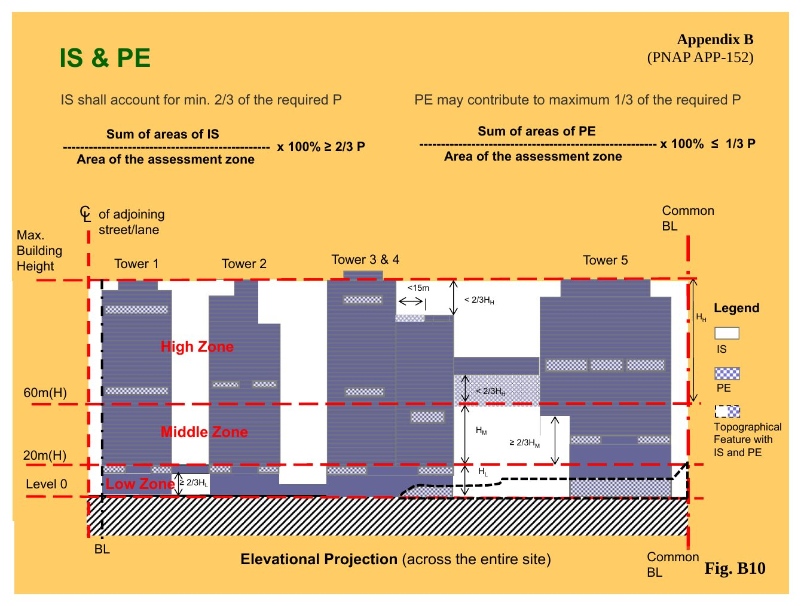{ loading=lazy }
  <figcaption>Fig. B10 — Intervening Space (IS) and Permeable Element (PE) in each assessment zone 各評估區域的間隔空間及通透元素 <small>Source: PNAP APP-152 (Sep 2023), Buildings Department 資料來源：屋宇署</small></figcaption>
</figure>

### 2. Building setback 建築物後移 (paras. 7–9)

!!! quote "Para. 7(a)"
    "For maintaining a ventilation corridor with minimum section of 15m x 15m, no part of the building up to a level of 15m above the street level should be within 7.5m from the centreline of the street…"

    **中譯（非官方）：** 為保持最小截面為 15 米 × 15 米的通風廊，建築物在街面以上 15 米高度範圍內的任何部分，均不得位於街道中線 7.5 米範圍內。

- **Alternative 7(b) 另一選擇:** provide a cross-ventilated communal podium garden (clear height ≥ 4.5 m), with nothing below 15 m protruding above a **45° plane** from the opposite site boundary. 提供淨高不少於 4.5 米、可對流通風的公用平台花園，且 15 米以下部分不得突出於由對面地段界線起計的 45° 斜面。
- **Allowed in setback area 後移範圍內准許** (para. 8): structures above 15 m, a canopy complying with B(P)R 10, minor projections ≤ 600 mm at ≥ 2.5 m clear height, single-storey footbridges and supporting columns.
- **Exemption 豁免** (para. 9): building height < **2 × mean street width**. 建築物高度少於街道平均闊度的 2 倍。

<figure markdown>
  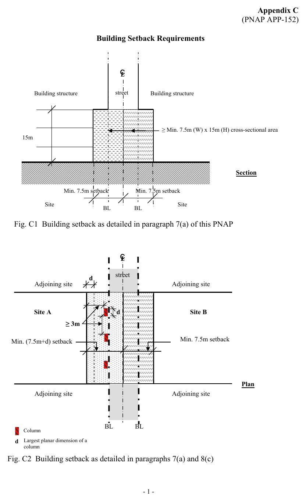{ loading=lazy }
  <figcaption>Figs. C1 & C2 — Building setback: 15 m × 15 m ventilation corridor, 7.5 m from street centreline 建築物後移：15 米 × 15 米通風廊 <small>Source: PNAP APP-152 (Sep 2023), Buildings Department 資料來源：屋宇署</small></figcaption>
</figure>

<figure markdown>
  { loading=lazy }
  <figcaption>Figs. C3 & C4 — Alternative: stepped profile with cross-ventilated communal podium garden 另一方案：設可對流通風公用平台花園的階梯式設計 <small>Source: PNAP APP-152 (Sep 2023), Buildings Department 資料來源：屋宇署</small></figcaption>
</figure>

### 3. Site coverage of greenery 上蓋綠化 (paras. 10–11)

**Table 2 — Minimum site coverage of greenery 最低上蓋綠化**

| Site area 地盤面積 | Primary zone 主要區域 | Overall 整體 |
|---|---|---|
| 1,000 m² – 20,000 m² | 10% | 20% |
| ≥ 20,000 m² | 15% | 30% |

- **Primary zone 主要區域** = the 15 m vertical zone along the abutting street level. 沿毗連街面起計 15 米的垂直區域。
- Not applicable to sites with a **single family house** only (para. 11). 只有單一獨立屋的地盤不適用。

<figure markdown>
  { loading=lazy }
  <figcaption>Fig. D1 — Measurement of greenery area: what counts and what does not 綠化面積的量度：可計算及不可計算的部分 <small>Source: PNAP APP-152 (Sep 2023), Buildings Department 資料來源：屋宇署</small></figcaption>
</figure>

## Detailed rules (Appendices A–F) 詳細規則（附錄 A–F） {#detailed-rules}

### Key terms (Appendix A) 主要用詞 {#terms}

| Term 用詞 | Meaning 意思 |
|---|---|
| **Level Zero** 零水平 | Mean level of the street the site abuts; with streets at different levels, the mean level of the **lower or lowest** street. Building height for SBD is from Level Zero to the mean roof level over the highest usable floor. |
| **Assessment zones** 評估區域 | **Low** 0–20 m, **middle** 20–60 m, **high** > 60 m above Level Zero. Each zone is checked on its own. |
| **Lp** 連續投影立面長度 | Total projected façade length of a building or group of buildings when the gap between them is **< 15 m** (a gap ≥ 15 m breaks the Lp). Measured on the **smallest notional rectangle** containing the building(s), along the long side (Figs B2–B3). |
| **U** 街道峽谷平均闊度 | Mean distance from the external wall of the building (if within **30 m** of the street centreline) to the **boundary of the site opposite** (or the far side of the street if there is no opposite site) (Figs B4–B7). Max. Lp = **5 × U**. |
| **Intervening Space (IS)** 間隔空間 | Space **open to above**, or with clear height **≥ 2/3 of the zone height**. |
| **Permeable Element (PE)** 通透元素 | Space within, above, below or between buildings with clear width **and** height **≥ 3 m** on the projection plane, e.g. refuge floors, sky gardens. |
| **Separating distance (S)** 分隔距離 | Width of an IS: façade to site boundary, façade to **centreline** of an adjoining street / lane, or façade to façade. |
| **Permeability (P)** 通透度 | (Area of IS + PE) ÷ area of the assessment zone on the projection plane × 100% (Fig. B9). |
| **Primary zone** 主要區域 | The **15 m vertical zone** along the abutting street level; the **top of soil** is the reference level. Greenery here must front or be visible from a street, public pedestrian way or public open space. |
| **Street** 街道 | ≥ **4.5 m** wide, government-maintained, or a private street on the same lease to be surrendered (B(P)R 18A(3)(a)). See [APP-124](app-124.md). |

### Building separation: how to measure (Appendix B) 建築物間距的量度 {#separation-measurement}

| Para. 段 | Rule 規則 | 中文要點 |
|---|---|---|
| B1.1 | Check **each zone separately** for Design Requirements (1) and (2), for buildings above Level Zero | 分區評估 |
| B1.2 | Measure to **external walls**. May disregard: single-storey footbridges (not stacked), signboards, APP-19 minor projections, **balconies, UPs**, covered walkways, trellises, railings and fences with **≥ 2/3 free area**; minor noise barriers with compensation | 可不計的部分 |
| B1.3 | Slopes, retaining walls and parts **below original ground** are disregarded (Fig. B1) | 地形及地下部分 |
| B2.1 | Lp control applies only if any part of the building is within **30 m of the street centreline** | 30 米內才管制 |
| B2.2 | Max. Lp = **5 × U**; if abutting two or more streets, use the **least U** | 取最小 U |
| B2.3 | Varying canyon width: U = canyon area ÷ length along the centreline; several canyons on one street: Σ areas ÷ Σ lengths (Fig. B7) | U 平均值 |
| B2.4 | In the **low zone**, parts **≤ 6.67 m** high (1/3 of 20 m) are disregarded for Lp | 低矮部分不計 |
| B2.5 | No Lp limit if the site does not abut a street, or no building in that zone is within 30 m of the centreline | 不適用情況 |
| B3.1 | Use **two vertical projection planes** at right angles; in the **low zone** one must be **parallel to a street** (tangent for a curved street); middle / high zones may suit the layout or wind | 兩個投影面 |
| B3.2 | The angle between the two planes may be **75°–105°** | 角度彈性 |
| B3.3 | Site **< 20,000 m²** and projected façades exceed 60 m on **one plane only**: check **that plane only** | 只查一面 |
| B4.2 | At least **2/3** of required P from IS at the **ends** (façade to boundary or street / lane centreline) with **S ≥ 7.5 m** (mean ≥ 7.5 m if varying, and no part within **3 m** of the boundary); if not enough, add IS **between buildings** with **S ≥ 15 m** (Figs B10–B12). Streets < 4.5 m wide may count; open space outside the site does not, except OZP nullahs, promenades or non-building areas | 端部間隔 ≥ 7.5 米 |
| B4.3 | PE may give **at most 1/3** of required P | 通透元素上限 |
| B4.4 | IS may follow a **notional air corridor** starting at 90° to the plane, turning **≤ 15°**, at least **15 m** wide (Figs B13–B16) | 風廊 |
| B4.5–4.6 | Large or irregular sites may be **subdivided** along a wind path open to above, **≥ 15 m** wide, turning ≤ 15°, meeting a street or lane **≥ 7.5 m** mean width at the boundary; P then checked per notional site (Figs B17–B18) | 分拆地盤 |

<figure markdown>
  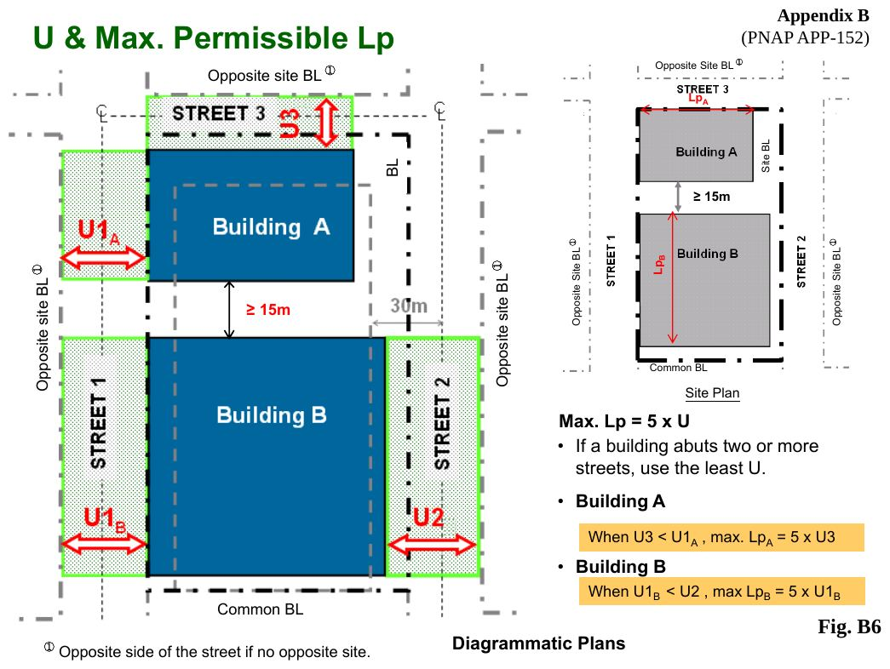{ loading=lazy }
  <figcaption>Fig. B6 — U and maximum permissible Lp; use the least U where a building abuts two streets 街道峽谷闊度 U 及最大 Lp <small>Source: PNAP APP-152 (Sep 2023), Buildings Department 資料來源：屋宇署</small></figcaption>
</figure>

<figure markdown>
  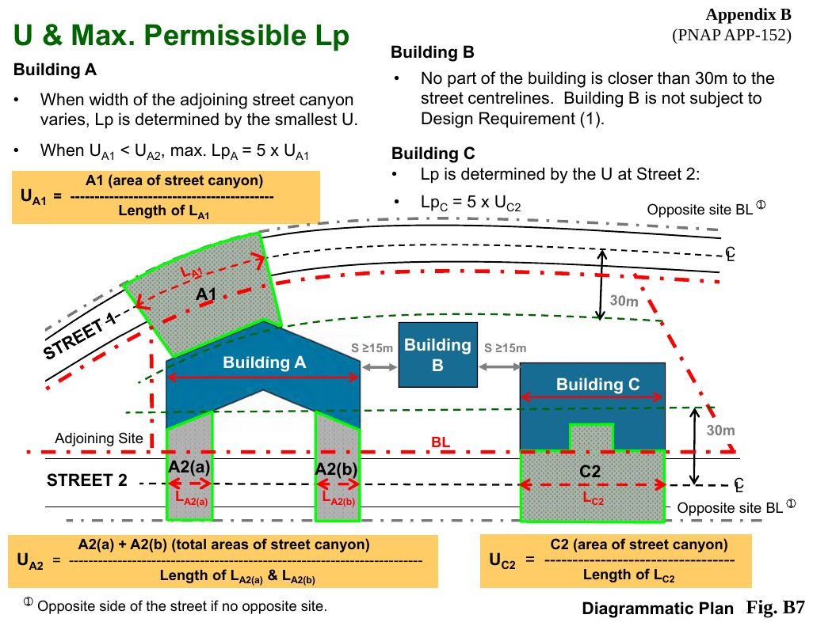{ loading=lazy }
  <figcaption>Fig. B7 — U where the street canyon width varies 街道峽谷闊度不一時的 U <small>Source: PNAP APP-152 (Sep 2023), Buildings Department 資料來源：屋宇署</small></figcaption>
</figure>

<figure markdown>
  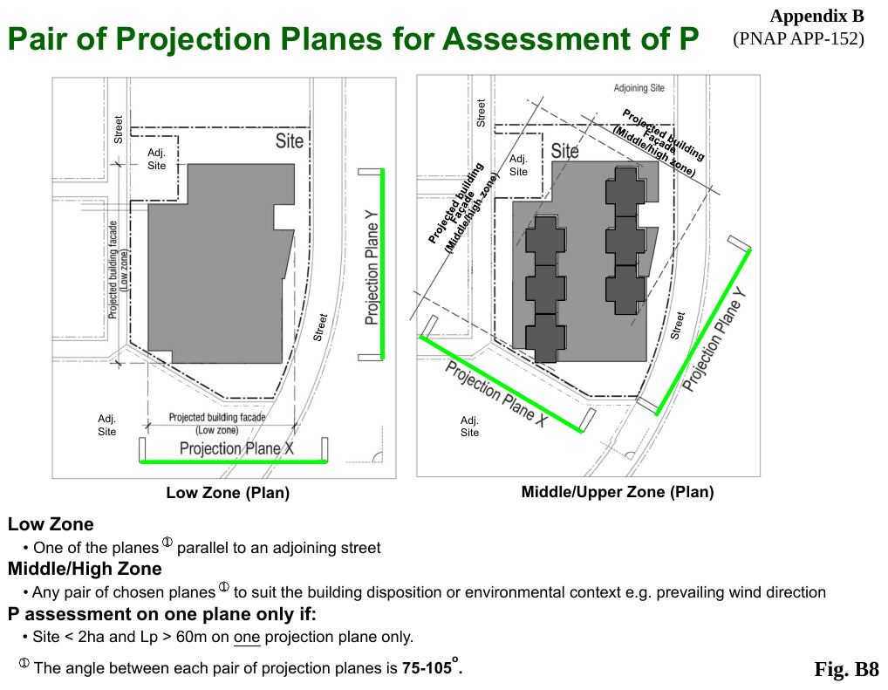{ loading=lazy }
  <figcaption>Fig. B8 — A pair of orthogonal projection planes 一對互相垂直的投影面 <small>Source: PNAP APP-152 (Sep 2023), Buildings Department 資料來源：屋宇署</small></figcaption>
</figure>

<figure markdown>
  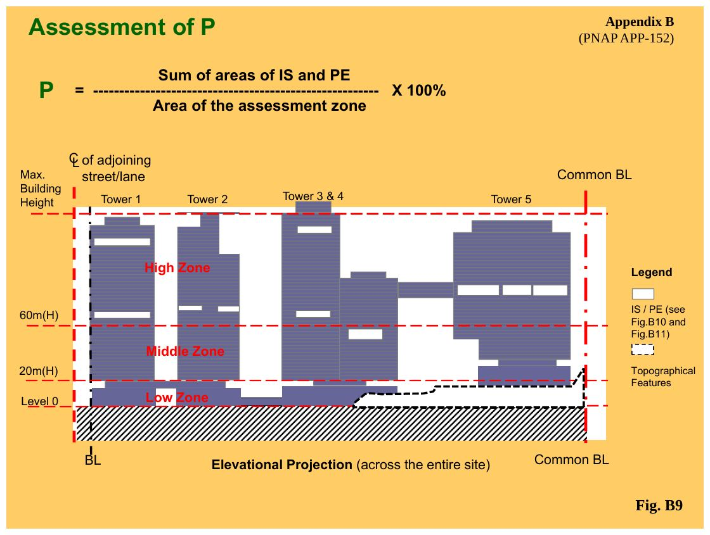{ loading=lazy }
  <figcaption>Fig. B9 — P = (IS + PE) ÷ area of the assessment zone 通透度計算 <small>Source: PNAP APP-152 (Sep 2023), Buildings Department 資料來源：屋宇署</small></figcaption>
</figure>

<figure markdown>
  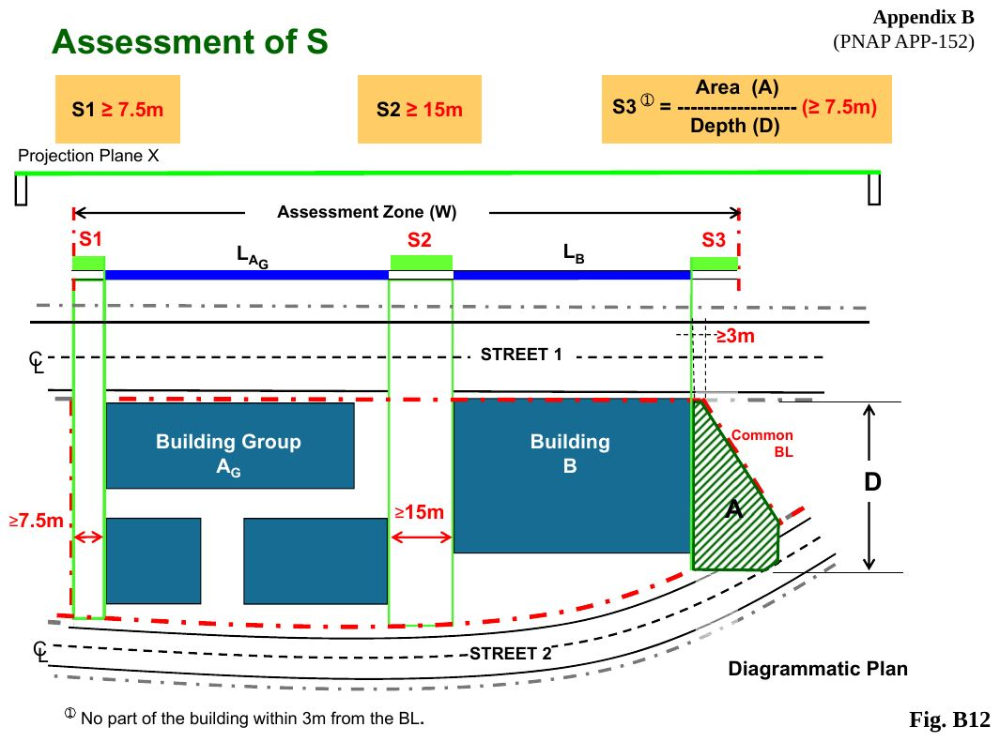{ loading=lazy }
  <figcaption>Fig. B12 — Mean S where the separating distance varies 分隔距離不一時的平均值 <small>Source: PNAP APP-152 (Sep 2023), Buildings Department 資料來源：屋宇署</small></figcaption>
</figure>

<figure markdown>
  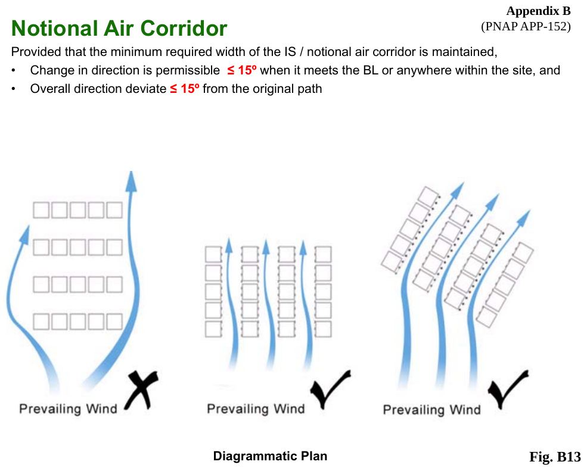{ loading=lazy }
  <figcaption>Fig. B13 — IS following a notional air corridor 沿風廊的間隔空間 <small>Source: PNAP APP-152 (Sep 2023), Buildings Department 資料來源：屋宇署</small></figcaption>
</figure>

<figure markdown>
  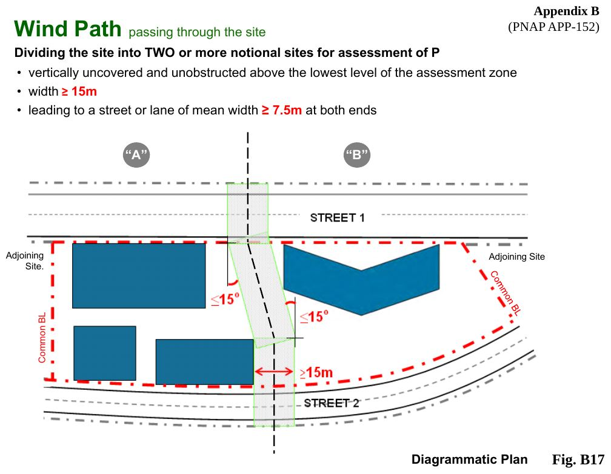{ loading=lazy }
  <figcaption>Fig. B17 — Subdividing a large site along a wind path 沿風道分拆大型地盤 <small>Source: PNAP APP-152 (Sep 2023), Buildings Department 資料來源：屋宇署</small></figcaption>
</figure>

### Building setback: examples (Appendix C) 建築物後移例子 {#setback-examples}

| Case 情況 | Setback needed? 是否須後移 |
|---|---|
| Columns in the setback area (Fig. C2) | Allowed, but the setback is measured as **7.5 m + d** (d = largest plan dimension of the column), and columns ≥ **3 m** from the boundary |
| Podium garden alternative (Figs C3–C4) | Garden clear height **≥ 4.5 m** (finished floor to false ceiling), cross-ventilated; edge parapet **≤ 1,250 mm** high with a clear opening **≥ 3,000 mm** above it; building up to 15 m kept below a **1 : 1 (45°)** plane from the opposite site boundary (Fig. C3) |
| Narrow lane ≥ 4.5 m with Green Belt beyond (Fig. C5) | **Yes** if the lane is a "street"; Green Belt is **not** treated as a lane |
| Part of site to be surrendered for road widening (Fig. C6) | **Yes**, measured from the centreline of the **existing** street, if the future street is ≥ 4.5 m but < 15 m |
| Street intersections (Fig. C7) | Measured from the centreline of each street < 15 m wide |
| Site at the end of a street or cul-de-sac (Fig. C8) | **No** |
| Sites along a cul-de-sac (Fig. C9) | **No** for the site abutting the cul-de-sac end; **yes** for sites along the street ≥ 4.5 m and < 15 m |
| Height < 2 × mean street width (para. 9) | **Exempt** (height from the mean street level to the mean roof level over the highest usable floor) |
| Setback area under structures above 15 m or under a canopy (footnote 2) | May be **exempt from GFA** if common parts, accessible to occupants and with no commercial use |

<figure markdown>
  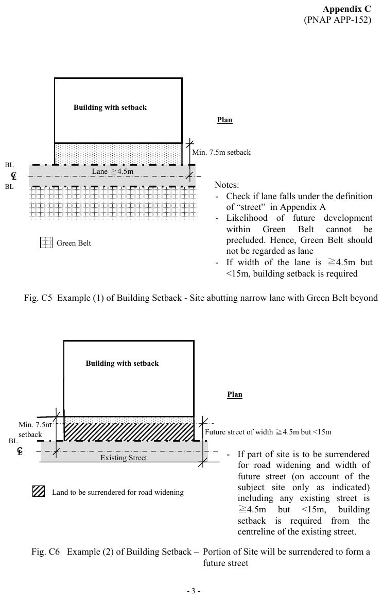{ loading=lazy }
  <figcaption>Figs C5–C6 — Narrow lane with Green Belt; land to be surrendered for road widening 窄巷及擴闊道路 <small>Source: PNAP APP-152 (Sep 2023), Buildings Department 資料來源：屋宇署</small></figcaption>
</figure>

<figure markdown>
  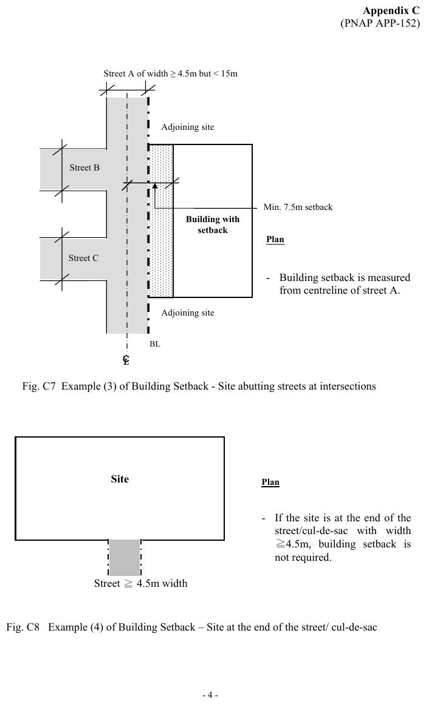{ loading=lazy }
  <figcaption>Figs C7–C8 — Street intersections; site at the end of a street 街道交界及盡頭地盤 <small>Source: PNAP APP-152 (Sep 2023), Buildings Department 資料來源：屋宇署</small></figcaption>
</figure>

<figure markdown>
  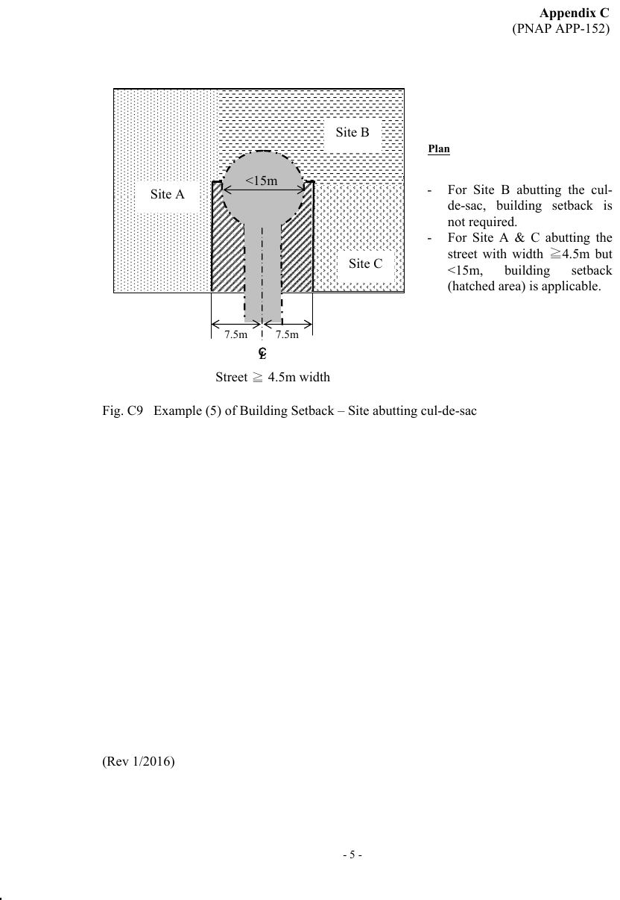{ loading=lazy }
  <figcaption>Fig. C9 — Sites abutting a cul-de-sac 毗鄰死胡同的地盤 <small>Source: PNAP APP-152 (Sep 2023), Buildings Department 資料來源：屋宇署</small></figcaption>
</figure>

### Greenery: what counts (Appendix D) 綠化面積計算 {#greenery-rules}

**Counted in full 全數計算** (measured horizontally on the soil area, para. 1): uncovered greenery; projecting planters covered by building parts with clear height **≥ 8 × the covered width**; stacked projecting planters both complying with APP-19 para. 9; greenery in the **primary zone** under buildings **within the 45° line** from the building edge and accessible from adjoining open areas.

**Green buffer** to APP-151 Appendix C1: **× 2** (para. 2).

**Other greening features** (para. 3): together **≤ 30% of the required overall greenery**:

| Feature 項目 | Where 位置 | Factor 系數 |
|---|---|---|
| Covered greenery accessible from adjoining open space (45° line) | Primary zone | **50%** |
| Water features (water surface; **not** pools or jacuzzis) | Primary zone or uncovered communal roof | **50%** |
| Grass paving (≥ 50% grass) | Not on car parking or L/UL spaces | **50%** |
| Planters on an **inaccessible roof** | Primary zone | **50%** |
| Vertical greening (elevational area; climbers count up to **7.5 m** high) | Anywhere | 100% |
| Greening on slopes / retaining structures **steeper than 45°** (elevational area) | Anywhere | 100% |

**Not counted 不計算**: removable pots (para. 5); **covered greenery above the primary zone** such as covered podium gardens or sky gardens (para. 6), unless one of the para. 1 cases applies; soil under a vertical-greening frame already counted (para. 7).

**Other conditions**: irrigation and drainage; impervious roof designed for soil and tree loads (para. 4); greenery is **common parts** with common access, including paths to planters on inaccessible roofs (para. 8). Approval conditions (para. 10): no other use without BA consent; restriction and common-part designation in the **DMC**; letter of undertaking **registered in the Land Registry before the OP application**.

### Alternative approaches (Appendix E) 替代方案 {#alternatives}

| Item 項目 | Conditions 條件 |
|---|---|
| Waive **low-zone** separation (E3) | SC incl. podium **≤ 65%**; **full-height** setback along street frontage for **≥ 50%** of the boundary length and **≥ 10 m** (or full frontage if shorter); setback area **≥ 15%** of site (as [APP-132](app-132.md)) |
| Performance-based separation (E4–E7) | Minimum P of Table 1 still met; **AVA** (wind tunnel or CFD, PlanD Technical Guide) shows equal or better than a **fully complying baseline**; submit in **two stages** (Stage 1: method and baseline for prior acceptance; Stage 2: urban climate study and AVA report); AVA reports go to PlanD's register |
| Historic buildings and special facilities (E8–E9) | Exempt from separation if AVA beats a viable notional scheme under **BEAM Plus SA8** and compensatory features (setback, stepped podium, podium garden) are provided |
| Relaxed setback (E10) | Full-height, full-frontage setback giving **≥ 15%** of site area; sites **≤ 1,000 m²** also provide primary-zone greenery **≥ 50% of the setback area** |
| Greenery (E11–E12) | "Green" path to view natural landscape behind; phased sites may use a notional site area per phase |
| Committee (E2) | Proposals may go to the **Building Committee** or Expanded Building Committee |

### What to submit (Appendix F) 呈交資料 {#submission}

| Element 項目 | Submit 呈交 |
|---|---|
| Separation | (a) **1:500** layout plans per zone: footprints, IS, PE, projection planes, air corridors and paths; (b) plans, elevations and sections (≥ **1:300**) with calculations of **U, Lp vs max. Lp, S vs required S, P vs minimum P** for each zone |
| Setback | (c) block plan with all street widths; (d) street levels where a street is < 15 m; (e) **1:100** plans and sections with calculations; (f) greenery under App. E para. 10(b) if used |
| Greenery | (g) plans (≥ 1:300) of greenery areas, common access, and the street / public way for the primary zone; (h) **schedule of greenery areas** with calculations and diagrams. Items (g)–(h) are **updated with the OP application** (PDF, 200 dpi) and **published on BD's website** after the OP (para. 15) |

## Step-by-step check 逐步核對 {#step-by-step}

### Checklist 核對清單 {#checklist}

| Step 步驟 | Check 核對 | Where 出處 |
|---|---|---|
| 0 | Are you claiming **GFA concessions** under APP-151? If yes, SBD compliance is a **pre-requisite** | [APP-151](app-151.md) para. 6 |
| 1 | Fix **Level Zero**, building heights and the three **assessment zones** | App. A |
| 2 | **Separation applies?** Site ≥ 20,000 m², or Lp ≥ 60 m in any zone (ignoring low-zone parts ≤ 6.67 m high). Standalone houses ≤ 15 m exempt | paras 3, 6; B2.4 |
| 3 | **Design Req. (1)**: for each zone and each building within 30 m of a street centreline: find U (least U if two streets), check Lp ≤ 5U | B2 |
| 4 | **Projection planes**: low zone parallel to a street; one or two planes (B3.3) | B3 |
| 5 | **Design Req. (2)**: required P from Table 1; IS at ends with S ≥ 7.5 m giving ≥ 2/3 of required P; extra IS between buildings S ≥ 15 m; PE ≤ 1/3 | B4, Table 1 |
| 6 | **Setback applies?** Each abutting street < 15 m wide; not a cul-de-sac end; height ≥ 2 × street width | paras 7, 9; App. C |
| 7 | **Setback**: nothing within 7.5 m of the centreline up to 15 m (or 45° podium-garden option); allowed items in para. 8 | para. 7–8 |
| 8 | **Greenery applies?** Site ≥ 1,000 m², not a single house | paras 10–11 |
| 9 | **Greenery**: overall and primary-zone %; other features ≤ 30% with factors; exclusions | Table 2; App. D |
| 10 | If any item fails: redesign, or an **alternative approach** with justification | App. E |
| 11 | Prepare **Appendix F** plans and calculations; update greenery with the OP | App. F |

### BD's sample case (Figs B19–B21) 屋宇署示例 {#bd-sample}

Site **1,920 m²**, one tower **78 m** high on a **15 m** podium, street **15 m** wide, podium 80 m long at the street boundary.

| Step 步驟 | Working 計算 | Result 結果 |
|---|---|---|
| Applies? | Site < 20,000 m² but podium Lp **80 m ≥ 60 m** | Separation **applies** |
| Lp, low zone (1st scheme) | U(podium) = **15 m** → max. Lp = 5 × 15 = **75 m**; podium Lp = 80 m | ❌ **Not OK** |
| Lp, low zone (revised) | Podium set back **7.5 m** at both ends: Lp = 80 − 2 × 7.5 = **65 m** | ✅ 65 < 75 |
| Lp, middle / high | U(tower) = **19 m** → max. 95 m; tower Lp = **32 m** | ✅ |
| P, low zone | Required **20%** (site < 20,000 m²). IS = 7.5 × 13.4 + 7.5 × 13.4 + 22.5 × 5 = **313.5 m²** (13.4 m = 20 m less the disregarded ≤ 6.67 m part; 22.5 × 5 m = podium roof garden open to above). P(IS) = 313.5 ÷ (20 × 80) = **19%**, which is ≥ 2/3 × 20% = 13.33% | IS share ✅ |
| | PE = 13 × 5 = **65 m²** → **4%** (≤ 1/3 × 20% = 6.67%, all counted) | P = 19% + 4% = **23%** ✅ |
| P, middle zone | IS = (18 + 30) × 40 = 1,920 m² ÷ (80 × 40) = **60%** | ✅ |
| P, high zone | IS = (18 + 30) × 18 = 864 m² ÷ (80 × 18) = **60%** | ✅ |

<figure markdown>
  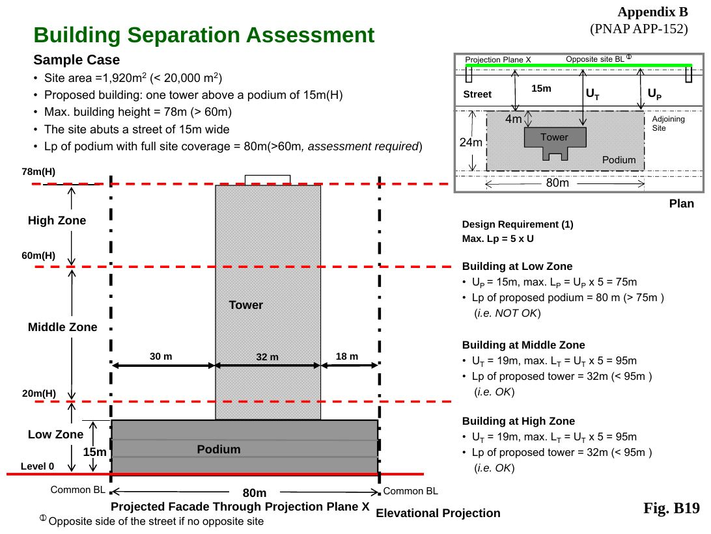{ loading=lazy }
  <figcaption>Fig. B19 — Sample case: Design Requirement (1), Lp 示例：最大 Lp <small>Source: PNAP APP-152 (Sep 2023), Buildings Department 資料來源：屋宇署</small></figcaption>
</figure>

<figure markdown>
  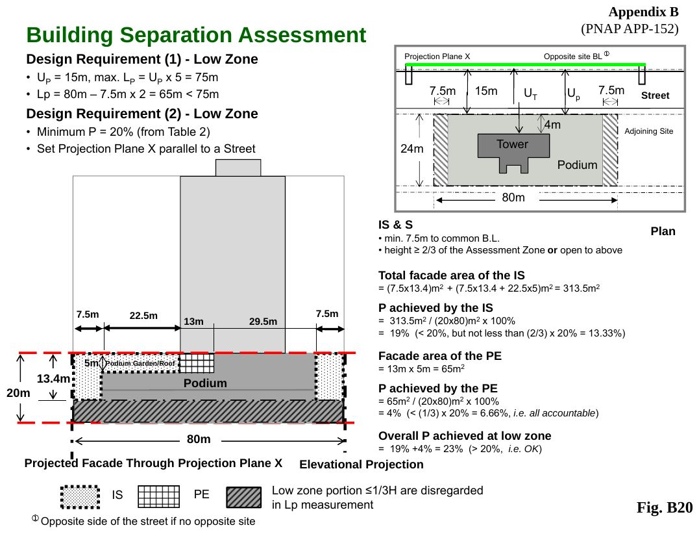{ loading=lazy }
  <figcaption>Fig. B20 — Sample case: low zone IS, PE and P 示例：低區通透度 <small>Source: PNAP APP-152 (Sep 2023), Buildings Department 資料來源：屋宇署</small></figcaption>
</figure>

<figure markdown>
  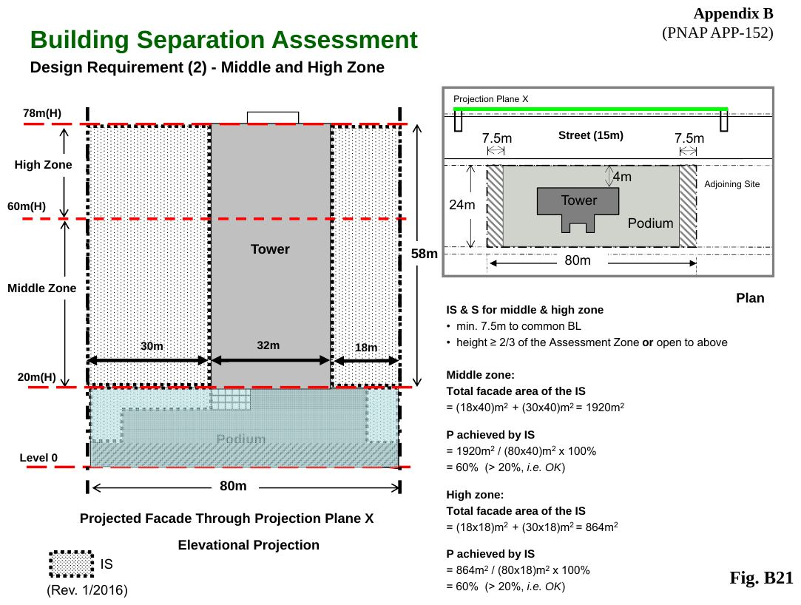{ loading=lazy }
  <figcaption>Fig. B21 — Sample case: middle and high zones 示例：中區及高區 <small>Source: PNAP APP-152 (Sep 2023), Buildings Department 資料來源：屋宇署</small></figcaption>
</figure>

### Worked example: two towers on a narrow street 計算例子：窄街雙塔 {#worked-example-two-towers}

!!! example "Illustrative only 只作說明"
    The site and numbers below are **made up** to show the method; they are not from the PNAP. Check every real case against the full text. 以下數字為虛構，只用作說明計算方法。

**The scheme 方案**: site **100 m** (street frontage) × **80 m** = **8,000 m²**; one street on the south, **12 m** wide, centreline **6 m** from the site boundary; Level Zero = mean street level. Podium **15 m** high, **55 m** deep, set back **1.5 m** from the street boundary. Two residential towers **90 m** high, each **25 m** wide and **20 m** deep, set back **10 m** from the street boundary. First scheme: podium **75 m** long (x = 15 to 90 m).

**Step 1–2: Does separation apply? 是否適用**

- Site 8,000 m² < 20,000 m², so look at Lp. Low zone: podium 75 m (15 m high, so not disregarded under B2.4) ≥ 60 m → **separation applies**.
- Plane Y (perpendicular to the street): projected width = podium depth **55 m** ≤ 60 m. Only plane X exceeds 60 m, so under **B3.3** only **plane X** (parallel to the street) needs checking.

**Step 3: Design Requirement (1), Lp ≤ 5U 最大連續投影立面長度**

| Zone 區域 | Building | Within 30 m of CL? | U | Max. Lp = 5U | Lp | Result |
|---|---|---|---|---|---|---|
| Low (1st scheme) | Podium | Yes (6 + 1.5 = 7.5 m) | 1.5 + 12 = **13.5 m** | **67.5 m** | 75 m | ❌ |
| Low (revised) | Podium shortened to x = 15–80 m | Yes | 13.5 m | 67.5 m | **65 m** | ✅ |
| Middle, high | Each tower | Yes (6 + 10 = 16 m) | 10 + 12 = **22 m** | 110 m | 25 m each (gap 15 m ≥ 15 m, so not combined) | ✅ |

!!! tip "Fixing a failed Lp 修正方法"
    Shorten the podium (as here), split it with a gap **≥ 15 m**, keep long low parts **≤ 6.67 m** high, or set the façade further back to increase U.

**Step 4–5: Design Requirement (2), permeability on plane X 通透度**

Required P = **20%** in each zone (site < 20,000 m² with Lp ≥ 60 m, Table 1). Towers at x = 15–40 m and 55–80 m; podium x = 15–80 m.

| Zone 區域 | Zone area | IS at ends (S ≥ 7.5 m) | IS between towers (S ≥ 15 m) | P | Check |
|---|---|---|---|---|---|
| Low 0–20 m | 100 × 20 = **2,000 m²** | West 15 m + east 20 m, height 13.33 m (20 − 6.67): 35 × 13.33 = **467 m²** (23.3%, ≥ 2/3 × 20% ✅) | Podium roof between towers, open to above: 15 × 5 = **75 m²** | 542 ÷ 2,000 = **27.1%** | ✅ ≥ 20% |
| Middle 20–60 m | 100 × 40 = **4,000 m²** | 35 × 40 = **1,400 m²** (35%) | 15 × 40 = **600 m²** | 2,000 ÷ 4,000 = **50%** | ✅ |
| High 60–90 m | 100 × 30 = **3,000 m²** | 35 × 30 = **1,050 m²** | 15 × 30 = **450 m²** | 1,500 ÷ 3,000 = **50%** | ✅ |

The east gap is 100 − 80 = 20 m and the west gap 15 m, both ≥ 7.5 m, so they count as end IS. If the east gap were only 5 m it would **not** count (S < 7.5 m).

**Step 6–7: Building setback 建築物後移**

- Street 12 m: ≥ 4.5 m (a street) and < 15 m → setback **applies**. Not a cul-de-sac end.
- Exemption test: height 90 m vs 2 × 12 = 24 m → 90 ≥ 24, **no exemption**.
- Required: nothing within **7.5 m of the centreline** up to **15 m** above street level. Centreline is 6 m from the boundary, so the building must be **7.5 − 6 = 1.5 m** behind the boundary for the **full frontage** up to 15 m. Podium at 1.5 m ✅.
- Allowed in the 1.5 m strip: canopy to B(P)R 10, projections ≤ **600 mm** at ≥ **2.5 m** clear, landscaping, perforated railings; **no** columns unless the setback is increased to 7.5 m + d (Fig. C2).

**Step 8–9: Site coverage of greenery 上蓋綠化**

Site 8,000 m² (1,000–20,000 m²): overall ≥ 20% = **1,600 m²**; primary zone ≥ 10% = **800 m²**; other features ≤ 30% × 1,600 = **480 m²**.

| Item 項目 | Location 位置 | Area | Factor | Counted 計算面積 | Primary zone? |
|---|---|---|---|---|---|
| At-grade planting, uncovered | Ends and setback strip | 650 m² | 100% | **650** | Yes |
| Podium roof garden, uncovered (soil top +15.6 m) | Podium roof | 700 m² | 100% | **700** | No (above 15 m) |
| Covered planting under podium canopy, within 45° line, accessible | G/F frontage | 240 m² | 50% | **120** | Yes (feature) |
| Water feature (water surface) | G/F plaza | 80 m² | 50% | **40** | Yes (feature) |
| Grass paving (EVA, not car park) | G/F | 300 m² | 50% | **150** | Yes (feature) |
| Vertical greening, ≤ 7.5 m high | Podium wall | 120 m² | 100% | **120** | Yes (feature) |
| Sky garden (covered, above primary zone) | 40/F | 200 m² | — | **0** (para. 6) | — |

- **Primary zone**: 650 + 120 + 40 + 150 + 120 = **1,080 m²** ≥ 800 ✅ (without the features it would be 650 ❌: features can make up the shortfall within the 30% cap).
- **Overall**: 1,080 + 700 = **1,780 m²** ≥ 1,600 ✅.
- **Features cap**: 120 + 40 + 150 + 120 = **430 m²** ≤ 480 ✅.
- All areas are **common parts** with common access; DMC clause and **registered undertaking** before the OP application.

**Step 10–11: Result and submission 結果及呈交**

All three elements comply after the podium is shortened from 75 m to 65 m. Submit the **Appendix F** plans: 1:500 zone plans with plane X, IS and S; elevations and sections with the U / Lp / P tables above; 1:100 setback sections; and the greenery plan and schedule, updated with the OP application.

## Explanation 淺白解釋 {#explanation}

=== "English"

    The guidelines tackle three urban problems: **"wall effect"** buildings that block wind, **narrow street canyons** that trap heat and pollution, and **too little greenery at street level**.

    - **Separation** breaks up long façades so wind can pass through the site. Picture looking at the site from the street: in each height zone, a minimum % of that elevation must be "see-through" (gaps between or through buildings).
    - **Setback** pushes the lower 15 m of the building back from narrow streets, which creates a wider ventilation corridor for pedestrians.
    - **Greenery** requires real planting (soil and live plants) over a % of the site, with part of it near street level where people can see or reach it.

    If you fail these, you can lose the **GFA concessions under APP-151**. In practice that is a big commercial impact, so check SBD compliance at the very early massing stage.

=== "中文"

    指引針對三個城市問題：阻擋通風的**「屏風效應」**、困住熱力及污染的**狹窄街道峽谷**，以及**街道層面綠化不足**。

    - **建築物間距**：打破過長的立面，讓風穿過地盤。可想像從街上望向地盤：在每個高度區域，立面須有指定百分比是「通透」的（建築物之間或建築物中的空隙）。
    - **建築物後移**：把建築物較低的 15 米從狹窄街道後移，為行人提供較闊的通風廊。
    - **上蓋綠化**：地盤須有指定百分比為真正種植（泥土及活植物），其中部分須位於接近街面、市民看得見或可到達的位置。

    若未能符合，可能會失去 **APP-151 的總樓面面積寬免**，對項目影響重大，故應於初步體量設計階段已核對是否符合。

## Practical notes 實務提示 {#practical-notes}

=== "English"

    !!! example "Worked example: greenery"
        Site area = **5,000 m²** (between 1,000 and 20,000 m²).

        - Overall greenery ≥ 20% × 5,000 = **1,000 m²**
        - Primary zone greenery ≥ 10% × 5,000 = **500 m²**

    !!! example "Worked example: Lp"
        Mean width of street canyon U = **15 m**, so maximum permissible Lp = 5 × 15 = **75 m** in that assessment zone.

    !!! tip "Counting greenery (Appendix D)"
        - Measure **horizontally on the soil area** shown on plan.
        - Removable pots **do not count**.
        - Covered greenery **above** the primary zone (e.g. covered podium / sky garden) generally does not count. Check the exceptions in App. D para. 1.
        - Water features, grass paving, vertical greening etc. can together make up **no more than 30%** of the required overall greenery, with reduction factors (e.g. grass paving 50%).
        - Recommended minimum soil depths: trees **1.2 m**, shrubs **0.6 m**, grass **0.3 m**.
        - All greenery must be **common parts**, with maintenance access from common areas.

    !!! tip "Special cases"
        Ferry piers, railway terminals, stadia and adaptive re-use of historic buildings may use the **alternative approaches** in Appendix E (para. 12).

=== "中文"

    !!! example "計算例子：綠化"
        地盤面積 = **5,000 平方米**（介乎 1,000 至 20,000 平方米）。

        - 整體綠化 ≥ 20% × 5,000 = **1,000 平方米**
        - 主要區域綠化 ≥ 10% × 5,000 = **500 平方米**

    !!! example "計算例子：Lp"
        街道峽谷平均闊度 U = **15 米**，該評估區域的最大准許 Lp = 5 × 15 = **75 米**。

    !!! tip "綠化面積計算（附錄 D）"
        - 以圖則上的**泥土面積水平量度**。
        - 可移動花盆**不計算**。
        - 主要區域**以上**有上蓋的綠化（如有蓋平台花園／空中花園）一般不計算，例外情況見附錄 D 第 1 段。
        - 水景、草地磚、垂直綠化等合共**不得多於**整體所需綠化面積的 **30%**，並須按折減系數計算（如草地磚 50%）。
        - 建議最少泥土深度：樹木 **1.2 米**、灌木 **0.6 米**、草 **0.3 米**。
        - 所有綠化面積須屬**公用部分**，並可由公用地方進行保養。

    !!! tip "特殊情況"
        渡輪碼頭、鐵路總站、運動場及活化歷史建築等，可採用附錄 E 的**其他方案**（第 12 段）。

<!-- APSEC START -->
## APSEC clarifications 認可人士及註冊結構工程師委員會討論 {#apsec-clarifications}

BD's responses at the APSEC Discussion Forum that clarify this document, **newest first**. Where the same question came up more than once, only the **latest position** is listed. See [all APSEC items](../apsec/index.md). 屋宇署在討論會上就本文件作出的澄清，新者在前；同一問題只列最新立場。

- **[Registration of Letters of Undertaking in the Land Registry](../apsec/2026.md#i202605085)** <small>ADF 2/2026, 8 May 2026</small> BD advised that the understanding of the HKIA was correct. Registration in the Land Registry for the following undertaking letters was required before OP application and might be imposed in the condition of the …
- **[GFA Concession for Car Parks](../apsec/2025.md#i2025112117)** <small>ADF 4/2025, 21 Nov 2025</small> BD advised that the aboveground car parks that would not pose adverse environmental or visual impact to its surrounding areas might be 100% disregarded from GFA calculation under paragraph 18(c)(ii) of PNAP APP-2. …
- **[Exemption of Guard Houses/Kiosks in Existing Buildings from the Compliance with Pre-requisites in PNAP APP-151](../apsec/2025.md#i2025050916)** <small>ADF 2/2025, 9 May 2025</small> Recognising the constraints in A&A works, BD would take a pragmatic approach in considering grating GFA concessions for guard houses/kiosks that were commensurate with the development under the said case.
- **[Building Separation – Design Requirement (2) – Separating Distance (S) and Permeability (P)](../apsec/2025.md#i2025050913)** <small>ADF 2/2025, 9 May 2025</small> BD advised that the purpose of building separation was to improve air ventilation, enhance environmental quality at pedestrian level and mitigate heat island effect arising from the undesirable walling effect of “long …
- **[Covered Vertical Greening](../apsec/2025.md#i2025021411)** <small>ADF 1/2025, 14 Feb 2025</small> BD advised that the provision of greenery aimed to improve the environmental quality of the urban space, particularly at the pedestrian level, and to mitigate the heat island effect. Vertical greening that grew on a …
- **[Building Separation Requirement – PNAP APP-152](../apsec/2024.md#i202411222)** <small>ADF 4/2024, 22 Nov 2024</small> BD advised that HKIA’s understanding was incorrect. The provision of separating distance (S) was one of the design requirements for building separation and should be complied with. There should be S of not less than 7.5 …
- **[Vertical Greening](../apsec/2024.md#i202408098)** <small>ADF 3/2024, 9 Aug 2024</small> BD advised that according to paragraph 3(n) of PNAP APP-19, metal supporting frames for growing of plants (including vertical frame for climbing and/or weeping plants and panel/modular planters) projecting not more than …
- **[Projecting Greenery](../apsec/2024.md#i202408092)** <small>ADF 3/2024, 9 Aug 2024</small> BD advised that whether the projecting greenery at common parts of a building satisfying the requirements under paragraph 9 of PNAP APP-19 could be disregarded in the building separation assessment would be considered …

??? note "18 more APSEC items 更多項目"

    - **[Site Coverage of Greenery](../apsec/2024.md#i202402236)** <small>ADF 1/2024, 23 Feb 2024</small> BD advised that uncovered greenery area, irrespective of location, could be included in the overall greenery areas calculation subject to compliance with all requirements under Appendix D to PNAP APP-152. For planters …
    - **[Requirements of Building Setback – PNAP APP-132 and APP-152](../apsec/2023.md#i2023080414)** <small>ADF 3/2023, 4 Aug 2023</small> BD advised that there was no requirement on minimum setback distance under PNAP APP-132 or under the alternative approach for building setback stipulated in Appendix E to PNAP APP-152 except for those stipulated in …
    - **[Tie Beams within Building Setback Area under Sustainable Building Design Guidelines (SBD Guidelines)](../apsec/2023.md#i2023050522)** <small>ADF 2/2023, 5 May 2023</small> BD would pragmatically consider the merits of the case with the provision of tie beams, provided that the ventilation effectiveness would not be adversely affected. Depending on the circumstances of the case, BD might …
    - **[Building Setback – PNAP APP-152](../apsec/2023.md#i2023021013)** <small>ADF 1/2023, 10 Feb 2023</small> BD advised that AAP’s understanding was correct. The term “street” was defined in Appendix A to PNAP APP-152 as described under regulation 18A(3)(a)(i) and (ii) of B(P)R.
    - **[Site Coverage of Greenery – PNAP APP-152](../apsec/2022.md#i202211259)** <small>ADF 5/2022, 25 Nov 2022</small> BD advised that the aquatic planting would be considered as part of the water features which was subject to the 50% reduction factor in calculating the Site Coverage of Greenery under PNAP APP-152.
    - **[Building Separation – Projected Building Facade at Low Zone](../apsec/2022.md#i202205134)** <small>ADF 3/2022, 13 May 2022</small> BD confirmed that HKIA’s understanding was correct. Paragraph 2.4 of Appendix B to PNAP APP-152 delineated Design Requirement (1) and it stipulated that when measuring Lp, which must be the long side, the part of the …
    - **[Covered Landscaped and Play Areas](../apsec/2022.md#i2022031816)** <small>ADF 2/2022, 18 Mar 2022</small> BD advised that there was no height requirement stipulated in PNAP APP-42 for communal podium gardens, covered landscaped and play areas. Nevertheless, under PNAP APP-152, for a communal podium garden adopted for …
    - **[Flexibility in Site Coverage and Open Space Provision for A&A Works – PNAP APP-132](../apsec/2022.md#i2022011414)** <small>ADF 1/2022, 14 Jan 2022</small> BD advised that the flexible site coverage under PNAP APP-132 was only applicable to new developments, subject to the pre-requisites set out under PNAP APP-151 and PNAP APP-152. It is not applicable to A&A works.
    - **[Building Setback Requirement for A&A works in Existing Buildings](../apsec/2021.md#i202111124)** <small>ADF 5/2021, 12 Nov 2021</small> BD advised that for A&A proposals resulting in new building(s) and entailing GFA concessions, the 10% overall cap on GFA concession and the Sustainable Building Design (SBD) Guidelines (viz. Building Separation …
    - **[Landscaped Features at Setback Area](../apsec/2021.md#i2021031916)** <small>ADF 2/2021, 19 Mar 2021</small> BD advised that water feature which would contribute to improving street environment were acceptable to be provided at the setback area under PNAP APP-132.
    - **[PNAP APP-152 – U & Max. Permissible Lp](../apsec/2021.md#i202103194)** <small>ADF 2/2021, 19 Mar 2021</small> BD advised that according to paragraph 2.3 of Appendix B under PNAP APP-152, U was the mean width of the street canyon that abutted such part of the building within 30m from the centreline of the street. It served the …
    - **[Discharge on Ground Level](../apsec/2020.md#i2020112616)** <small>ADF 4/2020, 26 Nov 2020</small> BD advised that the requirements under Clause C9.7 of FS Code 2011 were not applicable to “Lot A” under the specified situation but applicable to “Lot B” according to AAP’s sketch.
    - **[Registration of Undertaking Letter to Land Registry](../apsec/2019.md#i2019082315)** <small>ADF 4/2019, 23 Aug 2019</small> Registration of undertaking letters from developer or owner would only be required for certain situations as stipulated in relevant PNAPs and modification conditions. In some cases, registration of undertaking letters …
    - **[Application of PNAP APP-151](../apsec/2019.md#i201905245)** <small>ADF 3/2019, 24 May 2019</small> BD advised that according to paragraph 3 of PNAP APP-151, the BA will take account of the compliance with the SBD Guidelines as promulgated in the PNAP APP-152, where applicable, as a pre-requisite in exempting or …
    - **[Building Setback under SBD Guidelines](../apsec/2019.md#i201905242)** <small>ADF 3/2019, 24 May 2019</small> BD advised that if the site abuts more than one narrow street and the required set back of the building will result in more than 15% of the area of the site, AP might provide the required full height and full frontage …
    - **[Carpark GFA Exemption](../apsec/2019.md#i201901186)** <small>ADF 1/2019, 18 Jan 2019</small> BD advised that the current policy of disregarding underground car park from GFA calculation and the SBD Guidelines were two distinct measures arising from the recommendations of Sustainable Development Council to …
    - **[Follow-up on Setback areas under PNAP APP 132 and Building Set Back Alternative Approach](../apsec/2018.md#i201801197)** <small>ADF 1/2018, 19 Jan 2018</small> BD confirmed that the understanding was correct provided that the requirements under both PNAP APP-132 and APP-152 could be met.
    - **[Sustainable Building Design Guidelines](../apsec/2017.md#i201711171)** <small>ADF 5/2017, 17 Nov 2017</small> (Item withdrawn by HKIA during meeting.)

<!-- APSEC END -->

## Related 相關文件 {#related}

| Document 文件 | Relationship 關係 |
|---|---|
| [APP-151 優化建築設計 締造可持續建築環境](app-151.md) | SBD compliance is a GFA-concession pre-requisite 符合本指引為寬免先決條件 |
| APP-19 | Projections, planters 伸出物及花槽 |
| B(P)R 10, 18A | Canopy; definition of street 簷篷；街道定義 |
| BO s.42 | Modification, with conditions 變通（可附加條件） |
| PlanD Technical Guideline for AVA | Air ventilation assessment 空氣流通評估 |

---
<small>Prepared by: _[name]_ · Checked by: _[name]_ · Unofficial summary; refer to the official PNAP for the definitive text.</small>
