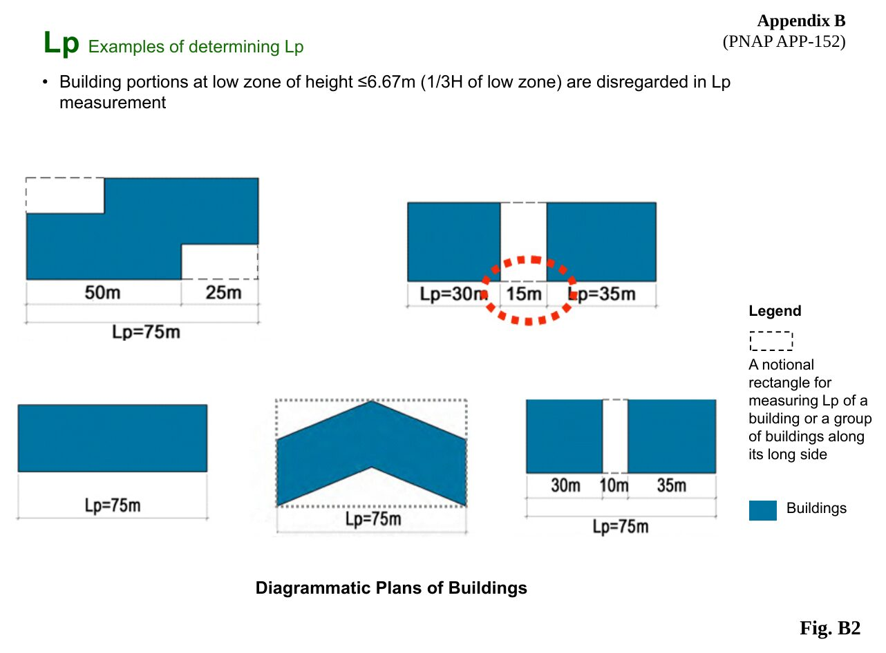
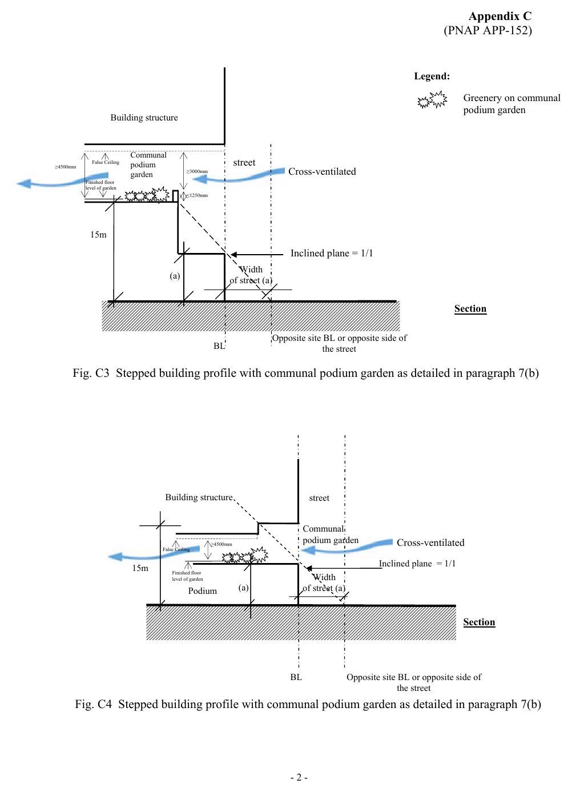
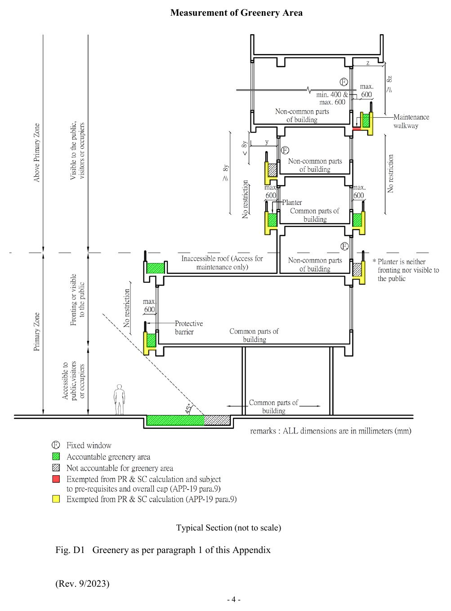

---
tags:
  - PNAP
  - APP series
  - Sustainable building design 可持續建築設計
  - Building separation 建築物間距
  - Building setback 建築物後移
  - Greenery 綠化
  - Sustainability 可持續發展
  - Green & amenity features 環保及適意設施
  - Lighting & ventilation 照明及通風
  - GFA 總樓面面積
  - GFA concession 樓面面積寬免
  - Site coverage 上蓋面積
  - Curtain wall & façade 幕牆及外牆
  - Site area & classification 地盤面積及分類
  - Heritage 文物
  - Building height 建築物高度
---

# APP-152 Sustainable Building Design Guidelines <small>可持續建築設計指引</small>

!!! info "Document info 文件資料"
    | | |
    |---|---|
    | **Type 類別** | PNAP (APP series) |
    | **Issued by 發出機構** | Buildings Department 屋宇署 |
    | **First issue 首次發出** | January 2011 |
    | **Version summarised 本摘要版本** | September 2023 (Appendices A & D amended) |
    | **Official language 官方語言** | English only (Chinese version not available) 只有英文版 |
    | **Source 原文** | [APP-152 (PDF)](https://www.bd.gov.hk/doc/en/resources/codes-and-references/practice-notes-and-circular-letters/pnap/APP/APP152.pdf) |
    | **Last checked 最後核對** | 2026-11-20 against the September 2023 version |

## At a glance 重點摘要

=== "English"

    - Sets out the **SBD Guidelines**. Complying with them is a **pre-requisite for GFA concessions** under [APP-151](app-151.md).
    - Three design elements: **building separation**, **building setback** and **site coverage of greenery**.
    - **Separation** applies to sites **≥ 20,000 m²**, or smaller sites with a continuous projected façade length **Lp ≥ 60 m**.
    - **Setback** applies to buildings fronting a street **< 15 m wide**. Keep a 15 m × 15 m ventilation corridor (nothing within **7.5 m of the street centreline** up to **15 m** high).
    - **Greenery** applies to sites **≥ 1,000 m²**: **20%** overall (10% in the primary zone); **30%** overall (15% primary zone) for sites ≥ 20,000 m².

=== "中文"

    - 訂明**可持續建築設計指引**。符合指引是 [APP-151](app-151.md) 下取得**總樓面面積寬免的先決條件**。
    - 三項設計元素：**建築物間距**、**建築物後移**及**上蓋綠化**。
    - **建築物間距**適用於面積 **≥ 20,000 平方米**的地盤，或連續投影立面長度 **Lp ≥ 60 米**的較小地盤。
    - **建築物後移**適用於臨街而街道闊度 **< 15 米**的建築物：須保留 15 米 × 15 米通風廊（街道中線 **7.5 米**範圍內、離街面 **15 米**高度以下不得有建築物）。
    - **上蓋綠化**適用於 **≥ 1,000 平方米**的地盤：整體 **20%**（主要區域 10%）；≥ 20,000 平方米的地盤為整體 **30%**（主要區域 15%）。

## Key clauses 主要條文

### 1. Building separation 建築物間距 (paras. 3–6)

!!! quote "Para. 3"
    "…building sites of the following categories should comply with the building separation requirements: (a) sites that are 20,000m² or above; or (b) sites that are less than 20,000m² and proposed with building or group of buildings having a continuous projected façade length (Lp) of 60m or above."

    **中譯（非官方）：** 以下類別的地盤須符合建築物間距要求：(a) 面積 20,000 平方米或以上的地盤；或 (b) 面積少於 20,000 平方米，但擬建建築物或建築群的連續投影立面長度 (Lp) 達 60 米或以上的地盤。

| Requirement 要求 | Rule 規定 |
|---|---|
| Design Req. (1) — Lp | Lp along a street ≤ **5 × U** (mean width of street canyon) 沿街 Lp 不得超過街道峽谷平均闊度 U 的 **5 倍** |
| Design Req. (2) — Permeability P | P = at least **2/3 Intervening Space (IS)** + at most **1/3 Permeable Element (PE)**, on 2 projection planes 通透度由最少 2/3 間隔空間及最多 1/3 通透元素組成 |
| Separating distance S | IS to site boundary / street centreline **≥ 7.5 m**; extra IS between two buildings **≥ 15 m** 間隔空間闊度 ≥ 7.5 米；兩建築物之間額外間隔 ≥ 15 米 |
| Exemption 豁免 | Standalone residential blocks **≤ 15 m** high (para. 6) 高度不超過 15 米的獨立住宅 |

**Table 1 — Minimum permeability P 最低通透度**

| Height of tallest building H | Site < 20,000 m² with Lp ≥ 60 m (each plane) | Site ≥ 20,000 m², Plane 1 | Site ≥ 20,000 m², Plane 2 |
|---|---|---|---|
| H ≤ 60 m | 20% | 20% | 25% |
| H > 60 m | 20% | 20% | 33.3% |

Assessment zones 評估區域: **low** 0–20 m, **middle** 20–60 m, **high** > 60 m above Level Zero. Each zone is assessed separately. 低區 0–20 米、中區 20–60 米、高區 60 米以上，分區評估。

<figure markdown>
  { loading=lazy }
  <figcaption>Fig. B2 — Examples of determining Lp 連續投影立面長度 (Lp) 的計算例子 <small>Source: PNAP APP-152 (Sep 2023), Buildings Department 資料來源：屋宇署</small></figcaption>
</figure>

<figure markdown>
  { loading=lazy }
  <figcaption>Fig. B10 — Intervening Space (IS) and Permeable Element (PE) in each assessment zone 各評估區域的間隔空間及通透元素 <small>Source: PNAP APP-152 (Sep 2023), Buildings Department 資料來源：屋宇署</small></figcaption>
</figure>

### 2. Building setback 建築物後移 (paras. 7–9)

!!! quote "Para. 7(a)"
    "For maintaining a ventilation corridor with minimum section of 15m x 15m, no part of the building up to a level of 15m above the street level should be within 7.5m from the centreline of the street…"

    **中譯（非官方）：** 為保持最小截面為 15 米 × 15 米的通風廊，建築物在街面以上 15 米高度範圍內的任何部分，均不得位於街道中線 7.5 米範圍內。

- **Alternative 7(b) 另一選擇:** provide a cross-ventilated communal podium garden (clear height ≥ 4.5 m), with nothing below 15 m protruding above a **45° plane** from the opposite site boundary. 提供淨高不少於 4.5 米、可對流通風的公用平台花園，且 15 米以下部分不得突出於由對面地段界線起計的 45° 斜面。
- **Allowed in setback area 後移範圍內准許** (para. 8): structures above 15 m, a canopy complying with B(P)R 10, minor projections ≤ 600 mm at ≥ 2.5 m clear height, single-storey footbridges and supporting columns.
- **Exemption 豁免** (para. 9): building height < **2 × mean street width**. 建築物高度少於街道平均闊度的 2 倍。

<figure markdown>
  { loading=lazy }
  <figcaption>Figs. C1 & C2 — Building setback: 15 m × 15 m ventilation corridor, 7.5 m from street centreline 建築物後移：15 米 × 15 米通風廊 <small>Source: PNAP APP-152 (Sep 2023), Buildings Department 資料來源：屋宇署</small></figcaption>
</figure>

<figure markdown>
  { loading=lazy }
  <figcaption>Figs. C3 & C4 — Alternative: stepped profile with cross-ventilated communal podium garden 另一方案：設可對流通風公用平台花園的階梯式設計 <small>Source: PNAP APP-152 (Sep 2023), Buildings Department 資料來源：屋宇署</small></figcaption>
</figure>

### 3. Site coverage of greenery 上蓋綠化 (paras. 10–11)

**Table 2 — Minimum site coverage of greenery 最低上蓋綠化**

| Site area 地盤面積 | Primary zone 主要區域 | Overall 整體 |
|---|---|---|
| 1,000 m² – 20,000 m² | 10% | 20% |
| ≥ 20,000 m² | 15% | 30% |

- **Primary zone 主要區域** = the 15 m vertical zone along the abutting street level. 沿毗連街面起計 15 米的垂直區域。
- Not applicable to sites with a **single family house** only (para. 11). 只有單一獨立屋的地盤不適用。

<figure markdown>
  { loading=lazy }
  <figcaption>Fig. D1 — Measurement of greenery area: what counts and what does not 綠化面積的量度：可計算及不可計算的部分 <small>Source: PNAP APP-152 (Sep 2023), Buildings Department 資料來源：屋宇署</small></figcaption>
</figure>

## Explanation 淺白解釋

=== "English"

    The guidelines tackle three urban problems: **"wall effect"** buildings that block wind, **narrow street canyons** that trap heat and pollution, and **too little greenery at street level**.

    - **Separation** breaks up long façades so wind can pass through the site. Picture looking at the site from the street: in each height zone, a minimum % of that elevation must be "see-through" (gaps between or through buildings).
    - **Setback** pushes the lower 15 m of the building back from narrow streets, which creates a wider ventilation corridor for pedestrians.
    - **Greenery** requires real planting (soil and live plants) over a % of the site, with part of it near street level where people can see or reach it.

    If you fail these, you can lose the **GFA concessions under APP-151**. In practice that is a big commercial impact, so check SBD compliance at the very early massing stage.

=== "中文"

    指引針對三個城市問題：阻擋通風的**「屏風效應」**、困住熱力及污染的**狹窄街道峽谷**，以及**街道層面綠化不足**。

    - **建築物間距**：打破過長的立面，讓風穿過地盤。可想像從街上望向地盤：在每個高度區域，立面須有指定百分比是「通透」的（建築物之間或建築物中的空隙）。
    - **建築物後移**：把建築物較低的 15 米從狹窄街道後移，為行人提供較闊的通風廊。
    - **上蓋綠化**：地盤須有指定百分比為真正種植（泥土及活植物），其中部分須位於接近街面、市民看得見或可到達的位置。

    若未能符合，可能會失去 **APP-151 的總樓面面積寬免**，對項目影響重大，故應於初步體量設計階段已核對是否符合。

## Practical notes 實務提示

=== "English"

    !!! example "Worked example: greenery"
        Site area = **5,000 m²** (between 1,000 and 20,000 m²).

        - Overall greenery ≥ 20% × 5,000 = **1,000 m²**
        - Primary zone greenery ≥ 10% × 5,000 = **500 m²**

    !!! example "Worked example: Lp"
        Mean width of street canyon U = **15 m**, so maximum permissible Lp = 5 × 15 = **75 m** in that assessment zone.

    !!! tip "Counting greenery (Appendix D)"
        - Measure **horizontally on the soil area** shown on plan.
        - Removable pots **do not count**.
        - Covered greenery **above** the primary zone (e.g. covered podium / sky garden) generally does not count. Check the exceptions in App. D para. 1.
        - Water features, grass paving, vertical greening etc. can together make up **no more than 30%** of the required overall greenery, with reduction factors (e.g. grass paving 50%).
        - Recommended minimum soil depths: trees **1.2 m**, shrubs **0.6 m**, grass **0.3 m**.
        - All greenery must be **common parts**, with maintenance access from common areas.

    !!! tip "Special cases"
        Ferry piers, railway terminals, stadia and adaptive re-use of historic buildings may use the **alternative approaches** in Appendix E (para. 12).

=== "中文"

    !!! example "計算例子：綠化"
        地盤面積 = **5,000 平方米**（介乎 1,000 至 20,000 平方米）。

        - 整體綠化 ≥ 20% × 5,000 = **1,000 平方米**
        - 主要區域綠化 ≥ 10% × 5,000 = **500 平方米**

    !!! example "計算例子：Lp"
        街道峽谷平均闊度 U = **15 米**，該評估區域的最大准許 Lp = 5 × 15 = **75 米**。

    !!! tip "綠化面積計算（附錄 D）"
        - 以圖則上的**泥土面積水平量度**。
        - 可移動花盆**不計算**。
        - 主要區域**以上**有上蓋的綠化（如有蓋平台花園／空中花園）一般不計算，例外情況見附錄 D 第 1 段。
        - 水景、草地磚、垂直綠化等合共**不得多於**整體所需綠化面積的 **30%**，並須按折減系數計算（如草地磚 50%）。
        - 建議最少泥土深度：樹木 **1.2 米**、灌木 **0.6 米**、草 **0.3 米**。
        - 所有綠化面積須屬**公用部分**，並可由公用地方進行保養。

    !!! tip "特殊情況"
        渡輪碼頭、鐵路總站、運動場及活化歷史建築等，可採用附錄 E 的**其他方案**（第 12 段）。

<!-- APSEC START -->
## APSEC clarifications 認可人士及註冊結構工程師委員會討論 {#apsec-clarifications}

BD's responses at the APSEC Discussion Forum that clarify this document, **newest first**. Where the same question came up more than once, only the **latest position** is listed. See [all APSEC items](../apsec/index.md). 屋宇署在討論會上就本文件作出的澄清，新者在前；同一問題只列最新立場。

- **[Registration of Letters of Undertaking in the Land Registry](../apsec/2026.md#i202605085)** <small>ADF 2/2026, 8 May 2026</small> BD advised that the understanding of the HKIA was correct. the Registration in the Land Registry for the following undertaking letters in was required before OP application and might be imposed in the condition of the modification/exemption granted, if applicable: (a) For surrender/dedication of land to permit the site coverage …
- **[GFA Concession for Car Parks](../apsec/2025.md#i2025112117)** <small>ADF 4/2025, 21 Nov 2025</small> BD advised that the aboveground car parks that would not pose adverse environmental or visual impact to its surrounding areas might be 100% disregarded from GFA calculation under paragraph 18(c)(ii) of PNAP APP-2. … <small>Latest position; replaces earlier discussion on [22 Nov 2024](../apsec/2024.md#i202411226) 以此為最新立場</small>
- **[Exemption of Guard Houses/Kiosks in Existing Buildings from the Compliance with Pre-requisites in PNAP APP-151](../apsec/2025.md#i2025050916)** <small>ADF 2/2025, 9 May 2025</small> Recognising the constraints in A&A works, BD would take a pragmatic approach in considering grating GFA concessions for guard houses/kiosks that were commensurate with the development under the said case.
- **[Building Separation – Design Requirement (2) – Separating Distance (S)](../apsec/2025.md#i2025050913)** <small>ADF 2/2025, 9 May 2025</small> BD advised that the purpose of building separation was to improve air ventilation, enhance environmental quality at pedestrian level and mitigate heat island effect arising from the undesirable walling effect of “long buildings”. …
- **[Covered Vertical Greening Paragraph 1 of Appendix D to PNAP APP-152 revised in September 2023](../apsec/2025.md#i2025021411)** <small>ADF 1/2025, 14 Feb 2025</small> environmental quality of the urban space, particularly at the pedestrian level, and to mitigate the heat island effect. Vertical greening that grew on a vertical surface should meet the same objectives. In general, greenery areas were uncovered in accordance with paragraph 1(i) of Appendix D to PNAP APP-152. …
- **[Building Separation Requirement – PNAP APP-152](../apsec/2024.md#i202411222)** <small>ADF 4/2024, 22 Nov 2024</small> BD advised that HKIA’s understanding was incorrect. The provision of separating distance (S) was one of the design requirements for building separation and should be complied with. …
- **[Vertical Greening](../apsec/2024.md#i202408098)** <small>ADF 3/2024, 9 Aug 2024</small> BD advised that according to paragraph 3(n) of PNAP APP-19, metal supporting frames for growing of plants (including vertical frame for climbing and/or weeping plants and panel/modular planters) projecting not more than 300 mm from the external walls within lot boundary could be excluded from site coverage and plot ratio … <small>Latest position; replaces earlier discussion on [13 May 2022](../apsec/2022.md#i202205133) 以此為最新立場</small>
- **[Projecting Greenery Paragraph 1.2 in Appendix B to PNAP APP-152 allows minor building](../apsec/2024.md#i202408092)** <small>ADF 3/2024, 9 Aug 2024</small> building satisfying the requirements under paragraph 9 of PNAP APP-19 could be disregarded in the building separation assessment would be considered on case basis taking into account the design and permeability of the projecting greenery.

??? note "18 more APSEC items 更多項目"

    - **[Site Coverage of Greenery](../apsec/2024.md#i202402236)** <small>ADF 1/2024, 23 Feb 2024</small> BD advised that uncovered greenery area, irrespective of location, could be included in the overall greenery areas calculation subject to compliance with all requirements under Appendix D to PNAP APP-152. … <small>Latest position; replaces earlier discussion on [18 Mar 2022](../apsec/2022.md#i202203184) 以此為最新立場</small>
    - **[Requirements of Building Setback – PNAP APP-132 and APP-152](../apsec/2023.md#i2023080414)** <small>ADF 3/2023, 4 Aug 2023</small> BD advised that there was no requirement on minimum setback distance under PNAP APP-132 or under the alternative approach for building setback stipulated in Appendix E to PNAP APP-152 except for those stipulated in paragraph 7 of PNAP APP-152. …
    - **[Tie Beams within Building Setback Area under Sustainable Building Design Guidelines (SBD Guidelines)](../apsec/2023.md#i2023050522)** <small>ADF 2/2023, 5 May 2023</small> BD would pragmatically consider the merits of the case with the provision of tie beams, provided that the ventilation effectiveness would not be adversely affected. Depending on the circumstances of the case, BD might require further setback from the centreline of the street. … <small>Latest position; replaces earlier discussion on [22 Nov 2019](../apsec/2019.md#i2019112225) 以此為最新立場</small>
    - **[Building Setback – PNAP APP-152](../apsec/2023.md#i2023021013)** <small>ADF 1/2023, 10 Feb 2023</small> BD advised that AAP’s understanding was correct. The term “street” was defined in Appendix A to PNAP APP-152 as described under regulation 18A(3)(a)(i) and (ii) of B(P)R.
    - **[Site Coverage of Greenery – PNAP APP-152 According to paragraph 2 of Appendix D to PNAP APP-152, a 50%](../apsec/2022.md#i202211259)** <small>ADF 5/2022, 25 Nov 2022</small> water features which was subject to the 50% reduction factor in calculating the Site Coverage of Greenery under PNAP APP-152.
    - **[Building Separation – Projected Building Facade at Low Zone](../apsec/2022.md#i202205134)** <small>ADF 3/2022, 13 May 2022</small> BD confirmed that HKIA’s understanding was correct. Paragraph 2.4 of Appendix B to PNAP APP-152 delineated Design Requirement (1) and it stipulated that when measuring Lp, which must be the long side, the part of the building of a height not more than 6.67 m within the low zone might be disregarded. …
    - **[Covered Landscaped and Play Areas Paragraph 26 of PNAP APP-42 Amenity Features stipulates that:](../apsec/2022.md#i2022031816)** <small>ADF 2/2022, 18 Mar 2022</small> APP-42 for communal podium gardens, covered landscaped and play areas. Nevertheless, under PNAP APP-152, for a communal podium garden adopted for fulfilling the building setback requirement under an alternative approach, such communal podium garden should have a clear height of not less than 4.5m for cross ventilation purpose.
    - **[Flexibility in Site Coverage and Open Space Provision for A&A Works – PNAP APP-132](../apsec/2022.md#i2022011414)** <small>ADF 1/2022, 14 Jan 2022</small> BD advised that the flexible site coverage under PNAP APP-132 was only applicable to new developments, subject to the pre-requisites set out under PNAP APP-151 and PNAP APP-152. It is not applicable to A&A works.
    - **[Building Setback Requirement for A&A works in Existing Buildings](../apsec/2021.md#i202111124)** <small>ADF 5/2021, 12 Nov 2021</small> BD advised that for A&A proposals resulting in new building(s) and entailing GFA concessions, the 10% overall cap on GFA concession and the Sustainable Building Design (SBD) Guidelines (viz. …
    - **[Landscaped Features at Setback Area](../apsec/2021.md#i2021031916)** <small>ADF 2/2021, 19 Mar 2021</small> BD advised that water feature which would contribute to improving street environment were acceptable to be provided at the setback area under PNAP APP-132.
    - **[PNAP APP-152 – U & Max. Permissible Lp](../apsec/2021.md#i202103194)** <small>ADF 2/2021, 19 Mar 2021</small> BD advised that according to paragraph 2.3 of Appendix B under PNAP APP-152, U was the mean width of the street canyon that abutted such part of the building within 30m from the centreline of the street. It served the purpose of determining the maximum permissible Lp in which no notional building profile would be allowed. …
    - **[Discharge on Ground Level](../apsec/2020.md#i2020112616)** <small>ADF 4/2020, 26 Nov 2020</small> BD advised that the requirements under Clause C9.7 of FS Code 2011 were not applicable to “Lot A” under the specified situation but applicable to “Lot B” according to AAP’s sketch. if a portion for of and except 13
    - **[Registration of Undertaking Letter to Land Registry](../apsec/2019.md#i2019082315)** <small>ADF 4/2019, 23 Aug 2019</small> Registration of undertaking letters from developer or owner would only be required for certain situations as stipulated in relevant PNAPs and modification conditions. In some cases, registration of undertaking letters might not be required, e.g. …
    - **[Application of PNAP APP-151](../apsec/2019.md#i201905245)** <small>ADF 3/2019, 24 May 2019</small> BD advised that according to paragraph 3 of PNAP APP-151, the BA will take account of the compliance with the SBD Guidelines as promulgated in the PNAP APP-152, where applicable, as a pre-requisite in exempting or disregarding green/amenity features and non-mandatory/non-essential plant rooms and services from GFA calculations …
    - **[Building Setback under SBD Guidelines](../apsec/2019.md#i201905242)** <small>ADF 3/2019, 24 May 2019</small> BD advised that if the site abuts more than one narrow street and the required set back of the building will result in more than 15% of the area of the site, AP might provide the required full height and full frontage setback from any narrow streets to which the site abuts, provided that the total setback area is not less than …
    - **[Carpark GFA Exemption](../apsec/2019.md#i201901186)** <small>ADF 1/2019, 18 Jan 2019</small> BD advised that the current policy of disregarding underground car park from GFA calculation and the SBD Guidelines were two distinct measures arising from the recommendations of Sustainable Development Council to foster a quality and sustainable built environment. …
    - **[Follow-up on Setback areas under PNAP APP 132 and Building Set Back Alternative Approach](../apsec/2018.md#i201801197)** <small>ADF 1/2018, 19 Jan 2018</small> BD confirmed that the understanding was correct provided that the requirements under both PNAP APP-132 and APP-152 could be met.
    - **[Sustainable Building Design Guidelines Regarding Design Requirement (1) of Building Separation, the maximum](../apsec/2017.md#i201711171)** <small>ADF 5/2017, 17 Nov 2017</small> 

<!-- APSEC END -->

## Related 相關文件

| Document 文件 | Relationship 關係 |
|---|---|
| [APP-151 優化建築設計 締造可持續建築環境](app-151.md) | SBD compliance is a GFA-concession pre-requisite 符合本指引為寬免先決條件 |
| APP-19 | Projections, planters 伸出物及花槽 |
| B(P)R 10, 18A | Canopy; definition of street 簷篷；街道定義 |
| BO s.42 | Modification, with conditions 變通（可附加條件） |
| PlanD Technical Guideline for AVA | Air ventilation assessment 空氣流通評估 |

---
<small>Prepared by: _[name]_ · Checked by: _[name]_ · Unofficial summary; refer to the official PNAP for the definitive text.</small>
