---
tags:
  - PNAP
  - APP series
  - Fire safety 消防安全
  - FS Code 消防守則
---

# APP-153 Code of Practice for Fire Safety in Buildings 2011 <small>《2011 年建築物消防安全守則》</small>

!!! info "Document info 文件資料"
    | | |
    |---|---|
    | **Type 類別** | PNAP (APP series) |
    | **Issued by 發出機構** | Buildings Department 屋宇署 |
    | **Version summarised 本摘要版本** | September 2024 |
    | **Official language 官方語言** | English and Chinese 中英文版 |
    | **Source 原文** | [English (PDF)](https://www.bd.gov.hk/doc/en/resources/codes-and-references/practice-notes-and-circular-letters/pnap/APP/APP153.pdf) · [中文 (PDF)](https://www.bd.gov.hk/doc/tc/resources/codes-and-references/practice-notes-and-circular-letters/pnap/APP/APP153.pdf) |
    | **Legal basis 法律依據** | [B(P)R 41–41D](../regulations/bpr-39-49e.md); [B(C)R 35](../regulations/bcr-123q.md) |
    | **Last checked 最後核對** | 2026-11-21 against the current BD version |

## At a glance 重點摘要

=== "English"

    - The **FS Code 2011** (Sep 2011) replaces the 1996 MOE and FRC Codes and the 2004 MOA Code, giving guidance on B(P)R 41(1), 41A–41D and B(C)R 35. Parts A–G plus Annex A (para. 1).
    - In operation **1 Apr 2012**; works under way or consented by then (for new buildings, **foundation consent**) may keep using the old codes; earlier plans could adopt the FS Code only **in its entirety** (para. 2).
    - Later paragraphs list the amendments and the current (June 2023) edition.

=== "中文"

    - **2011 年消防安全守則**（2011 年 9 月）取代 1996 年走火守則、耐火結構守則及 2004 年救援通道守則，為 B(P)R 第 41(1)、41A–41D 條及 B(C)R 第 35 條提供指引；分 A–G 部及附件 A（第 1 段）。
    - **2012 年 4 月 1 日**實施；當日或之前已展開或已獲同意（新建築物以**地基工程同意**為準）的工程可沿用舊守則；較早呈交的圖則只可**全面**採用消防守則（第 2 段）。
    - 其後各段列出修訂及現行（2023 年 6 月）版本。

## Diagram 圖解

<figure markdown>
  { width="760" loading=lazy }
  <figcaption>How the fire safety codes evolved. 消防安全守則演變。 Diagram prepared for this site; check the source text for exact wording.</figcaption>
</figure>

<!-- APSEC START -->
## APSEC clarifications 認可人士及註冊結構工程師委員會討論 {#apsec-clarifications}

BD's responses at the APSEC Discussion Forum that clarify this document, **newest first**. Where the same question came up more than once, only the **latest position** is listed. See [all APSEC items](../apsec/index.md). 屋宇署在討論會上就本文件作出的澄清，新者在前；同一問題只列最新立場。

- **[Fire Resistance Rating for Lift Doors of Alteration and Addition (A&A) Projects](../apsec/2024.md#i202408095)** <small>ADF 3/2024, 9 Aug 2024</small> BD advised that according to paragraph 3(a) of PNAP APP-153, generally only the areas affected by the proposed A&A works would be required to comply with the requirements of the FS Code. Nevertheless, HKIA could provide the details of the subject case for further consideration.

<!-- APSEC END -->

## Related 相關文件

| Document 文件 | Relationship 關係 |
|---|---|
| [FS Code 2011](../codes/fire-safety-code-2011.md) | Code summary 守則摘要 |
| [Part B MOE](../codes/fsc-part-b-means-of-escape.md) | Means of escape 逃生途徑 |

---
<small>Prepared by: _[name]_ · Checked by: _[name]_ · Quotes from the official English and Chinese versions; refer to the PNAP for the definitive text.</small>
