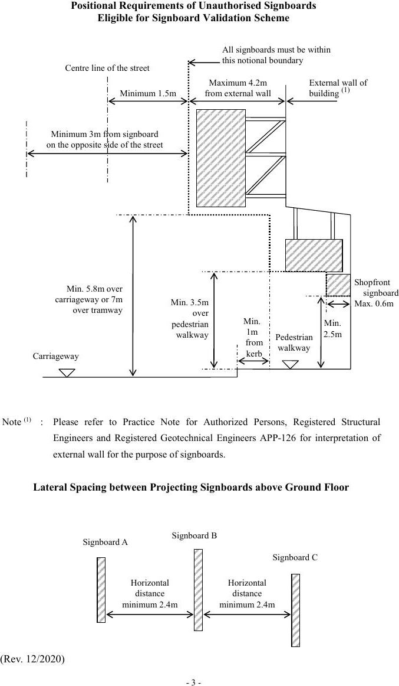

---
tags:
  - PNAP
  - APP series
  - Signboard 招牌
  - Validation 檢核
  - Minor works 小型工程
  - Balcony & utility platform 露台及工作平台
  - Structural 結構
  - Statutory period 法定期限
summary: "Signboard Validation Scheme for pre-2013 unauthorised signboards: eligible sizes by class, positional limits, SC forms, 5-year cycle and number display."
keywords: APP-155, signboard, 招牌, validation scheme, 檢核計劃, unauthorised signboard, 違例招牌, SC01, SC02, SC03, minor works, 5-year
---

# APP-155 Validation Scheme for Unauthorised Signboards <small>違例招牌檢核計劃</small>

!!! info "Document info 文件資料"
    | | |
    |---|---|
    | **Type 類別** | PNAP (APP series) |
    | **Issued by 發出機構** | Buildings Department 屋宇署 |
    | **Version summarised 本摘要版本** | December 2020 |
    | **Official language 官方語言** | English and Chinese 中英文版 |
    | **Source 原文** | [English (PDF)](https://www.bd.gov.hk/doc/en/resources/codes-and-references/practice-notes-and-circular-letters/pnap/APP/APP155.pdf) · [中文 (PDF)](https://www.bd.gov.hk/doc/tc/resources/codes-and-references/practice-notes-and-circular-letters/pnap/APP/APP155.pdf) |
    | **Legal basis 法律依據** | [B(MW)R](../regulations/bmwr-123n.md) |
    | **Last checked 最後核對** | 2026-11-21 against the current BD version |

## At a glance 重點摘要 {#at-a-glance}

=== "English"

    - The **Signboard Validation Scheme** (from **2 Sep 2013**) lets unauthorised signboards **erected before that date** that fit **minor works** specifications be validated: inspection, strengthening if needed, and certification by a **PBP and / or PRC** (paras. 1–2).
    - Eligible types: projecting, wall (including shopfront), roof, on-grade, spread-footing, and under balcony or canopy soffit signboards (App. A) (para. 2).
    - Validation lasts **5 years**; then re-validate or remove (para. 3).
    - Class I: **AP (+ RSE** unless specified construction), Form **SC01**; Class II: PBP or PRC, **SC02**; Class III: PBP or PRC, **SC03**; with record photos (para. 4). Ineligible or unvalidated signboards face enforcement.

=== "中文"

    - **招牌檢核計劃**（**2013 年 9 月 2 日**起）容許在**該日前豎設**、符合**小型工程**規格的違例招牌獲檢核：由**訂明建築專業人士及／或訂明註冊承建商**檢查、按需要加固並核證（第 1–2 段）。
    - 合資格類別：伸出式、牆身（包括舖面）、天台、地面、擴展式基礎及掛於露台或簷篷底的招牌（附錄 A）（第 2 段）。
    - 檢核有效期 **5 年**；期滿須再檢核或拆除（第 3 段）。
    - 第 I 級：**認可人士（如非指明構築物另加註冊結構工程師）**，表格 **SC01**；第 II 級：訂明建築專業人士或訂明註冊承建商，**SC02**；第 III 級：同上，**SC03**；均須附紀錄照片（第 4 段）；不合資格或未檢核的招牌會被執法。

!!! tip "Does it apply? 是否適用"
    **Applies 適用**: **unauthorised signboards erected before 2 Sep 2013** whose type and size fall within the signboard **minor works items**: they can be **validated** (inspected, strengthened if needed, certified) and kept, subject to **re-validation every 5 years**. Others face enforcement. **No fee**, no departmental referral. 2013 年 9 月 2 日前的違例招牌檢核。

## Key clauses 條文一覽 {#key-clauses-table}

| Para. 段 | Rule 規定 |
|---|---|
| 1 | Scheme from **2 Sep 2013** under BO and B(MW)R: inspection, strengthening, certification by a **PBP and / or PRC**; ineligible or unvalidated signboards face enforcement. 計劃概要。 |
| 2 | Eligible types (App. A): **projecting**, **wall / shopfront**, **roof**, **on-grade**, **spread footing**, **under balcony / canopy soffit**; only PBP / PRC registered for that class and item may certify. 合資格類型。 |
| 3 | **5-year cycle**: re-validate or remove every 5 years. 每 5 年。 |
| 4 | Requirements by class (table below). 各級要求。 |
| 5 | Procedures App. B; checklists App. C. 程序及核對表。 |
| 6 | Common parts: **DMC**, Building Management Ordinance, OC / manager consent, **third party insurance**; comply with [APP-126](app-126.md); signboards without required lateral spacing are ineligible. 公用部分。 |
| 7 | Display the **validation number** (App. D). 展示編號。 |
| 8 | **No referral** to other departments; get their approvals separately for strengthening. 不轉介其他部門。 |
| 9 | **Free** of charge. 免費。 |
| 10–11 | Technical guidelines in **TG on MWCS s.7.2**; similar note to contractors. 技術指引。 |

| Class 級別 | Inspect 檢查 | Repair 加固 | Submission 呈交 |
|---|---|---|---|
| **I** | **AP**, plus **RSE** unless a specified construction (B(MW)R s.37(4)) | PRC under AP / RSE | **SC01** with photos, fixing details, plans and **calculations**, safety checklist; strengthening: SC01 ≥ 7 days before, **SC01C** after |
| **II** | PBP (AP, RSE, RI) **or** PRC | PRC | **SC02** with photos, fixing details, plans, checklist; strengthening: SC02, then **SC02C** |
| **III** | PBP (AP, RSE, RI) **or** PRC | PRC | **SC03** with photos and fixing details, checklist; completion of works on SC03 |

<small>PRC = RGBC or RMWC registered for the corresponding Type C minor works. Notify completion **within 14 days**. 完工後 14 天內通知。</small>

## Appendix A: eligible sizes 附錄 A：合資格尺寸 {#appendix-a}

| Type 類型 | Class I | Class II | Class III |
|---|---|---|---|
| **Projecting** (MW 1.20 / 2.18 / 3.16) | Display **> 10 and ≤ 20 m²**; projection ≤ **4.2 m**; thickness ≤ **600 mm** | **≤ 10 m²**; same limits | **≤ 1 m²**; projection ≤ **1 m**; thickness ≤ **300 mm**; any part ≤ **6 m** above ground |
| **Wall / shopfront** (1.22 / 2.19 / 3.17) | With LED **> 5 ≤ 20 m²**; without LED **> 10 ≤ 40 m²**; no stone if > 6 m high | With LED **≤ 5 m²**; without **≤ 10 m²** | **≤ 5 m²**, any part ≤ 6 m above ground |
| **Roof** (1.21) | **≤ 20 m²**; not beyond external wall; thickness ≤ 600 mm; ≤ **6 m** above roof | — | — |
| **On-grade** (1.23 / 2.21) | **≤ 20 m²**, ≤ 600 mm thick, ≤ 6 m high | **≤ 10 m²**, ≤ **2 m** high | — |
| **Spread footing** (2.22) | — | **≤ 1 m²**, ≤ 300 mm thick, ≤ **3 m** high, excavation ≤ **500 mm** | — |
| **Under balcony / canopy** (2.20) | — | **≤ 2 m²**, height ≤ 600 mm, thickness ≤ **100 mm**, not beyond the balcony / canopy, no stone | — |

<small>General: no stone (where stated), **no extra load on cantilevered slabs**, **no alteration of structural elements**. 一般條件。</small>

| Positional requirement 位置要求 | Limit |
|---|---|
| Projection from external wall | **≤ 4.2 m**, and **≥ 1.5 m** short of the street centre line |
| From signboards across the street | **≥ 3 m** |
| Clearance above **pedestrian walkway** | **≥ 3.5 m** |
| Clearance above **carriageway** / **tramway** | **≥ 5.8 m** / **≥ 7 m** |
| From carriageway kerb | **≥ 1 m** |
| Shopfront signboard projection | **≤ 0.6 m**, min. **2.5 m** above walkway |
| Lateral spacing between projecting signboards above G/F | **≥ 2.4 m** |

<figure markdown>
  { width="560" loading=lazy }
  <figcaption>Appendix A – positional requirements and lateral spacing (2.4 m) of signboards eligible for validation. 招牌位置要求及橫向距離。Source: BD, PNAP APP-155.</figcaption>
</figure>

## Appendices B–D 附錄 B 至 D {#appendices-b-d}

- **App. B procedure**: owner appoints an Appointed Person (s.39C(2)); identify the class; inspect; if ineligible, **remove** under MWCS; if safe, certify on **SC01 / SC02 / SC03**; if strengthening, notify **≥ 7 days** before (Class I, II) and completion **within 14 days**; BD acknowledges and **audits** randomly. 程序。
- **App. C checklists**: dimensions (height H2 ≤ 20 m, clearance H1, projection P, thickness t, display area A = P × H2), weight, spacing, class determination, condition of frame and fixings. 核對表。
- **App. D number display**: e.g. **SC13122345**, black on white, block capitals, **≥ 35 mm** Arial, durable, visible from the nearest pavement (or opposite pavement for wall signs, main roof for roof signs); remove old numbers. 展示編號。

!!! example "Illustrative only 只作說明"
    A projecting shop sign 3.0 m × 2.5 m (**7.5 m²**), projecting 3.0 m, 400 mm thick, lowest point 4 m above the pavement, 2.6 m from the next sign: within **Class II** limits (≤ 10 m², projection ≤ 4.2 m, thickness ≤ 600 mm, clearance ≥ 3.5 m, spacing ≥ 2.4 m). A PRC or PBP inspects and submits **SC02**; re-validate after **5 years**. 招牌例子。

## Whole picture 整體關係 {#whole-picture}

| Topic 主題 | Where 文件 |
|---|---|
| Signboard design and control 招牌管制 | [APP-126](app-126.md) |
| Minor works items 小型工程 | [APP-147](app-147.md) · [B(MW)R](../regulations/bmwr-123n.md) · [Minor works guide](../guides/minor-works.md) |
| Forms SC01–SC03 表格 | [APP-60](app-60.md) |
| Unauthorised building works enforcement 違例建築工程 | [BO Part 2 (enforcement)](../regulations/bo-part-2-enforcement.md) |
| Other validation schemes 其他檢核計劃 | [APP-147](app-147.md) (household minor works, amenity features) |

## Diagram 圖解 {#diagram}

<figure markdown>
  { width="760" loading=lazy }
  <figcaption>Signboard validation every 5 years. 招牌每 5 年檢核。 Diagram prepared for this site; check the source text for exact wording.</figcaption>
</figure>

<!-- CL START -->
## Related circular letters 相關通告函件 {#circular-letters}

- 🟢 [Joining the Signboard Validation Scheme when Applying for Food Business Licence](../circulars/2019.md#cl-jsvsafbl2019) <small>1 Sep 2019 · 申請食物業牌照時參加招牌檢核計劃</small>
<!-- CL END -->

## Related 相關文件 {#related}

| Document 文件 | Relationship 關係 |
|---|---|
| [APP-126](app-126.md) | Erection of signboards 豎設招牌 |
| [APP-147](app-147.md) | Minor works 小型工程 |

---
<small>Prepared by: _[name]_ · Checked by: _[name]_ · Quotes from the official English and Chinese versions; refer to the PNAP for the definitive text.</small>
