---
tags:
  - PNAP
  - APP series
  - Approval conditions 批准條件
  - Site supervision 地盤監督
  - Smart site safety 智慧工地安全
  - Plan submission & approval 呈交及審批
  - Foundation 地基
  - Site safety 地盤安全
  - Excavation & ELS 挖掘
  - Demolition 拆卸
  - Structural 結構
  - Geotechnical 岩土
  - Concrete & materials 混凝土及物料
  - Curtain wall & façade 幕牆及外牆
summary: "Conditions under BO s.17: quality and qualified supervision, Smart Site Safety System for projects over $30 million, testing, monitoring and records."
keywords: APP-162, s.17, approval conditions, 批准條件, qualified supervision, 合資格監督, Smart Site Safety System, 智慧工地安全系統, 4S, QCS, QCC, $30 million
---

# APP-162 Conditions and Requirements Imposed under the Buildings Ordinance upon Granting Approval and/or Consent <small>根據《建築物條例》給予批准及／或同意時施加的條件及規定</small>

!!! info "Document info 文件資料"
    | | |
    |---|---|
    | **Type 類別** | PNAP (APP series) |
    | **Issued by 發出機構** | Buildings Department 屋宇署 |
    | **Version summarised 本摘要版本** | March 2025 |
    | **Official language 官方語言** | English and Chinese 中英文版 |
    | **Source 原文** | [English (PDF)](https://www.bd.gov.hk/doc/en/resources/codes-and-references/practice-notes-and-circular-letters/pnap/APP/APP162.pdf) · [中文 (PDF)](https://www.bd.gov.hk/doc/tc/resources/codes-and-references/practice-notes-and-circular-letters/pnap/APP/APP162.pdf) |
    | **Legal basis 法律依據** | [BO s.17](../regulations/bo-part-2-building-works.md) |
    | **Last checked 最後核對** | 2026-11-21 against the current BD version |

## At a glance 重點摘要 {#at-a-glance}

=== "English"

    - Under **BO s.17** the BA may impose case-specific conditions on approval or consent: **quality supervision, qualified supervision, QA / QC, material testing, monitoring instrumentation, record documentation**. Comply before consent, during works and at completion (para. 1).
    - **Quality supervision**: AP / RSE / RGE give **periodic**, RC **continuous** supervision per the supervision plan (Site Supervision CoP 2009; APP-158). E.g. **Type 2 coupler** connections need full-time RC TCPs (para. 2).
    - **Qualified supervision** (s.17(1) item 6): from **1 Jul 2025**, projects with building works over **$30 million** must use the **Mobile Plant Alert System** and **Tower Crane Alert System** (Smart Site Safety System) for demolition, site formation, ELS, foundation, pile cap and superstructure works (superstructure since 1 Jul 2024). The AP **declares** the cost under B(A)R 10 with the first consent application, or consent may be refused (paras. 3–5).
    - **Materials** tested per B(C)R 3; **monitor** vibration, tilt, movement and groundwater of adjacent property; keep **records** under B(A)R 10 (paras. 6–8).

=== "中文"

    - 根據**條例第 17 條**，建築事務監督批准或同意時可施加個別條件：**品質監督、合資格監督、品質保證及控制、物料測試、監測儀器、紀錄文件**；須在同意前、施工期間及完工時遵從（第 1 段）。
    - **品質監督**：認可人士／註冊結構工程師／註冊岩土工程師作**定期**監督，註冊承建商作**持續**監督，均按監工計劃書（2009 年工地監督守則；APP-158）；例如**第 2 類機械接駁器**的接駁須由承建商全職適任技術人員監督（第 2 段）。
    - **合資格監督**（第 17(1) 條第 6 項）：由 **2025 年 7 月 1 日**起，建築工程總造價超過 **3,000 萬元**的項目，拆卸、地盤平整、挖掘及側向承托、地基、樁帽及上蓋工程須採用智慧工地安全系統的**流動機械警報系統**及**塔式起重機警報系統**（上蓋工程自 2024 年 7 月 1 日起）；認可人士須在首次申請同意時根據 B(A)R 第 10 條**申報**造價，否則可被拒絕同意（第 3–5 段）。
    - **物料**按 B(C)R 第 3 條測試；**監測**鄰近物業的震動、傾斜、移動及地下水位；按 B(A)R 第 10 條保存**紀錄**（第 6–8 段）。

!!! tip "Does it apply? 是否適用"
    **Applies 適用**: all approvals and consents for **building works and street works** where the BA imposes conditions under **BO s.17** (and documents under **B(A)R 10**). The **Smart Site Safety System** alert conditions (paras. 4–5) apply to projects with estimated building works cost **> $30 million**, first approval or consent **from 1 Jul 2025** (superstructure from 1 Jul 2024). 所有附條件的批准及同意；智慧工地安全系統適用於 3,000 萬元以上項目。

## Key clauses 條文一覽 {#key-clauses-table}

| Para. 段 | Rule 規定 |
|---|---|
| 1 | BO **s.17** lets the BA impose case-specific conditions: quality supervision, qualified supervision, QA / QC, material testing, monitoring instruments, records; to be met before consent, during works and at completion. 第 17 條條件。 |
| 2 | **Quality supervision**: AP / RSE / RGE **periodic**, RC **continuous** supervision per the supervision plan ([Site Supervision Code](../codes/site-supervision-2009.md), TM 2009; [APP-158](app-158.md)). Fn. 1: continuous supervision suits the task, e.g. **full-time TCP** for **Type 2 coupler** splicing; hold points for rebar fixing. 品質監督。 |
| 3 | **Qualified supervision** for complex stages under **s.17(1) item 6**. 合資格監督。 |
| 4 | From **1 Jul 2025**, projects over **$30 million**: **Mobile Plant Alert System** and **Tower Crane Alert System** (4S) conditions under item 6(e) on first approval / major revision and first consent, for demolition, site formation, ELS, foundation, pile cap and superstructure works using mobile plant or tower cranes; also structural A&A over the threshold. 流動機械及塔式起重機警報系統。 |
| 5 | AP **declares** whether the cost exceeds **$30 million** (B(A)R 10) with the **first consent** application; no declaration may mean refusal (**s.16(3)(b)**). 須作成本聲明。 |
| 6 | **B(C)R 3**: suitable materials, tested by recognised tests; QA / QC in production and construction (fn. 3: follow manufacturer's instructions; traceability if used before testing). 物料及測試。 |
| 7 | **Monitor** vibration, tilting and movement of neighbours and groundwater. 監測。 |
| 8 | **Records** and reports under B(A)R 10. 記錄。 |
| 9 | Appendix A summarises common conditions; keep all approval / consent letters **on site** and brief the team. 條件撮要；信件須存放地盤。 |
| 10 | A similar note is issued to registered contractors. 承建商另有作業備考。 |

## Appendix A: common conditions 附錄 A：常見條件 {#appendix-a}

| Under s.17(1) item 6 (conditions) | Under B(A)R 10 (documents) |
|---|---|
| (a) Qualified supervision by experienced persons: RSE's **QCS** (≥ **T3**) inspecting **at least weekly**; RGBC / RSC's **QCC** (≥ **T1**, **T3** for Type 2 couplers) **full time**; **inspection log book** on site | (a) **Quality Supervision Plan** (e.g. heat soak of tempered glass, Type 2 couplers) |
| (b) **4S** mobile plant and tower crane alert systems | (b) Manufacturer's **QA scheme** |
| (c) Sampling and testing of materials and workmanship | (c) Pre-construction condition survey, monitoring records |
| (d) Instrumentation to check design assumptions and effects | (d) Material certificates; (e) test reports |
| (e) Performance review | (f) Audit reports by RSE and AS; (g) RSE compliance statement; (h) record plans; (i) **$30 million declaration** |

<small>Material- and method-specific common conditions are on BD's website ("Codes and references"). 個別物料條件見屋宇署網站。</small>

## Whole picture 整體關係 {#whole-picture}

| Topic 主題 | Where 文件 |
|---|---|
| Supervision plans and TCP grades 監工計劃書 | [Site Supervision Code](../codes/site-supervision-2009.md) · [APP-158](app-158.md) |
| Qualified supervision for structural and geotechnical works 合資格監督 | [APP-48](app-48.md) · [APP-28](app-28.md) |
| Consent and refusal 動工同意 | [BO Part 2](../regulations/bo-part-2-building-works.md) (s.16, s.17) · [B(A)R](../regulations/bar-123a.md) (reg. 10) · [ADM-19](adm-19.md) |
| Materials and testing 物料 | [B(C)R](../regulations/bcr-123q.md) · [APP-118](app-118.md) · [Concrete Code](../codes/concrete-2013.md) |
| Curtain wall glass 幕牆玻璃 | [APP-37](app-37.md) |
| Monitoring near railways / tunnels 監測 | [APP-24](app-24.md) · [APP-62](app-62.md) |

## Workflow / timeline 流程及時間表 {#workflow-timeline}

<figure markdown>
  { width="612" loading=lazy }
  <figcaption>Smart site safety conditions under s.17. 智慧工地安全條件。 Summary diagram prepared for this site; check the source text for exact wording.</figcaption>
</figure>

<!-- CL START -->
## Related circular letters 相關通告函件 {#circular-letters}

- 🔵 [Extension of Adopting Smart Site Safety System for Qualified Supervision of All Types of Building Works Involving Mobile Plants and Tower Cranes](../circulars/2025.md#cl-eassssqsatbwimptc2025) <small>31 Mar 2025 · 擴大「安全智慧工地」系統的採用範圍為涉及流動機械及塔式起重機的所有類型建築工程提供合格監督</small>
- 🟡 [Qualified Supervision of Building Works Involving Mobile Plants and Tower Cranes by Adopting Smart Site Safety System](../circulars/2024.md#cl-qsbwimptcassss2024) <small>28 Mar 2024 · 採用「安全智慧工地」系統為涉及流動機械及塔式起重機的建築工程提供合格監督</small>
- 🟡 [Smart Site Safety System](../circulars/2023.md#cl-ssss2023) <small>30 Mar 2023 · 「安全智慧工地」系統</small>
<!-- CL END -->

## Related 相關文件 {#related}

| Document 文件 | Relationship 關係 |
|---|---|
| [APP-97](app-97.md) | Consent procedures 動工同意程序 |
| [B(A)R](../regulations/bar-123a.md) | Reg. 10 records 紀錄 |

---
<small>Prepared by: _[name]_ · Checked by: _[name]_ · Quotes from the official English and Chinese versions; refer to the PNAP for the definitive text.</small>
