---
tags:
  - PNAP
  - APP series
  - Elderly-friendly 長者友善
  - Slip resistance 防滑
  - Domestic 住用
  - Plan submission & approval 呈交及審批
  - Foundation 地基
  - Barrier free access 無障礙
  - Lift 升降機
  - Minor works 小型工程
  - Staircase 樓梯
  - A&A works 改動及加建工程
summary: "From 1 Aug 2026, residential and commercial buildings need 13 elderly-friendly features in common areas and 3 inside flats (B(P)R 73), unless the works were consented before that date."
keywords: elderly-friendly, 長者友善, ageing in place, 居家安老, B(P)R 73, Fourth Schedule, 附表四, slip resistance, 防滑, P3, R10, dual-level handrail, 雙層扶手, mirror lift, 850 mm door
---

# APP-175 Elderly-friendly Building Design <small>長者友善樓宇設計－《建築物(規劃)規例》第73條及附表4</small>

!!! info "Document info 文件資料"
    | | |
    |---|---|
    | **Type 類別** | PNAP (APP series) |
    | **Issued by 發出機構** | Buildings Department 屋宇署 |
    | **First issue 首次發出** | **August 2026** (new) 新發出 |
    | **Version summarised 本摘要版本** | August 2026 | 官方語言** | English only for now (Chinese to follow) 暫只有英文版 |
    | **Source 原文** | [APP-175 (PDF)](https://www.bd.gov.hk/doc/en/resources/codes-and-references/practice-notes-and-circular-letters/pnap/APP/APP175.pdf) |
    | **Legal basis 法律依據** | [B(P)R 73 and Fourth Schedule](../regulations/bpr-71-73.md), in force **1 August 2026** |
    | **Last checked 最後核對** | 2026-11-21 against the August 2026 issue |

## At a glance 重點摘要 {#at-a-glance}

=== "English"

    - **In force 1 August 2026** (Building (Planning) (Amendment) Regulation 2026). Reg. 73 and the Fourth Schedule require residential and commercial buildings, and buildings with residential or commercial units, to be designed for **elderly persons** (para. 1).
    - **Scope excludes** single-household buildings ≤ **13 m**, Transitional Housing, Light Public Housing, and Part VII temporary buildings / contractor's sheds (fn. 1).
    - **Transitional (BO s.39(2))**: not applicable to works being carried out, or with **consent given**, by **1 August 2026** (generally the **foundation** works). For A&A works and minor works, the same cut-off (minor works by the "Date of Commencement" on the form) (paras. 2–3).
    - **s.42 modification** possible for existing buildings with special circumstances (para. 4).
    - **16 requirements** (para. 5): **13** for common areas (automatic main entrance door, **120 lux**, wider routes, slip-resistant floors indoors and out, wider doors, lower thresholds, larger accessible lift, **mirror-like finish**, gentler main stairs and dual-level handrails indoors and out) and **3** inside units (wider main entrance door, lower threshold, slip-resistant bathroom, kitchen and toilet floors).
    - Read **reg. 72 and reg. 73 together**: Third Schedule rules (e.g. handrail size and load) still apply (para. 6).
    - **Slip resistance** (App. A): indoor routes and wet areas **P3 / R10**; outdoor routes **P4 / R11** (AS 4586:2013 or DIN 51130). **Mirror** (App. B): clear width ≥ **850 mm**, bottom ≤ **300 mm**, top ≥ **1 800 mm**; alternatives (visual display / audio) via s.42.

=== "中文"

    - **2026 年 8 月 1 日生效**（《2026 年建築物(規劃)(修訂)規例》）：第 73 條及附表 4 規定住宅、商業建築物及內有住宅或商業單位的建築物須**利便長者**（第 1 段）。
    - **不適用於**高度 ≤ **13 米**的單一住户建築物、過渡性房屋、簡約公屋，以及第 VII 部臨時建築物／承建商屋棚（註 1）。
    - **過渡安排（《建築物條例》第 39(2) 條）**：在 **2026 年 8 月 1 日**已進行或**已獲同意展開**的工程（一般指**地基**工程）不受規限；改動加建工程及小型工程（按表格上的「展開工程日期」）亦以同日為準（第 2–3 段）。
    - 現有建築物如有特殊情況，可根據**第 42 條申請變通**（第 4 段）。
    - **16 項規定**（第 5 段）：公用地方 **13 項**（主要入口自動門、**120 勒克斯**、較闊路徑、室內外防滑地面、較闊門、較低門檻、較大暢通易達升降機、**鏡面**、室內外較平緩的主要樓梯及雙層扶手）；單位內 **3 項**（較闊主要入口門、較低門檻、浴室、廚房及洗手間防滑地面）。
    - **第 72 及 73 條須一併閱讀**：附表 3 的規定（例如扶手尺寸及荷載）仍然適用（第 6 段）。
    - **防滑**（附錄 A）：室內路徑及濕區 **P3／R10**；室外路徑 **P4／R11**（AS 4586:2013 或 DIN 51130）。**鏡面**（附錄 B）：淨闊 ≥ **850 毫米**、底邊 ≤ **300 毫米**、頂邊 ≥ **1 800 毫米**；其他方法（視像顯示／聲音）須按第 42 條申請。

!!! tip "Applies / does not apply 適用／不適用"
    **Applies**: **residential and commercial buildings**, and buildings with **residential or commercial units**, for new works and A&A works not under way or consented by **1 Aug 2026** (footnote 1, paras. 2–3). 適用於住宅及商業建築物，以及設有住宅或商業單位的建築物。
    **Excluded**: **single-household buildings ≤ 13 m** high, **Transitional Housing**, **Light Public Housing**, and **temporary buildings / contractor's sheds** (B(P)R Part VII). 13 米或以下的單一住戶建築物、過渡性房屋、簡約公屋、臨時建築物及工棚不包括在內。
    **Minor works**: excluded if the "Date of Commencement of the Works" on the form is on or before 1 Aug 2026 (footnote 2). 小型工程以表格上的動工日期為準。

## Key clauses 主要條文 {#key-clauses}

| Para. 段 | Rule 規定 |
|---|---|
| 1 | From **1 Aug 2026** (B(P)(Amendment) Regulation 2026), **B(P)R 73 and the Fourth Schedule** require buildings and residential units in scope to be designed so **elderly persons** can access and use them. 第 73 條生效。 |
| 2 | **New buildings**: not for works under way or **consented** at 1 Aug 2026 (BO s.39(2)); generally the **foundation works**. 新建築物過渡安排。 |
| 3 | **A&A works** to existing buildings: not for works under way, consented, or **minor works commenced** at 1 Aug 2026. 改動加建過渡安排。 |
| 4 | **Existing buildings** with undue difficulty: **exemption or modification** under **BO s.42**, case by case. 現有建築物可申請豁免或變通。 |
| 5(a) | **13 requirements** for areas accessible to residents, guests or the public (not inside units): automatic door; route lighting; route width; indoor slip-resistant floors; wider doors; lower thresholds; larger accessible lift; mirror-like lift finish; indoor stair risers/treads; indoor dual-level handrails; outdoor slip-resistant floors; outdoor stair risers/treads; outdoor dual-level handrails. 公用地方 13 項。 |
| 5(b) | **3 requirements** inside residential units: wider main door; lower main door threshold; slip-resistant bathroom, kitchen and toilet. 單位內 3 項。 |
| 6 | Read **regs 72 and 73 together**: Third Schedule BFA requirements still apply, e.g. handrail size, shape and **loading** in Division 8 with the Fourth Schedule dual-level handrails. 兩條規例並讀。 |
| 7 | Accepted performance standards: **slip resistance** (Appendix A) and **mirror-like finishes** (Appendix B). 性能標準。 |
| App. A | Test to **AS 4586:2013** or **DIN 51130:2014-02**: indoor routes and unit wet areas **P3 / R10**; outdoor routes **P4 / R11**; the two tests are **not interchangeable**; higher ratings allowed if tripping risk is considered; keep floors drained; choose durable, cleanable finishes. 防滑測試。 |
| App. B | Mirror-like finish **facing the lift entrance** (Sch. 4 s.9(3)): non-breakable mirror, mirror-finished stainless steel or reflective film; clear width **≥ 850 mm**, bottom edge **≤ 300 mm**, top edge **≥ 1,800 mm** above the car floor; small non-reflective decoration acceptable; alternatives (visual display, audio) need a **s.42** application. 鏡面要求。 |

## Key table: the 16 requirements (para. 5) 16 項規定 {#key-table-the-16-requirements-para-5-16}

| # | Common areas (13) 公用地方 | Fourth Schedule 附表 4 |
|---|---|---|
| (i) | Automatic door at one main entrance (residential) 主要入口自動門 | s.10 |
| (ii) | Indoor route lighting **≥ 120 lux** 照明 | s.3(6) |
| (iii) | Indoor route clear width **≥ 1 200 mm** 較闊路徑 | s.3(3) |
| (iv), (xi) | **Slip-resistant** floors, indoor and outdoor routes 防滑地面 | s.3(2) |
| (v) | Doors **≥ 850 mm** clear 較闊門 | s.6 |
| (vi) | Thresholds **≤ 15 mm**, bevelled 較低門檻 | s.7 |
| (vii) | Accessible lift car **≥ 1 200 × 1 400 mm** 較大升降機 | s.9(2) |
| (viii) | **Mirror-like** finish facing the entrance 鏡面 | s.9(3) |
| (ix), (xii) | Main circulation stairs: tread **≥ 300 mm**, riser **≤ 150 mm** (indoor and outdoor) 樓梯 | s.4 |
| (x), (xiii) | **Dual-level handrails** (850–950 / 700–800 mm) 雙層扶手 | s.5 |
| | **Residential units (3)** 住宅單位 | |
| (i) | Main entrance door **≥ 850 mm** 主要入口門 | s.11 |
| (ii) | Main entrance threshold **≤ 15 mm** 門檻 | s.12 |
| (iii) | Slip-resistant bathroom, kitchen, toilet 濕區防滑 | s.13 |

## Key table: slip resistance (Appendix A) 防滑等級 {#key-table-slip-resistance-appendix-a}

| Area 範圍 | Wet pendulum 濕擺錘 | Oil-wet ramp 油濕斜坡 |
|---|---|---|
| Indoor regulated route 室內受規管路徑 | **P3** | **R10** |
| Bathroom, kitchen, toilet of a residential unit 住宅單位浴室、廚房、洗手間 | **P3** | **R10** |
| Outdoor regulated route 室外受規管路徑 | **P4** | **R11** |

<small>Tests to AS 4586:2013 or DIN 51130:2014-02. Pendulum (P1–P5) and ramp (R9–R13) results are **not interchangeable**. Consider durability and cleaning so floors stay slip-resistant. 兩種測試結果不可互換。</small>

## How reg. 73 raises the reg. 72 standards 第 73 條如何提高第 72 條標準 {#comparison}

| Item 項目 | Reg. 72 / BFA 2008 (persons with a disability) 無障礙 | Reg. 73 (elderly-friendly) 長者友善 |
|---|---|---|
| Indoor route clear width 室內路徑淨闊 | **1,050 mm** | **1,200 mm** |
| Door clear width 門淨闊 | **800 mm** | **850 mm** (also flat main doors) |
| Threshold 門檻 | see BFA Division 4–9 | **≤ 15 mm**, bevelled ≤ 1:2 (also flat main doors) |
| Accessible lift car 無障礙升降機 | **1,200 deep × 1,100 wide mm** | **1,400 deep × 1,200 wide mm** + mirror-like finish |
| Route lighting 路徑照明 | — | **≥ 120 lux** at floor level |
| Main stairs 主要樓梯 | Third Schedule stair rules | Tread **≥ 300 mm**, riser **≤ 150 mm** |
| Handrails 扶手 | Division 8 size, shape, load | **Dual-level**: 850–950 mm and 700–800 mm, ≥ 150 mm apart |
| Floors 地面 | Firm, slip-resistant | Tested: **P3 / R10** indoor and wet areas, **P4 / R11** outdoor |
| Inside flats 單位內 | Not covered | Main door, threshold, **wet-area floors** |

<small>Reg. 72 figures from the BFA Manual 2008; see [BFA Divisions](../codes/bfa-div-4-9.md) and the [2026 Universal Accessibility Manual](../codes/dmua-2026.md), which now uses the reg. 73 figures throughout. 第 72 條數字取自 2008 年手冊；2026 年手冊已全面採用第 73 條數字。</small>

<figure markdown>
  { width="760" loading=lazy }
  <figcaption>The continuous route from the lot boundary to the flat, with reg. 72 and reg. 73 figures. 由地段界線至單位的連續路徑。</figcaption>
</figure>

## Explanation 淺白解釋 {#explanation}

=== "English"

    Reg. 73 is about **ageing in place**: the same building should still work when residents walk slowly, use a stick or a wheelchair, or see less well. Most items are small changes to things you already design: a slightly **wider** door and corridor, a **bigger** lift, **gentler** stairs with a second, lower handrail, **brighter** corridors and floors that are **not slippery when wet**. The three items inside flats (door, threshold, wet-area floors) mean the **interior design** of every new flat is now checked.

    The test is **when the works were consented**, not when the plans were approved: a scheme approved before 1 Aug 2026 but whose foundation consent comes later must comply.

=== "中文"

    第 73 條旨在**居家安老**：住戶行動減慢、使用手杖或輪椅、視力減弱時，建築物仍然合用。大部分要求只是在原有設計上稍作改動：門及走廊**稍闊**、升降機**較大**、樓梯**較平緩**並加設較低的第二層扶手、走廊**較光**、地面**濕滑時亦防滑**。單位內的三項要求（大門、門檻、濕區地面）表示每個新單位的**室內設計**現時亦須審核。

    準則是**工程何時獲同意動工**，而非圖則何時獲批：圖則於 2026 年 8 月 1 日前獲批但地基同意在其後的項目，仍須符合。

## Worked example 例子 {#worked-example}

A residential tower: GBP approved in May 2026, **foundation consent July 2026**, superstructure consent October 2026. 住宅大廈：2026 年 5 月批圖，**2026 年 7 月地基同意**，10 月上蓋同意：

| Question 問題 | Answer 答案 |
|---|---|
| Does reg. 73 apply? 是否適用？ | **No**: consent to the (foundation) works was given **before 1 Aug 2026** (para. 2). 否：地基工程同意在 2026 年 8 月 1 日前。 |
| A later A&A scheme in 2028 to convert the clubhouse into flats? 2028 年改動加建 | **Yes**, for the altered areas: works consented after 1 Aug 2026 (para. 3). 是，適用於改動部分。 |
| A Class III minor works lobby re-flooring with commencement date 3 Aug 2026? 小型工程 | **Yes**: commencement after 1 Aug 2026 (footnote 2) → floors **P3 / R10**. 是：須達 P3／R10。 |
| Existing lift too small and the shaft cannot be enlarged? 現有升降機槽太細 | Apply for **exemption or modification under s.42** with justification (para. 4). 按第 42 條申請。 |

## Key clause 主要條文 {#key-clause}

!!! quote "Para. 2 — Transitional 過渡安排"
    By virtue of section 39(2) of the Buildings Ordinance (BO), the mandatory requirements for elderly-friendly building design do not apply to building works which are being carried out or consent to the commencement of which has been given as at 1 August 2026. In general, building works may refer to foundation works of the proposed development.

    **中譯（非官方）：** 根據《建築物條例》第39(2)條，長者友善樓宇設計的強制規定不適用於在2026年8月1日正在進行或已獲同意展開的建築工程。一般而言，建築工程可指擬議發展項目的地基工程。

## Practical notes 實務提示 {#practical-notes}

=== "English"

    !!! tip "Common pitfalls"
        - Assuming a project with **GBP approved** before 1 Aug 2026 is exempt. The test is **works in progress or consent given** (usually foundations).
        - Specifying polished stone in lobbies or flat bathrooms without **P3 / R10** test evidence.
        - Mirror panel too narrow or starting above **300 mm** (it helps wheelchair users reverse out).
        - Dual-level handrails sized without checking **Third Schedule** dimensions and 1.3 kN load.

=== "中文"

    !!! tip "常見錯誤"
        - 以為在 2026 年 8 月 1 日前**已獲批圖則**的項目可獲豁免：準則是**工程已進行或已獲同意**（一般指地基）。
        - 大堂或單位浴室使用拋光石材而沒有 **P3／R10** 測試證明。
        - 鏡面太窄或底邊高於 **300 毫米**（鏡面幫助輪椅使用者倒後離開）。
        - 雙層扶手沒有核對**附表 3** 的尺寸及 1.3 千牛荷載。

<!-- APSEC START -->
## APSEC clarifications 認可人士及註冊結構工程師委員會討論 {#apsec-clarifications}

BD's responses at the APSEC Discussion Forum that clarify this document, **newest first**. Where the same question came up more than once, only the **latest position** is listed. See [all APSEC items](../apsec/index.md). 屋宇署在討論會上就本文件作出的澄清，新者在前；同一問題只列最新立場。

- **[Building (Planning) (Amendment) Regulation 2026](../apsec/2026.md#i2026081414)** <small>ADF 3/2026, 14 Aug 2026</small> Members noted and supported. [Table – see the original summary 表格見原文]

<!-- APSEC END -->

## Whole picture 整體關係 {#whole-picture}

| Topic 主題 | Where 文件 |
|---|---|
| Statutory text 法例 | [B(P)R 73 and Fourth Schedule](../regulations/bpr-71-73.md#clause-by-clause) |
| Barrier free (reg. 72) 無障礙 | [APP-41](app-41.md) · [Accessibility guide](../guides/barrier-free-access.md) |
| Design manuals 設計手冊 | [DMUA 2026](../codes/dmua-2026.md) · [APP-176](app-176.md) · [BFA Ch. 5–6](../codes/bfa-ch-5-6.md) |
| Lifts 升降機 | [APP-89](app-89.md) · [Lifts & Escalators Code](../codes/lifts-escalators-2011.md) |
| Staircases and handrails 樓梯及扶手 | [B(P)R 39](../regulations/bpr-39-49e.md#clause-by-clause) · [FS Code B14](../codes/fsc-part-b-means-of-escape.md#clause-by-clause) |
| Care homes 院舍 | [APP-172](app-172.md) |

<!-- CL START -->
## Related circular letters 相關通告函件 {#circular-letters}

- 🔵 [Amendments to the "Technical Guidelines on Minor Works Control System (2024 Edition)"](../circulars/2026.md#cl-atgmwcse2026) <small>13 Aug 2026 · 《小型工程監管制度之技術指引》（2024年修訂版）修訂事宜</small>
<!-- CL END -->

## Related 相關文件 {#related}

| Document 文件 | Relationship 關係 |
|---|---|
| [B(P)R 71–73](../regulations/bpr-71-73.md) | Reg. 73 and Fourth Schedule text 法例條文 |
| [APP-176](app-176.md) | Design Manual on Universal Accessibility 2026 暢道通行設計手冊 |
| [BFA Ch. 5–6](../codes/bfa-ch-5-6.md) | Earlier elderly-friendly guidelines 長者友善指引 |

---
<small>Prepared by: _[name]_ · Checked by: _[name]_ · English only for now; Chinese text is an unofficial translation (中譯（非官方）).</small>
