---
tags:
  - PNAP
  - APP series
  - Barrier free access 無障礙
  - Universal accessibility 暢道通行
  - Elderly-friendly 長者友善
---

# APP-176 Design Manual on Universal Accessibility <small>《設計手冊：暢道通行2026》</small>

!!! info "Document info 文件資料"
    | | |
    |---|---|
    | **Type 類別** | PNAP (APP series) |
    | **Issued by 發出機構** | Buildings Department 屋宇署 |
    | **First issue 首次發出** | **September 2026** (new) 新發出 |
    | **Official language 官方語言** | English only for now 暫只有英文版 |
    | **Source 原文** | [APP-176 (PDF)](https://www.bd.gov.hk/doc/en/resources/codes-and-references/practice-notes-and-circular-letters/pnap/APP/APP176.pdf) · [DMUA 2026 (PDF)](https://www.bd.gov.hk/doc/en/resources/codes-and-references/code-and-design-manuals/DMUA2026e.pdf) |
    | **Last checked 最後核對** | 2026-11-21 against the September 2026 issue |

!!! warning "BFA 2008 replaced 已取代《設計手冊：暢通無阻的通道 2008》"
    The **Design Manual on Universal Accessibility (DMUA) 2026** revamps and replaces the **Design Manual: Barrier Free Access 2008** (2025 Ed.). The BFA pages on this site remain a reference for the statutory Third Schedule; a DMUA write-up is planned.
    **DMUA 2026** 已全面修訂並取代 BFA 2008；本網站的 BFA 頁面仍可作為附表 3 法定要求的參考，DMUA 條目將陸續加入。

## At a glance 重點摘要

=== "English"

    - BD reviewed the BFA Manual (2024 consultancy, after a Labour and Welfare Bureau study) and produced the **DMUA**, adding **universal design** concepts for a more inclusive environment (paras. 1–2).
    - **Statutory** requirements remain in **B(P)R 72 and 73** and the **Third and Fourth Schedules** (para. 3).
    - Everything else in the DMUA is **advisory for now**. DMUA "obligatory" provisions not yet in the B(P)R will be proposed for **future legislation**; meanwhile APs and RSEs are encouraged to adopt them and give feedback (para. 4).
    - Show BFA and elderly-friendly provisions on plans (B(A)R 8(1)); **s.42** exemption / modification possible in special circumstances, e.g. site constraints, no control of common parts, unjustifiable hardship (paras. 5–6).
    - For **A&A in existing buildings** with constraints, **DMUA para. 11.6** gives practical alternatives (para. 7).
    - Applications are considered with advice from the **Advisory Committee on Barrier Free Access** (reg. 72) and the **Building Committee** (reg. 73); a **Technical Committee on DMUA** collects feedback (paras. 8–9).

=== "中文"

    - 屋宇署檢討 BFA 手冊（2024 年顧問研究，承接勞工及福利局的研究），制定 **DMUA**，加入**通用設計**概念，締造更共融的環境（第 1–2 段）。
    - **法定**要求仍載於 **B(P)R 第 72 及 73 條**及**附表 3、4**（第 3 段）。
    - DMUA 其餘內容**暫屬建議**；未納入規例的「強制性」條文將建議**日後立法**，期間鼓勵認可人士及註冊結構工程師採用並提供意見（第 4 段）。
    - 圖則須顯示無障礙及長者友善設施（B(A)R 第 8(1) 條）；如有特殊情況（例如地盤限制、無法控制公用部分、不合理困難）可根據**第 42 條**申請豁免／變通（第 5–6 段）。
    - 受限制的**現有建築物改動加建**可參考 **DMUA 第 11.6 段**的實際替代方案（第 7 段）。
    - 申請會參考**暢通無阻通道諮詢委員會**（第 72 條）及**建築小組委員會**（第 73 條）的意見；**DMUA 技術委員會**收集業界意見（第 8–9 段）。

## Diagram 圖解

<figure markdown>
  { width="760" loading=lazy }
  <figcaption>From the BFA Design Manual 2008 to the Universal Accessibility manual 2026. 由暢通無阻設計手冊到暢道通行設計手冊。 Diagram prepared for this site; check the source text for exact wording.</figcaption>
</figure>

## Key table: status of requirements 規定的地位

| Source 來源 | Status 地位 |
|---|---|
| B(P)R 72 + Third Schedule (disability) 殘疾人士 | **Mandatory** 強制 |
| B(P)R 73 + Fourth Schedule (elderly, from 1 Aug 2026) 長者 | **Mandatory** 強制 |
| DMUA "obligatory" items not yet in the B(P)R 未納入規例的強制項目 | **Advisory now**, to be legislated 暫屬建議，將立法 |
| DMUA best practice / universal design 良好作業／通用設計 | Advisory 建議 |

## Related 相關文件

| Document 文件 | Relationship 關係 |
|---|---|
| [B(P)R 71–73](../regulations/bpr-71-73.md) | Statutory requirements 法定要求 |
| [APP-175](app-175.md) | Elderly-friendly design 長者友善設計 |
| [BFA 2008](../codes/bfa-2008.md) | Superseded manual (Third Schedule reference) 已被取代的手冊 |

---
<small>Prepared by: _[name]_ · Checked by: _[name]_ · English only for now; Chinese text is an unofficial translation (中譯（非官方）).</small>
