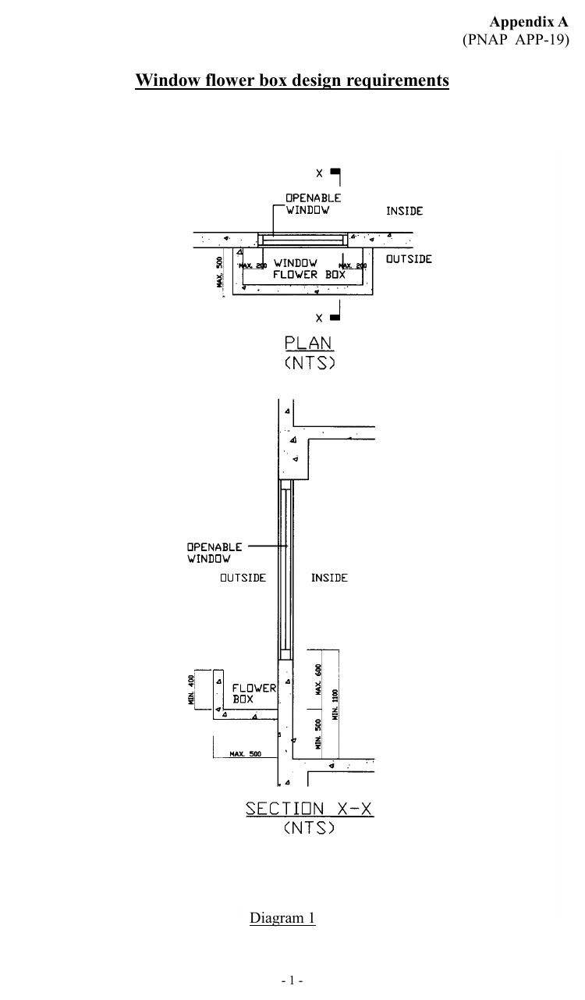
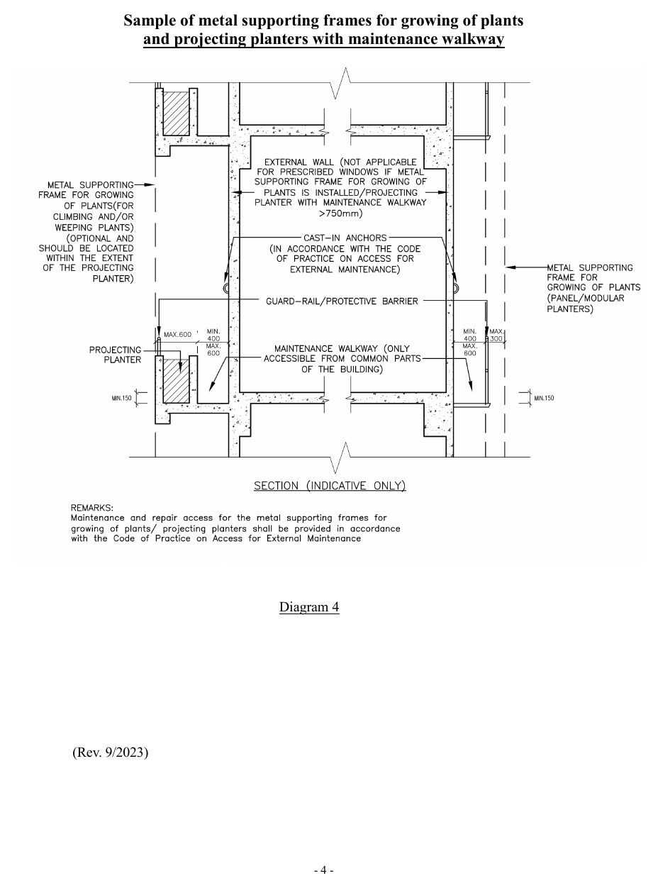
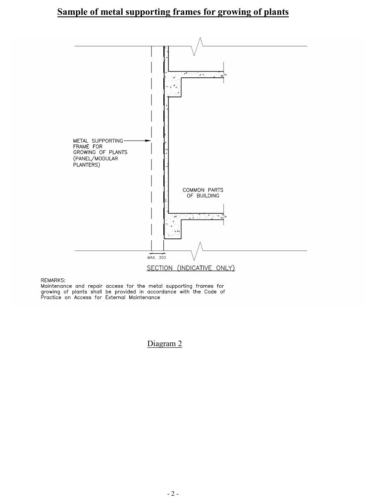
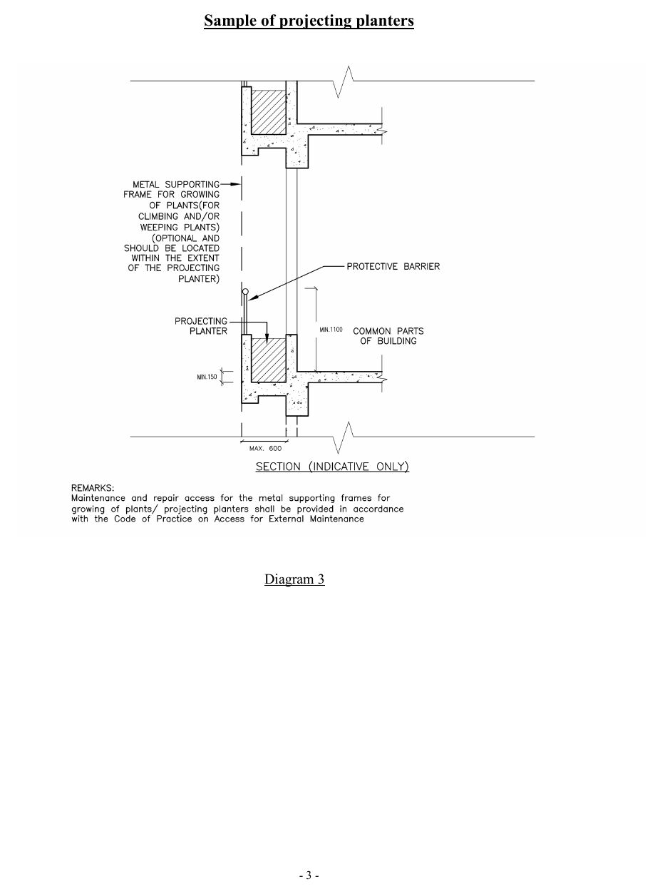

---
tags:
  - PNAP
  - APP series
  - Site coverage 上蓋面積
  - Plot ratio 地積比率
  - Projections 伸出物
  - GFA 總樓面面積
  - Maintenance access 維修通道
  - Structural 結構
  - Protective barrier 防護欄障
  - Green & amenity features 環保及適意設施
  - Drainage 排水
  - Occupation permit 佔用許可證
summary: "Projections and site coverage / plot ratio: which minor projections (A/C boxes, cills, flower boxes, canopies, fins) need not count and their size limits."
keywords: APP-19, projections, 伸出物, site coverage, plot ratio, A/C box 750 mm, canopy, bay window, minor projections
---

# APP-19 Projections in relation to Site Coverage and Plot Ratio <small>伸出物的上蓋面積和地積比率－《建築物（規劃）規例》第20及21條</small>

!!! info "Document info 文件資料"
    | | |
    |---|---|
    | **Type 類別** | PNAP (APP series), previously PNAP 68 舊編號 PNAP 68 |
    | **Issued by 發出機構** | Buildings Department 屋宇署 |
    | **First issue 首次發出** | March 1980 |
    | **Version summarised 本摘要版本** | June 2025 (para. 3(c) and (k) amended) |
    | **Official language 官方語言** | English only (Chinese version not available) 只有英文版 |
    | **Source 原文** | [APP-19 (PDF)](https://www.bd.gov.hk/doc/en/resources/codes-and-references/practice-notes-and-circular-letters/pnap/APP/APP019.pdf) |
    | **Last checked 最後核對** | 2026-11-20 against the June 2025 version |

## At a glance 重點摘要 {#at-a-glance}

=== "English"

    - **Site coverage** counts **all** parts of a building, including projections (B(P)R 2). **Plot ratio** counts floor area within the "external wall".
    - **Minor projections** with no significant impact on bulk **need not count** for SC or PR (para. 3): A/C boxes ≤ **750 mm**, window cills ≤ **100 mm**, flower boxes ≤ **500 mm**, sunshades / reflectors ≤ **1.5 m**, entrance canopies ≤ **3.5 m**, plant frames ≤ **300 mm**, etc.
    - **Projecting (bay) windows** are not GFA/SC if they meet **all 7 criteria**: living/dining/bedroom only, one per room, ≤ **50%** of the wall, ≤ **100 mm** projection, base ≥ **500 mm** above floor (para. 5).
    - **Covered areas under large overhangs** are not GFA if the clear height is > **7.5 m**, width : height ≥ **1:8**, and the area cannot be accessed (para. 6).
    - **Projecting planters** ≤ **600 mm** at common parts may be exempted **without** APP-151 pre-requisites or cap. **Maintenance walkways** (400–600 mm wide) **are** subject to them (para. 9).

=== "中文"

    - **上蓋面積**計算建築物**所有**部分，包括伸出物（B(P)R 第 2 條）；**地積比率**計算「外牆」以內的樓面面積。
    - 對建築物體積影響輕微的**小型伸出物毋須計入**上蓋面積及地積比率（第 3 段）：冷氣機箱 ≤ **750 毫米**、窗檻 ≤ **100 毫米**、窗花槽 ≤ **500 毫米**、遮陽篷／反光板 ≤ **1.5 米**、入口簷篷 ≤ **3.5 米**、植物支架 ≤ **300 毫米**等。
    - **伸出窗（俗稱窗台／凸窗）**如符合**全部 7 項準則**則不計總樓面面積／上蓋面積：只限客廳／飯廳／睡房、每房一個、≤ 外牆 **50%**、伸出 ≤ **100 毫米**、底部離地 ≥ **500 毫米**（第 5 段）。
    - **大型伸出物下的有蓋地方**：淨高 > **7.5 米**、闊高比 ≥ **1:8**，且不能進入，則不計總樓面面積（第 6 段）。
    - 公用部分 ≤ **600 毫米**的**伸出式花槽**可獲豁免，**毋須**符合 APP-151 先決條件及上限；**維修通道**（闊 400–600 毫米）則**須**符合（第 9 段）。

## Key table: minor projections not counted for SC and PR (para. 3) 毋須計入上蓋面積及地積比率的小型伸出物 {#key-table-minor-projections-not-counted-for-sc-and-pr-para-3}

| Item 項目 | Projection 伸出物 | Limit 限制 |
|---|---|---|
| (a) | Pitched roof eaves, flat roof overhangs 斜屋頂簷、平屋頂懸挑 | B(P)R 7(1) limits; not part of an accessible flat roof 符合第 7(1) 條；不屬可進入的平台 |
| (b) | Individual A/C boxes and platforms with built-in condensate disposal 獨立冷氣機箱／平台（設冷凝水排放） | ≤ **750 mm** |
| (c) | A/C platforms complying with the Code of Practice on Access for External Maintenance 符合外部維修通道守則的冷氣機平台 | Appendices B & C of that Code |
| (d) | Individual projections / window hoods; porches 窗簷；門廊 | Porches ≤ **2 m** |
| (e) | Window cills and window surrounds 窗檻及窗框 | ≤ **100 mm** |
| (f) | String courses, fins, architectural mouldings (not structural beams/columns) 腰線、鰭板、建築裝飾線 | B(P)R 7(1) limits |
| (g) | Window flower boxes 窗花槽 | ≤ **500 mm**, Diagram 1 |
| (h) | External drainage pipes and gutters 外牆排水管及簷槽 | B(P)R 7(2) limits |
| (i) | Sunshades for energy conservation 節能遮陽篷 | ≤ **1.5 m**; APP-67 and APP-156 criteria |
| (j) | Reflectors 反光板 | ≤ **1.5 m**; quantitative assessment if > **0.5 m** |
| (k) | Canopies over an entrance 入口簷篷 | ≤ **3.5 m** |
| (l) | Drying racks, frames for light fittings, telecom antennas 晾衣架、燈飾支架、電訊天線 | B(P)R 7(3) limits |
| (m) | Retractable awnings 可收回簷篷 | B(P)R 7(4) and minor works item 2.43 |
| (n) | Metal frames for growing plants (within lot) 植物生長金屬支架 | ≤ **300 mm**, Diagram 2 |

!!! warning "Para. 4 — Anti-abuse 防止濫用"
    Any feature that is exaggerated, excessive in scale, defeats the Buildings Ordinance (e.g. a **structural beam doubling as a flower box**) or is designed in an unusual way **will be counted** for SC and, if appropriate, PR.
    任何誇大、規模過大、規避《建築物條例》（例如**結構樑兼作花槽**）或設計不尋常的設施，**均會計入**上蓋面積，及（如適用）地積比率。

## Key clauses 主要條文 {#key-clauses}

!!! quote "Para. 5 — Projecting windows 伸出窗"
    …projecting windows will not be regarded as GFA and will be accepted as not counting for SC and PR, if they satisfy all the following criteria within the storey from which they project: (a) the projecting window is from living room, dining room or bedroom of domestic accommodation only; (b) only one such projecting window is allowed per room and it should be located on one external wall only; (c) the elevational area of the projecting window does not exceed 50% of the area of the external wall where the projecting window is located; (d) the extent of the projection is not more than 100 mm from the outer face of the main external wall; (e) the base is not less than 500 mm above finished floor level; (f) the window complies fully with regulation 3A of the B(P)R…; and (g) the projecting windows will not form a piecemeal addition to existing buildings.

    **中譯（非官方）：** 伸出窗如在其伸出的樓層內符合以下全部準則，不會被視為總樓面面積，亦不計入上蓋面積及地積比率：(a) 只限住宅的客廳、飯廳或睡房；(b) 每房只可設一個，並只可位於一幅外牆；(c) 伸出窗立面面積不超過所在外牆面積的 50%；(d) 伸出不超過主外牆外表面 100 毫米；(e) 底部離完成樓面不少於 500 毫米；(f) 完全符合 B(P)R 第 3A 條……；及 (g) 不屬現有建築物的零碎加建。

!!! quote "Para. 6 — Covered areas under large projecting features 大型伸出物下的有蓋地方"
    …where there is no objection from the relevant government departments and the clear height of the projecting feature is more than 7.5 m above the covered areas, the covered areas satisfying the following criteria will not be regarded as GFA…: (a) The ratio of horizontal width of the covered area to the clear height of the projecting features above the covered area is not less than 1:8 (b) Access to the covered area is not possible and abuse is unlikely.

    **中譯（非官方）：** ……如有關政府部門不反對，而伸出物在有蓋地方之上的淨高超過 7.5 米，符合以下準則的有蓋地方不會被視為總樓面面積：(a) 有蓋地方水平闊度與其上伸出物淨高之比不少於 1:8；(b) 不能進入該有蓋地方，亦不大可能被濫用。

!!! quote "Para. 8 — A/C boxes over streets 伸出街道的冷氣機箱"
    …the projection of individual air-conditioner boxes / platforms not exceeding 750 mm and window hoods not exceeding 500 mm may be permitted, provided they are at a height of not less than 2.5 m above ground…

    **中譯（非官方）：** ……伸出不超過 750 毫米的獨立冷氣機箱／平台及不超過 500 毫米的窗簷，如離地面不少於 2.5 米，可獲准許……

## Key table: projecting greenery at common parts (para. 9) 公用部分的伸出式綠化 {#key-table-projecting-greenery-at-common-parts-para-9}

| Feature 設施 | Criteria 準則 | APP-151 pre-req & cap 先決條件及上限 |
|---|---|:-:|
| Projecting planters (with or without plant frames) 伸出式花槽 | ≤ **600 mm**; automatic irrigation and drainage; Code of Practice on Access for External Maintenance 自動灌溉及排水 | **Not subject** 不受限 |
| Maintenance walkway to planters / plant frames 花槽維修通道 | **≥ 150 mm** drop in level from the access area; width **400–600 mm**; external maintenance safety provisions 由進入處下降 ≥ 150 毫米；闊 400–600 毫米 | **Subject** 受限 |

<small>Both must be within the lot, located in and accessible only from **common parts**, with a DMC undertaking registered in the Land Registry before OP. If walkway + planter exceeds **750 mm**, they are regarded as **obstructing prescribed windows**. 兩者須在地段內並只可由**公用部分**進入，並須在申請佔用許可證前於土地註冊處登記公契承諾書；通道連花槽超過 750 毫米會被視為阻擋訂明窗。</small>

## Diagrams 圖則 {#diagrams}

<figure markdown>
  { loading=lazy }
  <figcaption>Diagram 1 — Window flower box design requirements 窗花槽設計規定</figcaption>
</figure>

<figure markdown>
  { loading=lazy }
  <figcaption>Diagram 4 — Metal supporting frames and projecting planters with maintenance walkway 植物支架及伸出式花槽連維修通道</figcaption>
</figure>

??? abstract "Diagrams 2 & 3 原文圖 2 及 3"
    { loading=lazy }
    *Diagram 2 — Sample of metal supporting frames for growing of plants 植物生長金屬支架樣本*

    { loading=lazy }
    *Diagram 3 — Sample of projecting planters 伸出式花槽樣本*

<small>Source: PNAP APP-19 (June 2025) Appendix A, Buildings Department 資料來源：屋宇署</small>

## Explanation 淺白解釋 {#explanation}

=== "English"

    The principle (paras. 1–2): **SC** is a footprint measure, so in theory *everything* counts. **GFA** counts floor area inside the external wall. A projection only escapes both if it is **not at a (potential) floor level** and **does not dominate the façade**.

    APP-19 therefore gives a **"safe list"** of small projections with dimension limits. Anything beyond the list or the limits is counted. The BA also looks at the **intent**: a feature that looks like a flower box but is really a structural beam, or could become floor space, will be counted.

    **Bay windows** used to be a major source of extra space. Today only a **shallow (≤ 100 mm)** projecting window that meets every condition in para. 5 is accepted.

=== "中文"

    原則（第 1–2 段）：**上蓋面積**量度覆蓋範圍，理論上*所有*部分都計算；**總樓面面積**計算外牆以內的樓面面積。伸出物只有在**不位於（潛在）樓面水平**及**不主導外牆**時，才可兩者都不計。

    因此 APP-19 列出附尺寸限制的**「安全清單」**。超出清單或限制的一律計算。建築事務監督亦會考慮**設計意圖**：外觀像花槽但實為結構樑，或可變成樓面空間的設施，都會被計算。

    **窗台（凸窗）**以往是增加面積的主要來源。現時只接受**伸出 ≤ 100 毫米**並符合第 5 段所有條件的伸出窗。

## Practical notes 實務提示 {#practical-notes}

=== "English"

    !!! example "Worked example: projecting window check"
        Bedroom external wall area (excluding slab and wall thickness) **7.0 m²**; proposed projecting window **3.2 m²**, projecting **100 mm**, base **500 mm** above floor.

        - 3.2 ÷ 7.0 = **46%** ≤ 50% ✅; projection 100 mm ✅; base 500 mm ✅
        - Also check: one window per room ✅ and the B(P)R 3A protective barrier (1,100 mm) ✅
        - Result: not counted for GFA, SC or PR.

    !!! tip "Common pitfalls"
        - **A/C platforms over 750 mm** count, unless they comply with the External Maintenance Code (item (c)).
        - **Reflectors over 0.5 m** need a quantitative assessment of environmental benefits.
        - For the projecting window's **external wall area**, exclude slab and enclosing wall thickness, but include the window's own enclosure (footnote 1).
        - **Maintenance walkways** count towards the **APP-151 cap**. Planters do not.

=== "中文"

    !!! example "計算例子：伸出窗核對"
        睡房外牆面積（不包括樓板及牆厚）**7.0 平方米**；擬設伸出窗 **3.2 平方米**，伸出 **100 毫米**，底部離地 **500 毫米**。

        - 3.2 ÷ 7.0 = **46%** ≤ 50% ✅；伸出 100 毫米 ✅；底部 500 毫米 ✅
        - 另須核對：每房一個 ✅；B(P)R 第 3A 條保護欄障（1,100 毫米）✅
        - 結果：不計入總樓面面積、上蓋面積及地積比率。

    !!! tip "常見錯誤"
        - **超過 750 毫米的冷氣機平台**須計算，除非符合外部維修通道守則（第 (c) 項）。
        - **超過 0.5 米的反光板**須提交環境效益量化評估。
        - 計算伸出窗的**外牆面積**時，扣除樓板及圍牆厚度，但包括窗本身的圍封（註腳 1）。
        - **維修通道**計入 **APP-151 上限**，花槽則不計。

<!-- APSEC START -->
## APSEC clarifications 認可人士及註冊結構工程師委員會討論 {#apsec-clarifications}

BD's responses at the APSEC Discussion Forum that clarify this document, **newest first**. Where the same question came up more than once, only the **latest position** is listed. See [all APSEC items](../apsec/index.md). 屋宇署在討論會上就本文件作出的澄清，新者在前；同一問題只列最新立場。

- **[Registration of Letters of Undertaking in the Land Registry](../apsec/2026.md#i202605085)** <small>ADF 2/2026, 8 May 2026</small> BD advised that the understanding of the HKIA was correct. Registration in the Land Registry for the following undertaking letters was required before OP application and might be imposed in the condition of the …
- **[Implementation of PNAP APP-151 and GFA concessions under various updated PNAPs](../apsec/2025.md#i202511214)** <small>ADF 4/2025, 21 Nov 2025</small> BD advised that the GFA concessions under the recently revised PNAPs APP-19, APP-42, APP-89 and JPN No.1 were applicable to all new buildings with works in progress, including those with GBP approved before 30 June 2024 …
- **[Vertical Greening](../apsec/2024.md#i202408098)** <small>ADF 3/2024, 9 Aug 2024</small> BD advised that according to paragraph 3(n) of PNAP APP-19, metal supporting frames for growing of plants (including vertical frame for climbing and/or weeping plants and panel/modular planters) projecting not more than …
- **[Projecting Greenery](../apsec/2024.md#i202408092)** <small>ADF 3/2024, 9 Aug 2024</small> BD advised that whether the projecting greenery at common parts of a building satisfying the requirements under paragraph 9 of PNAP APP-19 could be disregarded in the building separation assessment would be considered …
- **[Site Coverage Flexibility under PNAP APP-132 – Minor Projecting Features](../apsec/2023.md#i202311172)** <small>ADF 4/2023, 17 Nov 2023</small> BD advised that according to footnote 3 of PNAP APP-132, the projections under PNAP APP-19 was excluded from the calculation of the total covered area of the buildings on the site for the purpose of determining whether …
- **[Requirements on Sunshades – PNAP APP-19 and APP-67](../apsec/2023.md#i202308049)** <small>ADF 3/2023, 4 Aug 2023</small> BD advised that according to PNAP APP-19, genuine sunshades solely used for the purpose of energy conservation projecting not more than 1.5 m from the external wall complying with the criteria set out in PNAP APP-67 and …
- **[Projections from External Wall – PNAP APP-19](../apsec/2022.md#i202208126)** <small>ADF 4/2022, 12 Aug 2022</small> For the purpose of PNAP APP-19, BD accepted that part of the architectural feature wrapping around the corner of a building as shown in the sketch plan need not be counted for SC and PR. Reference was made to item 12 of …
- **[Canopy Projection](../apsec/2022.md#i2022051315)** <small>ADF 3/2022, 13 May 2022</small> BD advised that the area covered by a canopy projecting not more than 2 m within the site boundary, over the entrance of a building, might be favourably considered for exemption from GFA calculation as per PNAP APP-19. …

??? note "7 more APSEC items 更多項目"

    - **[PNAP APP-132 – Site Coverage and Open Space Provision](../apsec/2022.md#i2022051310)** <small>ADF 3/2022, 13 May 2022</small> BD advised that vertical green which would contribute to improving street environment was acceptable to be provided at the setback area under PNAP APP-132. For metal supporting frames for growing of plants projecting …
    - **[Architectural Features not Projecting over Street](../apsec/2022.md#i202203187)** <small>ADF 2/2022, 18 Mar 2022</small> BD advised that under paragraph 3(f) of PNAP APP-19, architectural features projecting from the face of a building, having no significant impact on building bulk, and complying with the limits on projection (i.e. 500mm) …
    - **[Covered Areas under Elevated Structures and Large Projecting/Overhanging Features – JPN No. 4 and PNAP APP-19](../apsec/2022.md#i202201142)** <small>ADF 1/2022, 14 Jan 2022</small> BD advised that, in general, the covered areas under the elevated footbridge between two buildings were GFA accountable under regulation 23(3)(a) of B(P)R. If the covered areas were used as EVA with footpath / driveway …
    - **[Inclusion of AC Platform in Roofed-Over Area for the Purpose of Open Space Calculation](../apsec/2021.md#i202101229)** <small>ADF 1/2021, 22 Jan 2021</small> BD advised that subject to the compliance with the relevant criteria under paragraph 3 of PNAP APP-19 for exclusion from site coverage and plot ratio calculations, AC platforms could also be not counted for roofed-over …
    - **[Innovative Building Designs with Large Projecting/Overhanging Features](../apsec/2020.md#i202005291)** <small>ADF 2/2020, 29 May 2020</small> BD advised that whether the concerned covered areas could be exempted from GFA calculation would depend on the overall building design as well as the chance of abuse, and hence had to be considered on a case basis.
    - **[AC Platform in Steel Construction](../apsec/2020.md#i202001102)** <small>ADF 1/2020, 10 Jan 2020</small> The requirements stipulated under Appendix C to the Design for Safety Code were also applicable to AC platform wholly in steel construction. BD also advised that paragraph 3(c) of PNAP APP-19 should cover AC platforms …
    - **[GFA Calculation for Inclined Building Form](../apsec/2019.md#i2019112222)** <small>ADF 5/2019, 22 Nov 2019</small> BD advised that the GFA calculation for inclined building form and any other innovative building designs would be considered pragmatically on a case basis. AP was encouraged to make use of the pre-submission enquiry …

<!-- APSEC END -->

<!-- CL START -->
## Related circular letters 相關通告函件 {#circular-letters}

- 🟢 [Submission of Vertical Greening Plans](../circulars/2019.md#cl-svgp) <small>14 Feb 2019 · 呈交垂直綠化工程的圖則</small>
- 🟢 [Roof Greening in Existing Buildings](../circulars/2016.md#cl-rgeb) <small>26 May 2016 · 綠化現存樓宇屋頂</small>
<!-- CL END -->

## Related 相關文件 {#related}

| Document 文件 | Relationship 關係 |
|---|---|
| [B(P)R 18A–22](../regulations/bpr-18a-22.md) | SC and PR limits 上蓋面積及地積比率上限 |
| [APP-2](app-2.md) | GFA measurement 總樓面面積量度 |
| [APP-151](app-151.md) | Item 28 (projections) and 29 (maintenance walkway) in Appendix A 附錄 A 第 28、29 項 |
| [APP-42](app-42.md) | Amenity features; A/C over streets 適意設施 |
| [APP-156](app-156.md), APP-67 | Sunshades 遮陽篷 |
| APP-68 | Cantilevered RC structures 懸臂式鋼筋混凝土結構 |
| B(P)R 7, 3A | Projections over streets; protective barriers 伸出街道；保護欄障 |

---
<small>Prepared by: _[name]_ · Checked by: _[name]_ · Unofficial summary; refer to the official PNAP for the definitive text.</small>
