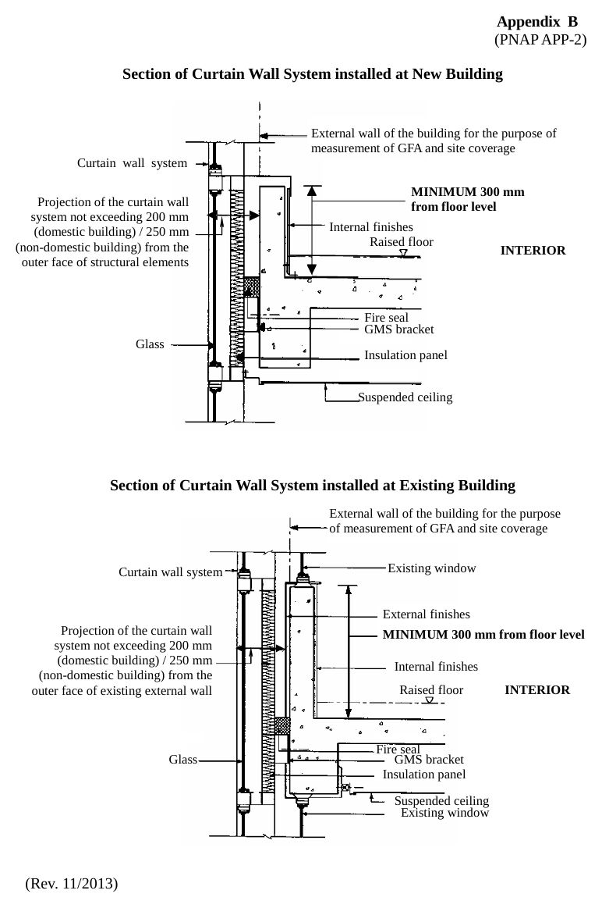

---
tags:
  - PNAP
  - APP series
  - GFA 總樓面面積
  - GFA concession 樓面面積寬免
  - Car park 停車場
  - Curtain wall & façade 幕牆及外牆
  - Plant rooms 機房
  - Domestic 住用
  - Structural 結構
  - Refuge floor 庇護層
  - Hotel 酒店
  - Concrete & materials 混凝土及物料
  - Fire safety 消防安全
  - Green & amenity features 環保及適意設施
summary: "How to measure GFA to the outer face of external walls, when voids may be exempted, and which areas are non-accountable GFA."
keywords: APP-2, gross floor area, 總樓面面積, GFA measurement, voids, non-accountable GFA, B(P)R 23(3), 樓面面積
---

# APP-2 Calculation of Gross Floor Area and Non-accountable Gross Floor Area <small>總樓面面積及無須計算的總樓面面積的計算 －《建築物(規劃)規例》第23(3)(a)及(b)條</small>

!!! info "Document info 文件資料"
    | | |
    |---|---|
    | **Type 類別** | PNAP (APP series), previously PNAP 13 舊編號 PNAP 13 |
    | **Issued by 發出機構** | Buildings Department 屋宇署 |
    | **First issue 首次發出** | December 1974 |
    | **Version summarised 本摘要版本** | November 2025 (paras. 17–19 and Appendix C amended) |
    | **Official language 官方語言** | English only (Chinese version not available) 只有英文版 |
    | **Source 原文** | [APP-2 (PDF)](https://www.bd.gov.hk/doc/en/resources/codes-and-references/practice-notes-and-circular-letters/pnap/APP/APP002.pdf) |
    | **Last checked 最後核對** | 2026-11-20 against the November 2025 version |

## At a glance 重點摘要 {#at-a-glance}

=== "English"

    - Explains how to **measure GFA** under [B(P)R 23(3)(a)](../regulations/bpr-23-23a.md): to the **outer surface of external walls**, at every floor. Areas **not floored over** (voids) are also counted.
    - **Voids** may be exempted in listed cases: cinemas, banking halls, shopping arcades (≤ **10%** of arcade GFA), auditoria, non-domestic main entrance lobbies, and duplex flats / houses that meet **Appendix A**.
    - **Curtain walls**: GFA may be measured to the structural elements if the projection is ≤ **200 mm** (domestic) / **250 mm** (non-domestic), there is a ≥ **300 mm** RC dwarf wall, and glass reflectance is ≤ **20%**.
    - **Cladding** ≤ **90 mm** thick (75 mm on NSPEW) may be disregarded.
    - **Plant rooms** (B(P)R 23(3)(b)): "any similar service" includes FS rooms, tanks, switch rooms, transformer rooms, etc. Enclosing walls up to **100 mm** may also be disregarded.
    - **Car parks**: underground **100%** disregarded. Above ground: **100%** for up to 2 floors, **50%** for the rest, unless the special cases apply. Spaces must be **EV charging-enabling** (para. 18).

=== "中文"

    - 解釋如何按 [B(P)R 第 23(3)(a) 條](../regulations/bpr-23-23a.md)**量度總樓面面積**：每層量度至**外牆外表面**，**沒有鋪設樓面**的地方（中空）亦須計算。
    - **中空位置**在指定情況下可獲豁免：戲院、銀行大堂、商場（≤ 商場總樓面面積 **10%**）、禮堂、非住用主要入口大堂，以及符合**附錄 A** 的複式單位／屋宇。
    - **幕牆**：如伸出 ≤ **200 毫米**（住用）／**250 毫米**（非住用）、設 ≥ **300 毫米**鋼筋混凝土矮牆，以及玻璃反光率 ≤ **20%**，可量度至結構構件。
    - **覆蓋層**厚度 ≤ **90 毫米**（非結構預製外牆為 75 毫米）可不計算。
    - **機房**（B(P)R 第 23(3)(b) 條）：「任何相類設施」包括消防控制中心、水缸、電掣房、變壓房等；圍牆厚度最多 **100 毫米**亦可不計算。
    - **停車場**：地庫 **100%** 不計；地面以上：首兩層 **100%**，其餘 **50%**（特殊情況除外）；車位須**預留電動車充電設施**（第 18 段）。

## Diagram 圖解 {#diagram}

<figure markdown>
  { width="537" loading=lazy }
  <figcaption>GFA concessions: prerequisites and the 10% cap. 樓面面積寬免：先決條件及 10% 上限。 Diagram prepared for this site; check the source text for exact wording.</figcaption>
</figure>

## Key clauses 主要條文 {#key-clauses}

!!! quote "Para. 1 — Calculation of GFA 總樓面面積的計算"
    Regulation 23(3)(a) of the Building (Planning) Regulations (B(P)R) stipulates that gross floor area (GFA) is the area contained within the outer surface of external walls of a building measured at each floor level. Any portions of this area not floored over should also be included in the GFA calculations.

    **中譯（非官方）：** 《建築物（規劃）規例》第 23(3)(a) 條訂明，總樓面面積是在每層樓面水平量度所得的建築物外牆外表面以內的面積。此範圍內任何沒有鋪設樓面的部分，亦須計入總樓面面積。

!!! quote "Para. 2 — Voids that may be exempted 可獲豁免的中空位置"
    …a modification of regulation 23(3)(a) of the B(P)R may be granted on application for voids in the following circumstances and subject to compliance with the pre-requisites (for items (a) to (g)) and the overall cap on GFA concessions (for items (f) and (g) only) stipulated in… PNAP APP-151…: (a) in front of cinema and theatre balconies; (b) in banking halls; (c) in shopping arcades provided that the total area of voids in the shopping arcade does not exceed 10% of the total GFA of the shopping arcade; (d) in single-staircase buildings in which cockloft floors for storage are provided in the ground storey; (e) in auditoria, sporting halls (including squash courts), school halls and religious institutions; (f) in main common entrance lobbies of non-domestic buildings; and (g) in duplex domestic flats or houses if they satisfy the criteria set out in Appendix A.

    **中譯（非官方）：** 以下情況的中空位置可申請變通第 23(3)(a) 條，須符合 APP-151 的先決條件（(a)至(g)項）及整體上限（只限(f)及(g)項）：(a) 戲院及劇院樓座前；(b) 銀行大堂；(c) 商場，惟中空總面積不得超過商場總樓面面積的 10%；(d) 地面層設有貯物閣樓的單樓梯建築物；(e) 禮堂、體育館（包括壁球場）、學校禮堂及宗教場所；(f) 非住用建築物的主要公用入口大堂；及 (g) 符合附錄 A 準則的複式住宅單位或屋宇。

!!! quote "Para. 12 — Walls of plant rooms 機房圍牆"
    For plant rooms and other features that are to be disregarded from GFA calculation, the enclosing walls and the associated protected lobby, if any, solely serving the said rooms or features and do not serve any other function, may also be disregarded from GFA calculation. The maximum thickness of such wall to be disregarded from GFA calculation should normally be not greater than 100mm.

    **中譯（非官方）：** 不計入總樓面面積的機房及其他設施，其只服務該等房間或設施而無其他功能的圍牆及相關防護前室，亦可不計算。可不計算的牆身厚度一般不應超過 100 毫米。

## Key table: other facilities (para. 4) 其他設施（第 4 段） {#key-table-other-facilities-para-4-4}

| Item 項目 | Facility 設施 | APP-151 pre-req 先決條件 | 10% cap 上限 |
|---|---|:-:|:-:|
| (a) | Chimney shafts 煙囪管道 | ✅ | ✅ |
| (b) | Filtration plant rooms for hotel pools or water features 酒店泳池或水景的過濾機房 | ✅ | ✅ |
| (c) | SMATV room ≤ **1.2 m × 1.2 m** (APP-42 para. 33) 衞星電視公共天線機房 | ✅ | ✅ |
| (d) | Pipe / air ducts for **non-mandatory** plant 非強制性機房的管道 | ✅ | ✅ |
| (e) | Pipe / air ducts for **mandatory** plant 強制性機房的管道 | — | — |
| (f) | Plant rooms for **environmentally friendly** systems (rain/grey water recycling, solar battery rooms) 環保系統機房 | ✅ | — |

<small>Para. 5: **refuge floors** complying with the FS Code may also be exempted. 符合《消防安全守則》的庇護層亦可獲豁免。</small>

## Key table: curtain walls and cladding (paras. 6–9) 幕牆及覆蓋層 {#key-table-curtain-walls-and-cladding-paras-69}

| Feature 項目 | Criterion 準則 |
|---|---|
| Curtain wall 幕牆 | GFA/SC measured to the **outer surface of structural elements** (beams, columns, slabs) if: 量度至結構構件外表面，條件： |
| | (a) not part of the structural system 不屬結構系統 |
| | (b) RC dwarf perimeter wall **≥ 300 mm** high, so no extra floor area 設 ≥ 300 毫米高鋼筋混凝土矮牆 |
| | (c) projection ≤ **200 mm** (domestic) / **250 mm** (non-domestic, incl. hotels) 伸出 ≤ 200 毫米（住用）／250 毫米（非住用，包括酒店） |
| | (d) external reflectance of glass ≤ **20%** 玻璃外反光率 ≤ 20% |
| Cladding / finishes 覆蓋層／飾面 | ≤ **90 mm** thick (≤ **75 mm** on NSPEW) may be disregarded; must not project beyond site boundary 厚度 ≤ 90 毫米（非結構預製外牆 ≤ 75 毫米）可不計；不得伸出地段界線 |

<figure markdown>
  { loading=lazy }
  <figcaption>Appendix B — Measurement of GFA and SC for curtain wall systems (new and existing buildings) 幕牆系統的總樓面面積及上蓋面積量度 <small>Source: PNAP APP-2 (Nov 2025), Buildings Department 資料來源：屋宇署</small></figcaption>
</figure>

## Key table: car parks and loading/unloading (para. 18) 停車場及上落貨區（第 18 段） {#key-table-car-parks-and-loadingunloading-para-18-18}

| Location 位置 | Private car parks 私家停車場 | Public car parks 公眾停車場 | Loading / unloading 上落貨 |
|---|:-:|:-:|:-:|
| (a) Underground 地庫 | 100%* | 100%* | 100% |
| (b)(i) Above ground, **not more than 2 floors** 地面以上首兩層 | 100%* | 100%* | G/F 100%; above G/F 50% |
| (b)(ii) Above ground, other floors 其他地面以上樓層 | 50%* | 50%* | |
| (c) Above ground where underground is technically infeasible, or no adverse environmental / visual impact 地庫技術上不可行或無不良影響 | 100%* | 100%* | 100% |
| (d) Above ground, required under lease for **Government Accommodation** 地契規定的政府設施 | 100%* | 100%* | 100% |
| (e) Above ground, required under lease for **subsidised sale/rental flats** by HKHS / URA 房協／市建局資助房屋 | 100%* | 100%* | 100% |

<small>% = proportion **disregarded** from GFA 不計入總樓面面積的比例. \* Only if the spaces are **EV charging-enabling**, except automated parking systems 須預留電動車充電設施（自動泊車系統除外）. Car parking on **open area / podium roof** is generally not GFA-accountable (para. 17). Para. 18(b) and 18(c) on above-ground public car parks apply to plans submitted on or after **1 November 2025** (para. 19).</small>

**Underground car park** (Appendix C para. 3): the structural ceiling soffit is at or below the **mean street level** (or the average of the streets' mean levels), and that level is ≤ **5 m** above the lowest street level. The topmost floor may protrude up to **half its height** (max. **2.5 m**) for natural light and ventilation.
**地庫停車場**（附錄 C 第 3 段）：結構天花底面位於**街道平均水平**（或各街道平均水平的平均數）或以下，而該水平不高於最低街道水平 **5 米**；最高一層停車場可突出最多其高度的**一半**（最多 **2.5 米**）以作天然採光及通風。

## Key table: voids in duplex flats and houses (Appendix A) 複式單位及屋宇的中空位置（附錄 A） {#key-table-voids-in-duplex-flats-and-houses-appendix-a-a}

| Criterion 準則 | Duplex flats 複式單位 | Houses 屋宇 |
|---|---|---|
| UFS of premises 實用樓面空間 | **≥ 150 m²** | **≥ 250 m²** |
| Void as % of UFS 中空佔實用樓面空間 | **≤ 10%** | **≤ 5%** |
| Void as % of total domestic GFA 佔住用總樓面面積 | Only **2 levels** of voids per tower, max. **0.5%** of total domestic GFA 每座最多兩層，≤ 0.5% | N.A. |
| Headroom of void 中空淨高 | **≤ 6.5 m** | **≤ 7.0 m** |
| Location 位置 | Living / dining room or entrance foyer 客廳、飯廳或入口門廊 | Living / dining room or entrance foyer |

<small>Conditions: anti-abuse design (e.g. up-stand beams, large glazing facing outside), compliance with OZP and lease, and an undertaking to designate the voids in the DMC. 條件：防止濫用的設計、符合分區計劃大綱圖及地契，以及承諾在公契中訂明為中空位置。</small>

## Explanation 淺白解釋 {#explanation}

=== "English"

    APP-2 is the **day-to-day rulebook for GFA calculation**. It answers three questions:

    1. **Where do I measure to?** To the outer surface of the external walls. Curtain walls and thin cladding get special treatment, so façade design does not "eat" GFA.
    2. **What about empty space (voids)?** Normally voids count as GFA, because they could later be floored over. Only the listed voids can be exempted, with conditions to stop people filling them in later.
    3. **What can be disregarded under reg. 23(3)(b)?** Genuine plant rooms ("any similar service"), car parks and loading/unloading areas. The BA checks that the space is justified in size and use.

    The **car park rules changed in November 2025**. Above-ground car parks now get only **50%** exemption beyond the first two floors, unless one of the special cases applies. All exempted spaces must be **EV charging-enabling**.

=== "中文"

    APP-2 是**計算總樓面面積的日常規則**，解答三個問題：

    1. **量度至哪裏？** 量度至外牆外表面。幕牆及薄覆蓋層有特別處理，令外牆設計不會「蠶食」總樓面面積。
    2. **中空位置如何處理？** 中空位置一般須計入總樓面面積，因為日後可加建樓板。只有表列的中空位置可獲豁免，並附條件防止日後被填封。
    3. **第 23(3)(b) 條可不計算甚麼？** 真正的機房（「任何相類設施」）、停車場及上落貨區。建築事務監督會審視其面積及用途是否合理。

    **停車場規則於 2025 年 11 月修訂**：地面以上停車場首兩層以外只獲 **50%** 豁免（特殊情況除外），所有獲豁免的車位須**預留電動車充電設施**。

## Practical notes 實務提示 {#practical-notes}

=== "English"

    !!! example "Worked example: above-ground private car park"
        Private car park on **4 above-ground floors**, each **2,000 m²**, all EV charging-enabling. No special case under 18(c)–(e).

        - Floors 1–2: 100% disregarded → 0 m² GFA
        - Floors 3–4: 50% disregarded → 2 × 2,000 × 50% = **2,000 m² GFA accountable**

    !!! tip "Common pitfalls"
        - **Split levels** that differ by **1 m or more** need clarification with BD (para. 3).
        - **Duplex voids** count towards the **10% cap** in APP-151 (para. 2(g)).
        - **A/C plant rooms** are subject to APP-151 pre-requisites and cap (para. 13). Mandatory plant rooms are not.
        - For **houses**, BD watches for duplicated or oversized plant rooms (para. 11).
        - **Public transport termini** are generally **GFA accountable** unless the town plan says otherwise (para. 20).

=== "中文"

    !!! example "計算例子：地面以上私家停車場"
        私家停車場位於**地面以上 4 層**，每層 **2,000 平方米**，全部預留電動車充電設施；不屬第 18(c)–(e) 段的特殊情況。

        - 第 1–2 層：100% 不計 → 0 平方米
        - 第 3–4 層：50% 不計 → 2 × 2,000 × 50% = **2,000 平方米須計入總樓面面積**

    !!! tip "常見錯誤"
        - 樓層高低差達 **1 米或以上**的錯層設計，須先向屋宇署澄清（第 3 段）。
        - **複式中空位置**計入 APP-151 的 **10% 上限**（第 2(g) 段）。
        - **冷氣機房**須符合 APP-151 先決條件及上限（第 13 段），強制性機房則不受限。
        - **屋宇**項目中，屋宇署會留意重複或過大的機房（第 11 段）。
        - **公共交通交匯處**一般**須計入總樓面面積**，除非城市規劃圖另有規定（第 20 段）。

<!-- APSEC START -->
## APSEC clarifications 認可人士及註冊結構工程師委員會討論 {#apsec-clarifications}

BD's responses at the APSEC Discussion Forum that clarify this document, **newest first**. Where the same question came up more than once, only the **latest position** is listed. See [all APSEC items](../apsec/index.md). 屋宇署在討論會上就本文件作出的澄清，新者在前；同一問題只列最新立場。

- **[PNAP APP-2 – Aboveground Private/ Public Car Park](../apsec/2026.md#i202608147)** <small>ADF 3/2026, 14 Aug 2026</small> BD advised that AAP’s diagram indicating the percentage of GFA concessions for the aboveground car parks was incorrect. Paragraph 7 and its footnote 4 of Appendix C to PNAP APP-2 stated that under paragraph 18(b)(i) of …
- **[Underground Car Parks](../apsec/2026.md#i2026050812)** <small>ADF 2/2026, 8 May 2026</small> BD advised that under paragraph 3(a) of Appendix C to PNAP APP-2, Case 3 could not be accepted as underground car park for the purpose of GFA concession as its mean street level was more than 5m above the lowest level …
- **[Aboveground Carpark](../apsec/2026.md#i202602067)** <small>ADF 1/2026, 6 Feb 2026</small> BD advised that: (a) For item 1, HKIA’s understanding was correct. (b) For item 2, according to paragraph 12 of Appendix C to PNAP APP-2, in the case of the car ramp and run-in/out serving both car parking spaces at …
- **[GFA Concession for Car Parks](../apsec/2025.md#i2025112117)** <small>ADF 4/2025, 21 Nov 2025</small> BD advised that the aboveground car parks that would not pose adverse environmental or visual impact to its surrounding areas might be 100% disregarded from GFA calculation under paragraph 18(c)(ii) of PNAP APP-2. …
- **[Curtain Wall outside Floor / Room without Accountable Gross Floor Area (GFA)](../apsec/2024.md#i202402231)** <small>ADF 1/2024, 23 Feb 2024</small> BD advised that under section 26 of the Building (Construction) Regulation (B(C)R), curtain wall meant “a non load-bearing enclosure of a building fixed on to the load-bearing structure of the building”, and cladding …
- **[GFA Calculation for Cavity Wall Systems at Car parks](../apsec/2023.md#i2023111715)** <small>ADF 4/2023, 17 Nov 2023</small> BD advised that AAP’s understanding was correct. The cavity wall of basement or semi-basement which served as underground or aboveground car parks could enjoy the same percentage of GFA concession as that of the …
- **[Cladding outside Floor/Room Without Accountable GFA](../apsec/2023.md#i202311171)** <small>ADF 4/2023, 17 Nov 2023</small> BD advised that cladding could be disregarded from the calculations of GFA and site coverage if the relevant requirements under PNAP APP-2 were fulfilled. Whether the floors/rooms were accountable to GFA calculation or …
- **[GFA Exemption for Hot Water Boiler Room](../apsec/2023.md#i2023050514)** <small>ADF 2/2023, 5 May 2023</small> BD advised that HKIS’s understanding was correct. Boiler room for centralised hot water supply system in a hotel or clubhouse might be exempted from GFA calculation subject to the pre-requisites and overall cap under …

??? note "26 more APSEC items 更多項目"

    - **[Lift Shaft and Staircase GFA passing through Floors with Non-accountable GFA](../apsec/2022.md#i202211255)** <small>ADF 5/2022, 25 Nov 2022</small> For the scenario illustrated by HKIA, BD clarified that apart from the horizontal areas of staircases, lift shafts and vertical ducts, the entire thickness of their enclosing walls should be fully accounted for the …
    - **[Measurement of Gross Floor Area (GFA) and Site Coverage (SC) of Curtain Walls – PNAP APP-2](../apsec/2022.md#i202211254)** <small>ADF 5/2022, 25 Nov 2022</small> BD advised that the HKIA’s understanding on both i) and ii) were correct. For i), BD would consider the extent of the projection of the curtain wall as up to the external face of the glass panel instead of the 10 mm …
    - **[Definition of Underground Car Park – Paragraph 3(a) of Appendix C to PNAP APP-2](../apsec/2022.md#i202208128)** <small>ADF 4/2022, 12 Aug 2022</small> Regarding to the definition of an underground car park, BD advised that for car park abutting a sloping street, according to paragraph 3(a) of Appendix C to PNAP APP-2, BD might consider accepting a car park as an …
    - **[GFA Concession for Electric Vehicle (EV) Charging-enabling Carparking Spaces](../apsec/2022.md#i2022051324)** <small>ADF 3/2022, 13 May 2022</small> BD advised that EV charging-enabling facilities should be provided for all types of carparking spaces to be disregarded from GFA calculation under PNAP APP-2.
    - **[GFA Calculation of U/G Fuel Tank](../apsec/2022.md#i2022051323)** <small>ADF 3/2022, 13 May 2022</small> BD would favourably consider disregarding the outdoor underground fuel tank from GFA calculation provided that it was in a genuine design and the abuse of such was unlikely.
    - **[GFA Concession for AC Plant Rooms](../apsec/2022.md#i2022051322)** <small>ADF 3/2022, 13 May 2022</small> BD advised that according to regulation 23(3)(b) of B(P)R, any floor space genuinely intended for AC might be disregarded from GFA calculation, subject to compliance with the pre-requisites and the overall cap on GFA …
    - **[GFA Concession for Plant Rooms](../apsec/2022.md#i2022051321)** <small>ADF 3/2022, 13 May 2022</small> BD advised that according to paragraph 4 and 5 of PNAP APP-150, for wholesale or partial conversion of an existing industrial building to data centre, where the proposed conversion would result in certain covered …
    - **[Void over Main Entrance Lobby of Domestic Building](../apsec/2022.md#i202205132)** <small>ADF 3/2022, 13 May 2022</small> BD advised that according to paragraph 2(f) of PNAP APP-2 and paragraph 24 of PNAP APP-42, BD might only consider to grant modification of regulation 23(3)(a) of the Building (Planning) Regulations (B(P)R) to exempt …
    - **[Night-time Public Parking Spaces under Lease](../apsec/2022.md#i202203185)** <small>ADF 2/2022, 18 Mar 2022</small> BD advised that HKIA’s understanding was correct. Except during night-time parking, the primary function as car parking spaces and/or loading/unloading areas ancillary to the building would remain unchanged. In this …
    - **[Regulation 23(3)(a) of Building (Planning) Regulations (B(P)R) and PNAP APP-2 - Voids in Main Common Entrance Lobbies of Non-domestic Buildings](../apsec/2022.md#i202203182)** <small>ADF 2/2022, 18 Mar 2022</small> According to paragraph 2(f) of PNAP APP-2 and paragraph 24 of PNAP APP-42, BD might favourably consider to grant modification of regulation 23(3)(a) of B(P)R to exempt voids over main common entrance lobbies of …
    - **[GFA Calculation in Duplex Unit](../apsec/2022.md#i202201148)** <small>ADF 1/2022, 14 Jan 2022</small> BD advised that in the case as per the attached diagrams, the horizontal areas of the staircase and the lift shaft may be exempted from GFA calculation.
    - **[Calculation of GFA Concession for Car Park Associated Run-in/out and Driveway at Ground Level](../apsec/2021.md#i2021111221)** <small>ADF 5/2021, 12 Nov 2021</small> BD advised that the guidelines served to provide the principle of the calculation on pro-rata basis and would be incorporated into PNAP APP-2 in due course.
    - **[Site Coverage and Open Space Provision](../apsec/2021.md#i202108131)** <small>ADF 4/2021, 13 Aug 2021</small> BD advised the following: For (1), HKIA’s understanding was correct. For (2), according to footnote 3 under PNAP APP-132, ‘the “total covered area” is the portion of the site covered by building(s) or in simple terms …
    - **[Calculation of GFA Concession for Car Park Ancillary Areas](../apsec/2021.md#i2021031914)** <small>ADF 2/2021, 19 Mar 2021</small> BD advised that as per paragraph 10 of Appendix C to PNAP APP-2, the principle of calculations should be on a pro-rata basis and the quoted examples by AAP might not cover all the scenarios. In this connection, BD would …
    - **[PNAP APP-2 - Non-Accountable Gross Floor Area](../apsec/2021.md#i202103193)** <small>ADF 2/2021, 19 Mar 2021</small> BD advised that in general, the internal staircase solely serving the carport (not accountable for GFA) in house-type development should not be accountable for GFA. However, it was not uncommon that private carports …
    - **[Non-Mandatory Feature or Non-essential Plant Room](../apsec/2020.md#i202011261)** <small>ADF 4/2020, 26 Nov 2020</small> BD advised that plant rooms, other than those described under paragraph 11 of PNAP APP-2 and PNAP APP-151 that might be exempted from GFA calculations, were GFA accountable. Grease trap room and sump pump room for F&B …
    - **[GFA and SC Calculations for Curtain Walls](../apsec/2020.md#i2020092915)** <small>ADF 3/2020, 29 Sep 2020</small> BD advised that the dwarf wall was not required to be provided at locations across entrance/exit (Scenario A) or at void levels (Scenario B). However, as clarified in ADF 4/2016 (item 15), the curtain wall could be …
    - **[PNAP APP-2 - Vertical Shafts at E&M Floor](../apsec/2020.md#i202009297)** <small>ADF 3/2020, 29 Sep 2020</small> BD confirmed that relevant responses in ADF 1/2017 and ADF 1/2020 were still pertinent.
    - **[GFA Calculation of Lorry Parking](../apsec/2020.md#i2020052919)** <small>ADF 2/2020, 29 May 2020</small> BD advised that the principles laid down in PNAP APP-2 would be adopted to decide whether car parking and loading/unloading areas could be disregarded from GFA calculation under B(P)R 23(3)(b).
    - **[Voids in Buildings](../apsec/2019.md#i2019112218)** <small>ADF 5/2019, 22 Nov 2019</small> BD confirmed that AAP’s interpretation was correct and reminded that the other exemption criteria for voids in duplex flat under Appendix A of PNAP APP-2 should also be fulfilled.
    - **[Provision of Footpath/Pavement in Carpark](../apsec/2019.md#i201911227)** <small>ADF 5/2019, 22 Nov 2019</small> The design of carpark including the provision of circulation spaces would be considered on a case basis in accordance with PNAP APP-2 and PNAP APP-111 for GFA concession.
    - **[Registration of Undertaking Letter to Land Registry](../apsec/2019.md#i2019082315)** <small>ADF 4/2019, 23 Aug 2019</small> Registration of undertaking letters from developer or owner would only be required for certain situations as stipulated in relevant PNAPs and modification conditions. In some cases, registration of undertaking letters …
    - **[RTTV and OTTV](../apsec/2019.md#i201905241)** <small>ADF 3/2019, 24 May 2019</small> BD advised that HKIA’s understanding was correct.
    - **[Carpark GFA Exemption](../apsec/2019.md#i201901186)** <small>ADF 1/2019, 18 Jan 2019</small> BD advised that the current policy of disregarding underground car park from GFA calculation and the SBD Guidelines were two distinct measures arising from the recommendations of Sustainable Development Council to …
    - **[Technical Difficulties in Providing Underground Car Parks](../apsec/2019.md#i201901183)** <small>ADF 1/2019, 18 Jan 2019</small> BD advised that whether above ground private car parks could be 100% disregarded from GFA calculation due to specific site constraints would be considered on case merits. For projects within railway protection area …
    - **[PNAP APP-2 – Appendix C – Underground Car park](../apsec/2017.md#i2017111710)** <small>ADF 5/2017, 17 Nov 2017</small> BD advised that while cases under 3(a) to (c) were relatively more straight forward than cases under 3(d), the approval process was the same in that discussion at BC meetings would be arranged on need basis.

<!-- APSEC END -->

## Related 相關文件 {#related}

| Document 文件 | Relationship 關係 |
|---|---|
| [B(P)R 23 & 23A](../regulations/bpr-23-23a.md) | Legal definition of GFA 總樓面面積法定定義 |
| [APP-151](app-151.md) | Pre-requisites and 10% cap 先決條件及上限 |
| [APP-19](app-19.md) | Projections and SC/PR 伸出物 |
| [APP-42](app-42.md) | Amenity features, SMATV room 適意設施 |
| APP-111 | Car park design standards 停車場設計標準 |
| [FS Code 2011](../codes/fire-safety-code-2011.md) | Refuge floors 庇護層 |

---
<small>Prepared by: _[name]_ · Checked by: _[name]_ · Unofficial summary; refer to the official PNAP for the definitive text.</small>
