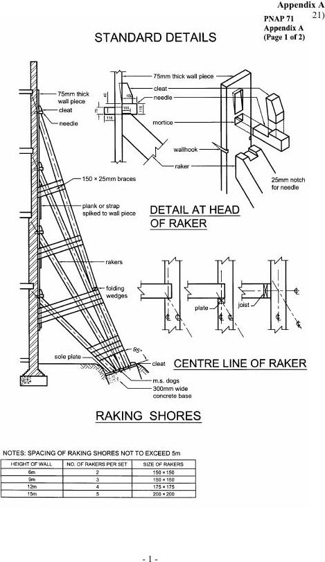
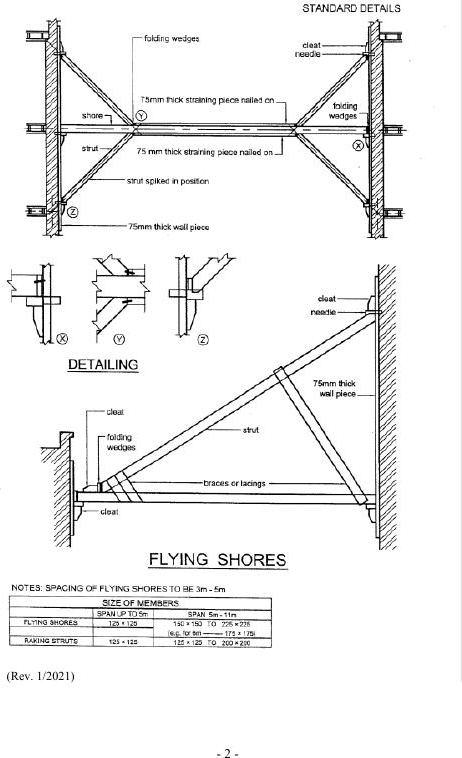

---
tags:
  - PNAP
  - APP series
  - Demolition 拆卸
  - Public safety 公眾安全
  - Plan submission & approval 呈交及審批
  - Site safety 地盤安全
  - Site supervision 地盤監督
  - Refuse 垃圾
  - Minor works 小型工程
  - Statutory period 法定期限
  - Geotechnical 岩土
  - Structural 結構
summary: "Demolition: plans and consent, supervision plan, video records, plant operators, dangerous buildings and party wall shores, fast-track completion, checklists and minor works before demolition."
keywords: APP-21, demolition, 拆卸, B(DW)R, plant operator, 機械操作員, video record, 錄影, raking shore, 斜撐, party wall, 共用牆, BA14B, fast track, dangerous building
---

# APP-21 Demolition Works - Measures for Public Safety <small>拆卸工程 保障公眾安全的措施</small>

!!! info "Document info 文件資料"
    | | |
    |---|---|
    | **Type 類別** | PNAP (APP series), previously PNAP 71 舊編號 PNAP 71 |
    | **Issued by 發出機構** | Buildings Department 屋宇署 |
    | **Version summarised 本摘要版本** | April 2025 |
    | **Official language 官方語言** | English only for now 暫只有英文版 |
    | **Source 原文** | [English (PDF)](https://www.bd.gov.hk/doc/en/resources/codes-and-references/practice-notes-and-circular-letters/pnap/APP/APP021.pdf) |
    | **Last checked 最後核對** | 2026-11-21 against the current BD version |

## At a glance 重點摘要 {#at-a-glance}

=== "English"

    - Demolition is controlled by the BO, B(A)R and **B(DW)R**: plan approval, consent, site safety supervision, **TCP** supervision, appointed plant operators and completion certification (para. 1).
    - Submit full demolition plans under **B(A)R 8(3), (4)**, following the **Code of Practice for Demolition of Buildings 2004**; incomplete proposals may be refused under s.16(1)(a), (e) (para. 3).
    - Consent refused if demolition plans are not approved (s.16(3)(a), (b)). Screens, nets, dust screens, scaffolds, catchfans, hoardings and shoring may go up **without consent** (para. 5). A **supervision plan** is lodged with the consent application (para. 6).
    - Full-time **site engineer** for complex structures, responsible to the RSC; **video cameras** (≥ 1 per site) record the whole demolition, kept **≥ 14 days** (paras. 7–10).

=== "中文"

    - 拆卸工程受條例、B(A)R 及 **B(DW)R** 規管：圖則批准、動工同意、地盤安全監督、**適任技術人員**監督、委任機械操作員及完工證明（第 1 段）。
    - 須按 **B(A)R 第 8(3)、(4) 條**呈交完整拆卸圖則，並參考 **2004 年拆卸建築物作業守則**；不完整的建議可根據第 16(1)(a)、(e) 條拒批（第 3 段）。
    - 拆卸圖則未獲批准會拒絕給予同意（第 16(3)(a)、(b) 條）；保護幕、安全網、防塵幕、棚架、防護網、圍板及支撐可**毋須同意**先行搭建（第 5 段）；申請同意時須提交**監工計劃書**（第 6 段）。
    - 複雜結構須有全職**地盤工程師**，向註冊專門承建商負責；設**錄影機**（每地盤 ≥ 1 部）記錄整個拆卸過程，紀錄保存 **≥ 14 天**（第 7–10 段）。

## Workflow / timeline 流程及時間表 {#workflow-timeline}

<figure markdown>
  { width="464" loading=lazy }
  <figcaption>Demolition workflow. 拆卸工程流程。 Summary diagram prepared for this site; check the source text for exact wording.</figcaption>
</figure>

!!! tip "Does it apply? 是否適用"
    **Applies 適用**: all **demolition works** needing approval and consent under the BO, B(A)R and **B(DW)R**: plans, consent, supervision plan, TCPs, plant operators and completion; special rules for **dangerous buildings** under a BA order. Some demolition-related works are **minor works** (para. 31). 拆卸工程。

## Key clauses 條文一覽 {#key-clauses-table}

| Para. 段 | Rule 規定 |
|---|---|
| 1–2 | Controls: plans approval, consent, site safety supervision, **TCP** appointment, **plant operator** appointment, completion. 管制範圍。 |
| 3–4 | Submit plans per **B(A)R 8(3)–(4)** with the **Demolition Code 2004**; refusal under s.16(1)(a), (e) if incomplete; no consent before approval (s.16(3)(a), (b)). 呈交圖則。 |
| 5 | May erect **without consent** (if not affecting structure): (a) screens and nets; (b) dust screens; (c) scaffolds and catchfans; (d) **hoarding, covered walkway, gantry, catch platforms**; (e) shoring and propping. 毋須同意可先搭建。 |
| 6 | **Supervision plan** lodged before / with consent (unless TM para. 11 exempts); Site Supervision Code 2009 (2024 Ed.); refusal under s.16(3)(bc). 監工計劃書。 |
| 7–8 | Follow the Demolition Code on **full-time site engineer** for complex structures, debris management, etc.; the site engineer answers to the **RSC**; changes reported at once. 駐地盤工程師。 |
| 9–10 | **Video cameras** record the whole process, **≥ 1 per site**, tamper-proof, shown on plans; keep records **≥ 14 days**. 錄影記錄 14 天。 |
| 11–15 | **Plant operators** to B(DW)R 9(3) (e.g. HKIC "Demolition of Building Course for Plant Operators"); particulars (names, HKID, DOB, address, phone) with the consent application (B(A)R 31) or refusal s.16(3)(b); BA vets them; changes notified within **7 days**. 機械操作員。 |
| 16 | Remove **flammable goods**; risk of fire or explosion (B(DW)R 6). 易燃品。 |
| 17(a) | **Dangerous buildings**: secure after closure; entry permit from **EBD**. 危險建築物封閉。 |
| 17(b)–(d) | **Shores** of steel **Grade 250+** to the Steel Code; dead shore positions agreed with EBD; raking or permanent supports designed and agreed; good **connection to party walls**; replace temporary shores with permanent support where needed. 支撐。 |
| 17(e)–(f) | Pedestrian passages per [APP-23](app-23.md); **joint demolition**: start only when all adjacent buildings can proceed together. 聯合拆卸。 |
| 17(g)–(i) | **Party walls**: raking or flying shores (Appendix A), often under a BA order; may require demolishing a party wall next to a framed building and new enclosure; alternatives considered; inspect and repair as demolition proceeds. 共用牆。 |
| 17(j)–(k) | **Default works** by BA with costs, supervision charge and surcharge; report unexpected weaknesses to EBD at once. 代辦工程及通報。 |
| 18–19 | Tell **HyD** about street name plates (BO s.32); tell **DSD** when drains are sealed (B(DW)R 3(2)(b)). 通知路政署及渠務署。 |
| 20 | Affecting slopes or walls: RGE recommendations in the plans, RSE / RGE agree before submission. 斜坡及擋土牆。 |
| 21–22 | Hoardings, covered walkways, gantries, catch platforms at all times; minimise **dust, noise, vibration**. 保障公眾。 |
| 23–24 | Design per Demolition Code Ch. 3 and [APP-23](app-23.md) (standard designs, precast footings, demountable joints). 圍板設計。 |
| 25 | Nets, screens, sheeting on façades **fire-retardant**, certificates on site. 防火膠布。 |
| 26 | Precautions done and documents in before / with **Form BA8** (checklist App. B); refusal under s.16(3)(b), (ba), (bc) or (bb). 動工前完成。 |
| 27 | Completion certified within **14 days**: **BA14A**, or **BA14B** for fast track. 14 天內完工證明。 |
| 28 | **Fast-track** criteria: (a) structurally independent; (b) no basement or below-ground structures (filling a basement with debris against buoyancy is OK); (c) nothing above ground left except G/F slab and beams; (d) no support needed for party / adjoining walls; (e) no effect on slopes or retaining structures. 快速驗收條件。 |
| 29–30 | State compliance on plans; submit **BA14B** with colour photos and a photo key plan; BD replies within **14 days**, or **28 days** if audited. 快速驗收程序。 |
| 31 | Some works are **minor works** ([APP-147](app-147.md)). 小型工程。 |
| 32–33 | **Appendix C** streamlined route for minor works before demolition; similar note to contractors. 簡化程序。 |

<figure markdown>
  { width="380" loading=lazy }
  <figcaption>Appendix A (1 of 2) – Standard details of raking shores, with spacing ≤ 5 m and raker sizes by wall height. 斜撐標準詳圖。Source: BD, PNAP APP-21.</figcaption>
</figure>

<figure markdown>
  { width="380" loading=lazy }
  <figcaption>Appendix A (2 of 2) – Standard details of flying shores, spacing ≤ 5 m. 飛撐標準詳圖。Source: BD, PNAP APP-21.</figcaption>
</figure>

## Appendix B: first consent checklist 附錄 B：首次同意核對表 {#appendix-b}

| Part | Items 項目 |
|---|---|
| 1 Site preparation | Hoarding, covered walkway, catch platforms; scaffolds, dust screens, catchfans (also at boundaries with adjoining demolition sites); propping of slabs; shoring and support to walls / slopes; **debris chutes**; **video cameras**; glazing and doors removed; drains **sealed**; utilities **disconnected**, meters removed; tram / street lighting fittings removed; emergency exit route with lighting and extinguishers; **no-go markings** for plant and propped areas; **asbestos** and hazardous materials removed by specialists; contacts posted at the entrance |
| 2 Documents | **BA8**; **BA20** (TCPs); supervision plan; TCP particulars; **plant operators**; debris disposal system; site engineer; **Chinese demolition plans**; minor works records |
| 3 Other | Hoarding permit valid; HyD excavation permit; adjoining owners' consent for party walls; approval conditions met; other departments and **MTR** requirements; **AMO**; HyD told about street name plates |

## Appendix C: minor works before demolition 附錄 C：拆卸前小型工程 {#appendix-c}

- Applies when the **same project team** (AP, RSE, RSC Demolition, same authorized signatory) does both. 同一項目團隊。
- Submit **MW01** at least **7 days** before, with the demolition plans, which show the MW and a precautions statement; photos not needed if in the building appraisal report. 提交 MW01。
- Submit **MW02** with **BA14A / BA14B**; no completion photos if the whole building is then demolished; if done before **BA10**, submit MW02 separately to NBD1. 提交 MW02。

## Whole picture 整體關係 {#whole-picture}

| Topic 主題 | Where 文件 |
|---|---|
| Demolition Code 拆卸守則 | [Demolition Code](../codes/demolition-2004.md) |
| Demolition regulations 拆卸規例 | [B(DW)R Cap. 123C](../regulations/bdwr-123c.md) |
| Hoardings and covered walkways 圍板 | [APP-23](app-23.md) · [B(P)R 50–70](../regulations/bpr-50-70.md) |
| Supervision plans and TCPs 監工 | [Site Supervision Code](../codes/site-supervision-2009.md) · [APP-158](app-158.md) |
| Blasting in demolition 爆破拆卸 | [APP-72](app-72.md) |
| Oil tank demolition 油缸拆卸 | [APP-10](app-10.md) App. D |
| Fundamental issues of demolition plans 根本性事項 | [ADM-19](adm-19.md) App. D |
| Minor works 小型工程 | [APP-147](app-147.md) |
| Site precautions overview 地盤預防措施 | [APP-107](app-107.md) |

<!-- APSEC START -->
## APSEC clarifications 認可人士及註冊結構工程師委員會討論 {#apsec-clarifications}

BD's responses at the APSEC Discussion Forum that clarify this document, **newest first**. Where the same question came up more than once, only the **latest position** is listed. See [all APSEC items](../apsec/index.md). 屋宇署在討論會上就本文件作出的澄清，新者在前；同一問題只列最新立場。

- **[Acceptance of Hoarding Plan Prior to Approval of Demolition Plan](../apsec/2022.md#i202201146)** <small>ADF 1/2022, 14 Jan 2022</small> BD advised that according to paragraph 1(a) of Appendix D to PNAP ADM-19, precautionary measures particularly the hoarding, covered walkways and any necessary propping and shoring were the fundamental issues to be …
- **[Hoarding Plan Submission](../apsec/2021.md#i2021111210)** <small>ADF 5/2021, 12 Nov 2021</small> To facilitate the development progress, BD had implemented streamlined procedures to facilitate the processing of hoarding permit application under PNAP APP-23. For cases meeting the streamlined processing criteria set …

<!-- APSEC END -->

## Related 相關文件 {#related}

| Document 文件 | Relationship 關係 |
|---|---|
| [APP-23](app-23.md) | Hoardings 圍板 |
| [APP-86](app-86.md) | Partition walls 間隔牆 |

---
<small>Prepared by: _[name]_ · Checked by: _[name]_ · English only for now; Chinese text is an unofficial translation (中譯（非官方）).</small>
