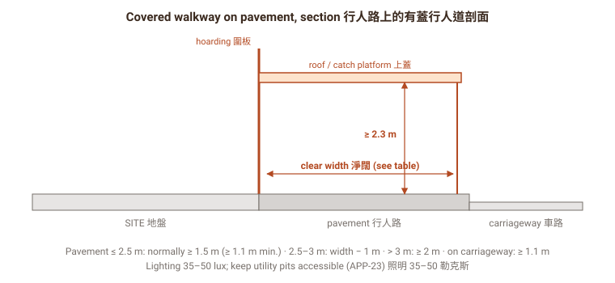

---
tags:
  - PNAP
  - APP series
  - Hoarding 圍板
  - Covered walkway 有蓋行人道
  - Gantry 門架
---

# APP-23 Hoardings, Covered Walkways and Gantries (including Temporary Access for Construction Vehicles) <small>圍板、有蓋人行道及門架(包括工程車輛的臨時通道) －《建築物(規劃)規例》第IX部</small>

!!! info "Document info 文件資料"
    | | |
    |---|---|
    | **Type 類別** | PNAP (APP series), previously PNAP 75 舊編號 PNAP 75 |
    | **Issued by 發出機構** | Buildings Department 屋宇署 |
    | **Version summarised 本摘要版本** | April 2025 |
    | **Official language 官方語言** | English only for now 暫只有英文版 |
    | **Source 原文** | [English (PDF)](https://www.bd.gov.hk/doc/en/resources/codes-and-references/practice-notes-and-circular-letters/pnap/APP/APP023.pdf) |
    | **Legal basis 法律依據** | [B(P)R Part IX (regs 64–66)](../regulations/bpr-50-70.md) |
    | **Last checked 最後核對** | 2026-11-21 against the current BD version |

## At a glance 重點摘要

=== "English"

    - Hoardings, covered walkways and gantries must be erected **before works start** under a **hoarding permit** (B(P)R 64–66). Plans show temporary vehicular access, post holes, traffic signs, transport facilities and trees; **declare** affected signs, lights, bus stops or reduced carriageway (para. 1).
    - Resiting of street furniture at owner's cost (street lights by HyD); **trees on government land** need prior approval and protection proposals (paras. 2–3).
    - On a carriageway keep **≥ 3 m** one-way lane / **5.5 m** two-way; otherwise consult TD on a **TIA** (red / pink routes, bus corridors, within 70 m of signalised junctions), submitted **2 months** ahead (para. 5).
    - **Pedestrian clear width**: see table; **headroom ≥ 2.3 m**; **35–50 lux** lighting; keep utility pits accessible; **Excavation Permit** (Cap. 28) for post holes on public roads (paras. 9–14).

=== "中文"

    - 圍板、有蓋行人道及門架須在**工程開始前**按**圍板准許證**搭建（B(P)R 第 64–66 條）；圖則須顯示臨時車輛通道、柱洞、交通標誌、交通設施及樹木；受影響的標誌、街燈、巴士站或收窄行車道必須**申報**（第 1 段）。
    - 遷移街道設施由業主付費（街燈由路政署進行）；**政府土地上的樹木**須事先批准並提交保護建議（第 2–3 段）。
    - 佔用行車道時，單程行車線須保持 **≥ 3 米**、雙程 **5.5 米**；否則須向運輸署查詢是否需要**交通影響評估**（紅色／粉紅色路線、巴士走廊、距燈號路口 70 米內），並在申請前 **2 個月**提交（第 5 段）。
    - **行人通道淨闊度**見下表；**淨高 ≥ 2.3 米**；照明 **35–50 勒克斯**；保持公用設施沙井可達；公共道路上掘柱洞須取得**挖掘准許證**（第 28 章）（第 9–14 段）。

## Diagram 圖解

<figure markdown>
  { width="760" loading=lazy }
  <figcaption>Covered walkway section with clear width and headroom (APP-23). 有蓋行人道剖面。 Diagram prepared for this site; check the source text for exact wording.</figcaption>
</figure>

## Key table: pedestrian walkway clear width 行人通道淨闊度

| Existing pavement 現有行人路 | Clear width 淨闊度 |
|---|---|
| On carriageway 設於行車道 | ≥ **1.1 m** |
| ≤ 2.5 m | Normally ≥ **1.5 m**; may relax to ≥ 1.1 m if pedestrian LOS "C" maintained 一般 ≥ 1.5 米 |
| > 2.5 m to 3 m | Pavement width **minus 1 m** 行人路闊度減 1 米 |
| > 3 m | ≥ **2 m** |

## Related 相關文件

| Document 文件 | Relationship 關係 |
|---|---|
| [B(P)R 50–70](../regulations/bpr-50-70.md) | Part IX hoardings 圍板 |
| [APP-127](app-127.md) | Contractor's sheds 承建商屋棚 |

---
<small>Prepared by: _[name]_ · Checked by: _[name]_ · English only for now; Chinese text is an unofficial translation (中譯（非官方）).</small>
