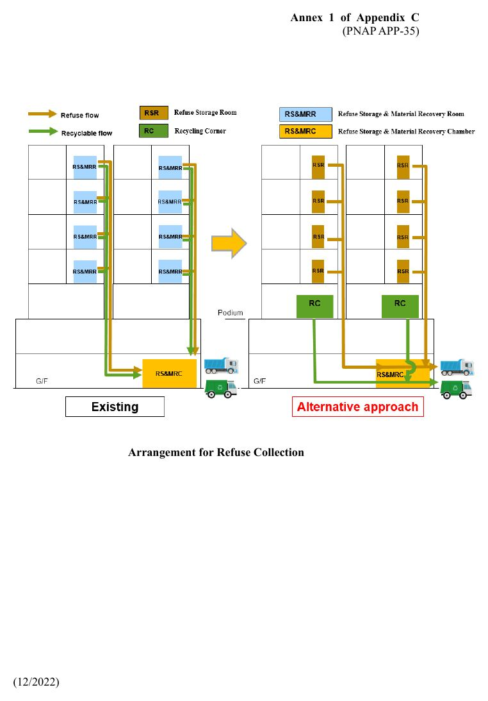
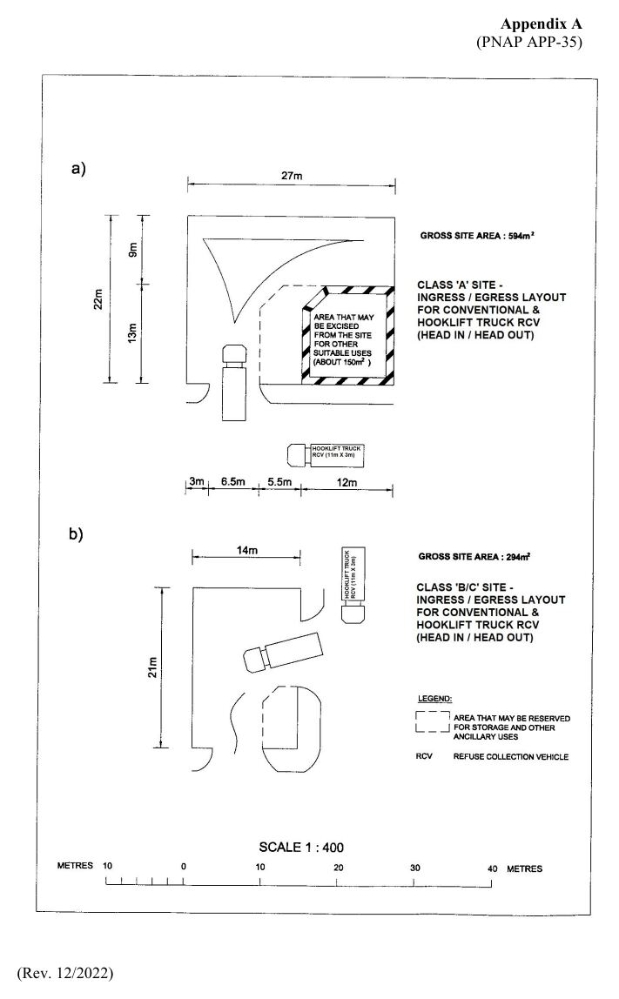
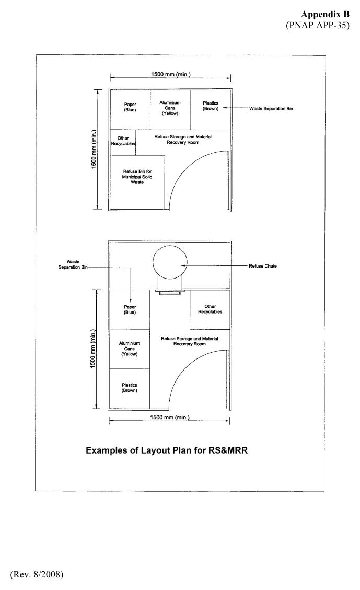
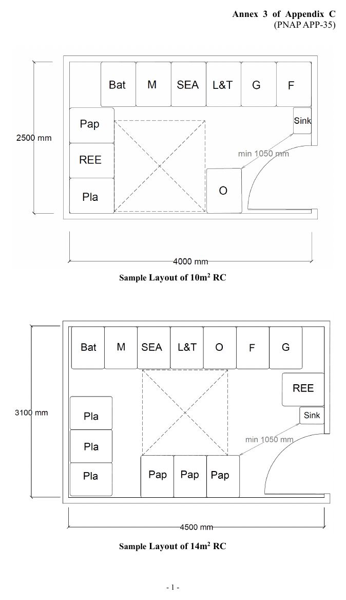

---
tags:
  - PNAP
  - APP series
  - Refuse 垃圾
  - Recycling 回收
  - GFA concession 樓面面積寬免
---

# APP-35 Refuse Storage and Collection <small>垃圾的存放及收集－《建築物（垃圾及物料回收房及垃圾槽）規例》</small>

!!! info "Document info 文件資料"
    | | |
    |---|---|
    | **Type 類別** | PNAP (APP series), previously PNAP 98 舊編號 PNAP 98 |
    | **Issued by 發出機構** | Buildings Department 屋宇署 |
    | **First issue 首次發出** | November 1983 |
    | **Version summarised 本摘要版本** | December 2022 (general revision) |
    | **Official language 官方語言** | English and Chinese 中英文版 |
    | **Source 原文** | [English (PDF)](https://www.bd.gov.hk/doc/en/resources/codes-and-references/practice-notes-and-circular-letters/pnap/APP/APP035.pdf) · [中文 (PDF)](https://www.bd.gov.hk/doc/tc/resources/codes-and-references/practice-notes-and-circular-letters/pnap/APP/APP035.pdf) |
    | **Legal basis 法律依據** | Building (Refuse Storage and Material Recovery Chambers and Refuse Chutes) Regulations 《建築物（垃圾及物料回收房及垃圾槽）規例》 B(RS&MRC&RC)R |
    | **Last checked 最後核對** | 2026-11-20 against the December 2022 version |

## At a glance 重點摘要

=== "English"

    - Design the **refuse storage and material recovery chamber (RS&MRC)** at G/F or podium for **refuse collection vehicle (RCV)** access: **11 m** long, **3 m** wide, **4 m** high, needing **4.5 m** headroom for bin-lifting, a **20 m** turning circle, **26 t**, gradient ≤ **1:10**, and a parking space of **5 m × 12 m** (para. 1).
    - If the RCV cannot drive out forwards, provide a **hammer-head of 27 m × 9.5 m** with a **10.9 m** wide approach (para. 2).
    - **Refuse storage and material recovery rooms (RS&MRR)** on each domestic floor: walls **-/120/120**, door **-/60/60** (self-closing, **no hold-open**), fire alarm and sprinkler (para. 6).
    - **MRC, RS&MRC, RS&MRR, refuse chutes and hopper rooms** may be **excluded from GFA** under B(P)R 23(3)(b) (para. 7).
    - **Alternative (App. C)**: for domestic buildings with TUFS **≥ 1,320 m²**, provide a small **refuse storage room (RSR ≥ 1.5 m²)** on every floor plus one **centralised recycling corner (RC, 10–21 m²)** at the main entrance level, instead of an RS&MRR on every floor.

=== "中文"

    - **垃圾及物料回收房**應設於地面或平台，以供**垃圾收集車**進出：車長 **11 米**、闊 **3 米**、高 **4 米**，提升垃圾桶時需 **4.5 米**淨空，迴轉圈 **20 米**，重 **26 噸**，斜度 ≤ **1:10**，泊車位 **5 米 × 12 米**（第 1 段）。
    - 如垃圾車不能向前駛離，須提供 **27 米 × 9.5 米的錘頭式迴旋處**，入口闊 **10.9 米**（第 2 段）。
    - 每層住宅的**垃圾及物料回收室**：牆 **-/120/120**，門 **-/60/60**（自動關閉，**不得固定開啟**），並設火警鐘及花灑（第 6 段）。
    - **物料回收房、垃圾及物料回收房、垃圾及物料回收室、垃圾槽及垃圾漏斗室**可根據 B(P)R 第 23(3)(b) 條**豁免總樓面面積**（第 7 段）。
    - **另一方案（附錄 C）**：總實用樓面空間 **≥ 1,320 平方米**的住用建築物，可在每層設小型**垃圾存放室（≥ 1.5 平方米）**，並在主要出入口樓層設一個**中央回收點（10–21 平方米）**，取代每層的垃圾及物料回收室。

## Key table: refuse collection vehicle (para. 1) 垃圾收集車規格（第 1 段）

| Item 項目 | Value 數值 |
|---|---|
| Overall length 車長 | **11 m** |
| Overall width (mirror to mirror) 車闊（連倒後鏡） | **3 m** |
| Overall height 車高 | **4 m** |
| Min. headroom for bin-lifting 提升垃圾桶所需最低淨空 | **4.5 m** |
| Min. ground clearance 最低離地距離 | 0.24 m |
| Min. angle of departure (fully laden) 最小離去角（滿載） | 10° |
| Turning circle (wall to wall) 迴轉圈 | **20 m** |
| Gross vehicle weight 總重量 | **26 t** |
| Max. gradient for access 通道最大斜度 | **1:10** |
| Access road width 通路闊度 | Preferably **4 m**, min. **3.5 m** 最好 4 米，最少 3.5 米 |
| Parking space for collection 收集垃圾泊車位 | **5 m × 12 m** |
| Turning (if no forward exit) 迴轉（不能向前駛離） | Hammer-head **27 m × 9.5 m**, approach **10.9 m** wide 錘頭式 27 × 9.5 米 |

## Key clauses 主要條文

!!! quote "Para. 6 — Fire protection of RS&MRR 垃圾及物料回收室的防火"
    Every RS&MRR should have adequate provisions for fire prevention and fire fighting such as fire alarm and sprinkler. The room should be separated from the remainder of the building by walls having a fire resisting rating (FRR) of not less than -/120/120 and the access door thereto should have an FRR of not less than -/60/60. The self-closing mechanism to the door should not permit the door to be held in an open position.

    **官方中文本：** 每個垃圾及物料回收室應配置足夠防火及滅火設備，例如火警鐘及花灑。回收室與建築物其餘部分應以耐火效能標準不低於-/120/120的牆壁分隔，其通道門的耐火效能標準不應低於-/60/60，而自動關門裝置不應容許該門固定於開啟狀態。

!!! quote "Para. 7 — GFA exclusion 豁免總樓面面積"
    Subject to satisfactory planning, the area of MRC, RS&MRC, RS&MRR, refuse chutes and hopper rooms (where provided) may be excluded from gross floor area (GFA) calculations under regulation 23(3)(b) of the Building (Planning) Regulations (B(P)R).

    **官方中文本：** 如規劃令人滿意，物料回收房、垃圾及物料回收房、垃圾及物料回收室、垃圾槽以及垃圾漏斗室（如有），可根據《建築物（規劃）規例》第23(3)(b)條獲豁免計入總樓面面積內。

## Key table: alternative approach (Appendix C) 另一方案（附錄 C）

| Item 項目 | Requirement 規定 |
|---|---|
| Applies to 適用 | Domestic building / domestic part with TUFS **≥ 1,320 m²** 總實用樓面空間 ≥ 1,320 平方米 |
| **RSR** (each floor, refuse only) 垃圾存放室（每層，只放垃圾） | Min. dimension **1 m**, area **≥ 1.5 m²**; same requirements as an RS&MRR (B(RS&MRC&RC)R 12A–12C) 最小尺寸 1 米，面積 ≥ 1.5 平方米 |
| **RC** location 中央回收點位置 | One per building / tower at the **main entrance level** (podium or G/F); **common parts** in the DMC; recycling only 每座一個，設於主要出入口樓層；公用部分 |
| RC size by TUFS 按總實用樓面空間的面積 | **Low** 1,320–7,260 m² → **10–14 m²** · **Medium** 7,260–13,200 m² → **14–16 m²** · **High** > 13,200 m² → **16–21 m²** |
| Accessibility 無障礙 | No dimension < **1.5 m**; **1.5 × 1.5 m** turning space inside 最小尺寸 1.5 米；內有 1.5 × 1.5 米迴轉空間 |
| Shared RC 共用 | Buildings on the same site with combined TUFS ≥ 1,320 m², each main entrance ≤ **75 m** from the RC 同一地盤合共 ≥ 1,320 平方米，距離 ≤ 75 米 |
| Ventilation 通風 | Mechanical, ≥ **3 air changes per hour** + air purifier 機械通風每小時 ≥ 3 次換氣 + 空氣淨化 |
| Lighting 照明 | ≥ **120 lux** at floor; sockets for smart bins 照明 ≥ 120 勒克斯 |
| Fire 防火 | Fire alarm + sprinkler; walls **-/120/120**, door **-/60/60**, no hold-open 牆 -/120/120、門 -/60/60 |
| Water and drainage 供水及排水 | Water point and sink; floor drain with grating, **≥ 100 mm** pipe to a trapped gully outside 水喉及洗滌盆；地台排水 |
| GFA 總樓面面積 | RSR and RC may be **excluded** under B(P)R 23(3)(b), by modification of reg. 3A (para. 13) 可豁免 |

## Figures 圖則

<figure markdown>
  { loading=lazy }
  <figcaption>Annex 1 of App. C — Existing vs alternative refuse collection arrangement 現行與另一方案的垃圾收集安排</figcaption>
</figure>

??? abstract "Appendix A (RCV turning layouts), Appendix B (RS&MRR layouts), Annex 3 (RC layouts) 附錄 A、B 及附件 3"
    { loading=lazy }
    *Appendix A — Ingress/egress layouts for refuse collection vehicles 垃圾收集車出入佈局*

    { loading=lazy }
    *Appendix B — Examples of RS&MRR layout (min. 1,500 mm) 垃圾及物料回收室佈局例子*

    { loading=lazy }
    *Annex 3 — Sample layouts of 10 m² and 14 m² recycling corners 10 及 14 平方米回收點樣本*

<small>Source: PNAP APP-35 (Dec 2022), Buildings Department 資料來源：屋宇署</small>

## Explanation 淺白解釋

=== "English"

    Two things drive refuse design:

    1. **The truck.** The main RS&MRC must be reachable by an 11 m, 26 t RCV that lifts bins and needs **4.5 m** clear height. Check the **driveway, turning and headroom** early, especially under podium transfer structures.
    2. **Recycling on every floor.** The regulations require an RS&MRR on each domestic floor. APP-35 offers a better option for larger buildings: a tiny **refuse-only room** on each floor plus one generous, well-lit, accessible **recycling corner** downstairs. This makes sorting easier for residents and management.

    All these refuse spaces are normally **GFA-free** (reg. 23(3)(b)), and they are **not** subject to the APP-151 10% cap (APP-151 item 2.1).

=== "中文"

    垃圾設施設計有兩大考慮：

    1. **垃圾車**：主要的垃圾及物料回收房須讓 11 米長、26 噸、需提升垃圾桶並需 **4.5 米**淨空的垃圾收集車到達。應及早核對**車道、迴轉及淨空**，特別是平台轉換層下。
    2. **每層回收**：規例要求每層住宅設垃圾及物料回收室；APP-35 為較大型建築物提供更佳方案：每層一個只放垃圾的小房間，另在地面設一個寬敞、照明充足、無障礙的**中央回收點**，方便住客分類及管理。

    這些垃圾設施一般**不計總樓面面積**（第 23(3)(b) 條），亦**不受** APP-151 的 10% 上限限制（APP-151 第 2.1 項）。

## Practical notes 實務提示

=== "English"

    !!! example "Worked example: recycling corner size"
        Residential tower with TUFS **9,500 m²** → **Medium** band (7,260 < TUFS ≤ 13,200) → RC **14–16 m²**, at the podium entrance level, with no dimension < 1.5 m.

    !!! tip "Common pitfalls"
        - **Headroom under 4.5 m** at the RCV loading point, e.g. under a podium transfer beam.
        - RS&MRR doors with **hold-open devices**. These are not allowed.
        - An RS&MRC on a floor that the RCV can only reach **through other floors**. It must have direct vehicular access from the street (para. 3).
        - Show the **RCV route** from the public street on the building plans (para. 3).

=== "中文"

    !!! example "計算例子：中央回收點面積"
        住宅大廈總實用樓面空間 **9,500 平方米** → **中**級（7,260 < 總實用樓面空間 ≤ 13,200）→ 回收點 **14–16 平方米**，設於平台入口樓層，任何尺寸不少於 1.5 米。

    !!! tip "常見錯誤"
        - 垃圾車上落處**淨空不足 4.5 米**，例如平台轉換樑下。
        - 垃圾及物料回收室的門設**停門裝置**：不准許。
        - 垃圾及物料回收房所在樓層須**經其他樓層**才可到達：須由街道直接駛入（第 3 段）。
        - 須在建築圖則上顯示由公共街道起的**垃圾車路線**（第 3 段）。

<!-- APSEC START -->
## APSEC clarifications 認可人士及註冊結構工程師委員會討論 {#apsec-clarifications}

BD's responses at the APSEC Discussion Forum that clarify this document, **newest first**. Where the same question came up more than once, only the **latest position** is listed. See [all APSEC items](../apsec/index.md). 屋宇署在討論會上就本文件作出的澄清，新者在前；同一問題只列最新立場。

- **[Minimum Headroom required for Refuse Collection Vehicles (RCV)](../apsec/2023.md#i202302103)** <small>ADF 1/2023, 10 Feb 2023</small> BD advised that the specifications of the RCV currently in use by FEHD specified in PNAP APP-35 were still applicable. In case of high headroom required by FEHD, BD would take a pragmatic approach and consider the case merits subject to AP's justification and the comments of the relevant government departments. …

<!-- APSEC END -->

## Related 相關文件

| Document 文件 | Relationship 關係 |
|---|---|
| [B(P)R 23](../regulations/bpr-23-23a.md) | Reg. 23(3)(b) refuse facilities disregarded 垃圾設施不計總樓面面積 |
| [APP-151](app-151.md) item 2.1 | Mandatory / essential plant, outside the cap 強制性設施，不受上限 |
| [APP-111](app-111.md) | Access roads and loading bays 通路及上落貨位 |
| [FS Code Part C](../codes/fsc-part-c-fire-resisting-construction.md) | C13 special hazards; C16 fire doors 特殊危險；防火門 |

---
<small>Prepared by: _[name]_ · Checked by: _[name]_ · Quotes from the official English and Chinese versions; refer to the PNAP for the definitive text.</small>
