---
tags:
  - PNAP
  - APP series
  - Barrier free access 無障礙
  - B(P)R 72
  - Elderly-friendly 長者友善
---

# APP-41 Buildings to be Planned for Use by Persons with a Disability <small>建築物須經規劃以供殘疾人士使用《建築物（規劃）規例》第72條《設計手冊：暢通無阻的通道2008》</small>

!!! info "Document info 文件資料"
    | | |
    |---|---|
    | **Type 類別** | PNAP (APP series), previously PNAP 112 舊編號 PNAP 112 |
    | **Issued by 發出機構** | Buildings Department 屋宇署 |
    | **Version summarised 本摘要版本** | June 2025 |
    | **Official language 官方語言** | English only for now 暫只有英文版 |
    | **Source 原文** | [English (PDF)](https://www.bd.gov.hk/doc/en/resources/codes-and-references/practice-notes-and-circular-letters/pnap/APP/APP041.pdf) |
    | **Legal basis 法律依據** | [B(P)R 72 and Third Schedule](../regulations/bpr-71-73.md); DDO (Cap. 487) s.84 |
    | **Last checked 最後核對** | 2026-11-21 against the current BD version |

!!! note "Note 注意"
    This summarises the June 2025 revision based on the Design Manual: Barrier Free Access 2008. The **Design Manual: Universal Accessibility 2026** now replaces it (see the banner on [BFA 2008](../codes/bfa-2008.md)). Check BD for the re-issued APP-41.

## At a glance 重點摘要 {#at-a-glance}

=== "English"

    - Under **DDO s.84**, the BA must not approve plans unless **reasonable access** for persons with a disability is provided; build BFA in at design stage (para. 1).
    - Relevant provisions: **B(A)R 8(1)(m)** (show on plans), **B(P)R 2(1), 39(3)(e), 72 and Third Schedule**, **B(SSF,P,D&L)R 61(3)** (para. 2). Part 4 of the Third Schedule lists buildings needing only **limited** BFA; others comply fully unless exempt under 72(4) (paras. 3–4).
    - **Exemption or modification** only in **special circumstances** (site location, unjustifiable hardship) per **App. A**; for A&A to buildings without access, take all practical measures (paras. 6–7). The BA consults the **Advisory Committee on Barrier Free Access (ACBFA)** (para. 8).
    - Design Manual amendments (Apps C–I, 2012–2024); **App. J (2025)** adds recommended **elderly-friendly** design (Chapter 6) from the Task Force on Promoting Elderly-friendly Building Design, to be made mandatory later via B(P)R amendments (paras. 9–12).

=== "中文"

    - 根據**《殘疾歧視條例》第 84 條**，除非提供**合理的**殘疾人士通道，否則建築事務監督不得批准圖則；無障礙設施須在設計階段納入（第 1 段）。
    - 相關條文：**B(A)R 第 8(1)(m) 條**（在圖則顯示）、**B(P)R 第 2(1)、39(3)(e)、72 條及附表三**、**B(SSF,P,D&L)R 第 61(3) 條**（第 2 段）；附表三第 4 部列出只須提供**有限度**無障礙設施的建築物，其他建築物除根據第 72(4) 條獲豁免外須全面遵從（第 3–4 段）。
    - 只在**特殊情況**（地盤位置、不合理的困難）下按**附錄 A** 考慮**豁免或變通**；為沒有通道的現有建築物進行改動加建時，須採取一切切實可行措施（第 6–7 段）；建築事務監督會諮詢**無障礙通道諮詢委員會**（第 8 段）。
    - 設計手冊修訂（附錄 C–I，2012–2024 年）；**附錄 J（2025 年）**加入推廣長者友善建築設計專責小組建議的**長者友善**設計（第 6 章），日後將修訂 B(P)R 使之成為強制規定（第 9–12 段）。

## Diagram 圖解 {#diagram}

<figure markdown>
  { width="760" loading=lazy }
  <figcaption>From the BFA Design Manual 2008 to the Universal Accessibility manual 2026. 由暢通無阻設計手冊到暢道通行設計手冊。 Diagram prepared for this site; check the source text for exact wording.</figcaption>
</figure>

<!-- APSEC START -->
## APSEC clarifications 認可人士及註冊結構工程師委員會討論 {#apsec-clarifications}

BD's responses at the APSEC Discussion Forum that clarify this document, **newest first**. Where the same question came up more than once, only the **latest position** is listed. See [all APSEC items](../apsec/index.md). 屋宇署在討論會上就本文件作出的澄清，新者在前；同一問題只列最新立場。

- **[Landing for Accessible Lift in Alterations and Additions (A&A) Works](../apsec/2025.md#i202505097)** <small>ADF 2/2025, 9 May 2025</small> According to paragraph 7 of PNAP APP-41, where alteration and addition works were proposed to an existing building without initial access for persons with a disability, all practical measures should be taken to provide suitable barrier free access. …

<!-- APSEC END -->

## Related 相關文件 {#related}

| Document 文件 | Relationship 關係 |
|---|---|
| [BFA 2008](../codes/bfa-2008.md) | Design Manual 設計手冊 |
| [B(P)R 71–73](../regulations/bpr-71-73.md) | Reg. 72 |
| [APP-176](app-176.md) | DMUA 2026 |

---
<small>Prepared by: _[name]_ · Checked by: _[name]_ · English only for now; Chinese text is an unofficial translation (中譯（非官方）).</small>
