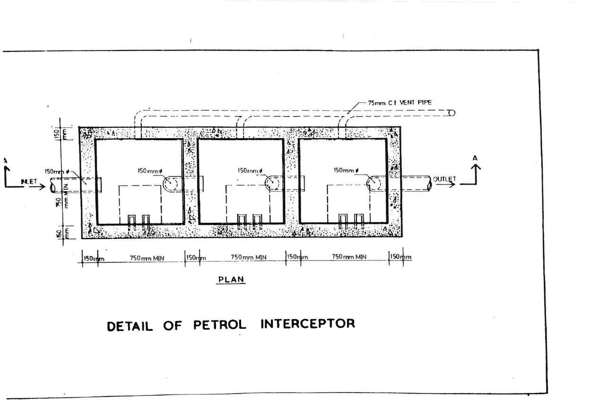
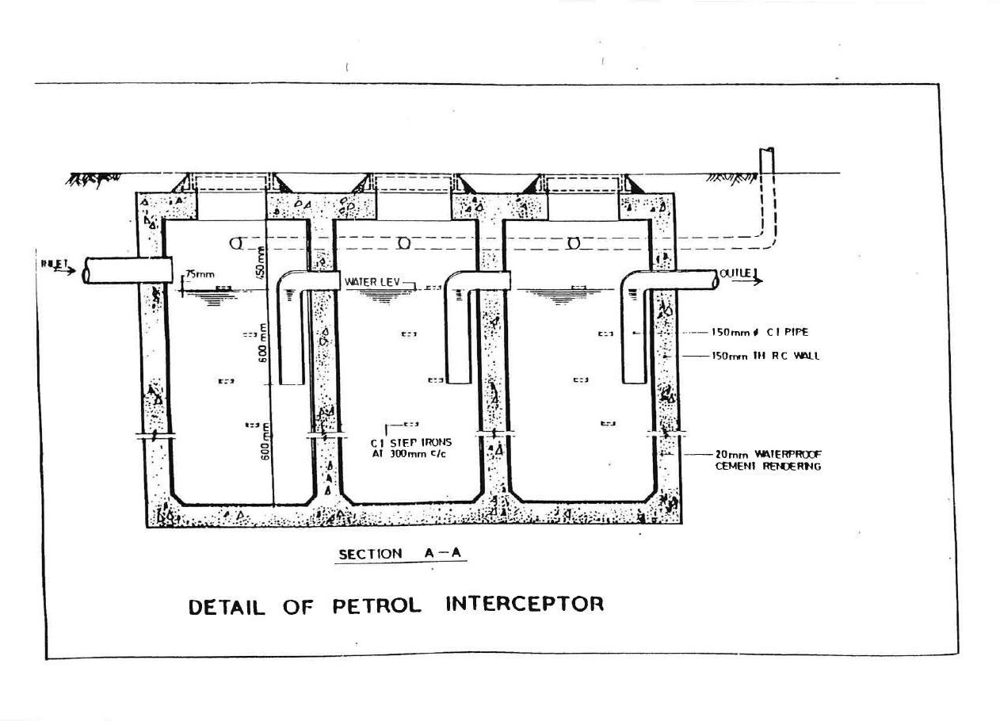

---
tags:
  - PNAP
  - APP series
  - Industrial building 工業大廈
  - Drainage 排水
  - Pollution 污染
  - Plumbing & sanitary 衞生設備
  - Car park 停車場
summary: "Industrial effluent: state processes on drainage plans, individual trapped outlets per factory unit (100 / 150 mm), and petrol interceptor details."
keywords: APP-46, industrial effluent, 工業污水, flatted factory, 分層工廠大廈, petrol interceptor, 截油器, reg. 90, drainage
---

# APP-46 Pollution from Industrial Buildings <small>工業建築物産生的污染－《建築物(衞生設備標準、水管裝置、排水工程及廁所)規例》第90條</small>

!!! info "Document info 文件資料"
    | | |
    |---|---|
    | **Type 類別** | PNAP (APP series), previously PNAP 124 舊編號 PNAP 124 |
    | **Issued by 發出機構** | Buildings Department 屋宇署 |
    | **Version summarised 本摘要版本** | March 1992 |
    | **Official language 官方語言** | English and Chinese 中英文版 |
    | **Source 原文** | [English (PDF)](https://www.bd.gov.hk/doc/en/resources/codes-and-references/practice-notes-and-circular-letters/pnap/APP/APP046.pdf) · [中文 (PDF)](https://www.bd.gov.hk/doc/tc/resources/codes-and-references/practice-notes-and-circular-letters/pnap/APP/APP046.pdf) |
    | **Legal basis 法律依據** | [BO s.24, 28](../regulations/bo-part-2-enforcement.md); [B(SFP&W)R 90](../regulations/bsfpwr-123i.md) |
    | **Last checked 最後核對** | 2026-11-21 against the current BD version |

## At a glance 重點摘要 {#at-a-glance}

=== "English"

    - BO s.24, 28 and B(SFP&W)R 90 let the BA tackle **water pollution** from industrial effluent (para. 1).
    - Untreated noxious effluent harms watercourses, the sea, treatment works and drains, and endangers maintenance workers (para. 2).
    - BD consults **EPD** for single-occupancy specialised factories and checks **flatted factory** drainage for general effluent treatment (para. 3).
    - State the **building uses** on drainage plans and provide **effluent treatment**; missing information may lead to rejection under **s.16(1)(i)** (para. 4). For flatted factories, assume effluent needing **treatment facilities** (para. 5).

=== "中文"

    - 《建築物條例》第 24、28 條及 B(SFP&W)R 第 90 條容許建築事務監督處理工業污水造成的**水污染**（第 1 段）。
    - 未經處理的有害污水會損害河道、海洋、處理設施及渠管，並危及維修工人（第 2 段）。
    - 單一佔用的專門工廠會諮詢**環保署**；**分層工廠**則審核一般污水處理設施（第 3 段）。
    - 排水圖則須列明**建築物用途**並提供**污水處理**；資料不足可根據**第 16(1)(i) 條**拒批（第 4 段）；分層工廠須假設會排放須**處理**的污水（第 5 段）。

!!! tip "Does it apply? 是否適用"
    **Applies 適用**: drainage plans of **industrial buildings**, especially multi-occupancy **"flatted factories"**, and areas for servicing and parking vehicles (petrol interceptors). 工業大廈排水圖，特別是分層工廠大廈。

## Key clauses 條文一覽 {#key-clauses-table}

| Para. 段 | Rule 規定 |
|---|---|
| 1 | Powers: **BO s.24, s.28** and **Cap. 123I reg. 90** to tackle water pollution from industrial effluent. 法定權力。 |
| 2 | Stricter measures since 1987: untreated effluent pollutes streams and sea, damages treatment works, drains and sewers, overloads them, and endangers maintenance workers. 背景。 |
| 3 | Single-occupancy specialised factories: **EPD** consulted; flatted factories: BD checks general effluent provisions. 諮詢環保署。 |
| 4 | APs / RSEs should get the **intended industrial processes** from clients and state building uses on drainage plans; otherwise drainage proposals may be rejected under **BO s.16(1)(i)**. 須列明工序。 |
| 5 | Flatted factories are assumed to need drainage **beyond reg. 5(1)**; not providing for future effluent may lead to disapproval under **reg. 90**. 須預留排放設施。 |
| 6 | Each unit: individual **trapped outlet** to the **foul** system: **100 mm** (unit < 1,000 m²), **150 mm min.** (> 1,000 m²); foul stacks **150–300 mm**; **never to storm drains**; may be sealed at floor level until needed; occupants treat effluent before discharge. 每單位獨立出口。 |
| 7 | **Petrol interceptor** for vehicle servicing and parking areas (standard detail below); seek consultants' advice for other effluents. 截油器。 |
| 8 | A BD unit targets **illegal and polluting drains and factories**. 執法小組。 |

<figure markdown>
  { width="640" loading=lazy }
  <figcaption>Detail of petrol interceptor, plan: three chambers ≥ 750 mm, 150 mm walls, 150 mm pipes, 75 mm CI vent. 截油器平面圖。Source: BD, PNAP APP-46.</figcaption>
</figure>

<figure markdown>
  { width="640" loading=lazy }
  <figcaption>Section A–A: 150 mm RC walls with 20 mm waterproof render, dip pipes, CI step irons at 300 mm. 截油器剖面圖。Source: BD, PNAP APP-46.</figcaption>
</figure>

## Whole picture 整體關係 {#whole-picture}

| Topic 主題 | Where 文件 |
|---|---|
| Drainage regulations 排水規例 | [Cap. 123I](../regulations/bsfpwr-123i.md) (regs. 5, 90) |
| Drainage design and access 排水設計 | [APP-93](app-93.md) · [ADM-19](adm-19.md) App. C (trade effluent to EPD) |
| Car parks 停車場 | [APP-111](app-111.md) |
| Industrial building conversions 工廈改裝 | [APP-150](app-150.md) |
| Oil installations 油缸 | [APP-10](app-10.md) |

## Related 相關文件 {#related}

| Document 文件 | Relationship 關係 |
|---|---|
| [B(SFP&W)R](../regulations/bsfpwr-123i.md) | Reg. 90 neutralizing tanks 中和池 |
| [APP-93](app-93.md) | Drainage works 排水工程 |

---
<small>Prepared by: _[name]_ · Checked by: _[name]_ · Quotes from the official English and Chinese versions; refer to the PNAP for the definitive text.</small>
