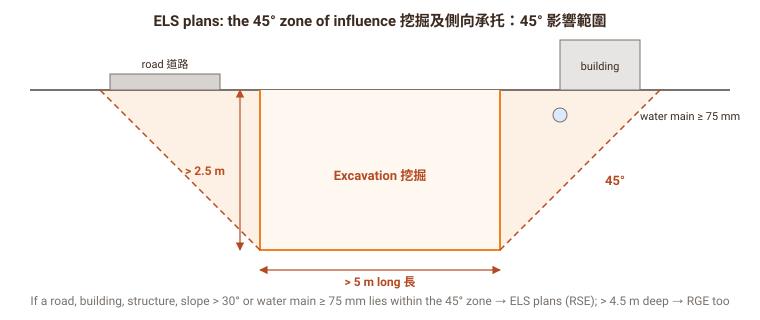

---
tags:
  - PNAP
  - APP series
  - Excavation & ELS 挖掘
  - Geotechnical 岩土
  - Plan submission & approval 呈交及審批
  - Structural 結構
summary: "When an excavation and lateral support (ELS) plan is required (over 2.5 m deep and 5 m long near roads, buildings or mains) and its contents."
keywords: APP-57, excavation and lateral support, ELS, 挖掘及側向承托, 2.5 m, ELS plan, monitoring
---

# APP-57 Requirements for an Excavation and Lateral Support Plan <small>挖掘與側向承托圖則的規定《建築物（管理）規例》第8(1)(bc)條</small>

!!! info "Document info 文件資料"
    | | |
    |---|---|
    | **Type 類別** | PNAP (APP series), previously PNAP 148 舊編號 PNAP 148 |
    | **Issued by 發出機構** | Buildings Department 屋宇署 |
    | **Version summarised 本摘要版本** | July 2026 |
    | **Official language 官方語言** | English only for now 暫只有英文版 |
    | **Source 原文** | [English (PDF)](https://www.bd.gov.hk/doc/en/resources/codes-and-references/practice-notes-and-circular-letters/pnap/APP/APP057.pdf) |
    | **Legal basis 法律依據** | [B(A)R 8(1)(bc)](../regulations/bar-123a.md) |
    | **Last checked 最後核對** | 2026-11-21 against the current BD version |

## At a glance 重點摘要 {#at-a-glance}

=== "English"

    - Even shallow bulk excavation can be dangerous; see APP-18 and APP-137 for monitoring (para. 1).
    - **ELS plans required** where excavation is **> 2.5 m deep and > 5 m long**, **and** liable to affect a road, building, structure, slope **> 30°** or water main **≥ 75 mm**, within the **45° line** from the excavation base (para. 3). No consent without approved ELS plans (para. 4).
    - ELS plans and the structural assessment of excavation and dewatering effects are signed by an **RSE**; for depths **> 4.5 m**, an **RGE** signs the geotechnical documents (para. 5).

=== "中文"

    - 即使淺層的大規模挖掘亦可能危險；監測要求見 APP-18 及 APP-137（第 1 段）。
    - 挖掘**深於 2.5 米及長於 5 米**，**並且**可能影響 **45° 線**範圍內的道路、建築物、構築物、陡於 **30°** 的斜坡或直徑 **≥ 75 毫米**的水管，**須呈交挖掘及側向承托圖則**（第 3 段）；未獲批准不會給予同意（第 4 段）。
    - 圖則及挖掘與降水對鄰近構築物影響的結構評估由**註冊結構工程師**簽署；深度 **> 4.5 米**者，岩土文件須由**註冊岩土工程師**簽署（第 5 段）。

## Workflow / timeline 流程及時間表 {#workflow-timeline}

<figure markdown>
  { width="381" loading=lazy }
  <figcaption>Do I need ELS plans? 是否須呈交挖掘及側向承托圖則？ Summary diagram prepared for this site; check the source text for exact wording.</figcaption>
</figure>

<figure markdown>
  { width="760" loading=lazy }
  <figcaption>The 45° zone of influence for ELS plans (APP-57). 45° 影響範圍。 Diagram prepared for this site; check the source text for exact wording.</figcaption>
</figure>

## Key table: when ELS plans are required 何時須呈交 {#key-table-when-els-plans-are-required}

| Condition 條件 | Threshold 門檻 |
|---|---|
| Depth and length 深度及長度 | > 2.5 m deep **and** > 5 m long |
| Affected features 受影響設施 | Road, building, structure, slope > 30°, water main ≥ 75 mm |
| Zone of influence 影響範圍 | 45° line from excavation base to ground surface |
| RGE needed 須岩土工程師 | Excavation > 4.5 m deep |

<!-- APSEC START -->
## APSEC clarifications 認可人士及註冊結構工程師委員會討論 {#apsec-clarifications}

BD's responses at the APSEC Discussion Forum that clarify this document, **newest first**. Where the same question came up more than once, only the **latest position** is listed. See [all APSEC items](../apsec/index.md). 屋宇署在討論會上就本文件作出的澄清，新者在前；同一問題只列最新立場。

- **[Criteria for Submission of Excavation and Lateral Support (ELS) Plans](../apsec/2025.md#i2025080825)** <small>ADF 3/2025, 8 Aug 2025</small> BD advised that ELS plans were required to be submitted for approval when both criteria in paragraph 3(a) and (b) of PNAP APP-57 were met. The length of the excavation in paragraph 3(a) should refer to the single …
- **[Consent for Initial Stage ELS Works](../apsec/2025.md#i2025050910)** <small>ADF 2/2025, 9 May 2025</small> BD advised that the streamlining measure for carrying out the initial stage of excavation works not exceeding 1.5 m below ground level and erection of the first layer of lateral support was promulgated via BD’s Circular …
- **[Factor of Safety Against Toe Stability of Flexible Earth Retaining Structures for Excavation and Lateral Support (ELS) Works](../apsec/2025.md#i202505098)** <small>ADF 2/2025, 9 May 2025</small> BD advised that with reference to GEO Publication No. 1/2023, a minimum global factor of 1.5 was considered appropriate for design against overturning/toe stability when adopting effective stress analysis (drained shear …
- **[Submission of Supervision Plan (SP) for Excavation Deeper than 2.5 m and greater than 5 m in length](../apsec/2025.md#i2025021415)** <small>ADF 1/2025, 14 Feb 2025</small> BD advised that for ELS works and superstructure works to be carried out concurrently on site, submission of one supervision plan appended with the Form C for combined supervision resources would suffice. Section 11 of …
- **[Split of ELS Plans Submission](../apsec/2020.md#i202001107)** <small>ADF 1/2020, 10 Jan 2020</small> BD confirmed that Stage 1 submission could be a schematic design of ELS system and the structural details of the lateral support system could be included in Stage 2 submission. In this regard, BD would draw GEO’s …
- **[PNAP APP-57](../apsec/2018.md#i201801194)** <small>ADF 1/2018, 19 Jan 2018</small> BD advised that the excavation levels of each stage of ELS works were submitted as tentative levels in the 1st Stage ELS plans and these ELS works, including subsequent amendments of the revised excavation levels if …

<!-- APSEC END -->

<!-- CL START -->
## Related circular letters 相關通告函件 {#circular-letters}

- 🟢 [Use of Tied-Back Wall Support System for Excavation Works](../circulars/2026.md#cl-utbwssew2026) <small>7 Jul 2026 · 挖掘工程使用後拉式圍牆支撐系統</small>
<!-- CL END -->

## Related 相關文件 {#related}

| Document 文件 | Relationship 關係 |
|---|---|
| [APP-22](app-22.md) | Dewatering 降低地下水位 |
| [APP-18](app-18.md) | Foundations Code 基礎守則 |

---
<small>Prepared by: _[name]_ · Checked by: _[name]_ · English only for now; Chinese text is an unofficial translation (中譯（非官方）).</small>
