---
tags:
  - PNAP
  - APP series
  - Drainage 排水
  - Testing 測試
  - Plumbing & sanitary 衞生設備
  - Registration 註冊
  - Site supervision 地盤監督
summary: "Testing of drainage works: AP attends tests under reg. 73(1), contractor arranges, and the completion-of-testing certificate within 7 days."
keywords: APP-58, drainage testing, 排水測試, water test, AP attendance, completion certificate, Cap. 123I
---

# APP-58 Testing of Drainage Works <small>排水工程測試《建築物（衞生設備標準、水管裝置、排水工程及廁所）規例》第73條</small>

!!! info "Document info 文件資料"
    | | |
    |---|---|
    | **Type 類別** | PNAP (APP series), previously PNAP 157 舊編號 PNAP 157 |
    | **Issued by 發出機構** | Buildings Department 屋宇署 |
    | **Version summarised 本摘要版本** | January 2024 |
    | **Official language 官方語言** | English and Chinese 中英文版 |
    | **Source 原文** | [English (PDF)](https://www.bd.gov.hk/doc/en/resources/codes-and-references/practice-notes-and-circular-letters/pnap/APP/APP058.pdf) · [中文 (PDF)](https://www.bd.gov.hk/doc/tc/resources/codes-and-references/practice-notes-and-circular-letters/pnap/APP/APP058.pdf) |
    | **Legal basis 法律依據** | [B(SSF,P,D&L)R 73](../regulations/bsfpwr-123i.md) |
    | **Last checked 最後核對** | 2026-11-21 against the current BD version |

## At a glance 重點摘要 {#at-a-glance}

=== "English"

    - RCs and registered professionals are responsible for compliance; BA monitors. **Drainage tests** under reg. 73(1) must always be **attended by the AP** or representative, whether or not BA inspects (para. 1).
    - RC arranges the test with the AP and applies to BA (copy to AP); the AP witnesses, endorses results and submits a **completion-of-testing certificate** (Appendix) within **7 days** (para. 2). PNRC 11 covers procedures (para. 3).

=== "中文"

    - 註冊承建商及註冊專業人士負責確保合規，建築事務監督只作監察；根據第 73(1) 條進行的**排水測試**必須由**認可人士**或其代表**出席**，不論建築事務監督是否巡查（第 1 段）。
    - 註冊承建商與認可人士安排測試並向建築事務監督申請（副本送認可人士）；認可人士見證、簽署結果，並在 **7 天**內提交**排水工程測試完成證明書**（附錄）（第 2 段）；程序見註冊承建商作業備考第 11 號（第 3 段）。

<!-- APSEC START -->
## APSEC clarifications 認可人士及註冊結構工程師委員會討論 {#apsec-clarifications}

BD's responses at the APSEC Discussion Forum that clarify this document, **newest first**. Where the same question came up more than once, only the **latest position** is listed. See [all APSEC items](../apsec/index.md). 屋宇署在討論會上就本文件作出的澄清，新者在前；同一問題只列最新立場。

- **[Enhanced Communication and Timely Submission of Documents](../apsec/2021.md#i2021081315)** <small>ADF 4/2021, 13 Aug 2021</small> For items 1 and 2, members shared their experience in handling site incidents concerning quality of works and the difficulties encountered for timely submission of structural documents to BD. …
- **[Arrangement of Approval for Vent Pipe Design following Design B](../apsec/2017.md#i2017111714)** <small>ADF 5/2017, 17 Nov 2017</small> BD would follow up on the issue accordingly. [Post-meeting notes: As subsequently clarified with Carolin of AAP, this item was withdrawn.]

<!-- APSEC END -->

---
<small>Prepared by: _[name]_ · Checked by: _[name]_ · Quotes from the official English and Chinese versions; refer to the PNAP for the definitive text.</small>

## Workflow / timeline 流程及時間表 {#workflow-timeline}

<figure markdown>
  { width="320" loading=lazy }
  <figcaption>Drainage testing procedure. 排水工程測試程序。 Summary diagram prepared for this site; check the source text for exact wording.</figcaption>
</figure>

