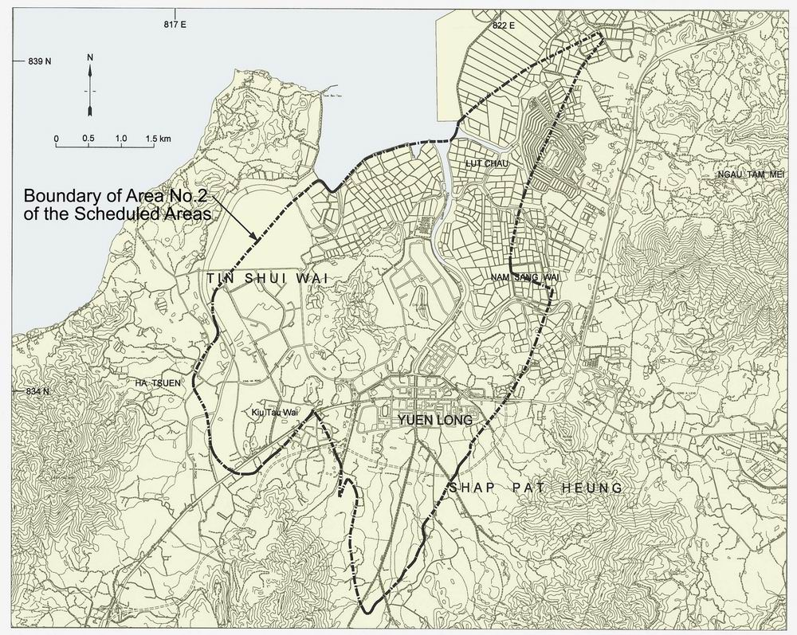
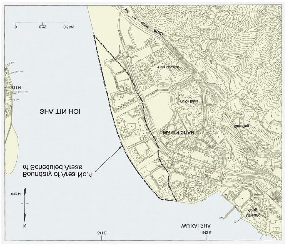

---
tags:
  - PNAP
  - APP series
  - Scheduled area 附表地區
  - Karst / cavities 溶洞
  - Foundation 地基
  - Geotechnical 岩土
  - Plan submission & approval 呈交及審批
  - Excavation & ELS 挖掘
summary: "Marble karst Scheduled Areas 2 and 4 (NW NT, Ma On Shan): GI approval, 20 m into sound marble, piling, records, performance review and monitoring."
keywords: APP-61, Scheduled Area, 附表區, marble, 大理石, cavity, 溶洞, karst, Yuen Long, 元朗, Ma On Shan, 馬鞍山, piling, 打樁, ground investigation
---

# APP-61 Geotechnical Control on Developments in Area Numbers 2 and 4 of the Scheduled Areas <small>附表所列地區第2號及第4號地區內發展的岩土工程管制</small>

!!! info "Document info 文件資料"
    | | |
    |---|---|
    | **Type 類別** | PNAP (APP series), previously PNAP 161 舊編號 PNAP 161 |
    | **Issued by 發出機構** | Buildings Department 屋宇署 |
    | **Version summarised 本摘要版本** | February 2021 |
    | **Official language 官方語言** | English and Chinese 中英文版 |
    | **Source 原文** | [English (PDF)](https://www.bd.gov.hk/doc/en/resources/codes-and-references/practice-notes-and-circular-letters/pnap/APP/APP061.pdf) · [中文 (PDF)](https://www.bd.gov.hk/doc/tc/resources/codes-and-references/practice-notes-and-circular-letters/pnap/APP/APP061.pdf) |
    | **Legal basis 法律依據** | [BO s.41(3), Sch. 5](../regulations/bo-parts-4-9-schedules.md) |
    | **Last checked 最後核對** | 2026-11-21 against the current BD version |

## At a glance 重點摘要 {#at-a-glance}

=== "English"

    - **Area No. 2** (north-west NT) and **Area No. 4** (part of Ma On Shan) have **marble cavity** problems; maps are at BD and CEDD (para. 1).
    - Controls cover **GI, foundation design and construction, and groundwater pumping**, complementing the Foundations Code and APP-18 (para. 2).
    - **GI needs BA approval and consent** (s.41(3), B(A)R 8(1)(l)); high-standard, well-supervised GI to Geoguide 2 by experienced RSCs, with minimum supervisory qualifications (paras. 3–5). Avoid wells here (see APP-4).

=== "中文"

    - **第 2 號地區**（新界西北）及**第 4 號地區**（馬鞍山部分地方）有**大理石溶洞**問題；地圖存放於屋宇署及土木工程拓展署（第 1 段）。
    - 管制涵蓋**土地勘測、基礎設計及施工，以及抽取地下水**，補充基礎守則及 APP-18（第 2 段）。
    - **土地勘測須取得批准及同意**（第 41(3) 條、B(A)R 第 8(1)(l) 條）；須按岩土指南第 2 號由有經驗的註冊專門承建商進行高標準、受妥善監督的勘測，並訂有最低監督資格（第 3–5 段）；該區應避免開鑿水井（見 APP-4）。

!!! tip "Does it apply? 是否適用"
    **Applies 適用**: GI, foundation design and construction, and groundwater pumping in **Scheduled Area No. 2** (north-western NT, e.g. Yuen Long) and **No. 4** (part of **Ma On Shan**), underlain by **marble with cavities (karst)**. 附表區第 2 及第 4 號（大理石溶洞）。

## Key clauses 條文一覽 {#key-clauses-table}

| Para. 段 | Rule 規定 |
|---|---|
| 1–2 | Areas defined in BO Schedule 5 (maps below); measures complement the **Foundations Code 2017** and [APP-18](app-18.md). 範圍。 |
| 3 | **GI needs BA approval and consent** (s.41(3); B(A)R 8(1)(l)). 土地勘測須批准。 |
| 4–5 | High-standard, supervised GI by competent RSCs (Geoguide 2); cores logged by a **Competent Person (Logging)** (Geoguide 3) noting **cavity size, walls, infill**, discontinuities and **TCR, SCR, RQD, FI**. 記錄岩芯。 |
| 6–7 | GI in **stages**; deep holes, **inclined** holes where trends are vertical, geophysics; **grout all holes**; early stages **before** finalising GBP (moving structures may be cheapest). 分階段勘測。 |
| 8 | Depth by marble level and loads; **≥ 20 m into sound marble**, deeper near cavities; control **flushing water** (it has induced sinkholes); **triple-tube** with air foam for infill. 鑽入完整大理石最少 20 米。 |
| 9–10 | Further GI once pile positions known, especially at **edges**; consult the district **Chief Geotechnical Engineer**; **≥ 2 weeks'** notice before GI (B(A)R 20). 補充勘測及通知。 |
| 11 | Keep **cores and samples** on site until substantial completion. 保存岩芯。 |
| 12–15 | **Driven or machine-bored piles** preferred; **no hand-dug caissons** (dewatering may cause sinkholes); heavy driven piles with **strengthened tips**, pre-drilling where needed, **extra piles** for load redistribution; for large bored piles or barrettes, probe the stressed zone for cavities. 樁基設計。 |
| 16 | Supporting documents per **B(A)R 8(1)(d)(ii)** or refusal under s.16(1)(a), (i). 附交文件。 |
| 17–18 | Driven pile records: blows per **500 mm** (easy) to per **100 mm** (hard), plotted by depth; easy / hard divide at **10 blows / 100 mm**; survey pile deviation. 打樁記錄。 |
| 19–20 | Review records closely (buckling, sinkholes, cavity collapse); **trial piles**, instrumentation, extra NDT for anomalies. 施工檢討。 |
| 21 | Superstructure consent may be refused (**s.16(3)(ba)**) if the **performance review** (Foundations Code 7.8) is inadequate. 表現檢討。 |
| 22–25 | Settlement monitoring scheme agreed before foundation completion; results **monthly**; GEO may continue after OP; also monitor buildings on weathered siltstone / sandstone over marble. 沉降監測。 |
| 26–27 | **Wells** need an RGE submission showing no adverse effect; flushing water usually supplied (Yuen Long, Ma On Shan) ([APP-4](app-4.md)). 水井。 |
| 28–29 | Geological maps and Sheet Reports 1 (Yuen Long) and 5 (Ma On Shan); GEO **TGN 26** (marble), TGN 5, GEO Publication 1/2006. 參考資料。 |

<figure markdown>
  { width="620" loading=lazy }
  <figcaption>Figure 1 – Scheduled Area No. 2, north-western New Territories. 附表區第 2 號。Source: BD, PNAP APP-61.</figcaption>
</figure>

<figure markdown>
  { width="480" loading=lazy }
  <figcaption>Figure 2 – Scheduled Area No. 4, Ma On Shan. 附表區第 4 號。Source: BD, PNAP APP-61.</figcaption>
</figure>

## Whole picture 整體關係 {#whole-picture}

| Topic 主題 | Where 文件 |
|---|---|
| Foundations and performance review 地基 | [Foundations Code](../codes/foundations-2017.md) · [APP-18](app-18.md) |
| Site investigation 地盤勘測 | [APP-49](app-49.md) |
| Hand-dug caissons 人手挖掘沉箱 | [APP-59](app-59.md) |
| Wells 水井 | [APP-4](app-4.md) |
| Minor amendments not allowed (excavation limits) 輕微修訂 | [ADM-19](adm-19.md) App. G |
| Other Scheduled Areas 其他附表區 | [APP-51](app-51.md) (Mid-levels) · [APP-62](app-62.md) (sewage tunnels, Area 5) · [APP-24](app-24.md) (railways, Area 3) |

## Related 相關文件 {#related}

| Document 文件 | Relationship 關係 |
|---|---|
| [APP-4](app-4.md) | Wells 水井 |
| [APP-30](app-30.md) | Scheduled Area 1 第 1 號地區 |

---
<small>Prepared by: _[name]_ · Checked by: _[name]_ · Quotes from the official English and Chinese versions; refer to the PNAP for the definitive text.</small>
