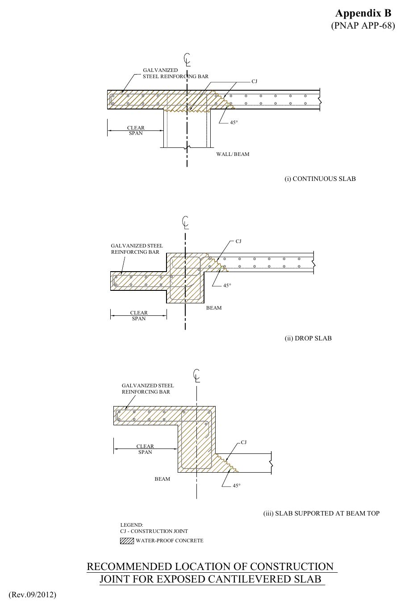

---
tags:
  - PNAP
  - APP series
  - Structural 結構
  - Cantilever 懸臂
  - Projections 伸出物
  - Concrete & materials 混凝土及物料
  - Drainage 排水
  - Site supervision 地盤監督
  - Balcony & utility platform 露台及工作平台
summary: "Design and construction of cantilevered RC structures (canopies, balconies, A/C platforms): beam-and-slab for spans over 1 m, loads, cover and supervision."
keywords: APP-68, cantilever, 懸臂, canopy, balcony, A/C platform, reinforced concrete, beam-and-slab
---

# APP-68 Design and Construction of Cantilevered Reinforced Concrete Structures <small>懸臂式鋼筋混凝土構築物的設計及建造</small>

!!! info "Document info 文件資料"
    | | |
    |---|---|
    | **Type 類別** | PNAP (APP series), previously PNAP 173 舊編號 PNAP 173 |
    | **Issued by 發出機構** | Buildings Department 屋宇署 |
    | **First issue 首次發出** | October 1994 |
    | **Version summarised 本摘要版本** | September 2012 (paras. 1 & 2 and Appendices A & B revised; Appendix C deleted) |
    | **Official language 官方語言** | English and Chinese 中英文版 |
    | **Source 原文** | [English (PDF)](https://www.bd.gov.hk/doc/en/resources/codes-and-references/practice-notes-and-circular-letters/pnap/APP/APP068.pdf) · [中文 (PDF)](https://www.bd.gov.hk/doc/tc/resources/codes-and-references/practice-notes-and-circular-letters/pnap/APP/APP068.pdf) |
    | **Last checked 最後核對** | 2026-11-20 against the September 2012 version |

!!! note "Code reference 守則版本"
    APP-68 cites the **Code of Practice for Structural Use of Concrete 2004** and the **Code of Practice for Site Supervision 2009**. Check the latest editions for the equivalent clause numbers.
    本備考引用《2004 年混凝土結構作業守則》及《2009 年地盤監督作業守則》，請核對最新版本的相應條文。

## At a glance 重點摘要 {#at-a-glance}

=== "English"

    - Covers **canopies, balconies, projecting windows, A/C hoods and platforms, flower beds** and similar cantilevers. Their **collapse would be serious**, and weathering degrades them (para. 1).
    - **Design**: use **beam-and-slab** rather than a pure slab cantilever for clear spans **> 1,000 mm** where practicable. Allow for finishes, parapets, waterproofing, maintenance loads and **ponding**. Detail cantilevers over streets so they can be **demolished or replaced** without affecting the main structure.
    - **Cantilever slabs**: min. thickness **110 / 125 / 150 mm** for spans ≤ 500 / 500–750 / > 750 mm; HY bars **both faces, both ways**, **≥ T10 @ ≤ 150 mm**, ≥ **0.25%** steel; external slabs crack width **≤ 0.1 mm** (or steel stress ≤ 100 N/mm²).
    - **Cantilever beams**: overall depth at support **≥ 300 mm**; exposure condition **2** or higher.
    - **Exposed external slabs > 750 mm**: **waterproof concrete ≥ 35 MPa**, **hot-dip galvanised** main bars, waterproof membrane, plus a **construction report and Form BA14** on completion.
    - **Drainage**: falls ≥ **1:75**, drips at the edge, outlets ≤ **5 m** apart where not accessible. Canopies always drain to the building's system. Show on GBP and drainage plans (complies with B(P)R 4(b), 10(3)).

=== "中文"

    - 適用於**簷篷、露台、伸出窗、冷氣機罩及平台、花槽**等懸臂構件；其**倒塌後果嚴重**，且受風雨侵蝕會加速老化（第 1 段）。
    - **設計**：淨跨度 **> 1,000 毫米**時應盡量採用**樑板式**而非純懸臂板；須計及飾面、欄杆、防水層、維修荷載及**積水**；伸出街道的懸臂構件須設計成可在不影響主結構下**拆除或更換**。
    - **懸臂板**：跨度 ≤ 500／500–750／> 750 毫米的最少厚度為 **110／125／150 毫米**；高強度鋼筋**雙面雙向**、**≥ T10 @ ≤ 150 毫米**、鋼筋 ≥ **0.25%**；外部懸臂板裂縫 **≤ 0.1 毫米**（或鋼筋應力 ≤ 100 牛頓／平方毫米）。
    - **懸臂樑**：支座處總深度 **≥ 300 毫米**；暴露條件 **2** 級或以上。
    - **外露而跨度 > 750 毫米的外部懸臂板**：**≥ 35 兆帕的防水混凝土**、**熱浸鍍鋅**主鋼筋、防水膜，竣工時提交**施工報告及 BA14 表格**。
    - **排水**：斜度 ≥ **1:75**，邊緣設滴水線，不能進入清理者排水口相距 ≤ **5 米**；簷篷必須接駁建築物排水系統；須在一般建築圖則及排水圖則上顯示（符合 B(P)R 第 4(b)、10(3) 條）。

## Key table: design requirements (Appendix A) 設計規定（附錄 A） {#key-table-design-requirements-appendix-a-a}

| Item 項目 | Requirement 規定 | Para. 段 |
|---|---|---|
| Arrangement 佈置 | Clear span **> 1,000 mm** → **beam-and-slab** where practicable 淨跨度 > 1,000 毫米採用樑板式 | 1(a) |
| Span/depth 跨深比 | Per the Concrete Code (cl. 7.3.4.2) 按混凝土守則 | 1(b) |
| Loads 荷載 | Finishes, parapets, waterproofing, maintenance and **ponding** from blocked drains 包括積水 | 1(c) |
| Replaceability 可更換 | Over streets: demolishable / replaceable without affecting the main structure 伸出街道者可拆換 | 1(d) |
| Projection / clearance 伸出／淨空 | B(P)R 7, 10 and [APP-19](app-19.md) | 1(e) |
| **Cantilever beam** depth 懸臂樑深度 | **≥ 300 mm** at support; exposure condition **2+** 支座 ≥ 300 毫米 | 5 |
| **Slab thickness** 懸臂板厚度 | Span ≤ 500 mm: **110 mm** · 500–750 mm: **125 mm** · > 750 mm: **150 mm** | 6(a) |
| Slab reinforcement 懸臂板鋼筋 | HY bars in **both faces and both directions**; main bars **≥ 10 mm @ ≤ 150 mm**; **≥ 0.25%** of the concrete section; drop slabs: top bars **≤ 16 mm** for anchorage 雙面雙向；≥ 10 毫米 @ ≤ 150 毫米；≥ 0.25% | 6(c)–(d) |
| Corners and returns 轉角及回頭欄杆 | Specific details for slabs around building corners and side edges with return parapets 轉角及側邊須特別設計 | 6(e) |
| External slabs 外部懸臂板 | Crack width **≤ 0.1 mm** (SLS) or HY steel stress **≤ 100 N/mm²** (working load); cover for exposure **2+** 裂縫 ≤ 0.1 毫米 | 8 |
| **Exposed, span > 750 mm** 外露且跨度 > 750 毫米 | **Waterproof concrete ≥ 35 MPa**; **hot-dip galvanised** main bars (BS EN ISO 1461); membrane protected by 1:3 cement-sand mortar (w/c ≤ 0.65); **construction report + Form BA14** 防水混凝土 ≥ 35 兆帕；熱浸鍍鋅；施工報告 | 9–10 |

<small>"Exposed to weathering" excludes cantilevers under a permanent solid cover not more than one storey above and at least the same plan area (footnote 1). 位於不高於一層、面積不少於其本身的永久實心上蓋下的懸臂構件，可視為不受風雨侵蝕。</small>

## Key table: construction, drainage and maintenance 施工、排水及保養 {#key-table-construction-drainage-and-maintenance}

| Topic 主題 | Requirement 規定 | Para. 段 |
|---|---|---|
| Casting 澆築 | **Monolithic** with supporting members; **no construction joint** along the external edge of the support (alternative needs prior approval) 與支承構件一同澆築；支承外邊不得設施工縫 | 2(a) |
| Bar position 鋼筋位置 | Adequate **bar spacers**; avoid displacing or depressing top bars during concreting 足夠墊塊；防止面筋下陷 | 2(b)–(c) |
| Supervision 監督 | AP / RSE / RGBC per **Table 9.1** of the Code of Practice for Site Supervision 按地盤監督守則 | 3 |
| Waterproofing and falls 防水及斜度 | Effective waterproofing; mortar to a fall **≥ 1:75**; **continuous drip / groove** at the bottom edge 斜度 ≥ 1:75；邊緣設滴水線 | 4(a)–(b) |
| Canopies 簷篷 | **All** canopies drain into the building's surface water system 所有簷篷須接駁排水系統 | 4(b) |
| Outlets 排水口 | ≤ **5 m** apart where not accessible for cleaning 不能清理者相距 ≤ 5 米 | 4(c) |
| Embedded pipes 預埋喉管 | Avoid; if unavoidable, allow for loss of strength (see APP-105) 避免預埋喉管 | 4(d) |
| Construction report 施工報告 | As-built plan (dimensions, falls, outlets, finishes, membrane, joints, grades, bars, casting date, **covermeter readings**) + photos before and after concreting 竣工圖及照片 | 10 |
| Maintenance 保養 | AP / RSE / RGBC prepare inspection and maintenance documentation for the owners. Clear drains and check waterproofing regularly, especially in the **rainy season**. **Do not** use canopies as A/C supports 定期清理排水口；簷篷不得用作冷氣機支架 | 11–12 |

## Key clauses 主要條文 {#key-clauses}

!!! quote "App. A para. 6(a) — Minimum slab thickness 最少厚度"
    The minimum overall thickness should be-- (i) 110 mm for span not greater than 500 mm; (ii) 125 mm for span greater than 500 mm but not greater than 750 mm; (iii) 150 mm for span greater than 750 mm.

    **官方中文本：** 最少總厚度方面：(i) 若跨度不超逾500毫米，其最少總厚度應為110毫米；(ii) 若跨度介乎500毫米至750毫米，其最少總厚度應為125毫米；(iii) 若跨度超逾750毫米，其最少總厚度應為150毫米。

!!! quote "App. A para. 9 — Exposed slabs over 750 mm 跨度超逾 750 毫米的外露懸臂板"
    External cantilevered slabs with a span exceeding 750 mm exposed to weathering should satisfy the following additional requirements: (a) The AP/RSE, in conjunction with the RGBC where appropriate, is required to submit a construction report upon completion of the works. A Form BA 14 confirming that the works have been carried out in accordance with the approved plans and are structurally safe should also be submitted; (b) Concrete should be water-proof concrete of characteristic compressive strength not less than 35MPa at 28 days; (c) All main steel reinforcing bars should be hot-dip galvanized to BS EN ISO 1461; and (d) Water-proof membrane/tanking should be provided and protected by 1:3 cement sand mortar of 0.65 maximum free water/cement ratio or other equivalent means.

    **官方中文本：** 外部懸臂式平板的跨度如超逾750毫米並外露受風雨侵蝕，須符合下述的額外規定：(a) 認可人士／註冊結構工程師（如適用，可聯同註冊一般建築承建商）須於竣工後提交施工報告。表格BA14亦須一併提交，以確認工程的進行符合經批准圖則並且結構安全；(b) 混凝土應為28天特徵抗壓強度不少於35兆帕斯卡的防水混凝土；(c) 所有主鋼筋應進行符合BS EN ISO 1461的熱浸鍍鋅……

<figure markdown>
  { loading=lazy }
  <figcaption>Appendix B — Recommended location of construction joints for exposed cantilevered slabs (continuous slab, drop slab, slab at beam top) 外露懸臂板施工縫的建議位置 <small>Source: PNAP APP-68 (Sep 2012), Buildings Department 資料來源：屋宇署</small></figcaption>
</figure>

## Explanation 淺白解釋 {#explanation}

=== "English"

    Cantilevers have **no second support**. If the top steel corrodes or slips, or ponding overloads the slab, they fail suddenly, and often over a pavement. APP-68 tackles the usual causes of failure:

    - **Top bars in the wrong place** (pushed down during concreting) → spacers, supervision, photos before casting.
    - **Water getting in** at the support joint and corroding the steel → monolithic casting, waterproof concrete, galvanised bars, membranes, falls and drips.
    - **Blocked drains and misuse** (ponding, A/C units on canopies) → drainage outlets, maintenance documents for owners.

    Following Appendix A is treated as complying with the structural performance requirements of B(C)R 4. Showing the drainage on plans is treated as complying with B(P)R 4(b) and 10(3).

=== "中文"

    懸臂構件**沒有第二個支承**；如面筋生鏽或移位，或積水令平板超載，便會突然倒塌，而且往往在行人路上。APP-68 針對常見的失效原因：

    - **面筋位置錯誤**（澆築時被壓低）→ 墊塊、監督、澆築前拍照。
    - **雨水由支承接縫滲入**令鋼筋生鏽 → 一同澆築、防水混凝土、鍍鋅鋼筋、防水膜、斜度及滴水線。
    - **排水口淤塞及不當使用**（積水、在簷篷放冷氣機）→ 排水口、給業主的保養文件。

    遵從附錄 A 即被視為符合 B(C)R 第 4 條的結構性能要求；在圖則上顯示排水即被視為符合 B(P)R 第 4(b) 及 10(3) 條。

## Practical notes 實務提示 {#practical-notes}

=== "English"

    !!! example "Worked example: entrance canopy"
        Exposed RC canopy slab with a clear span of **1,200 mm**.

        - Span > 1,000 mm → prefer a **beam-and-slab** arrangement; cantilever beams ≥ **300 mm** deep at the support.
        - Any slab cantilever > 750 mm → **≥ 150 mm** thick, **35 MPa waterproof concrete**, **galvanised** main bars, membrane, **construction report + BA14**.
        - Falls ≥ 1:75 to outlets connected to the building drainage, plus a drip at the edge.

    !!! tip "Common pitfalls"
        - **Construction joints at the face of the supporting wall or beam**. Follow Appendix B or get prior approval.
        - **Embedding drainage pipes** in thin cantilever slabs.
        - Canopies with **no drainage**, letting water cascade onto pedestrians.
        - Forgetting the extra load from **return parapets** at slab side edges and corners.

=== "中文"

    !!! example "計算例子：入口簷篷"
        外露的鋼筋混凝土簷篷板，淨跨度 **1,200 毫米**。

        - 跨度 > 1,000 毫米 → 應採用**樑板式**；懸臂樑支座處深度 ≥ **300 毫米**。
        - 任何跨度 > 750 毫米的懸臂板 → 厚 **≥ 150 毫米**、**35 兆帕防水混凝土**、**鍍鋅**主鋼筋、防水膜，並須提交**施工報告及 BA14**。
        - 斜度 ≥ 1:75 流向接駁建築物排水系統的排水口，邊緣設滴水線。

    !!! tip "常見錯誤"
        - **在支承牆或樑的面設施工縫**：須按附錄 B 或事先取得批准。
        - 在薄懸臂板內**預埋排水管**。
        - 簷篷**沒有排水**，雨水直接流到行人身上。
        - 忘記平板側邊及轉角**回頭欄杆**的額外荷載。

<!-- APSEC START -->
## APSEC clarifications 認可人士及註冊結構工程師委員會討論 {#apsec-clarifications}

BD's responses at the APSEC Discussion Forum that clarify this document, **newest first**. Where the same question came up more than once, only the **latest position** is listed. See [all APSEC items](../apsec/index.md). 屋宇署在討論會上就本文件作出的澄清，新者在前；同一問題只列最新立場。

- **[Definition of Span in Clause 9.4.1 of Code of Practice for Structural](../apsec/2026.md#i202605088)** <small>ADF 2/2026, 8 May 2026</small> Use or slab BD confirmed that the span specified in Clause 9.4.1 of the Concrete Code There is should refer to the clear span of cantilevered structure. Is it the APP-68 BD advised that an amendment to the Concrete Code was being prepared to incorporate the updated design and construction requirements for where cantilevered … <small>Latest position; replaces earlier discussion on [10 Feb 2023](../apsec/2023.md#i2023021020) 以此為最新立場</small>
- **[Cantilevered Reinforced Concrete Structure](../apsec/2019.md#i2019082313)** <small>ADF 4/2019, 23 Aug 2019</small> BD confirmed that the submission of construction report and Form BA14 would not be required for AC platform with clear span exceeding 750mm provided that the criteria stated in the footnote of PNAP APP-68 were fulfilled.
- **[Design and Disposition of AC Platform](../apsec/2018.md#i201808174)** <small>ADF 4/2018, 17 Aug 2018</small> BD advised that relaxation on the required level difference between balcony/UP and the adjoining AC platform would be considered on a case basis with due regard to the circumstances and difficulties of individual cases. …

<!-- APSEC END -->

## Related 相關文件 {#related}

| Document 文件 | Relationship 關係 |
|---|---|
| [APP-19](app-19.md) para. 10 | Drainage for cantilevered RC structures; projection limits 懸臂結構排水；伸出限制 |
| [APP-42](app-42.md) para. 18 | Canopies 簷篷 |
| [APP-93](app-93.md) | Drainage works 排水工程 |
| APP-105 | Embedded water-borne pipes in RC 預埋喉管 |
| Code of Practice for Structural Use of Concrete; Site Supervision | Design and supervision 設計及監督 |

---
<small>Prepared by: _[name]_ · Checked by: _[name]_ · Quotes from the official English and Chinese versions; refer to the PNAP for the definitive text.</small>
