---
tags:
  - PNAP
  - APP series
  - Occupation permit 佔用許可證
  - Inspection 檢驗
  - Statutory period 法定期限
  - Plumbing & sanitary 衞生設備
  - Plan submission & approval 呈交及審批
  - Site safety 地盤安全
summary: "Occupation permit procedure: 14-day processing, documents before BA13, joint OP inspection, refusals, comprehensive inspection and scaffold arrangements (Nov 2026)."
keywords: APP-78, occupation permit, 佔用許可證, OP, BA13, s.21, OP inspection, 驗樓, comprehensive inspection, scaffold, 棚架
---

# APP-78 Occupation of New Buildings under Section 21 of the Buildings Ordinance <small>佔用新建築物－《建築物條例》第21條</small>

!!! info "Document info 文件資料"
    | | |
    |---|---|
    | **Type 類別** | PNAP (APP series), previously PNAP 188 舊編號 PNAP 188 |
    | **Issued by 發出機構** | Buildings Department 屋宇署 |
    | **Version summarised 本摘要版本** | November 2026 |
    | **Official language 官方語言** | English only for now 暫只有英文版 |
    | **Source 原文** | [English (PDF)](https://www.bd.gov.hk/doc/en/resources/codes-and-references/practice-notes-and-circular-letters/pnap/APP/APP078.pdf) |
    | **Legal basis 法律依據** | [BO s.21](../regulations/bo-part-2-building-works.md) |
    | **Last checked 最後核對** | 2026-11-21 against the current BD version |

## At a glance 重點摘要 {#at-a-glance}

=== "English"

    - The BA must process an **OP application within 14 days** (BO s.21(7)); submit certificates, record plans, material and product schedules and structural documents **before or with Form BA13**, ideally **early via the Electronic Submission Hub (ESH)** (paras. 2–3).
    - **Joint OP inspection** with the AP and contractor; all parts available; obviously **incomplete works** (e.g. sanitary fitments, fire doors) mean summary refusal and a fresh BA13, and possible discipline for premature certification (paras. 4–5).
    - Plant required by the BO must be operational; rectifications may be confirmed in writing with photos within the 14 days; after refusal, written confirmation triggers **re-inspection within 14 days** (paras. 6–9).
    - **Facilitation**: a **joint comprehensive inspection** after superstructure completion to catch major non-conformities early, with audit measurements; arrangements for temporary scaffold supports and other items (paras. 10–13+).

=== "中文"

    - 建築事務監督須在 **14 天**內處理**佔用許可證申請**（第 21(7) 條）；證明書、紀錄圖則、物料及產品清單及結構文件須在**表格 BA13 之前或同時**呈交，最好**及早經電子呈交平台**提交（第 2–3 段）。
    - 與認可人士及承建商**聯合巡查**；所有部分須可供檢查；明顯**未完成的工程**（例如衞生設備、防火門）會被即時拒絕，須重新呈交 BA13，過早核證或會引致紀律處分（第 4–5 段）。
    - 條例規定的機器須可運作；可在 14 天內以書面及照片確認已作修正；被拒後提交書面確認，屋宇署會在 **14 天內再巡查**（第 6–9 段）。
    - **便利措施**：上蓋完成後進行**聯合全面巡查**，及早找出重大不符之處並抽查尺寸；另有臨時棚架支撐等安排（第 10–13 段起）。

!!! tip "Does it apply? 是否適用"
    **Applies 適用**: applications for an **occupation permit** (OP / TOP) for new buildings under **BO s.21**, on **Form BA13**. Revised **November 2026** (general revamp). 新建築物佔用許可證申請。

## Key clauses 條文一覽 {#key-clauses-table}

| Para. 段 | Rule 規定 |
|---|---|
| 1 | Procedures for OP applications and facilitation measures. 目的。 |
| 2 | BA processes within **14 days** (s.21(7)). Works complete per approved plans and BO; **certificates, record plans, material schedules and documents** submitted **before**, and no later than, the **BA13**; missing documents may cause **refusal**. 14 天；文件須齊備。 |
| 3 | Submit test reports and product certificates **as soon as available**; use **ESH** batch submissions and tracking (ESH manual s.2.28). 盡早經電子平台呈交。 |
| 4 | **Joint OP inspection** with the AP, who co-ordinates the RC to follow up irregularities. 聯合驗樓。 |
| 5 | All works must be available; **obviously incomplete** works (e.g. missing sanitary fitments or fire doors) → **summary refusal**, fresh BA13 needed; serious cases may lead to **disciplinary action** for premature certification. 明顯未完成即拒絕。 |
| 6 | Required plant (e.g. extensive A/C) must be operational and inspectable; installing plant and fixtures before OP is fine if safe and not hampering inspection. 機械須可運作。 |
| 7 | Rectifications may be accepted on the AP's **written confirmation and photos** before the 14 days expire, in good time. 書面確認及照片。 |
| 8 | Refusals notified by **ESH, email, fax or post**, with other comments for information. 拒絕通知。 |
| 9 | After refusal (unless premature), **no new BA13**: on AP's confirmation, reinspection and decision **within 14 days**. 毋須重新申請。 |
| 10–12 | **Joint comprehensive inspection (CI)** after **superstructure completion**, arranged by the AP, to find major non-conformities (incl. audit measurements) and check modification conditions; it does not shift responsibility. 上蓋完成後全面巡查。 |
| 13 | **Scaffolds**: temporary structures removed at completion, but **localised scaffolds and supports** may stay at OP inspection if: (a) agreed at the CI; (b) not hampering inspection; (c) fully removed and made good **before OP issue**; (d) AP letter and plan after the CI. 局部棚架安排。 |
| 14 | If not removed before the processing period ends: refusal under **s.21(6)(a)**; may need a fresh BA13 and reinspection. 未拆除即拒絕。 |

## Whole picture 整體關係 {#whole-picture}

| Topic 主題 | Where 文件 |
|---|---|
| Statutory OP provisions 法定條文 | [BO Part 2](../regulations/bo-part-2-building-works.md) (s.21) · [B(A)R](../regulations/bar-123a.md) |
| Documents before OP 入伙前文件 | [Submission to OP guide](../guides/submission-to-op.md) · [ADM-2](adm-2.md) (GFA concession summary) · [APP-156](app-156.md) · [APP-130](app-130.md) |
| Fire safety code compliance 消防守則 | [APP-153](app-153.md) |
| Electronic submissions 電子呈交 | [ADM-17](adm-17.md) · [APP-60](app-60.md) |
| Temporary buildings and show flats 臨時建築物 | [APP-50](app-50.md) · [APP-95](app-95.md) |
| Approval process 審批程序 | [ADM-19](adm-19.md) (Stage III GBP) |

## Workflow / timeline 流程及時間表 {#workflow-timeline}

<figure markdown>
  { width="615" loading=lazy }
  <figcaption>Occupation permit inspection workflow. 佔用許可證巡查流程。 Summary diagram prepared for this site; check the source text for exact wording.</figcaption>
</figure>

## Practical notes 實務提示 {#practical-notes}

=== "English"

    !!! tip "Common pitfalls"
        - Applying for OP with fire doors, sanitary fitments or FSI still incomplete.
        - Leaving material test reports and product certificates to the last minute.

=== "中文"

    !!! tip "常見錯誤"
        - 防火門、衞生設備或消防裝置未完成便申請佔用許可證。
        - 物料測試報告及產品證書留到最後才提交。

## Related 相關文件 {#related}

| Document 文件 | Relationship 關係 |
|---|---|
| [APP-13](app-13.md) | Completion certificates and record plans 完工證明書 |
| [BO s.14–21](../regulations/bo-part-2-building-works.md) | Occupation permit 佔用許可證 |

---
<small>Prepared by: _[name]_ · Checked by: _[name]_ · English only for now; Chinese text is an unofficial translation (中譯（非官方）).</small>
