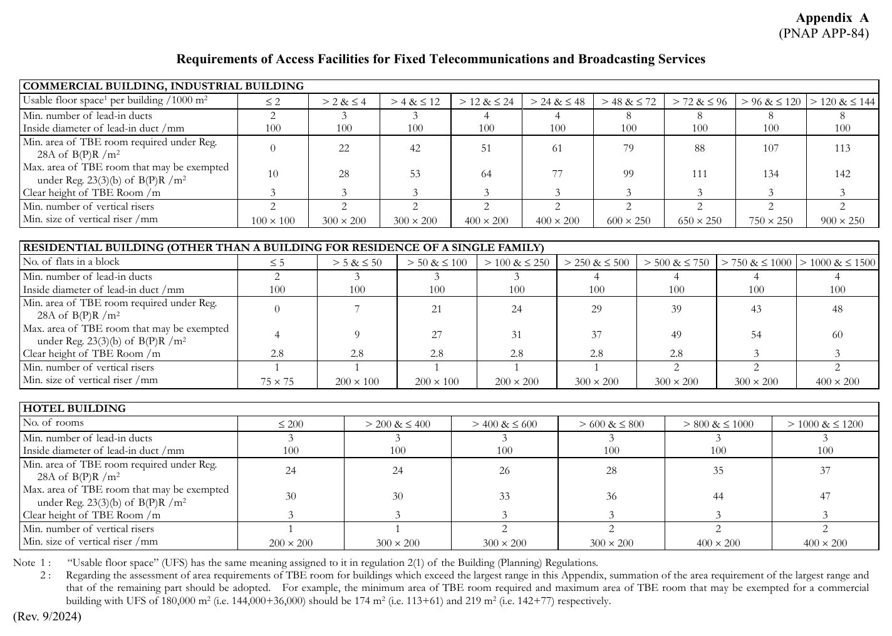
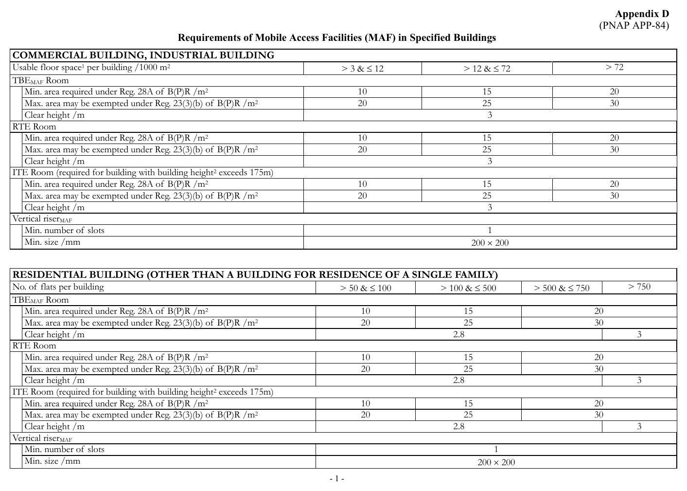
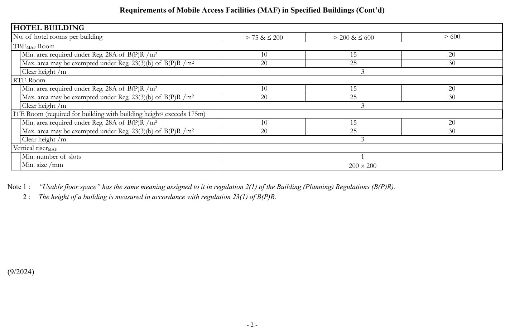
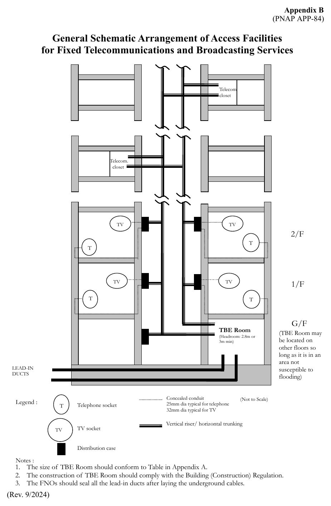
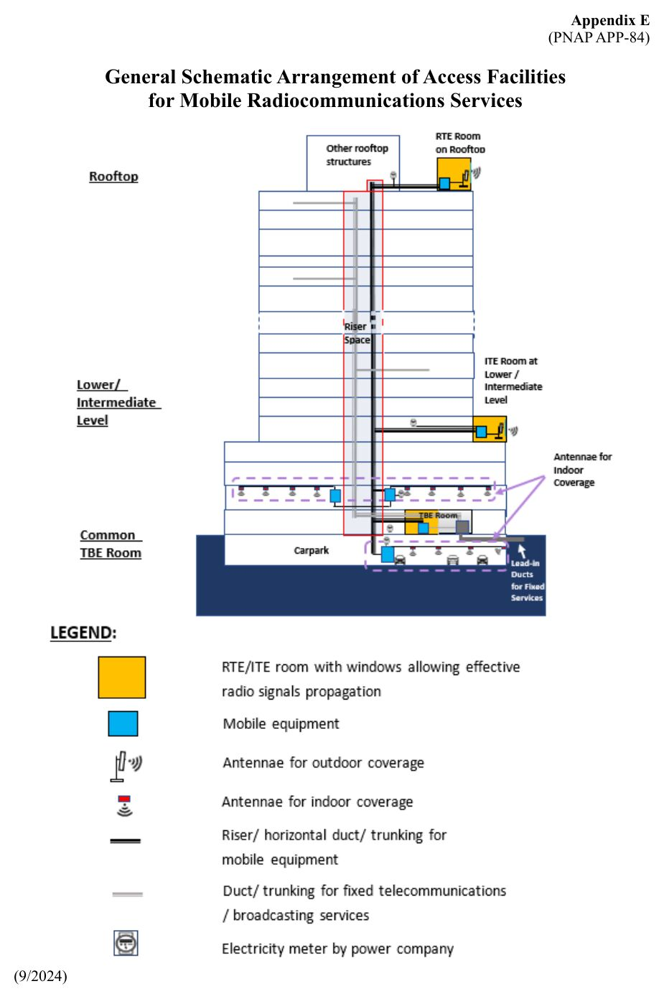

---
tags:
  - PNAP
  - APP series
  - Telecom 電訊
  - GFA concession 樓面面積寬免
  - 5G
  - GFA 總樓面面積
  - Domestic 住用
  - Hotel 酒店
  - Drainage 排水
  - Lighting & ventilation 照明及通風
---

# APP-84 Access Facilities for Telecommunications and Broadcasting Services <small>為電訊及廣播服務而設的接達設施</small>

!!! info "Document info 文件資料"
    | | |
    |---|---|
    | **Type 類別** | PNAP (APP series), previously PNAP 201 舊編號 PNAP 201 |
    | **Issued by 發出機構** | Buildings Department 屋宇署 |
    | **First issue 首次發出** | November 1997 |
    | **Version summarised 本摘要版本** | September 2024 (generally revamped; Appendices C–E added for mobile/5G) |
    | **Official language 官方語言** | English only (Chinese version not available) 只有英文版 |
    | **Source 原文** | [APP-84 (PDF)](https://www.bd.gov.hk/doc/en/resources/codes-and-references/practice-notes-and-circular-letters/pnap/APP/APP084.pdf) |
    | **Legal basis 法律依據** | B(P)R 28A; Telecommunications Ordinance (Cap. 106) s.14 |
    | **Last checked 最後核對** | 2026-11-20 against the September 2024 version |

## At a glance 重點摘要 {#at-a-glance}

=== "English"

    - **B(P)R 28A** requires **access facilities for telecommunications and broadcasting** in every commercial, industrial, residential (except single-family) and hotel building (para. 4).
    - **Fixed services** (Appendix A): **lead-in ducts**, a **TBE room** (min. size required; max. size **GFA-exempt** under reg. 23(3)(b)) and **vertical risers**, sized by **UFS / number of flats / number of rooms**.
    - **TBE room**: not liable to flooding; **no water/drainage pipes, sprinklers, HV cables or transformers** inside; lighting, power, ventilation; separate telecom earth; clear height **3 m** (2.8 m for smaller residential) (paras. 9–10).
    - **Mobile / 5G (new, from 1 Apr 2025)**: "**specified buildings**" (commercial/industrial > **3,000 m²** UFS, residential > **50 flats**, hotels > **75 rooms**) must provide **mobile access facilities (MAF)**: a **TBEMAF room**, a **rooftop telecom equipment (RTE) room**, an **ITE room** for buildings > **175 m**, and risers (Appendices C–D).
    - **GFA**: TBE rooms up to the Appendix A max., and MAF in specified buildings, may be **disregarded**. MAF rooms **< 10 m²** are not exempted; MAF in non-specified buildings counts as GFA (para. 17).

=== "中文"

    - **B(P)R 第 28A 條**規定每幢商業、工業、住宅（單一家庭住宅除外）及酒店建築物須設**電訊及廣播服務接達設施**（第 4 段）。
    - **固網服務**（附錄 A）：**引入管道**、**電訊及廣播設備房**（設最低面積；最高面積可根據第 23(3)(b) 條**豁免總樓面面積**）及**垂直槽**，按**實用樓面空間／單位數目／客房數目**釐定。
    - **電訊及廣播設備房**：不易水浸；房內**不得有水管、排水管、花灑、高壓電纜或變壓器**；須有照明、電力及通風；獨立電訊接地；淨高 **3 米**（較小住宅 2.8 米）（第 9–10 段）。
    - **流動／5G（新增，2025 年 4 月 1 日起）**：「**指明建築物**」（商業／工業實用樓面空間 > **3,000 平方米**、住宅 > **50 個單位**、酒店 > **75 間客房**）須提供**流動通訊接達設施**：**流動通訊設備房**、**天台電訊設備房**、高於 **175 米**的建築物另設**中層電訊設備房**，以及垂直槽（附錄 C–D）。
    - **總樓面面積**：附錄 A 上限內的設備房，以及指明建築物的流動通訊設施可**不計算**；**< 10 平方米**的流動通訊設備房不獲豁免；非指明建築物的流動通訊設施須計入總樓面面積（第 17 段）。

## Key table: TBE room areas (Appendix A) 電訊及廣播設備房面積（附錄 A） {#key-table-tbe-room-areas-appendix-a-a}

**Commercial / industrial buildings 商業／工業建築物** (UFS per building, ×1,000 m² 每幢實用樓面空間)

| UFS (×1,000 m²) | ≤ 2 | > 2–4 | > 4–12 | > 12–24 | > 24–48 | > 48–72 | > 72–96 | > 96–120 | > 120–144 |
|---|--:|--:|--:|--:|--:|--:|--:|--:|--:|
| Min. TBE room (reg. 28A) 最低面積 (m²) | 0 | 22 | 42 | 51 | 61 | 79 | 88 | 107 | 113 |
| Max. exempted (reg. 23(3)(b)) 最高豁免 (m²) | 10 | 28 | 53 | 64 | 77 | 99 | 111 | 134 | 142 |
| Lead-in ducts (100 mm) 引入管道 | 2 | 3 | 3 | 4 | 4 | 8 | 8 | 8 | 8 |
| Vertical risers 垂直槽 | 2 × 100×100 | 2 × 300×200 | 2 × 300×200 | 2 × 400×200 | 2 × 400×200 | 2 × 600×250 | 2 × 650×250 | 2 × 750×250 | 2 × 900×250 |

**Residential buildings 住宅建築物** (flats per block 每座單位數目)

| Flats 單位 | ≤ 5 | > 5–50 | > 50–100 | > 100–250 | > 250–500 | > 500–750 | > 750–1,000 | > 1,000–1,500 |
|---|--:|--:|--:|--:|--:|--:|--:|--:|
| Min. TBE room 最低面積 (m²) | 0 | 7 | 21 | 24 | 29 | 39 | 43 | 48 |
| Max. exempted 最高豁免 (m²) | 4 | 9 | 27 | 31 | 37 | 49 | 54 | 60 |
| Clear height 淨高 (m) | 2.8 | 2.8 | 2.8 | 2.8 | 2.8 | 2.8 | 3 | 3 |

**Hotel buildings 酒店建築物** (rooms 客房數目)

| Rooms 客房 | ≤ 200 | > 200–400 | > 400–600 | > 600–800 | > 800–1,000 | > 1,000–1,200 |
|---|--:|--:|--:|--:|--:|--:|
| Min. TBE room 最低面積 (m²) | 24 | 24 | 26 | 28 | 35 | 37 |
| Max. exempted 最高豁免 (m²) | 30 | 30 | 33 | 36 | 44 | 47 |

<small>Clear height 3 m for commercial, industrial and hotel buildings. For buildings above the largest band, add the largest band to the requirement for the remainder (e.g. commercial UFS 180,000 m² = 144,000 + 36,000 → min. 113 + 61 = **174 m²**, max. 142 + 77 = **219 m²**). 商業、工業及酒店淨高 3 米；超出最大級別者，以最大級別加餘數級別計算。</small>

<figure markdown>
  { loading=lazy }
  <figcaption>Appendix A — Requirements of access facilities for fixed telecommunications and broadcasting services (original) 固網電訊及廣播服務接達設施要求（原文） <small>Source: PNAP APP-84 (Sep 2024), Buildings Department 資料來源：屋宇署</small></figcaption>
</figure>

## Key table: mobile access facilities (Appendices C–D) 流動通訊接達設施（附錄 C–D） {#key-table-mobile-access-facilities-appendices-cd-cd}

| Item 項目 | Requirement 規定 |
|---|---|
| **Specified building** needing MAF 須提供的指明建築物 | GBP first approved on or after **1 Apr 2025**, and: commercial or industrial UFS > **3,000 m²**; residential > **50 flats**; hotel > **75 rooms** 2025 年 4 月 1 日或之後首次批核；商業／工業 > 3,000 平方米、住宅 > 50 單位、酒店 > 75 間客房 |
| Multiple buildings 多幢建築物 | Number providing MAF = **≥ 25%** of the qualifying buildings (rounded up), normally the **tallest**. A development of > 5 small specified buildings provides MAF in one 合資格建築物的 25%（向上取整），一般為最高者 |
| Tower on podium 平台上的大廈 | Each tower and the podium are **separate** specified buildings 大廈及平台分開計算 |
| Facilities 設施 | **TBEMAF room**, **RTE room** (rooftop, or ≥ 90% of building height if the rooftop is unusable), **ITE room** for buildings > **175 m**, **vertical riserMAF**. RTE and ITE must not be combined 流動通訊設備房、天台及中層電訊設備房、垂直槽 |
| RTE / ITE rooms 天台／中層電訊設備房 | Fixed **opaque windows** that let radio signals through (e.g. glass / fibreglass); no water pipes, sprinklers or HV cables; power, lighting, ventilation, maintenance access; minimise visual impact 可讓訊號穿透的固定不透明窗 |
| Common parts 公用部分 | MAF are common parts and accessible from common parts; power points for operators to apply for supply 須屬公用部分 |
| GFA 總樓面面積 | Exempted in specified buildings (para. 17). **Not** exempted if a room is **< 10 m²**; MAF in non-specified buildings **counts** 指明建築物可豁免；< 10 平方米不豁免 |

??? abstract "Appendix D — MAF sizes by building type (original, 2 pages) 附錄 D：流動通訊設施面積（原文）"
    { loading=lazy }
    { loading=lazy }

??? abstract "Appendices B and E — schematic arrangements 附錄 B 及 E：示意圖"
    { loading=lazy }
    *Appendix B — Fixed telecom and broadcasting access facilities 固網接達設施*

    { loading=lazy }
    *Appendix E — Mobile access facilities 流動通訊接達設施*

## Key clause 主要條文 {#key-clause}

!!! quote "Para. 17 — GFA exemption for MAF 流動通訊設施的總樓面面積豁免"
    As stated in paragraph 3 above, both the requirements of MAF and access right to MAF granted under section 14 of the TO are only applicable to specified buildings. Hence, GFA exemption under regulation 23(3)(b) of the B(P)R for MAF is only applicable to MAF provided in specified buildings under paragraphs 12 and 13, as well as those provided under paragraph 14 subject to support by OFCA. MAF in buildings other than specified buildings should be included in GFA calculation. [Footnote: GFA exemption would not be granted if the size of TBEMAF room, RTE room or ITE room to be provided is less than 10m².]

    **中譯（非官方）：** 如上文第 3 段所述，流動通訊接達設施的規定及根據《電訊條例》第 14 條授予的接達權只適用於指明建築物。因此，根據 B(P)R 第 23(3)(b) 條給予流動通訊設施的總樓面面積豁免，只適用於按第 12 及 13 段在指明建築物內提供的設施，以及獲通訊事務管理局辦公室支持而按第 14 段提供的設施；非指明建築物內的流動通訊設施須計入總樓面面積。〔註：如流動通訊設備房、天台或中層電訊設備房面積少於 10 平方米，將不獲豁免。〕

## Explanation 淺白解釋 {#explanation}

=== "English"

    Every building needs a **front door for telecom cables**: lead-in ducts from the street, a **TBE room** where operators put their equipment, and **risers** to every floor. The BA sets a **minimum** size, so operators have space, and a **maximum** that is GFA-free, so the room is not oversized.

    Since **1 April 2025**, larger new buildings must also reserve space for **mobile network (5G) equipment**: a room at the base, a **rooftop room** with radio-transparent windows, and an intermediate room in super-tall buildings. Mobile operators have a legal **right of access** to these specified buildings.

    Keep **water out**. No pipes, sprinklers or drainage inside TBE and MAF rooms, and keep TBE rooms away from flood-prone levels.

=== "中文"

    每幢建築物都需要**電訊線纜的入口**：由街道引入的管道、讓營辦商放置設備的**電訊及廣播設備房**，以及通往每層的**垂直槽**。建築事務監督訂明**最低**面積確保營辦商有足夠空間，並訂明可豁免總樓面面積的**最高**面積以免設備房過大。

    自 **2025 年 4 月 1 日**起，較大型的新建築物亦須為**流動網絡（5G）設備**預留空間：底層一個房間、設可讓訊號穿透窗戶的**天台房間**，以及超高建築物的中層房間；流動網絡營辦商依法有權進入這些指明建築物。

    **防水**：電訊及流動通訊設備房內不得有水管、花灑或排水管，電訊及廣播設備房亦不應設於易水浸的樓層。

## Practical notes 實務提示 {#practical-notes}

=== "English"

    !!! example "Worked example: residential block"
        Residential block with **320 flats** → band **> 250–500** → TBE room **min. 29 m²**, max. GFA-exempt **37 m²**, clear height **2.8 m**, 4 lead-in ducts.
        With > 50 flats and GBP approved after 1 Apr 2025, it is a **specified building**, so it also needs **MAF** (TBEMAF room, RTE room on the roof, riser) per Appendix D.

    !!! tip "Common pitfalls"
        - **Sprinkler pipes or drainage** running through the TBE room. These are not allowed (para. 10(ii)).
        - A **TBE room oversized** beyond the Appendix A max.: the excess counts as GFA.
        - An **RTE room with solid walls only**: it needs **radio-transparent fixed windows**.
        - Towers above a podium: provide **separate TBE rooms** for each tower and the podium (para. 9).
        - MAF rooms **under 10 m²** get **no GFA exemption**.

=== "中文"

    !!! example "計算例子：住宅大廈"
        住宅大廈 **320 個單位** → **> 250–500** 級別 → 電訊及廣播設備房**最少 29 平方米**，最多 **37 平方米**可豁免總樓面面積，淨高 **2.8 米**，4 條引入管道。
        單位數目 > 50，且一般建築圖則於 2025 年 4 月 1 日後批核，屬**指明建築物**，須按附錄 D 另設**流動通訊接達設施**（流動通訊設備房、天台電訊設備房、垂直槽）。

    !!! tip "常見錯誤"
        - **花灑喉或排水管**穿過電訊及廣播設備房：不准許（第 10(ii) 段）。
        - 設備房**超過**附錄 A 的最高面積：超出部分須計入總樓面面積。
        - **天台電訊設備房只有實心牆**：須設**可讓訊號穿透的固定窗**。
        - 平台上設多座大廈：每座大廈及平台須設**獨立的**電訊及廣播設備房（第 9 段）。
        - **少於 10 平方米**的流動通訊設備房**不獲豁免**。

<!-- APSEC START -->
## APSEC clarifications 認可人士及註冊結構工程師委員會討論 {#apsec-clarifications}

BD's responses at the APSEC Discussion Forum that clarify this document, **newest first**. Where the same question came up more than once, only the **latest position** is listed. See [all APSEC items](../apsec/index.md). 屋宇署在討論會上就本文件作出的澄清，新者在前；同一問題只列最新立場。

- **[Hostels in the City Scheme – Provision of Access Facilities Telecommunications and Broadcasting Services](../apsec/2026.md#i2026050813)** <small>ADF 2/2026, 8 May 2026</small> for BD advised that student hostel was a specified building where access facilities for telecommunications and broadcasting services should be provided under regulation 28A of the B(P)R. …
- **[PNAP APP-84 Telecommunications and Broadcasting Services According to Appendix A1 of PNAP ADV-33, the telecommunications](../apsec/2026.md#i2026020612)** <small>ADF 1/2026, 6 Feb 2026</small> on the it is not
- **[PNAP APP-84 - Access Facilities for Telecommunications and Broadcasting Services](../apsec/2026.md#i202602066)** <small>ADF 1/2026, 6 Feb 2026</small> of BD advised that according to regulation 28A of B(P)R, every specified of building shall be provided with access facilities for telecommunications and and broadcasting services in accordance with PNAP APP-84 for the approval of GBP. …
- **[Mobile Access Facilities (MAF) – PNAP APP-84](../apsec/2025.md#i202508087)** <small>ADF 3/2025, 8 Aug 2025</small> BD advised that according to paragraph 3 of PNAP APP-84, the Telecommunications (Amendment) Ordinance 2024 was enacted to amend section 14 of the Telecommunications Ordinance so that MNOs were granted access right to place and maintain MAF in specified buildings. …
- **[Briefing Session on Revised PNAP APP-84](../apsec/2024.md#i2024112224)** <small>ADF 4/2024, 22 Nov 2024</small> Members noted.
- **[Gross Floor Area (GFA) Concessions for Air Conditioning (AC) Plant Rooms serving Essential Plant Rooms](../apsec/2024.md#i202411225)** <small>ADF 4/2024, 22 Nov 2024</small> BD advised that according to PNAP APP-84, the maximum area of TBE room that could be disregarded from GFA calculation had already accommodated the area of plants supporting the operation of the access facilities for telecommunications and broadcasting. …
- **[Provision of Telecommunications and Broadcasting (TBE) Room in Existing Shopping Arcade](../apsec/2024.md#i202405031)** <small>ADF 2/2024, 3 May 2024</small> For existing buildings without the provision of TBE room in the original approved design, BD advised that unless the proposed A&A works would result in a new building where not less than one half measured by volume was rebuilt or the building was altered to such an extent as to necessitate the reconstruction of not less than …

<!-- APSEC END -->

## Related 相關文件 {#related}

| Document 文件 | Relationship 關係 |
|---|---|
| [B(P)R 23](../regulations/bpr-23-23a.md) | Reg. 23(3)(b): telecom access facilities disregarded 電訊接達設施不計總樓面面積 |
| [APP-151](app-151.md) item 2.1 | Mandatory feature, outside the 10% cap 強制性設施，不受上限 |
| [APP-42](app-42.md) paras. 34–41 | SMATV rooms; radio base stations 衞星電視機房；無線電基站 |
| CA Codes of Practice | Access facilities; mobile access facilities in specified buildings 通訊事務管理局守則 |

---
<small>Prepared by: _[name]_ · Checked by: _[name]_ · Unofficial summary; refer to the official PNAP for the definitive text.</small>
