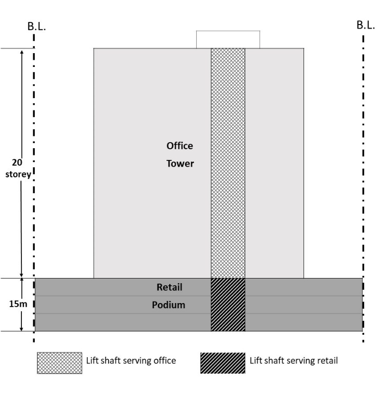

---
tags:
  - PNAP
  - APP series
  - Lift 升降機
  - GFA concession 樓面面積寬免
  - GFA 總樓面面積
  - Domestic 住用
  - Hotel 酒店
  - Site coverage 上蓋面積
  - Occupation permit 佔用許可證
  - Registration 註冊
  - Refuge floor 庇護層
  - Plot ratio 地積比率
  - Barrier free access 無障礙
  - Sustainable building design 可持續建築設計
  - Means of access 救援通道
  - Elderly-friendly 長者友善
  - Fire safety 消防安全
summary: "Lift shaft area above 2.5% (domestic/hotel) or 5% / 3.5% (office) of GFA may be exempted from GFA and SC, up to 3.5% / 3% / 2.5%, with an engineer's lift service assessment."
keywords: lift shaft, 升降機槽, better lift service, 優質升降機服務, GFA exemption, 總樓面面積豁免, handling capacity, waiting time, 候機時間, registered lift engineer, 註冊升降機工程師, PNAP 207
---

# APP-89 Provision of Better Lift Service <small>提供較佳的升降機服務</small>

!!! info "Document info 文件資料"
    | | |
    |---|---|
    | **Type 類別** | PNAP (APP series), previously PNAP 207 舊編號 PNAP 207 |
    | **Issued by 發出機構** | Buildings Department 屋宇署 |
    | **First issue 首次發出** | August 1997 |
    | **Version summarised 本摘要版本** | June 2025 (general revision) |
    | **Official language 官方語言** | English only (Chinese version not available) 只有英文版 |
    | **Source 原文** | [APP-89 (PDF)](https://www.bd.gov.hk/doc/en/resources/codes-and-references/practice-notes-and-circular-letters/pnap/APP/APP089.pdf) |
    | **Last checked 最後核對** | 2026-11-20 against the June 2025 version |

## At a glance 重點摘要 {#at-a-glance}

=== "English"

    - Lift shafts normally **count** for GFA and SC (B(P)R 20, 23(3)(a)). To encourage **better lift service**, the BA may exempt the lift shaft area **above an "average standard"** (para. 4).
    - **Domestic / composite / hotel**: exempt the lift shaft area **above 2.5%** of domestic/hotel GFA, capped at **3.5%** of that GFA.
    - **Office, office GFA < 10,000 m²**: above **5%**, capped at **3%**. **Office ≥ 10,000 m²**: above **3.5%**, capped at **2.5%**. For office GFA **10,000–12,000 m²**, up to **300 m²** may be allowed.
    - **SC exemption** = exempted lift shaft GFA ÷ number of storeys the shafts occupy (para. 6).
    - **Pre-requisites**: car / shaft ≥ **1.82 / 4.12 m²** (domestic) or **2.1 / 4.4 m²** (office). A **registered lift engineer** or **RPE (BS)** must certify that service is above the acceptable level (handling capacity, waiting time) with adequate maintenance space. **APP-151 pre-requisites** also apply (not the 10% cap).
    - **Not** for buildings with an OP. In phased developments, completed phases do not qualify and there is **no transfer** between phases.

=== "中文"

    - 升降機及升降機槽一般**須計入**總樓面面積及上蓋面積（B(P)R 第 20、23(3)(a) 條）；為鼓勵**較佳升降機服務**，建築事務監督可豁免**超出「平均標準」**的升降機槽面積（第 4 段）。
    - **住用／綜合用途／酒店**：豁免超出住用／酒店總樓面面積 **2.5%** 的升降機槽面積，上限為該總樓面面積的 **3.5%**。
    - **辦公室總樓面面積 < 10,000 平方米**：超出 **5%** 的部分，上限 **3%**；**≥ 10,000 平方米**：超出 **3.5%** 的部分，上限 **2.5%**；辦公室總樓面面積 **10,000–12,000 平方米**可最多豁免 **300 平方米**。
    - **上蓋面積豁免** = 獲豁免的升降機槽總樓面面積 ÷ 升降機槽所佔樓層數目（第 6 段）。
    - **先決條件**：機廂／升降機槽 ≥ **1.82／4.12 平方米**（住用）或 **2.1／4.4 平方米**（辦公室）；須由**註冊升降機工程師**或**註冊專業工程師（屋宇裝備）**證明服務水平（載客量、候梯時間）高於可接受水平並有足夠維修空間；亦須符合 **APP-151 先決條件**（不計入 10% 上限）。
    - **不適用**於已取得佔用許可證的建築物；分期發展中已完成的期數不獲考慮，各期**不得轉移**面積。

!!! tip "Applies / does not apply 適用／不適用"
    **Applies**: lift shafts serving **domestic, hotel and office** accommodation in new buildings, or buildings **under construction** if an enhanced lift service is shown (para. 10); also **phased** developments, phase by phase (para. 11). 適用於住用、酒店及辦公室的升降機槽。
    **Does not apply**: buildings **with an OP** already issued, and **completed phases** (no transfer between phases); lift shafts serving **non-accountable storeys** such as refuge floors; **other commercial** (retail) lift shafts in office/commercial buildings (footnotes 1–2). 已取得佔用許可證的建築物、已完成的期數、服務庇護層或零售部分的升降機槽不適用。

## Key clauses 主要條文 {#key-clauses}

| Para. 段 | Rule 規定 |
|---|---|
| 1 | Guidelines on lifts in **domestic and office** buildings to promote **better lift service**. 目的。 |
| 2 | Lifts and lift shafts **count for SC and GFA** (B(P)R 20, 23(3)(a)). 計入上蓋面積及總樓面面積。 |
| 3 | Apart from **fireman's lifts** ([FS Code Part D](../codes/fsc-part-d-means-of-access.md)) and **accessible lifts** ([B(P)R 72–73](../regulations/bpr-71-73.md)), the law sets no lift service standard, so designers often provide the minimum. 法例沒有服務標準。 |
| 4 | Lift quality depends on **number, size, handling capacity, travel and waiting time**; the BA may exclude lift shaft area **above the average** from GFA and SC under paras. 5–6. 可豁免超出平均的部分。 |
| 5(a) | **Domestic, composite (domestic part) and hotels**: exempt the shaft area **above 2.5 %** of domestic/hotel GFA, capped at **3.5 %** (i.e. shafts over **6 %** get the full 3.5 %). 住用及酒店。 |
| 5(b) | **Office GFA < 10,000 m²**: exempt above **5 %**, capped at **3 %** (full cap at **8 %**). 辦公室少於 10,000 平方米。 |
| 5(c) | **Office GFA ≥ 10,000 m²**: exempt above **3.5 %**, capped at **2.5 %** (full cap at **6 %**). 辦公室 10,000 平方米或以上。 |
| 5(d) | **Office GFA 10,000–12,000 m²**: up to **300 m²** may be allowed (bridges the step at 10,000 m²). 過渡範圍。 |
| fn. 1–2 | Includes podium lift shafts with lobbies **solely** serving the domestic/hotel/office part; excludes shafts serving **refuge floors** and other non-accountable storeys; office GFA includes ancillary uses but **not** other commercial uses. 計算範圍。 |
| 6 | **SC exemption** = GFA exemption ÷ **number of storeys** the exempted shafts occupy. 上蓋面積豁免。 |
| 7 | Example in **Appendix A**. 例子。 |
| 8 | Pre-requisites: (a) domestic/composite car **≥ 1.82 m²**, shaft **≥ 4.12 m²** each; (b) office car **≥ 2.1 m²**, shaft **≥ 4.4 m²** each; (c) assessment by a **registered lift engineer** (Cap. 618) or **RPE (building services)**: above the acceptance level for **handling capacity and waiting time** to international codes, with **maintenance space**. 先決條件。 |
| 9 | Also subject to the **APP-151 pre-requisites** (SBD, energy efficiency). 須符合 APP-151 先決條件。 |
| 10 | **Not** for buildings with an OP; buildings under construction considered if enhanced service is built in. 適用時間。 |
| 11 | **Phased** developments: completed phases excluded; **no transfer** of GFA/SC between phases (Appendix B). 分期發展。 |

<figure markdown>
  { width="720" loading=lazy }
  <figcaption>Which rule applies, and how the GFA and SC exemptions follow (paras. 5–6, 8). 適用哪條規則及如何計算豁免。</figcaption>
</figure>

## Key table: GFA exemption for lift shafts (para. 5) 升降機槽總樓面面積豁免（第 5 段） {#key-table-gfa-exemption-for-lift-shafts-para-5-5}

| Accommodation served 服務對象 | Lift shaft area exempted 可豁免的升降機槽面積 | Max. exempted 豁免上限 | i.e. lift shaft area at which the cap is reached 達上限時的升降機槽面積 |
|---|---|---|---|
| **Domestic / composite (domestic part) / hotel** 住用／綜合用途（住用部分）／酒店 | Above **2.5%** of domestic/hotel GFA 超出 2.5% | **3.5%** of domestic/hotel GFA | 6% |
| **Office**, office GFA **< 10,000 m²** 辦公室 < 10,000 平方米 | Above **5%** of office GFA 超出 5% | **3%** of office GFA | 8% |
| **Office**, office GFA **≥ 10,000 m²** 辦公室 ≥ 10,000 平方米 | Above **3.5%** of office GFA 超出 3.5% | **2.5%** of office GFA | 6% |
| Office GFA **10,000–12,000 m²** 辦公室 10,000–12,000 平方米 | — | up to **300 m²** may be allowed (para. 5(d)) 最多 300 平方米 | — |

<small>Lift shaft area includes shafts at podium floors with lobbies serving solely the domestic / hotel / office accommodation; excludes shafts serving non-accountable storeys such as refuge floors (footnote 1). "Office accommodation" includes ancillary uses but excludes other commercial uses (footnote 2). 升降機槽面積包括只服務住用／酒店／辦公室部分的平台層升降機槽，但不包括服務庇護層等不計總樓面面積樓層者。</small>

## Key table: pre-requisites (para. 8) 先決條件（第 8 段） {#key-table-pre-requisites-para-8-8}

| Item 項目 | Domestic / composite 住用／綜合用途 | Office 辦公室 |
|---|--:|--:|
| Min. internal area of each **lift car** 每部機廂最小內部面積 | **1.82 m²** | **2.1 m²** |
| Min. internal area of each **lift shaft** 每個升降機槽最小內部面積 | **4.12 m²** | **4.4 m²** |
| Certification 證明 | Registered lift engineer (Cap. 618) or RPE (building services): service above acceptable level (handling capacity, waiting time) to international codes; adequate maintenance space 註冊升降機工程師或註冊專業工程師（屋宇裝備）證明 | |
| APP-151 | Pre-requisites apply (SBD, BEAM Plus, energy) 須符合先決條件 | |

## Official worked example (Appendix A) 官方計算例子（附錄 A） {#official-worked-example-appendix-a-a}

<figure markdown>
  { width="520" loading=lazy }
  <figcaption>Appendix A — office tower (20 storeys) on a 15 m retail podium: only the shafts serving the **office** count for the exemption. 附錄 A：只有服務辦公室的升降機槽可計算豁免。 <small>Source: PNAP APP-89 (Jun 2025), Buildings Department 資料來源：屋宇署</small></figcaption>
</figure>

!!! example "Office/commercial building 辦公室／商業建築物"
    Site **2,000 m²**; permissible non-domestic PR **15**; SC 100% (≤ 15 m) / **65%** (> 15 m).

    - Retail podium GFA **6,000 m²**; office tower GFA **24,000 m²** (≥ 10,000 m² → 3.5% / 2.5% rule)
    - Lift shafts for office = **6%** of office GFA
    - Exempted GFA = 24,000 × (6% − 3.5%) = **600 m²** (≤ 2.5% × 24,000 = 600 m² ✅)
    - Accountable GFA = 6,000 + 24,000 − 600 = **29,400 m²** → PR **14.7** ✅
    - SC: covered area over 15 m = 1,320 m² (66%); lift shafts occupy **20** office storeys → SC exempted = 600 ÷ 20 = **30 m²** (1.5%) → SC **64.5%** ✅ (≤ 65%)

    寫字樓總樓面面積 24,000 平方米，升降機槽佔 6%；豁免 = 24,000 × (6% − 3.5%) = 600 平方米；計算地積比率的總樓面面積 = 29,400 平方米（地積比率 14.7）；上蓋面積豁免 = 600 ÷ 20 = 30 平方米（1.5%），上蓋面積由 66% 減至 64.5%。

??? example "Phased residential development (Appendix B) 分期住宅發展（附錄 B）"
    Site 10,000 m², domestic PR 5 (GFA 50,000 m²), SC 40%.

    | Phase 期數 | Status 狀況 | GFA | Lift shafts 升降機槽 | Exempted 豁免 | Accountable GFA 計算面積 |
    |---|---|--:|--:|--:|--:|
    | I | OP issued 已取得佔用許可證 | 10,000 | 7% | **0** (not eligible 不適用) | 10,000 |
    | II | Under construction 興建中 | 25,000 | 6% | 25,000 × 3.5% = **875** | 24,125 |
    | III | GBP approved 圖則已批 | 15,000 | 5.5% | 15,000 × 3.0% = **450** | 14,550 |
    | **Total 總計** | | | | | **48,675** (PR 4.868) |

    SC exemption: Phase II 875 ÷ 15 = 58.33 m²; Phase III 450 ÷ 15 = 30 m². Overall SC 39.117% ≤ 40% ✅. No GFA/SC is transferred from Phase I. 上蓋面積豁免：第二期 58.33 平方米、第三期 30 平方米；整體 39.117%；第一期不得轉移。

## Explanation 淺白解釋 {#explanation}

=== "English"

    Developers used to squeeze lifts to the minimum to save GFA, which led to long waits. APP-89 makes **generous lift provision partly GFA-free**. The lift shaft area above a normal allowance (2.5%, 3.5% or 5% depending on use and size) is exempted, up to a cap. Car and shaft sizes must meet a minimum, and a lift engineer must certify that the service really is better.

    The concession is subject to the **APP-151 pre-requisites** but **not** the 10% overall cap (APP-151 Appendix A item 18).

=== "中文"

    以往發展商為節省總樓面面積，往往把升降機減至最少，導致候梯時間長。APP-89 讓**較充足的升降機設施可部分豁免總樓面面積**：超出一般標準（視乎用途及規模為 2.5%、3.5% 或 5%）的升降機槽面積可獲豁免，但設上限；機廂及升降機槽須達最小尺寸，並須由升降機工程師證明服務確實較佳。

    本寬免須符合 **APP-151 先決條件**，但**不計入** 10% 整體上限（APP-151 附錄 A 第 18 項）。

## Practical notes 實務提示 {#practical-notes}

=== "English"

    !!! example "Worked example: residential tower"
        Domestic GFA **40,000 m²**; lift shafts total **2,000 m²** (5%) over **38** storeys.

        - Exempted = 40,000 × (5% − 2.5%) = **1,000 m²** (≤ 3.5% × 40,000 = 1,400 m² ✅)
        - SC exempted = 1,000 ÷ 38 ≈ **26.3 m²**
        - Each car ≥ 1.82 m² and shaft ≥ 4.12 m², plus the lift engineer's certificate.

    !!! tip "Common pitfalls"
        - Including **refuge floor** lift shafts in the calculation (excluded, footnote 1).
        - Office/commercial buildings: count **office GFA only**, not retail (footnote 2).
        - Applying after the **OP** is issued: not considered (para. 10).
        - Moving exempted GFA between **phases**: not allowed (para. 11).

=== "中文"

    !!! example "計算例子：住宅大廈"
        住用總樓面面積 **40,000 平方米**；升降機槽合共 **2,000 平方米**（5%），共 **38** 層。

        - 豁免 = 40,000 × (5% − 2.5%) = **1,000 平方米**（≤ 3.5% × 40,000 = 1,400 平方米 ✅）
        - 上蓋面積豁免 = 1,000 ÷ 38 ≈ **26.3 平方米**
        - 每部機廂 ≥ 1.82 平方米、升降機槽 ≥ 4.12 平方米，並須有升降機工程師證明。

    !!! tip "常見錯誤"
        - 把服務**庇護層**的升降機槽計入（不包括，註腳 1）。
        - 辦公室／商業建築物只計**辦公室總樓面面積**，不計零售（註腳 2）。
        - **取得佔用許可證後**才申請：不獲考慮（第 10 段）。
        - 在**期數之間**轉移獲豁免面積：不准許（第 11 段）。

<!-- APSEC START -->
## APSEC clarifications 認可人士及註冊結構工程師委員會討論 {#apsec-clarifications}

BD's responses at the APSEC Discussion Forum that clarify this document, **newest first**. Where the same question came up more than once, only the **latest position** is listed. See [all APSEC items](../apsec/index.md). 屋宇署在討論會上就本文件作出的澄清，新者在前；同一問題只列最新立場。

- **[GFA Exemption for better lift service](../apsec/2025.md#i202511218)** <small>ADF 4/2025, 21 Nov 2025</small> BD advised that newly built student hostels under the Scheme would be considered as hotels for the purposes of PNAP APP-89, provided that the criteria stipulated in PNAP APP-89 are met, which include the compliance with …
- **[Implementation of PNAP APP-151 and GFA concessions under various updated PNAPs](../apsec/2025.md#i202511214)** <small>ADF 4/2025, 21 Nov 2025</small> BD advised that the GFA concessions under the recently revised PNAPs APP-19, APP-42, APP-89 and JPN No.1 were applicable to all new buildings with works in progress, including those with GBP approved before 30 June 2024 …

<!-- APSEC END -->

## Whole picture 整體關係 {#whole-picture}

| Topic 主題 | Where 文件 |
|---|---|
| Lift shafts in GFA 升降機槽與總樓面面積 | [APP-2](app-2.md) · [APP-151](app-151.md) item 18 · [GFA guide](../guides/gfa.md) |
| Accessible and elderly-friendly lifts 無障礙升降機 | [B(P)R 72–73](../regulations/bpr-71-73.md) · [APP-175](app-175.md) · [DMUA 2026](../codes/dmua-2026.md) |
| Fireman's lifts 消防員升降機 | [FS Code Part D](../codes/fsc-part-d-means-of-access.md#clause-by-clause) D6–D13 · [B(P)R 41B](../regulations/bpr-39-49e.md#clause-by-clause) |
| Liftwell fire resistance 升降機槽耐火 | [FS Code C9](../codes/fsc-part-c-fire-resisting-construction.md#clause-by-clause) |
| Lift engineering 升降機工程 | [Lifts & Escalators Code](../codes/lifts-escalators-2011.md) · [APP-29](app-29.md) |
| Lift lobbies and escape 升降機大堂 | [FS Code B16](../codes/fsc-part-b-means-of-escape.md#clause-by-clause) |

## Related 相關文件 {#related}

| Document 文件 | Relationship 關係 |
|---|---|
| [APP-151](app-151.md) item 18 | Larger lift shaft: pre-requisites, not cap 較大升降機槽：先決條件，不受上限 |
| [APP-2](app-2.md) para. 14 | Lift shafts measured with the floors they pass through 升降機槽隨樓層計算 |
| [B(P)R 18A–22](../regulations/bpr-18a-22.md) | SC and PR limits 上蓋面積及地積比率 |
| [BFA 2008](../codes/bfa-2008.md) Division 19 | Accessible lift sizes 暢通易達升降機尺寸 |
| [FS Code Part D](../codes/fsc-part-d-means-of-access.md) | Fireman's lifts 消防員升降機 |
| [B(P)R 73](../regulations/bpr-71-73.md), [APP-175](app-175.md) | Elderly-friendly: accessible lift car **1,400 × 1,200 mm** from Aug 2026 長者友善較大升降機 |
| [Lifts & Escalators Code](../codes/lifts-escalators-2011.md) | Minimum well, pit, headroom and machine room sizes 升降機槽尺寸 |
| [APP-29](app-29.md) | Lift and escalator installations 升降機及自動梯安裝 |
| [GFA guide](../guides/gfa.md) | Where lift shafts sit among the GFA concessions 總樓面面積專題 |

---
<small>Prepared by: _[name]_ · Checked by: _[name]_ · Unofficial summary; refer to the official PNAP for the definitive text.</small>
