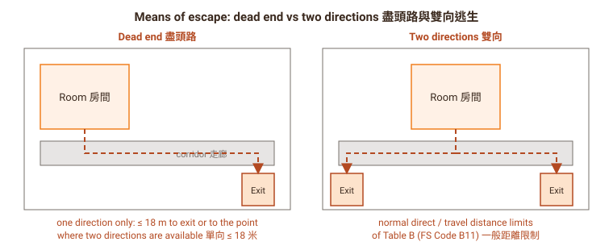

---
tags:
  - PNAP
  - APP series
  - Means of escape 逃生途徑
  - Dead end 盡頭路
  - Fire safety 消防安全
summary: "MOE Code 1996 dead-end amendment: 18 m to an exit or point of choice; superseded by FS Code B11."
keywords: APP-92, dead end, 盡頭, travel distance, 行走距離, 18 m, MOE Code 1996, superseded
---

# APP-92 Amendments and Clarification to Code of Practice for the Provision of Means of Escape in Case of Fire 1996 <small>修訂及澄清《1996年提供火警逃生途徑守則》</small>

!!! info "Document info 文件資料"
    | | |
    |---|---|
    | **Type 類別** | PNAP (APP series), previously PNAP 210 舊編號 PNAP 210 |
    | **Issued by 發出機構** | Buildings Department 屋宇署 |
    | **Version summarised 本摘要版本** | August 1997 |
    | **Official language 官方語言** | English and Chinese 中英文版 |
    | **Source 原文** | [English (PDF)](https://www.bd.gov.hk/doc/en/resources/codes-and-references/practice-notes-and-circular-letters/pnap/APP/APP092.pdf) · [中文 (PDF)](https://www.bd.gov.hk/doc/tc/resources/codes-and-references/practice-notes-and-circular-letters/pnap/APP/APP092.pdf) |
    | **Last checked 最後核對** | 2026-11-21 against the current BD version |

!!! note "Note 注意"
    Historical note: the 1995/1996 fire codes it refers to have been replaced by the [Code of Practice for Fire Safety in Buildings 2011](../codes/fire-safety-code-2011.md). It is kept for older buildings and approvals.

## At a glance 重點摘要 {#at-a-glance}

=== "English"

    - Replaces MOE Code para. 14(3)(b): where travel from a room exit is possible in **one direction only (dead end)**, no point in the room may be more than **18 m** (direct plus travel distance) from an exit or from a point where 2 or more exits are available; beyond that point the normal para. 14 limits apply (para. 1).

=== "中文"

    - 取代走火守則第 14(3)(b) 段：如由房間出口只可**單向行走（盡頭路）**，房間內任何一點與出口或可通往 2 個或以上出口的地點之間的距離（直線距離加行走距離）不得超過 **18 米**；該點以後適用第 14 段的一般限制（第 1 段）。

!!! warning "Superseded for new works 新工程已不適用"
    Listed in [APP-153 Appendix A](app-153.md#appendix-a): it does **not apply** to buildings designed to the **FS Code 2011**. Current rule: [FS Code B11.2](../codes/fsc-part-b-means-of-escape.md#clause-by-clause) (dead-end limits by use class). Still relevant to older buildings and Cap. 502 / 572 upgrading. 按 2011 年消防守則設計的建築物不適用。

## Key clauses 條文一覽 {#key-clauses-table}

| Para. 段 | Rule 規定 |
|---|---|
| 1 | MOE Code 1996 para. 14(3)(b) replaced: where travel from a room's exit door to a staircase or discharge point is in **one direction only** (dead end), no point of the room more than **18 m** (direct + travel distance) from an exit or a point of choice; from a point of choice, the distance to one exit must meet para. 14 limits. 盡頭 18 米。 |
| 2 | Included in the next reprint. 納入重印本。 |

## Whole picture 整體關係 {#whole-picture}

| Topic 主題 | Where 文件 |
|---|---|
| Current dead-end and travel distances 現行距離 | [FS Code B11.2–B11.7](../codes/fsc-part-b-means-of-escape.md#clause-by-clause) · [Diagram](../codes/fsc-part-b-means-of-escape.md) |
| Other MOE Code 1996 notes 其他 | [APP-82](app-82.md) · [APP-121](app-121.md) |

## Diagram 圖解 {#diagram}

<figure markdown>
  { width="760" loading=lazy }
  <figcaption>Dead-end travel (18 m) compared with two-direction escape. 盡頭路與雙向逃生。 Diagram prepared for this site; check the source text for exact wording.</figcaption>
</figure>

## Related 相關文件 {#related}

| Document 文件 | Relationship 關係 |
|---|---|
| [APP-82](app-82.md) | MOE Code 1996 |

---
<small>Prepared by: _[name]_ · Checked by: _[name]_ · Quotes from the official English and Chinese versions; refer to the PNAP for the definitive text.</small>
