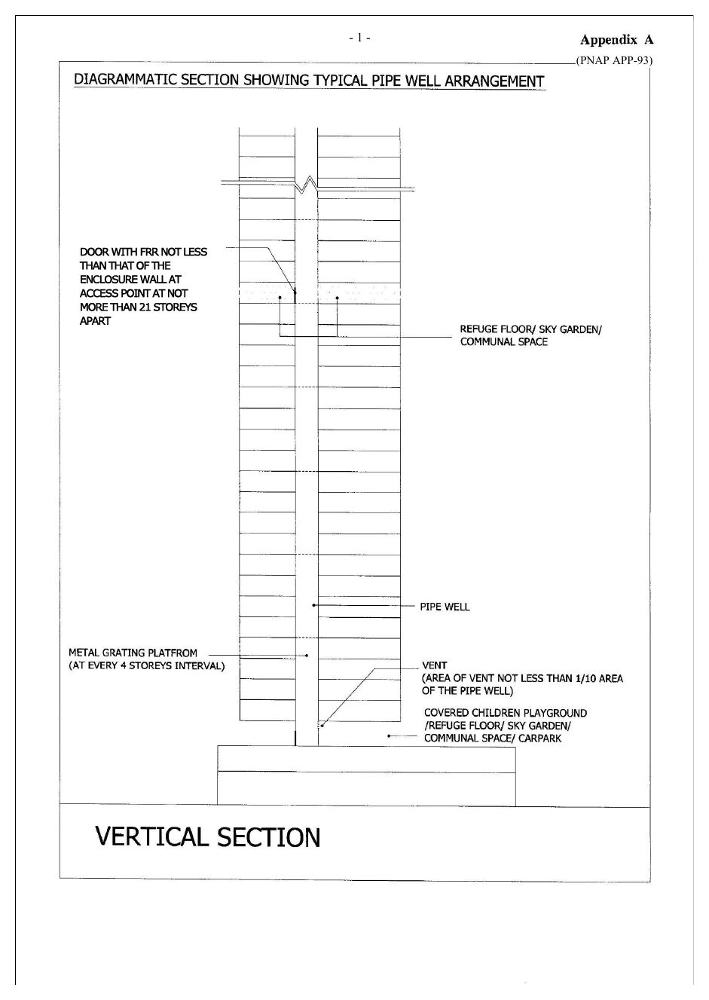
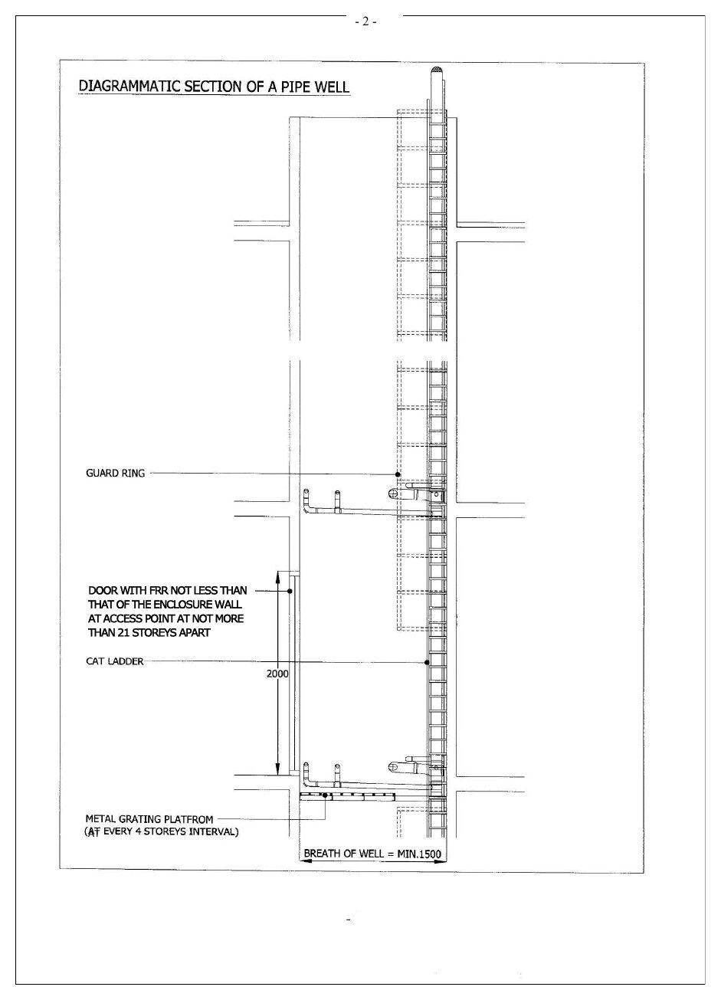
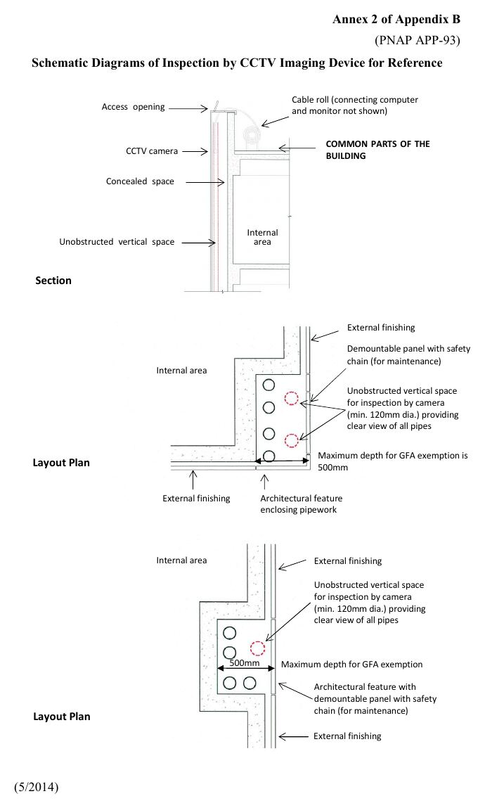
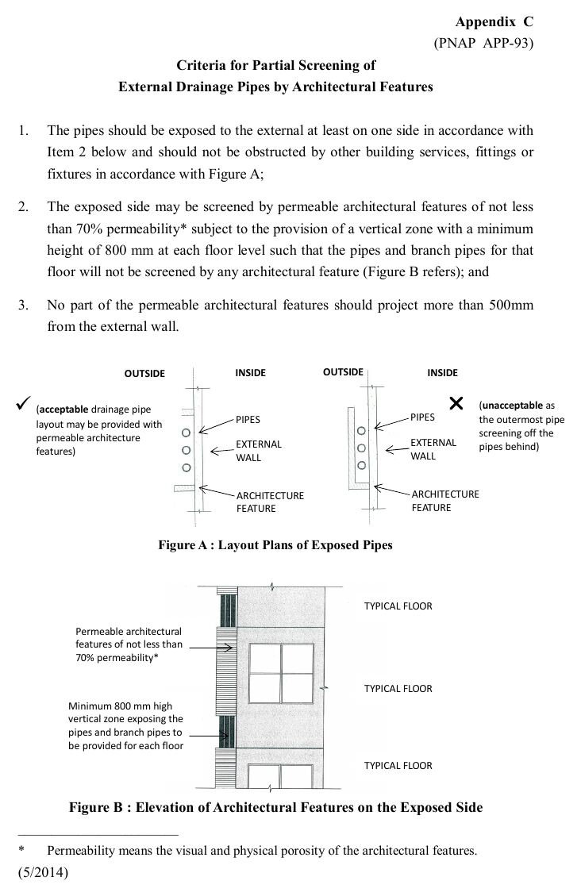

---
tags:
  - PNAP
  - APP series
  - Drainage 排水
  - Pipe ducts 管槽
  - Maintenance 保養
  - Domestic 住用
  - GFA 總樓面面積
  - Plumbing & sanitary 衞生設備
  - Maintenance access 維修通道
  - Fire safety 消防安全
  - Concrete & materials 混凝土及物料
  - Plant rooms 機房
  - Lighting & ventilation 照明及通風
  - Occupation permit 佔用許可證
  - GFA concession 樓面面積寬免
summary: "Drainage layout for maintainable common drains: pipe ducts, pipe wells, no pipes into the flat below, sunken slabs and concealed external pipes."
keywords: APP-93, drainage, 排水, pipe duct, 管槽, pipe well, 管井, sunken slab, 下沉式樓板, CCTV, concealed pipes, 遮蔽喉管, common parts, 公用部分
---

# APP-93 Planning and Design of Drainage Works <small>規劃及設計排水工程</small>

!!! info "Document info 文件資料"
    | | |
    |---|---|
    | **Type 類別** | PNAP (APP series), previously PNAP 211 舊編號 PNAP 211 |
    | **Issued by 發出機構** | Buildings Department 屋宇署 |
    | **First issue 首次發出** | August 1997 |
    | **Version summarised 本摘要版本** | May 2014 (para. 7 and Appendices B & C added) |
    | **Official language 官方語言** | English and Chinese 中英文版 |
    | **Source 原文** | [English (PDF)](https://www.bd.gov.hk/doc/en/resources/codes-and-references/practice-notes-and-circular-letters/pnap/APP/APP093.pdf) · [中文 (PDF)](https://www.bd.gov.hk/doc/tc/resources/codes-and-references/practice-notes-and-circular-letters/pnap/APP/APP093.pdf) |
    | **Legal basis 法律依據** | BO s.28(1); Building (Standards of Sanitary Fitments, Plumbing, Drainage Works and Latrines) Regulations |
    | **Last checked 最後核對** | 2026-11-20 against the May 2014 version |

## At a glance 重點摘要 {#at-a-glance}

=== "English"

    - Aim: drains and stacks must be **maintainable from common parts**, without entering private flats or shops (paras. 2–3).
    - Required under **BO s.28(1)** (para. 3): common **underground drains** in sterilised land or common parts (except under car-park floors); internal common **soil and waste stacks** in multi-occupancy domestic buildings in **common parts**, in **pipe ducts** (access from common parts, **700 mm** working space, door ≥ **600 × 2,000 mm**) or **pipe wells** (≥ **1,200 × 1,500 mm**, access every ≤ **21 storeys**, cat ladder, grating platforms every ≤ **4 storeys**, top and bottom vents ≥ **1/10** of the area).
    - **No pipes from one flat protruding into the flat below** (domestic, multi-occupancy). The lowest floor connects **separately** to a manhole (buildings > 3 storeys). Bends at the stack foot have radius ≥ **4 × stack radius**, and never < **200 mm**.
    - **GFA**: pipe ducts and pipe wells may be **exempted** (open pipe wells also from SC). Where they also carry pipes for **non-essential plant**, the APP-151 **pre-requisites and 10% cap** apply (para. 4).
    - **Concealed external pipes** behind architectural features need **CCTV inspection access** from common parts and a DMC undertaking (Appendix B). Partial screening (≥ **70%** permeable, **800 mm** clear zone per floor, ≤ **500 mm** projection) is not treated as concealment (Appendix C).

=== "中文"

    - 目的：排水渠及豎管須可**由公用部分維修**，毋須進入私人單位或店舖（第 2–3 段）。
    - 根據**《建築物條例》第 28(1) 條**的規定（第 3 段）：公用**地下排水渠**須敷設於未經佔用的土地或公用部分（停車場樓層除外）；多戶住宅的室內公用**污水及廢水豎管**須設於**公用部分**，置於**管槽**（由公用部分進入、**700 毫米**作業空間、門 ≥ **600 × 2,000 毫米**）或**管井**（≥ **1,200 × 1,500 毫米**、出入口相距 ≤ **21 層**、豎梯、每 ≤ **4 層**設格柵平台、頂部及底部通風口 ≥ 面積 **1/10**）。
    - **單位的喉管不得伸入下層另一單位**（多戶住宅）；最底層須**獨立**接駁沙井（3 層以上建築物）；豎管底部彎位半徑 ≥ **4 倍豎管半徑**，絕不少於 **200 毫米**。
    - **總樓面面積**：管槽及管井可**豁免**（露天管井亦可豁免上蓋面積）；如同時容納**非必要機房**的喉管，須符合 APP-151 **先決條件及 10% 上限**（第 4 段）。
    - 以建築裝飾**遮蔽的外牆喉管**須由公用部分提供**閉路電視檢查**通道，並在公契中承諾（附錄 B）；部分遮蔽（通透度 ≥ **70%**、每層 **800 毫米**不遮蔽區、伸出 ≤ **500 毫米**）不視為遮蔽（附錄 C）。

!!! tip "Does it apply? 是否適用"
    **Applies 適用**: drainage works for **new buildings**, imposed under **BO s.28(1)**; paras. 3(b) and 3(d) target **multi-occupancy domestic** buildings. 新建築物；第 3(b)、3(d) 段針對多伙住用建築物。

    **Does not apply / partly 不適用或部分適用**: car-parking floors for para. 3(a); single-occupancy domestic buildings and single-family houses for 3(b), 3(d); buildings **≤ 3 storeys** for 3(e); non-domestic premises for 3(d) (encouraged only, para. 8). 停車層、獨立住宅、三層或以下、非住用。

## Key clauses table 條文一覽 {#key-clauses-table}

| Para. | What it says 內容 |
|---|---|
| 1 | Requirements for planning and design of drainage for **new buildings** |
| 2 | Why: repairs to drains under shops, restaurant kitchens and separate flats mean entry, opening slabs, trenches, even closure |
| 3(a)–(g) | Imposed under **BO s.28(1)** (see table below): drains in sterilised / common land; stacks in common parts; pipe duct and pipe well criteria; GFA exemption (and SC for open pipe wells); re-entrant access; **no pipes into the flat below**; separate lowest-floor pipework; soil pipe size; bends ≥ 4 × radius, ≥ 200 mm |
| 4 | Ducts / wells also housing pipes for **non-mandatory / non-essential plant**: exemption subject to the [APP-151](app-151.md) pre-requisites and **10% cap** (fn. 1) |
| 5 | Modification of **B(SSFPDWL)R 25(1)**: bath / shower to trap up to **750 mm** at **1:40**; sunken slabs not backfilled, else access panels / cleaning eyes for CCTV; warn owners floors may be opened |
| 6 | External pipe maintenance per [ADV-14](adv-14.md); separate pipe **zones** for high-rise |
| 7 | Pipes **enclosed by architectural features**: effective visual inspection from common parts, shown on drainage and building plans (Appendix B); partial screening per Appendix C is not "enclosed" |
| 8 | Para. 3(d) encouraged for non-domestic premises |

## Key table: requirements under BO s.28(1) (para. 3) 規定（第 3 段） {#key-table-requirements-under-bo-s281-para-3-3}

| Item 項目 | Requirement 規定 |
|---|---|
| (a) Underground drains 地下排水渠 | Common drains in **sterilised land or common parts** (except in car-parking floors) 公用排水渠設於未經佔用的土地或公用部分 |
| (b) Internal common stacks 室內公用豎管 | In **common parts** of multi-occupancy domestic buildings 設於公用部分 |
| (b)(i) **Pipe duct** 管槽 | Access from common parts; working space **≥ 700 mm** in front of pipes; door/panel **≥ 600 mm × 2,000 mm**, fire-rated per FS Code Part C 作業空間 ≥ 700 毫米；門 ≥ 600 × 2,000 毫米 |
| (b)(ii) **Pipe well** 管井 | **≥ 1,200 × 1,500 mm**; only access openings from common parts, **≤ 21 storeys apart**; **cat ladder** with guard rings full height; **grating platforms ≤ 4 storeys** apart; openings **≥ 600 × 2,000 mm** (fire-rated); vents at top and bottom **≥ 1/10** of the plan area ≥ 1,200 × 1,500 毫米；出入口 ≤ 21 層；格柵平台 ≤ 4 層 |
| (c) Re-entrants / light wells 內角／天井 | Lowest level designated **common parts**, with access (cat ladder if needed) 最低層屬公用部分並可進入 |
| (d) Pipes into flat below 伸入下層單位 | **Not allowed** in multi-occupancy domestic buildings 不准許 |
| (e) Lowest floor 最低樓層 | **Separate pipework to a manhole** for fitments at the stack-foot level (buildings > 3 storeys) 獨立接駁沙井 |
| (f) Soil pipe size 污水管尺寸 | ≥ the outlet diameter of the fitments served 不少於潔具出水口 |
| (g) Bends 彎位 | Only where unavoidable; stack-foot bend radius ≥ **4 × stack radius**, never **< 200 mm** (centreline) 豎管底彎位半徑 ≥ 4 倍，不少於 200 毫米 |

## Key clause 主要條文 {#key-clause}

!!! quote "Para. 3(b)(ii) — Pipe wells 管井"
    (1) The size of pipe well shall not be less than 1200 mm x 1500 mm; (2) No opening will be allowed in a pipe well other than access points for inspection and maintenance, which shall be from the common parts of the building. Access points shall be provided to the pipe well at not more than 21 storeys apart; (3) Cat ladder with proper guard rings shall be installed in the full height of the pipe well for inspection and maintenance purposes; (4) Grating platforms shall be provided at intervals of not more than 4 storeys; (5) The opening at every access point shall not be less than 600 mm wide by 2000 mm high and shall comply with Part C of the Code of Practice for Fire Safety in Buildings 2011; and (6) A ventilation opening having a minimum net area of 1/10th of the horizontal area of the pipe well shall be provided at both the top and bottom of the pipe well…

    **官方中文本：** (1) 管井的尺寸不應少於1 200毫米x 1 500毫米；(2) 除了從建築物的公用部分進入以供檢查和維修保養的出入口外，管井不得有其他開口。管井出入口的間距不得超過21層樓；(3) 為了進行檢查和維修保養，整道管井應裝設配備護圈的豎梯；(4) 須配置格柵平台，平台與平台的間距不得超過4層樓；(5) 每個出入口的開口不得少於600毫米闊x 2 000毫米高，並須符合《2011年建築物消防安全守則》C部的規定；及 (6) 管井的底部和頂部各開一個通風口，其淨面積最小應為管井平面面積的十分之一。除下文第4段另有規定外，管槽和管井的面積可獲豁免計入總樓面面積內。露天管井亦可獲豁免計算入上蓋面積。

## Key table: other provisions 其他規定 {#key-table-other-provisions}

| Topic 主題 | Requirement 規定 | Para. 段 |
|---|---|---|
| Bathtub / shower trap length 浴缸／淋浴盤至隔氣彎管長度 | Modification of the Drainage Regulations reg. 25(1) to allow up to **750 mm** at **≥ 1:40**, so pipes avoid the flat below 可放寬至 750 毫米、斜度 ≥ 1:40 | 5 |
| **Sunken slabs** 下沉式樓板 | Do **not** backfill the void with concrete. If unavoidable, provide **access panels / cleaning eyes** for CCTV inspection; warn owners that floors may need opening up 不得以混凝土回填；否則須設檢查口 | 5 |
| External pipes 外牆喉管 | Facilities for maintenance per **PNAP ADV-14**; consider **separate pipe zones** for high-rise buildings 按 ADV-14；高樓分區 | 6 |
| **Concealed external pipes** 遮蔽的外牆喉管 (App. B) | Feature projection ≤ **500 mm**; vents ≥ **50%** of the concealed space area at top and bottom; access openings ≥ **300 × 300 mm** from common parts; DMC undertaking for a **CCTV device / service** and regular inspection; **CCTV inspection and AP certificate before OP** 伸出 ≤ 500 毫米；閉路電視檢查；佔用許可證前提交證明書 | 7 |
| **Partial screening** 部分遮蔽 (App. C) | Not "concealed" if pipes are exposed on at least one side, the screen is **≥ 70% permeable**, with an **800 mm** unscreened zone per floor, and projects ≤ **500 mm** 通透度 ≥ 70%、每層 800 毫米不遮蔽、伸出 ≤ 500 毫米 | 7 |
| Non-domestic 非住用 | Para. 3(d) not mandatory but **encouraged** 鼓勵採用 | 8 |

## Figures 圖則 {#figures}

<figure markdown>
  { loading=lazy }
  <figcaption>Appendix A — Sample design of a pipe well (access at ≤ 21 storeys) 管井設計樣本</figcaption>
</figure>

??? abstract "More figures: pipe well (cont.), concealed pipes, partial screening 更多圖則"
    { loading=lazy }
    { loading=lazy }
    *Annex 2 of Appendix B — Inspection of concealed external drainage pipes 遮蔽外牆喉管的檢查*

    { loading=lazy }
    *Appendix C — Criteria for partial screening 部分遮蔽準則*

<small>Source: PNAP APP-93 (May 2014), Buildings Department 資料來源：屋宇署</small>

## Appendix B in detail: concealed external pipes 遮蔽外牆喉管詳細要求 {#appendix-b-detail}

| Ref. | Requirement 要求 |
|---|---|
| App. B 1 | Feature and space to Annex 1 so a **CCTV imaging device** (camera on a cable, up to ~120 m) can inspect; schematics in Annex 2 |
| App. B 2 | Owner / developer **undertaking** that the **DMC** will (a) require the manager to provide a suitable CCTV device and trained staff, or a service contract; (b) designate access and working space as **common parts**; (c) require **regular inspection** at the AP's proposed interval |
| App. B 3 | No DMC: undertaking direct, carried into sale, assignment and tenancy documents |
| App. B 4 | Before OP: CCTV inspection supervised by the AP or representative; submit the **Annex 3 certificate** with endorsed records (B(A)R 44, with Form **BA13**) |
| Annex 1 1.1–1.3 | Projection **≤ 500 mm** (also the max. depth for GFA exemption); space wide enough for fixing and camera; vents **≥ 50%** of the space's plan area at top and bottom |
| Annex 1 2.1–2.7 | Access openings **≥ 300 × 300 mm** from common parts, connected to a vertical passage, extra openings per cable length; within **600 mm** of floor / roof or with a cast-in anchor ([ADV-14](adv-14.md)); lowest level accessible; working space as common parts |
| Annex 1 3.1–3.3 | Vertical passage unobstructed full height, **≥ 120 mm** clear in front of all pipes; extra passages ≥ 120 mm dia. so every pipe is seen |

## Appendix C: partial screening 部分遮蔽準則 {#appendix-c-detail}

1. Pipes exposed on **at least one side** and not hidden behind other services (Fig. A: the outermost pipe must not screen pipes behind). 至少一面外露。
2. The exposed side may have screens of **≥ 70% permeability**, with an unscreened vertical zone **≥ 800 mm** high at each floor exposing pipes and branches (Fig. B). 通透度 ≥ 70%，每層留 800 毫米。
3. No part projects more than **500 mm**. 伸出不超過 500 毫米。

## Worked example 例子 {#worked-example}

!!! example "Illustrative only 只作說明"
    A 35-storey residential tower, 8 flats per floor.

    - Internal soil and waste stacks in a **pipe well 1,300 × 1,600 mm** opening off the lift lobby: access doors (600 × 2,000, FRR as the enclosure) at G/F, 21/F and roof (≤ 21 storeys apart); grating platforms every 4 floors; cat ladder; top and bottom vents ≥ 0.21 m² (1/10 of 2.08 m²). Area **exempt from GFA**; it holds only drainage pipes, so the APP-151 cap does not apply (para. 4).
    - Bathrooms on **sunken slabs**, void left unfilled; bath trap 700 mm at 1:40 under a **BA16** for B(SSFPDWL)R 25(1) (para. 5) so no pipe enters the flat below (3(d)).
    - Ground-floor fitments at the stack-foot level on **separate pipework to a manhole** (3(e)); stack-foot bends radius ≥ 4 × stack radius.
    - External pipes behind 450 mm deep fins: Appendix B route with DMC undertaking and CCTV certificate before OP.

## Whole picture 整體關係 {#whole-picture}

| Topic 主題 | Where 文件 |
|---|---|
| Drainage regulations (traps, falls, joints) 排水規例 | [B(SSFPDWL)R Cap. 123I](../regulations/bsfpwr-123i.md) |
| BO s.28 drainage powers 條例第 28 條 | [BO Part 2](../regulations/bo-part-2-building-works.md) |
| Pipe ducts GFA and cap 管槽面積及上限 | [APP-2](app-2.md) · [APP-151](app-151.md) · [ADM-2](adm-2.md) App. G |
| External maintenance access 外部保養設施 | [ADV-14](adv-14.md) · [Access for External Maintenance Code](../codes/external-maintenance-2021.md) |
| Fire-rated access doors 防火門 | [FS Code Part C](../codes/fsc-part-c-fire-resisting-construction.md) |
| Inspection later in life 樓宇檢驗 | [MBIS / MWIS Code](../codes/mbis-mwis-2012.md) |

## Explanation 淺白解釋 {#explanation}

=== "English"

    The classic Hong Kong drainage problem is a **leaking stack inside a restaurant kitchen** or a **pipe from the flat above running through your ceiling**. Repairs then need access to someone else's property. APP-93 designs this out:

    - Put all **common** drains and stacks in **common parts**, in ducts or wells you can **walk into** (cat ladder, platforms, doors from the corridor).
    - Keep each flat's pipes **within that flat** (no protrusion into the flat below), using the 750 mm trap-length relaxation and sunken slabs if needed, but **without concrete backfill**.
    - Make sure pipes hidden behind **façade features** can still be inspected with a **CCTV camera**.

    Pipe ducts and wells are generally **GFA-exempt** as essential services. If they also carry non-essential plant pipework, they fall under the APP-151 cap.

=== "中文"

    香港典型的排水問題是**餐廳廚房內的豎管滲漏**，或**樓上單位的喉管穿過你的天花**，維修時須進入他人物業。APP-93 從設計上避免這情況：

    - 把所有**公用**排水渠及豎管設於**公用部分**，放在可**進入**的管槽或管井內（豎梯、平台、由走廊開門）。
    - 每個單位的喉管**留在該單位內**（不伸入下層），如有需要可用 750 毫米隔氣彎管放寬及下沉式樓板，但**不得以混凝土回填**。
    - 確保**外牆裝飾**後面的喉管仍可用**閉路電視攝像機**檢查。

    管槽及管井一般屬必要設施，**豁免總樓面面積**；如同時容納非必要機房的喉管，便計入 APP-151 上限。

## Practical notes 實務提示 {#practical-notes}

=== "English"

    !!! tip "Common pitfalls"
        - Pipe ducts opening **only from inside flats**. Access must be from **common parts**.
        - Working space **< 700 mm** in front of pipes, or access doors smaller than **600 × 2,000 mm** or not fire-rated.
        - **Backfilled sunken slabs** with no cleaning eyes or access panels.
        - Decorative fins hiding external pipes **without CCTV access** and no DMC undertaking.
        - Combining common stacks with **A/C condensate or non-essential plant pipes** in the same duct, then claiming exemption outside the cap.

=== "中文"

    !!! tip "常見錯誤"
        - 管槽**只可由單位內**進入：須由**公用部分**進入。
        - 喉管前作業空間 **< 700 毫米**，或檢修門小於 **600 × 2,000 毫米**或沒有耐火效能。
        - **下沉式樓板已回填**而沒有清理口或檢修門。
        - 以裝飾鰭板遮蔽外牆喉管而**沒有閉路電視檢查通道**及公契承諾。
        - 在同一管槽內放置公用豎管及**冷氣冷凝水或非必要機房喉管**，卻申請不計入上限的豁免。

<!-- APSEC START -->
## APSEC clarifications 認可人士及註冊結構工程師委員會討論 {#apsec-clarifications}

BD's responses at the APSEC Discussion Forum that clarify this document, **newest first**. Where the same question came up more than once, only the **latest position** is listed. See [all APSEC items](../apsec/index.md). 屋宇署在討論會上就本文件作出的澄清，新者在前；同一問題只列最新立場。

- **[PNAP APP-93](../apsec/2026.md#i202608148)** <small>ADF 3/2026, 14 Aug 2026</small> BD advised that AAP’s understanding was correct, subject to compliance with the criteria set in PNAP APP-93, especially the ventilation openings with a minimum net area of 1/10th of the horizontal area of the pipe well …
- **[Registration of Letters of Undertaking in the Land Registry](../apsec/2026.md#i202605085)** <small>ADF 2/2026, 8 May 2026</small> BD advised that the understanding of the HKIA was correct. Registration in the Land Registry for the following undertaking letters was required before OP application and might be imposed in the condition of the …
- **[PNAP APP-93](../apsec/2026.md#i202605081)** <small>ADF 2/2026, 8 May 2026</small> BD advised that under PNAP APP-93, no pipeworks for a premises should protrude into other premises under separate occupancy. However, pipeworks for a premises protruding into other premises under separate occupancy …
- **[Maintenance of External Drain not being a Common Drain](../apsec/2024.md#i202408097)** <small>ADF 3/2024, 9 Aug 2024</small> BD advised that the requirements set out in paragraph 7 of PNAP APP-93 were applicable to the connections between the external drainage pipe serving a private premises and the common drainage pipe. BD also reminded that …
- **[Location of Manholes in Car Park](../apsec/2024.md#i2024022317)** <small>ADF 1/2024, 23 Feb 2024</small> BD advised that all manholes or associated drainage system located at the car parking floors should be conveniently and safely accessible for frequent inspection and routine maintenance to meet the spirits in PNAP …
- **[Cleaning Eye Provision for Drainage](../apsec/2024.md#i202402235)** <small>ADF 1/2024, 23 Feb 2024</small> BD advised that access points in sunken slab should be provided to facilitate inspection of every part of the pipe works and clearance of any blockage thereof in accordance with paragraph 5 of PNAP APP-93. BD also …
- **[Access to External Services Covered by Architectural Features](../apsec/2024.md#i202402233)** <small>ADF 1/2024, 23 Feb 2024</small> BD advised that the arrangement shown in the figure failed to enable workers in the gondola to reach all common drainage pipes within 500 mm. Further information on the effective inspection of drainage pipe should be …
- **[Partial Screening of External Drainage Pipes by Architectural Features – Appendix C to PNAP APP-93](../apsec/2023.md#i202311179)** <small>ADF 4/2023, 17 Nov 2023</small> BD advised that the proposed arrangement illustrated in the sketch was not acceptable as the pipe could not be readily inspected without the use of BMU, and hence did not fulfill the requirement in Appendix C to PNAP …

??? note "7 more APSEC items 更多項目"

    - **[Sunken Slab at Single Family House and G/F of Apartment](../apsec/2023.md#i202305051)** <small>ADF 2/2023, 5 May 2023</small> (i) According to paragraph 5 of PNAP APP-93, sunken slab design complying with the relevant requirements should be considered as an acceptable solution to satisfy the requirement set out in paragraph 3(d) of PNAP …
    - **[External Architectural Features for Screening of External Pipes in Single Family Houses](../apsec/2022.md#i202211253)** <small>ADF 5/2022, 25 Nov 2022</small> BD advised that as per paragraph 7 of PNAP APP-93, “ the AP should provide an effective arrangement for visual inspection of the pipes including pipe connexions, fixing of pipes, etc. to enable the detection or …
    - **[Disposition of AC Platform combined with Balcony and/or UP](../apsec/2021.md#i2021052112)** <small>ADF 3/2021, 21 May 2021</small> BD advised that if architectural feature was proposed to enclose external drainage pipes, the access for inspections and maintenance should be from common part of the building. Paragraph 7 and appendices B and C of PNAP …
    - **[Access for Inspections and Maintenance of External Drainage Pipe](../apsec/2021.md#i2021031917)** <small>ADF 2/2021, 19 Mar 2021</small> BD advised that the access for inspections and maintenance of external drainage pipe enclosed by architectural features required under paragraph 7 of the PNAP APP-93 should be connected from the common parts of the …
    - **[Registration of Undertaking Letter to Land Registry](../apsec/2019.md#i2019082315)** <small>ADF 4/2019, 23 Aug 2019</small> Registration of undertaking letters from developer or owner would only be required for certain situations as stipulated in relevant PNAPs and modification conditions. In some cases, registration of undertaking letters …
    - **[Access Panel to Air Duct](../apsec/2019.md#i2019032212)** <small>ADF 2/2019, 22 Mar 2019</small> BD advised that PNAP APP-93 which set out the requirements for the planning and design of drainage works for new buildings might not be appropriate for application to air duct. While the provision of access panels for …
    - **[Details of Demountable Panels covering External Drainage Pipes](../apsec/2019.md#i201903227)** <small>ADF 2/2019, 22 Mar 2019</small> BD advised that the fixing details of the demountable panel of architectural features enclosing external drainage pipes should be included in the structural plans for approval. Nevertheless, provision of safety chain …

<!-- APSEC END -->

## Related 相關文件 {#related}

| Document 文件 | Relationship 關係 |
|---|---|
| [APP-2](app-2.md) para. 4(d)–(e) | Pipe ducts for mandatory / non-mandatory plant 管道豁免 |
| [APP-151](app-151.md) items 21–22 | Pipe ducts: cap applies to non-essential 非必要管道計入上限 |
| [APP-68](app-68.md) | Drainage of cantilevered structures 懸臂結構排水 |
| [FS Code Part C](../codes/fsc-part-c-fire-resisting-construction.md) | Fire-rated access doors; shafts (C8) 防火檢修門；管槽 |
| [ADV-14](adv-14.md) | Maintenance of external drainage pipes 外牆喉管保養 |
| Building (Standards of Sanitary Fitments, Plumbing, Drainage Works and Latrines) Regulations | Drainage regulations 排水規例 |

---
<small>Prepared by: _[name]_ · Checked by: _[name]_ · Quotes from the official English and Chinese versions; refer to the PNAP for the definitive text.</small>
