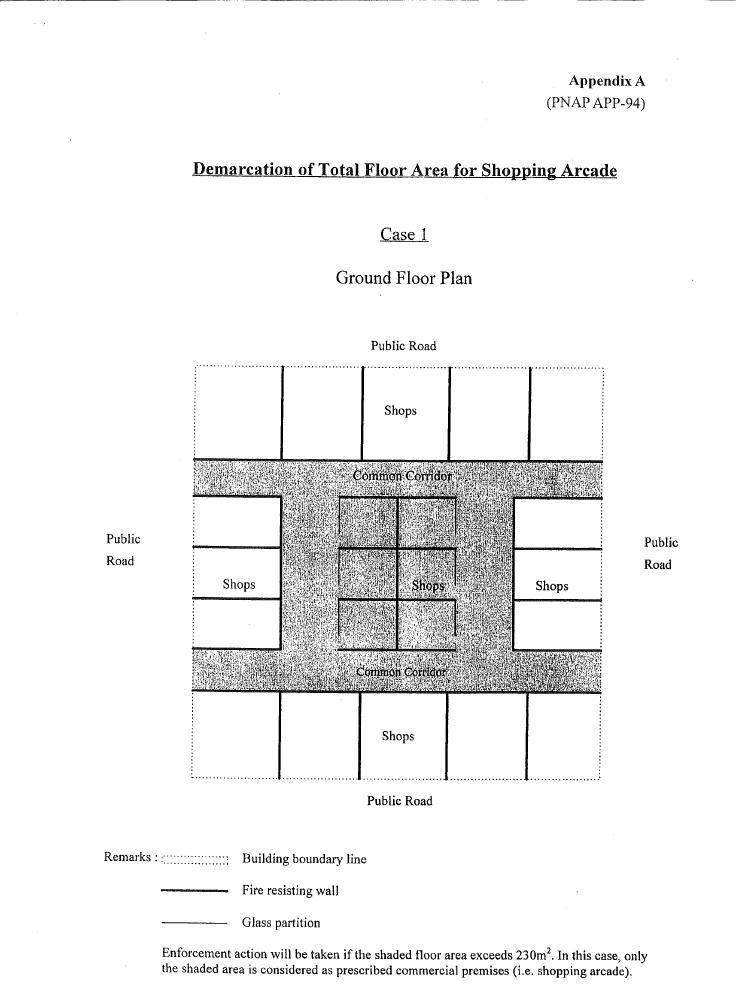
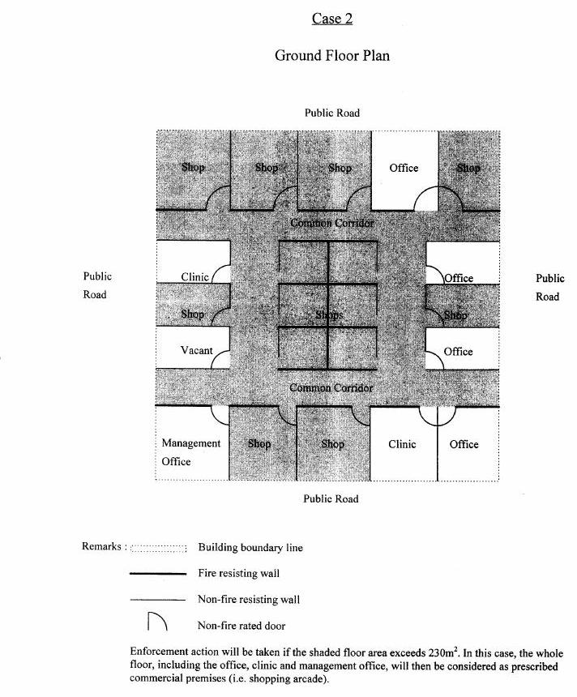
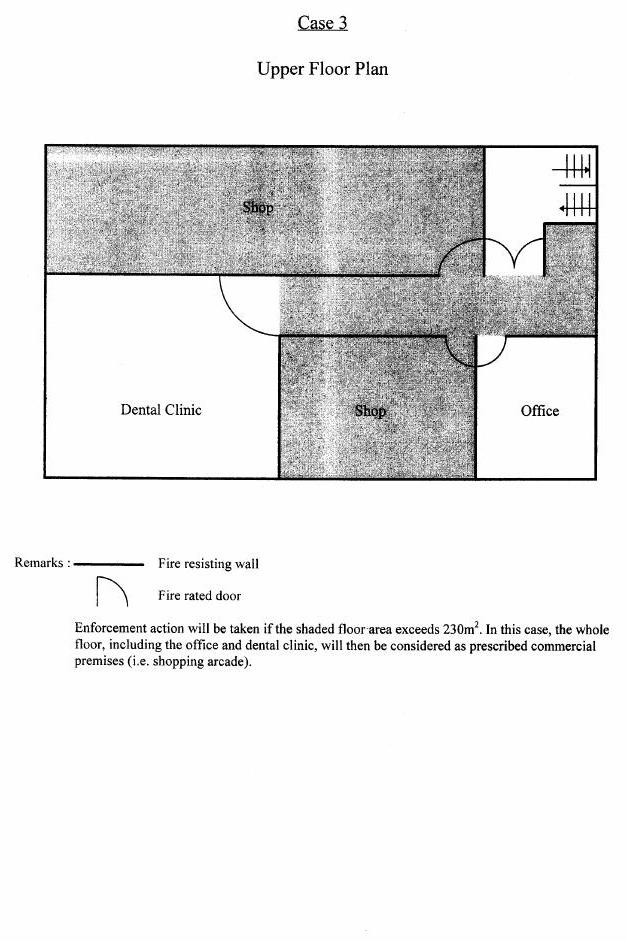
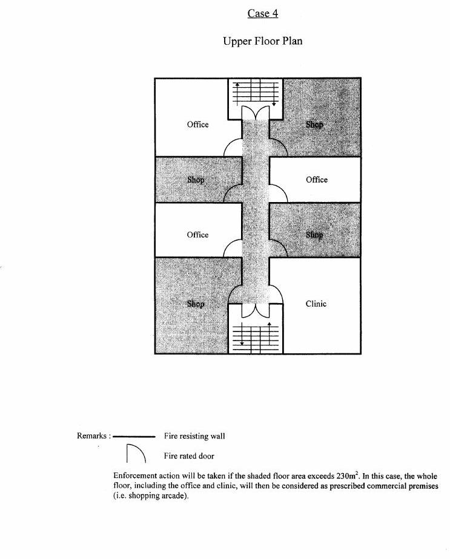

---
tags:
  - PNAP
  - APP series
  - FS(CP)O 消防安全(商業處所)條例
  - Commercial 商業
  - Fire safety 消防安全
  - Means of escape 逃生途徑
summary: "Fire Safety (Commercial Premises) Ordinance Cap. 502: which premises and buildings, required measures, directions and orders, alternatives, and shopping arcade floor area cases."
keywords: APP-94, Cap. 502, FS(CP)O, 消防安全（商業處所）條例, prescribed commercial premises, 指明商業處所, specified commercial building, 訂明商業建築物, 230 m2, shopping arcade, 商場, fire safety direction, 消防安全指示
---

# APP-94 Fire Safety (Commercial Premises) Ordinance, Cap. 502 <small>《消防安全（商業處所）條例》(第502章)</small>

!!! info "Document info 文件資料"
    | | |
    |---|---|
    | **Type 類別** | PNAP (APP series), previously PNAP 212 舊編號 PNAP 212 |
    | **Issued by 發出機構** | Buildings Department 屋宇署 |
    | **Version summarised 本摘要版本** | October 2010 |
    | **Official language 官方語言** | English and Chinese 中英文版 |
    | **Source 原文** | [English (PDF)](https://www.bd.gov.hk/doc/en/resources/codes-and-references/practice-notes-and-circular-letters/pnap/APP/APP094.pdf) · [中文 (PDF)](https://www.bd.gov.hk/doc/tc/resources/codes-and-references/practice-notes-and-circular-letters/pnap/APP/APP094.pdf) |
    | **Last checked 最後核對** | 2026-11-21 against the current BD version |

## At a glance 重點摘要 {#at-a-glance}

=== "English"

    - **Cap. 502** (from 2 May 1997, amended 1 Jun 1998) upgrades fire safety in commercial premises and buildings (para. 1).
    - **Prescribed commercial premises**: banks, off-course betting, jewellers with security areas, supermarkets / department stores, shopping arcades, with total floor area **> 230 m²** (s.3(3)–(6); App. A) (paras. 2–3).
    - **Specified commercial buildings**: office, business, trade or entertainment buildings with plans first submitted (or built) **on or before 1 Mar 1987** (para. 4). Similar to Cap. 572 (APP-145); BD Fire Safety Section can clarify.

=== "中文"

    - **第 502 章**（1997 年 5 月 2 日生效，1998 年 6 月 1 日修訂）提升商業處所及建築物的消防安全（第 1 段）。
    - **訂明商業處所**：銀行、場外投注站、設保安區的珠寶金行、超級市場／百貨公司、商場，總樓面面積 **> 230 平方米**（第 3(3)–(6) 條；附錄 A）（第 2–3 段）。
    - **指明商業建築物**：作辦公室、商業、貿易或娛樂用途，圖則在 **1987 年 3 月 1 日或之前**首次呈交（或建成）的建築物（第 4 段）；與第 572 章相若（APP-145），可向屋宇署消防安全組查詢。

!!! tip "Does it apply? 是否適用"
    **Prescribed commercial premises (PCP)**: banks (not merchant banks), off-course betting, jewellery / goldsmiths with a security area, supermarkets, hypermarkets, department stores, **shopping arcades**, with total floor area **> 230 m²**. **Specified commercial buildings (SCB)**: office, business, trade or entertainment buildings with plans first submitted (or built) **on or before 1 Mar 1987**. 指明商業處所及訂明商業建築物。

    **Standards used 採用標準**: the **1995 / 1996 codes** (MOE, FRC, MOA) under the Ordinance's Schedules 2 and 5, not the FS Code 2011 ([APP-153](app-153.md) para. 2(c)). 按 1995／1996 年守則，而非 2011 年守則。

## Key clauses 條文一覽 {#key-clauses-table}

| Para. 段 | Rule 規定 |
|---|---|
| 1 | **FS(CP)O Cap. 502** (in force **2 May 1997**, amended **1 Jun 1998**) upgrades PCP and SCB to current fire safety standards: FSI and fire safety construction. 目的。 |
| 2–3 | PCP definition (activities + **> 230 m²**); floor area per **s.3(3)–(6)**; **Appendix A** shows how a shopping arcade's floor area is demarcated; ask BD's **Fire Safety Section** if unsure. 指明商業處所。 |
| 4 | SCB definition: office / business / trade / entertainment, plans first submitted or built **on or before 1 Mar 1987**. 訂明商業建築物。 |
| 5 | Measures: (a) construction: **MoE**, **MoA**, **fire spread and structural integrity**; (b) FSI: sprinklers, ventilation cut-offs, emergency lighting, manual alarms, extinguishers, hydrant / hose reel, FSI Code 1994. 措施。 |
| 6 | Construction scope in **Schedule 2** (PCP) and **Schedule 5** (SCB); detail in the **MOE 1996, FRC 1996, MOA 1995** codes. 附表及守則。 |
| 7–8 | **Director of Buildings**: construction; **Director of Fire Services**: FSI; BD **Fire Safety Section** (CBS/FS). 執法機關。 |
| 9–10 | **Fire safety direction** (PCP) or **fire safety improvement direction** (SCB) under s.5(1) / 5(1A); on conviction, a magistrate's **compliance order** (s.6(1)). 指示及命令。 |
| 11 | Genuine difficulties: **alternative measures** on fire safety engineering principles. 替代措施。 |
| 12 | **ACFSO** (from 1 Jun 2010) advises on alternatives; terms in [APP-145](app-145.md) App. A. 諮詢委員會。 |
| 13 | Non-exempted works need BO approval; **3 sets** of FSI plans for FSD (not 2). 須 3 套圖則。 |
| 14 | **No plan fee** (B(A)R 42) if works are entirely to meet a direction. 豁免費用。 |

## Appendix A: demarcating a shopping arcade 附錄 A：商場面積劃定 {#appendix-a}

| Case 個案 | Floor 樓層 | When is it PCP? 何時屬指明商業處所 |
|---|---|---|
| 1 | G/F: shops round a common corridor, glass partitions | If the **shaded** shops + corridor exceed **230 m²**, only the **shaded area** is PCP |
| 2 | G/F: shops, offices, clinic, management office on corridors, non-fire-resisting walls / doors | If shaded area > 230 m², the **whole floor** (incl. office, clinic, management office) is PCP |
| 3 | Upper floor: shops, dental clinic, office; fire resisting walls, fire rated doors | If shaded > 230 m², **whole floor** is PCP |
| 4 | Upper floor: shops, offices, clinic off a central corridor | If shaded > 230 m², **whole floor** is PCP |

??? abstract "Appendix A original plans (Cases 1–4) 附錄 A 原圖"
    { loading=lazy }
    { loading=lazy }
    { loading=lazy }
    { loading=lazy }

    <small>Source: BD, PNAP APP-94 Appendix A. 資料來源：屋宇署。</small>

## Whole picture 整體關係 {#whole-picture}

| Topic 主題 | Where 文件 |
|---|---|
| Composite and domestic buildings (Cap. 572) 綜合用途及住宅 | [APP-145](app-145.md) |
| Codes used 採用守則 | [Superseded codes](../codes/superseded-codes.md) · [APP-80](app-80.md) · [APP-82](app-82.md) · [APP-75](app-75.md) |
| Why the FS Code 2011 is not used here 為何不用 2011 年守則 | [APP-153](app-153.md) para. 2(c) |
| Plan fees 費用 | [APP-55](app-55.md) |
| Fire safety in today's code 現行守則 | [FS Code Parts B–D](../codes/fsc-part-b-means-of-escape.md) |

## Related 相關文件 {#related}

| Document 文件 | Relationship 關係 |
|---|---|
| [APP-145](app-145.md) | Cap. 572 Fire Safety (Buildings) Ordinance |

---
<small>Prepared by: _[name]_ · Checked by: _[name]_ · Quotes from the official English and Chinese versions; refer to the PNAP for the definitive text.</small>
