---
tags:
  - PNAP
  - APP series
  - Contractor registration 承建商註冊
  - RGBC 註冊一般建築承建商
  - Registration 註冊
  - Minor works 小型工程
  - Demolition 拆卸
  - Lighting & ventilation 照明及通風
  - Foundation 地基
summary: "Building works must be done by contractors on the right register; five categories of specialised works need registered specialist contractors."
keywords: RGBC, RSC, registered general building contractor, 註冊一般建築承建商, specialist contractor, 註冊專門承建商, CRC, authorized signatory, technical director, PNAP 214, PNRC 38, specialised works, 專門工程
---

# APP-96 Registration of General Building Contractors and Specialist Contractors <small>一般建築承建商和專門承建商的註冊事宜</small>

!!! info "Document info 文件資料"
    | | |
    |---|---|
    | **Type 類別** | PNAP (APP series), previously PNAP 214 舊編號 PNAP 214 |
    | **Issued by 發出機構** | Buildings Department 屋宇署 |
    | **Version summarised 本摘要版本** | September 2026 |
    | **Official language 官方語言** | English only for now 暫只有英文版 |
    | **Source 原文** | [English (PDF)](https://www.bd.gov.hk/doc/en/resources/codes-and-references/practice-notes-and-circular-letters/pnap/APP/APP096.pdf) |
    | **Legal basis 法律依據** | [BO s.8–8F](../regulations/bo-part-1-registration.md) |
    | **Last checked 最後核對** | 2026-11-21 against the current BD version |

## At a glance 重點摘要 {#at-a-glance}

=== "English"

    - Covers registration of **general building** and **specialist contractors** (minor works contractors separately) under **BO s.8–8F**, so only competent contractors carry out works (paras. 1–2).
    - BA keeps **three registers** (general building, specialist with sub-registers, minor works), gazetted annually and online with the **Authorized Signatory** (paras. 3–4).
    - **Five specialised works categories**: **demolition, foundation, ground investigation field works, site formation, ventilation** (para. 5). **RGBC** do general works but **not** specialised works; **RSC** only their sub-register; RGBC may also do all minor works (para. 6). Applicants need management, qualified personnel, plant and an **AS** (plus a **TD** for companies) (paras. 9–11); **Pre-accepted AS** list (para. 12); AS / TD / OO cannot serve two contractors (para. 15). The BA cannot register without the **CRC's recommendation** (para. 17).

=== "中文"

    - 涵蓋根據**條例第 8–8F 條**註冊**一般建築承建商**及**專門承建商**（小型工程承建商另行說明），確保只有勝任的承建商進行工程（第 1–2 段）。
    - 建築事務監督備存**三份名冊**（一般建築、專門（設分冊）、小型工程），每年刊憲並在網站公布，連同**獲授權簽署人**資料（第 3–4 段）。
    - **五類專門工程**：**拆卸、地基、土地勘測外勤、地盤平整、通風**（第 5 段）。**註冊一般建築承建商**可進行一般工程但**不包括**專門工程；**註冊專門承建商**只可進行其分冊類別；一般建築承建商亦可進行所有小型工程（第 6 段）。申請人須具管理架構、合資格人員、機械及**獲授權簽署人**（公司另須**技術董事**）（第 9–11 段）；設**預先接納獲授權簽署人**名單（第 12 段）；獲授權簽署人等不得同時服務兩間承建商（第 15 段）；未經**承建商註冊事務委員會**推薦不得註冊（第 17 段）。

## Key clauses 主要條文 {#key-clauses}

| Para. 段 | Rule 規定 |
|---|---|
| 1–2 | General building and specialist contractors (minor works: APP-148); BO ss.8–8F. 承建商註冊。 |
| 3 | Three registers: **general building**, **specialist** (with sub-registers), **minor works**. 三個名冊。 |
| 4 | Names gazetted annually; AS, registration number and expiry on the BD website. 每年刊憲。 |
| 5 | **Five specialised works**: demolition, foundation, ground investigation field works, site formation, ventilation. 五類專門工程。 |
| 6 | RGBC: general works and street works without specialised works, plus all minor works; RSC: only their categories. 工程範圍。 |
| 7–8 | Owners appoint from the right register; scope and overlaps in Appendix A. 委任合適承建商。 |
| 9 | Requirements (BO s.8B(2)): management structure, qualified personnel, **plant and resources**, AS's understanding of the works and law. 註冊要求。 |
| 10–11 | At least **one AS**; for corporations at least **one TD**; plus qualified supporting staff. 主要人員。 |
| 12 | **Pre-accepted AS**: individuals assessed in advance and put on the List of AS. 預先接納獲授權簽署人。 |
| 13 | Who may be AS / TD by business type (individual, partnership, corporation). 資格。 |
| 15 | AS / TD / other officer of one contractor **cannot** serve another, except special sharing arrangements. 不得兼任。 |
| 16–18 | **CRC** examines and interviews; BA **must not register** without its recommendation (s.8B(10)); may advise on renewal and restoration. 註冊事務委員會。 |
| 19–21 | CRC composition for the general and specialist registers; chair elected by members. 委員會組成。 |
| 22 | Procedures in **PNRC 38**. 申請程序。 |

## Paragraph by paragraph (full) 逐段詳解 {#paragraph-detail}

Checked against the BD copy, revision September 2026 (paras 10 and 17 amended, para. 12 added). 已按 2026 年 9 月版本核對（第 10、17 段修訂，新增第 12 段）。

### Points not shown in the key clauses table 主要條文表未載的細節

| Para. 段 | Detail 細節 |
|---|---|
| 6 | RGBC may do **all** minor works in B(MW)R Schedule 1 Part 2. RSC may only do the minor works in **B(MW)R s. 28(1)(b) to (ea)** for their own sub-register categories. 專門承建商只可做第 28(1)(b)–(ea) 條相應小型工程。 |
| 9 | BO s. 8B(2) tests: (a) management structure (corporations); (b) experience and qualifications of personnel; (c) access to plant and resources; (d) AS understands building and street works through experience and knows the basic statutory requirements. |
| 10(b) | **Technical Director (TD)**: at least one board director of a corporation, authorised by the board to (i) access plant and resources, (ii) give technical and financial support, (iii) make decisions and supervise the AS and other staff. 技術董事須獲董事會授權。 |
| 10(c) | If the director acting as TD lacks the qualifications or experience, the board appoints an **Other Officer (OO)** or an AS to assist. An OO or AS may assist **one TD only**. 其他高級人員只可協助一名技術董事。 |
| 11 | The applicant must also show it employs suitably qualified staff to help execute, manage and supervise the works. |
| 12 | **Pre-accepted AS** (new): qualified individuals (minimum qualifications and experience in **PNRC 38 Appendices A–F**) may be assessed by the CRC and BA before any contractor appoints them. Successful names go on the **List of AS** on BD's website, which has three parts: Former AS, Pre-accepted AS and Practising AS. Contractors may pick from it when applying for registration or adding an AS. |
| 13 | Individual: only the applicant may be AS. Partnership: a partner appointed by all other partners. Corporation: AS appointed by the board; TD must be a director under the Companies Ordinance appointed by the board as TD. |
| 14 | One person may be both AS and TD of a corporation if he/she meets both sets of requirements. 同一人可兼任 AS 及 TD。 |
| 15 | No person may be AS/TD/OO of two contractors at the same time, except the **special sharing arrangement for holding and subsidiary companies**. |
| 16 | CRC functions: examine qualifications; inquire into experience; interview applicants and key personnel; advise the BA to **accept, defer or reject**. |
| 17 | BA must not register an RGBC or RSC unless the CRC recommends (s. 8B(10)). The BA may also ask the CRC about adding an AS/TD/OO and about **Pre-accepted AS** applications. |
| 18 | Renewal (s. 8C(4)) and restoration (s. 8D(3)): BA may consult the CRC. |
| 19 | **General building CRC** (s. 8(3)): BA's representative; 3 persons, one each nominated by the ARB, ERB and SRB from the AP/RSE/RGE lists; 3 nominated by the HK Construction Association; **1** by the HK E&M Contractors' Association; **1** selected by the BA from nominees of bodies it thinks fit. |
| 20 | **Specialist CRC** (s. 8(3A)): BA's representative; 3 from ARB/ERB/SRB; 3 from the HK Construction Association; **2** selected by the BA. |
| 21 | Chairman elected by members, not the BA's representative (s. 8(6)). |

### Appendix A: scope of works 附錄 A：工程範圍 (9/2013)

**When specialist contractors are needed 何時須聘用專門承建商**

| Category 類別 | Specialised works unless … 除非全部符合以下情況，否則屬專門工程 |
|---|---|
| **Demolition RSC(D)** | All demolition under the Building (Demolition Works) Regulations, **unless all** apply: (a) not in Scheduled Area No. 1; (b) no part **> 10 m** above adjacent ground; (c) no element with clear span **> 6 m** or cantilever **> 1 m**; (d) no prestressed concrete; (e) no earth-retaining structure with retained height **> 1.5 m**; (f) no other building within **5 m**. |
| **Foundation RSC(F)** | All foundation works **except** where the penetration depth of the element is **≤ 3 m**. 入土深度不超過 3 米除外。 |
| **Ground investigation RSC(GIFW)** | Always: exploratory drilling, boring, excavation and probing (with instruments, sampling, borehole testing); **pre-drilling** for foundations; **proof-drilling** for cast-in-place foundations, mini-piles and socketed H-piles; field tests of treated ground. |
| **Site formation RSC(SF)** | All site formation **unless all** apply: (a) gradient across the lot **≤ 15°**; (b) overall gradient within 10 m outside the lot **< 15°**; (c) no slope within 10 m outside the lot steeper than **30°** or higher than **1.5 m**; (d) no retaining / terrace wall **> 1.5 m** in the lot or within 10 m; (e) no such wall > 1.5 m to be built; (f) no slope > 30° or > 1.5 m to be built; (g) combined new wall and slope height **≤ 1.5 m**. |
| **Ventilation RSC(V)** | All ventilating system works under the Building (Ventilating Systems) Regulations. |

**Examples of GIFW works (para. 5, not exhaustive) 土地勘測工程例子**

| Type 類型 | Examples 例子 |
|---|---|
| Excavation | Trial pits, trial trenches, slope surface stripping |
| Boreholes | Hand auger, corehole drilling, light cable percussion, rotary open hole, rotary core drilling |
| Sampling | Disturbed, U76, U100, split barrel SPT, thin-walled piston, continuous soil and rock, rotary core, Mazier, block, groundwater samples, vibro-coring |
| Instrumentation | Piezometers, standpipes, tensiometers, piezometer buckets, inclinometers, extensometers |
| Borehole field tests | SPT, vane shear, permeability, packer (water absorption), plate, pressuremeter, impression packer survey, cone penetration test |
| Cast-in-place foundations | Pre-drilling for rockhead; core-drilling to check the founding stratum |
| Ground treatment | Field tests of load capacity of treated ground |

**Works that more than one category may do (paras 8–10) 可由多於一類承建商進行的工程**

Paras 8–9: no exhaustive line can be drawn. The AP/RSE/RGE judges whether a category has the competence, experience, plant and resources; unusual cases go to the BA case by case.

| Item 項目 | Who may do it 可進行者 |
|---|---|
| (a) Temporary works | RGBC, RSC(F), RSC(SF), RSC(D) for temporary works tied to their own works: hoarding, covered walkways, sheet / soldier / pipe piling, shoring, rock-filled slopes for demolition, protective measures. |
| (b) Pile caps | RGBC or RSC(F), with related excavation and lateral support. |
| (c) Basements | Excavation, basement walls, slabs and drains not part of pile caps: **RGBC**. |
| (d) Foundations | Diaphragm walls **> 3 m** penetration: RSC(F). Depth is measured from existing or newly formed ground. Spread footings and rafts: RSC(F) or RGBC. |
| (e) Landscape and street works | On-grade roads, streets, landscape features: generally RGBC. If no roof or foundation is involved (and drains are peripheral, not permanent building drains), RSC(SF) may also do them. |
| (f) Retaining structures | With diaphragm walls, bored piles, caissons or other foundations: RSC(F). Mini-piles (up to 400 mm dia., not for lateral load per [APP-18](app-18.md) App. B): RSC(F), or RGBC if **< 3 m** deep, but **not** RSC(SF). |
| (g) Dredging | Site formation: RSC(SF) if within the Appendix A para. 6 scope, otherwise RGBC. |
| (h) Reclamation | Site formation: RSC(SF). |
| (i) Trial pits | Normally RSC(GIFW). Any other registered contractor **except RSC(V)** may dig them only to: expose shallow foundations; locate utilities and underground structures; check backfill density behind retaining structures (in-situ density test by a Hong Kong Accreditation Service accredited lab); or other studies not about ground conditions (e.g. archaeology). |
| (j) Fire dampers | RGBC or RSC(V) may install. If RGBC installs, an RSC(V) inspects and certifies under FS Code cl. E8.3; if RSC(V) installs, it may certify its own. Certification: [APP-13](app-13.md). |

<!-- APSEC START -->
## APSEC clarifications 認可人士及註冊結構工程師委員會討論 {#apsec-clarifications}

BD's responses at the APSEC Discussion Forum that clarify this document, **newest first**. Where the same question came up more than once, only the **latest position** is listed. See [all APSEC items](../apsec/index.md). 屋宇署在討論會上就本文件作出的澄清，新者在前；同一問題只列最新立場。

- **[Removal of Retaining Walls in Site Formation Works](../apsec/2023.md#i2023021011)** <small>ADF 1/2023, 10 Feb 2023</small> BD advised that the scope of works of Registered Specialist Contractors in the demotion works and site formation works categories were delineated under Appendix A to PNAP APP-96. HKIE would provide case details for BD’s …
- **[PNAP ADM-8](../apsec/2018.md#i2018011914)** <small>ADF 1/2018, 19 Jan 2018</small> Members noted and would assist to facilitate BD’s review.
- **[PNAP APP-96 - Registration of General Building Contractors and Specialist Contractors](../apsec/2018.md#i2018011911)** <small>ADF 1/2018, 19 Jan 2018</small> BD advised that as the tie beams and individual caps/footings as shown in the attached plans formed an integral part of the foundation system, RSC(F) would be allowed to construct these beams and slabs. Other …

<!-- APSEC END -->

---
<small>Prepared by: _[name]_ · Checked by: _[name]_ · English only for now; Chinese text is an unofficial translation (中譯（非官方）).</small>
## Diagram 圖解 {#diagram}

<figure markdown>
  { width="760" loading=lazy }
  <figcaption>The three contractor registers. 三份承建商名冊。 Diagram prepared for this site; check the source text for exact wording.</figcaption>
</figure>

