---
tags:
  - PNAP
  - APP series
  - Consent 動工同意
  - Fast track 快速處理
  - Plan submission & approval 呈交及審批
  - Excavation & ELS 挖掘
  - Demolition 拆卸
  - Curtain wall & façade 幕牆及外牆
  - Structural 結構
  - Site supervision 地盤監督
  - Refuse 垃圾
  - Occupation permit 佔用許可證
  - Geotechnical 岩土
  - Foundation 地基
  - Drainage 排水
summary: "Consent procedures: Type I and Type II works, fast-track consent, the 2-year review of approved plans, new regulations and the first-consent checklist."
keywords: APP-97, consent, 動工同意, Type II works, fast track, 快速處理, BA8, s.16(3)(d), first consent checklist, 首次同意
---

# APP-97 Consent Procedures for Building Works and Street Works <small>處理同意展開建築工程及街道工程的程序</small>

!!! info "Document info 文件資料"
    | | |
    |---|---|
    | **Type 類別** | PNAP (APP series), previously PNAP 215 舊編號 PNAP 215 |
    | **Issued by 發出機構** | Buildings Department 屋宇署 |
    | **Version summarised 本摘要版本** | May 2023 |
    | **Official language 官方語言** | English only for now 暫只有英文版 |
    | **Source 原文** | [English (PDF)](https://www.bd.gov.hk/doc/en/resources/codes-and-references/practice-notes-and-circular-letters/pnap/APP/APP097.pdf) |
    | **Legal basis 法律依據** | [BO s.14(1)(b)](../regulations/bo-part-2-building-works.md); [B(A)R 31, 33](../regulations/bar-123a.md) |
    | **Last checked 最後核對** | 2026-11-21 against the current BD version |

## At a glance 重點摘要 {#at-a-glance}

=== "English"

    - Two routes to BA consent (para. 3): **normal** (separate approval then consent, for all works) and **fast-track** (approval and consent together, for **Type II works** only).
    - **Type I**: works with no first consent yet, including major revisions or materially deviating amendments. **Type II**: amendments to works already approved and consented, excluding major revisions (para. 4).
    - For fast-track, mark the plans (lower right) with the **prescribed Type II statement** under B(A)R 33; wrong classification can be refused under s.16(3) (paras. 5–6).
    - Fast-track lets minor adjustments proceed **without suspending works**, but consent covers only what is on the approved plans; if structural amendment plans are also needed, do not build until those are approved and consented (paras. 7, 11).
    - Use standard **works terminology** (demolition, GI, site formation, ELS, foundation, superstructure, curtain wall, A&A, drainage…) and the **first-consent checklist** in App. A (paras. 8–9).

=== "中文"

    - 取得建築事務監督同意有兩種程序（第 3 段）：**一般程序**（先批准後同意，適用於所有工程）及**快速處理程序**（批准及同意同時發出，只適用於**第 II 類工程**）。
    - **第 I 類**：未獲首次同意的工程，包括重大修訂或有重大偏差的修訂圖則。**第 II 類**：已獲批准及首次同意工程的修訂，不包括重大修訂（第 4 段）。
    - 採用快速處理須在圖則右下角加上 B(A)R 第 33 條的**指定第 II 類聲明**；分類錯誤可根據第 16(3) 條拒絕（第 5–6 段）。
    - 快速處理容許輕微調整**無須暫停工程**，但同意只涵蓋已批准圖則的內容；如需結構修訂圖則，須待其獲批准及同意後才施工（第 7、11 段）。
    - 使用標準**工程名稱**（拆卸、土地勘測、地盤平整、挖掘及側向承托、地基、上蓋、幕牆、改動加建、排水等），並參考附錄 A 的**首次同意清單**（第 8–9 段）。

!!! tip "Does it apply? 是否適用"
    **Applies 適用**: every **consent application** for building works and street works. **Fast track** only for **Type II works** (amendments to works that already have a first consent, not major revisions or material deviations). 所有動工同意申請；快速處理只適用於第 II 類工程。

## Key clauses 條文一覽 {#key-clauses-table}

| Para. 段 | Rule 規定 |
|---|---|
| 1–3 | Two procedures: **normal** (all works; required for Type I) and **fast track** (Type II only). 兩套程序。 |
| 4 | **Type I**: works with **no first consent** yet (including major revisions / material deviations approved later). **Type II**: amendments to approved and consented works, excluding major revisions. 第 I、II 類定義。 |
| 5 | Mark plans (lower right): *"The works shown on these plans are Type II works … Fast Track consent application under regulation 33 of the B(A)R."* 圖則註明。 |
| 6 | The AP / RSE / RGE classifies; if the BA disagrees, consent may be refused under **s.16(3)(a) or (b)**. 分類由專業人士負責。 |
| 7 | Fast track allows minor adjustments **without stopping works**, but only where consent was already obtained. 毋須停工。 |
| 8 | Standard terms: demolition, GI, site formation, slope / retaining wall, ELS, foundation, cap / footing / basement, superstructure, curtain wall / cladding, A&A, street / access road, drainage, tunnel, general building works. 工程名稱。 |
| 9 | **Appendix A** checklist before the **first superstructure consent** (not submitted). 核對表。 |
| 10 | Normal: separate approval and consent applications. 一般程序。 |
| 11–12 | Fast track: approval and consent **together**, limited to what is shown; wait for related structural approvals. Steps: 1 statement; 2 disapproval + refusal together; 3 approval + consent; 4 approval but consent refused → normal route; 5 repeat for later amendments. 五個步驟。 |
| 13 | The para. 5 statement replaces **Form BA8** for Type II. 代替 BA8。 |
| 14 | Get all consents before starting; sanctions under **BO s.7 and s.40**. 罰則。 |
| 15 | No validity period for approved plans, but **s.16(3)(d)** lets the BA refuse consent for plans approved **> 2 years** ago that no longer meet current BO standards (not used to enforce later OZPs). 兩年覆核。 |
| 16 | New regulations (**s.39(2)**): works consented before keep the old law; if required works are not on plans approved within 2 years at first consent, refusal under **s.16(3)(a)**; otherwise amend plans before OP, else OP may be refused (**s.21(6)**). 新規例過渡。 |

## Appendix A: first consent checklist 附錄 A：首次同意核對表 {#appendix-a}

| Part | Items 項目 |
|---|---|
| 1 Site preparation | Party walls / adjoining buildings safe; shoring installed; AP / RSE / RGE / RC contacts displayed ([ADV-12](adv-12.md)) |
| 2 Documents | **BA8 / BA8A**; supervision plan; modification conditions: **BEAM Plus provisional assessment**, energy information, **provisional EE report** ([APP-151](app-151.md), [APP-156](app-156.md)); proof of **full site ownership**; B(A)R 10 items: **Stage II GBP** ([ADM-19](adm-19.md), [ADV-33](adv-33.md)), provisional **OTTV** ([APP-67](app-67.md)), site parameter proof ([ADM-21](adm-21.md)); s.17 documents ([APP-162](app-162.md)) |
| 3 Other | Superstructure and drainage plans approved; anchor system plans ([APP-12](app-12.md)); s.17 and GEO conditions met; new codes complied with; **AMO** requirements ([APP-69](app-69.md)); modification permit valid; **hoarding permit** ([APP-23](app-23.md)); party wall consent (s.113); **BA14** for foundations acknowledged; B(A)R 33(1) modification for minor amendments ([ADM-19](adm-19.md)) |

## Whole picture 整體關係 {#whole-picture}

| Topic 主題 | Where 文件 |
|---|---|
| Statutory consent provisions 法定條文 | [BO Part 2](../regulations/bo-part-2-building-works.md) (s.14, s.16, s.39) · [B(A)R](../regulations/bar-123a.md) (regs. 31, 33) |
| Concurrent approval and consent, fast tracks 同時申請 | [ADM-19](adm-19.md) (BA8A, 30-day tracks) |
| Conditions of consent 同意條件 | [APP-162](app-162.md) |
| Fees and major revisions 費用及重大修訂 | [APP-55](app-55.md) |
| Supervision plans 監工計劃書 | [Site Supervision Code](../codes/site-supervision-2009.md) |
| Whole process 整體流程 | [Submission to OP guide](../guides/submission-to-op.md) |

## Workflow / timeline 流程及時間表 {#workflow-timeline}

<figure markdown>
  { width="520" loading=lazy }
  <figcaption>Normal or fast-track consent? 一般程序還是快速處理？ Summary diagram prepared for this site; check the source text for exact wording.</figcaption>
</figure>

## Related 相關文件 {#related}

| Document 文件 | Relationship 關係 |
|---|---|
| [B(A)R](../regulations/bar-123a.md) | Regs 31, 33 consent 同意 |
| [APP-13](app-13.md) | Completion 完工 |

---
<small>Prepared by: _[name]_ · Checked by: _[name]_ · English only for now; Chinese text is an unofficial translation (中譯（非官方）).</small>
