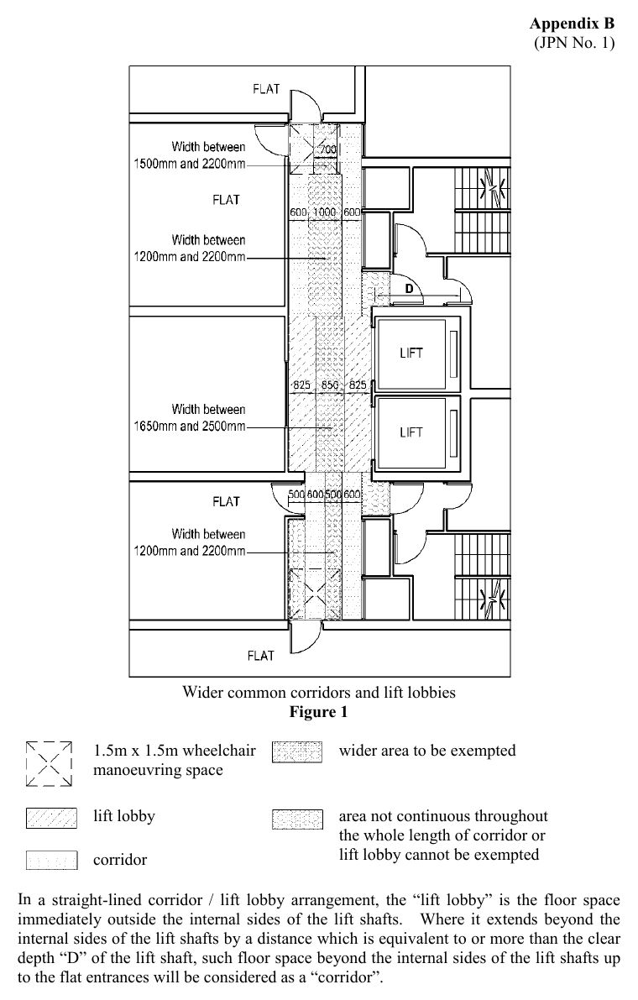
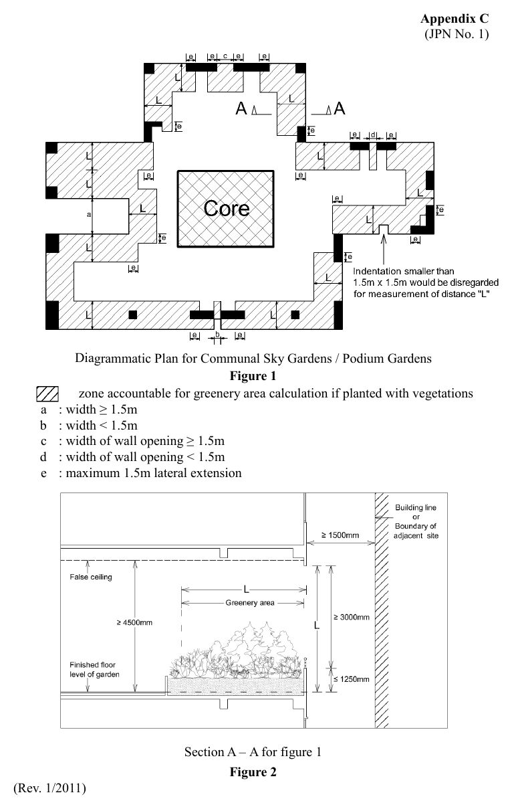
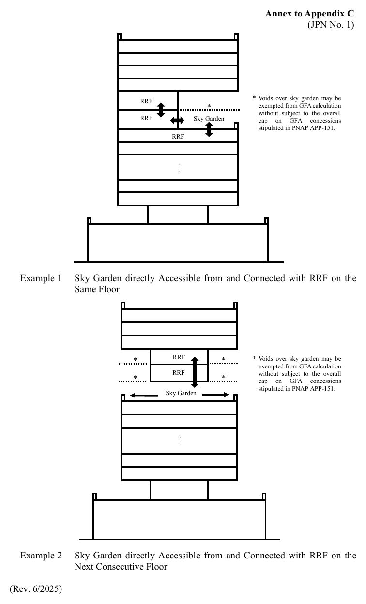

---
tags:
  - JPN
  - GFA concession 樓面面積寬免
  - Green & amenity features 環保及適意設施
  - Balcony & utility platform 露台及工作平台
  - Sky garden 空中花園
  - Domestic 住用
  - GFA 總樓面面積
  - Lift 升降機
  - Hotel 酒店
  - Site coverage 上蓋面積
  - Lighting & ventilation 照明及通風
  - Refuge floor 庇護層
  - Sustainable building design 可持續建築設計
  - Occupation permit 佔用許可證
  - Elderly-friendly 長者友善
summary: "Joint Practice Note 1: six green features (balconies, wider corridors, sky gardens, podium gardens, acoustic fins, wing walls) exempt from GFA / SC under BO, lease and planning."
keywords: JPN 1, green and innovative buildings, 環保及創新樓宇, balcony, sky garden, GFA exemption, joint practice note
---

# JPN 1 Green and Innovative Buildings <small>聯合作業備考第 1 號：環保及創新的樓宇</small>

!!! info "Document info 文件資料"
    | | |
    |---|---|
    | **Type 類別** | Joint Practice Note 聯合作業備考 (BD 屋宇署 · LandsD 地政總署 · PlanD 規劃署) |
    | **First issue 首次發出** | February 2001 |
    | **Version summarised 本摘要版本** | June 2025 (paras. 9, 12, 13 and App. A amended; para. 10 and Annex to App. C added) |
    | **Official language 官方語言** | English only (Chinese version not available) 只有英文版 |
    | **Source 原文** | [JPN 1 (PDF)](https://www.bd.gov.hk/doc/en/resources/codes-and-references/practice-notes-and-circular-letters/joint/JPN01.pdf) |
    | **Last checked 最後核對** | 2026-11-20 against the June 2025 version |

## At a glance 重點摘要 {#at-a-glance}

=== "English"

    - Joint incentive from **BD, LandsD and PlanD**: six **green features** may be exempted from GFA and/or SC under the **BO**, the **lease** and the **Town Planning Ordinance** (paras. 4–15).
    - The six features: **(a) balconies** (residential) · **(b) wider common corridors and lift lobbies** (residential) · **(c) communal sky gardens** (residential) · **(d) communal podium gardens** (non-residential) · **(e) acoustic fins** · **(f) wing walls, wind catchers and funnels**.
    - **Balconies**: only **50%** of the area is exempted, max. **1 m² or 2.5% of UFS (greater), capped at 3 m² per flat**. Balcony ≥ **2 m²**, ≥ **40%** of its perimeter open, ≥ **150 mm** drop. Subject to the APP-151 **pre-requisites and 10% cap**.
    - **Sky gardens**: max. **1 per 15 residential storeys**; net garden ≥ **50%** of floor plate; greenery ≥ **15%**; clear height ≥ **4.5 m**; cross-ventilated; at least **10 storeys apart**.
    - **Lease and planning**: the BA's exemption is a **pre-requisite**. LandsD may then exempt under the lease (balconies may need a **premium**). PlanD applies the same criteria, subject to OZP height and SC limits.
    - **Misuse** (enclosing balconies, exhausts into balconies, private use of gardens) leads to **enforcement and prosecution** (para. 21).

=== "中文"

    - **屋宇署、地政總署及規劃署**聯合推出的鼓勵措施：六項**環保設施**可根據**《建築物條例》**、**地契**及**《城市規劃條例》**獲豁免總樓面面積及／或上蓋面積（第 4–15 段）。
    - 六項設施：**(a) 露台**（住宅）· **(b) 加闊公用走廊及升降機大堂**（住宅）· **(c) 公用空中花園**（住宅）· **(d) 公用平台花園**（非住宅）· **(e) 隔音鰭** · **(f) 翼牆、捕風器及風斗**。
    - **露台**：只豁免面積的 **50%**，每單位上限為 **1 平方米或實用樓面空間 2.5%（取較大者），最多 3 平方米**；露台 ≥ **2 平方米**，周邊 ≥ **40%** 開敞，下降 ≥ **150 毫米**；須符合 APP-151 **先決條件及 10% 上限**。
    - **空中花園**：每 **15 層住宅樓層最多 1 個**；淨花園面積 ≥ 樓面 **50%**；綠化 ≥ **15%**；淨高 ≥ **4.5 米**；對流通風；相隔最少 **10 層**。
    - **地契及規劃**：建築事務監督批出豁免是**先決條件**，其後地政總署可按地契豁免（露台或須**補地價**）；規劃署採用相同準則，惟須符合分區計劃大綱圖的高度及上蓋面積限制。
    - **濫用**（圍封露台、浴室排氣口通往露台、花園私用）會被**執法及檢控**（第 21 段）。

## Key table: the six green features (Appendix A) 六項環保設施（附錄 A） {#key-table-the-six-green-features-appendix-a-a}

| Feature 設施 | Exempted from 豁免 | Key criteria 主要準則 | APP-151 pre-req 先決條件 | 10% cap 上限 |
|---|---|---|:-:|:-:|
| **(a) Balconies** (residential) 露台（住宅） | GFA & SC | Living/dining/bedroom only; no projecting window in same room; ≥ **1.5 m** from utility platform; not in re-entrant < **2.3 m** wide or light well; ≥ **40%** of perimeter open above safe parapet; within lot; ≥ **150 mm** drop; **50%** of area exempted; total per flat **max(1 m², 2.5% UFS) ≤ 3 m²**; each balcony ≥ **2 m²** 只限客廳／飯廳／睡房；≥ 40% 周邊開敞；下降 ≥ 150 毫米；豁免 50%；每單位上限 1 平方米或 2.5% 實用樓面空間（較大者），最多 3 平方米 | ✅ | ✅ |
| **(b) Wider common corridors & lift lobbies** (residential) 加闊公用走廊及升降機大堂 | GFA & SC | Not entrance halls; only the width **1,200–2,200 mm** (corridor) and **1,650–2,500 mm** (lift lobby) is exempted, continuous along the whole length; structural dimensions; not a statutory requirement 不適用於入口大堂；只豁免走廊闊度 1,200–2,200 毫米及升降機大堂 1,650–2,500 毫米的部分 | ✅ | — |
| **(c) Communal sky gardens** (residential) 公用空中花園 | GFA | ≤ residential storeys ÷ **15**; open on **2 opposite sides**; net area ≥ **50%** of floor plate; greenery ≥ **15%** within zone *L*; first sky garden ≤ **10 storeys** above ground if no podium garden; ≥ **10 storeys** apart; clear height ≥ **4.5 m**; common access only; no commercial use 數目 ≤ 住宅樓層 ÷ 15；淨面積 ≥ 50%；綠化 ≥ 15%；淨高 ≥ 4.5 米；相隔 ≥ 10 層 | ✅ | — |
| **(d) Communal podium gardens** (non-residential) 公用平台花園（非住宅） | GFA | Under a non-residential tower footprint; no occupied accommodation on that floor; clear height ≥ **4.5 m**; open on 2 opposite sides; not served by cargo lifts; net area ≥ **50%** of tower footprint; greenery ≥ **15%** 位於非住宅大廈範圍下；淨高 ≥ 4.5 米；淨面積 ≥ 50%；綠化 ≥ 15% | ✅ | — |
| **(e) Acoustic fins** 隔音鰭 | GFA & SC | Mitigates noise; non-load-bearing; within lot; justified by quantitative assessment 減低噪音；非承重；須量化評估 | ✅ | — |
| **(f) Wing walls, wind catchers, funnels** 翼牆、捕風器、風斗 | GFA & SC | Promotes natural ventilation; non-load-bearing; within lot; justified by quantitative assessment 促進自然通風；非承重；須量化評估 | ✅ | — |

<small>"Residential" excludes the non-domestic part of composite buildings, and **hotels are non-residential** for this JPN, so (a)–(c) do not apply to hotels. 本備考中的「住宅」不包括綜合用途建築物的非住用部分；**酒店屬非住宅**，故 (a)–(c) 不適用於酒店。</small>

## Key clauses 主要條文 {#key-clauses}

!!! quote "App. A para. 1(a)(x)–(xii) — Balcony exemption limits 露台豁免上限"
    (x) Not more than 50% of the area of the balcony is to be exempted from GFA and SC calculations; (xi) The summation of areas to be exempted for such balconies including portion of such balconies per residential unit is 1m² or 2.5% of the Usable Floor Space of the unit whichever is the greater subject to a maximum of 3m²; (xii) The size of any balcony, including part of which to be exempted from GFA and SC calculations, is not less than 2m².

    **中譯（非官方）：** (x) 露台面積只有不多於 50% 可獲豁免總樓面面積及上蓋面積；(xi) 每個住宅單位獲豁免的露台面積總和為 1 平方米或單位實用樓面空間的 2.5%（以較大者為準），上限為 3 平方米；(xii) 任何露台（包括獲豁免部分）的面積不少於 2 平方米。

!!! quote "App. A para. 1(c)(ii), (iv), (v) — Sky gardens 空中花園"
    (ii) In addition to any podium garden, the maximum number of sky gardens provided is equal to or less than the number of residential storeys divided by 15; … (iv) The net area of the sky garden occupies not less than 50% of the area of the floor plate…; (v) Within such net garden area, not less than 15% of the area of the floor plate is the greenery area which is: a. planted with vegetations; and b. within a zone which is not more than a horizontal distance 'L' measured perpendicularly from the outer edge of any external wall which is open above safe parapet height and faces into the open air, where 'L' equals to the clear vertical distance between the top of such external wall opening and the finished floor level of the garden.

    **中譯（非官方）：** (ii) 除任何平台花園外，空中花園的數目最多為住宅樓層數目除以 15；……(iv) 空中花園的淨面積不少於該層樓面面積的 50%……；(v) 在淨花園面積內，不少於樓面面積 15% 為綠化面積，該面積須：a. 種植植物；及 b. 位於由在安全欄杆高度以上開敞並面向露天地方的外牆外邊起計、垂直量度不超過水平距離「L」的範圍內，「L」等於該外牆開口頂部至花園完成樓面的垂直淨距離。

!!! quote "Para. 21 — Misuse of incentives 濫用鼓勵措施"
    The Government will monitor the use of the features and will take enforcement action, including prosecution, against non-compliance with the following conditions of exemption: (a) Balconies and the covered areas underneath the balconies are not to be enclosed…; (b) The exhaust outlets for internal bathrooms and lavatories are not to open into the balconies…; or (c) Sky gardens and podium gardens are to be designated for the exclusive use of the owners, tenants and their visitors only…

    **中譯（非官方）：** 政府會監察設施的使用，並會就違反以下豁免條件採取執法行動（包括檢控）：(a) 不得圍封露台及露台下的有蓋地方；(b) 內置浴室及洗手間的排氣口不得通往露台；或 (c) 空中花園及平台花園須指定只供業主、租客及其訪客專用。

## Figures 圖則 {#figures}

<figure markdown>
  { loading=lazy }
  <figcaption>Appendix B Fig. 1 — Wider common corridors and lift lobbies: which width is exempted 加闊公用走廊及升降機大堂：可豁免的闊度</figcaption>
</figure>

<figure markdown>
  { loading=lazy }
  <figcaption>Appendix C — Greenery zone "L" in communal sky / podium gardens 公用空中／平台花園的綠化範圍「L」</figcaption>
</figure>

??? abstract "Annex to Appendix C — sky garden connected with RRF 空中花園連接住客康樂設施"
    { loading=lazy }

    A sky garden may connect directly with the residents' recreational facilities (RRF) on the same or the next floor (max. **3 consecutive storeys**). It must have an **elderly-friendly toilet and fitness equipment**, and cannot be coupled with a refuge floor. On the same floor, the net area may drop to **30%** and greenery to **8%** of the floor plate (App. A 1(c)(xvi)).
    空中花園可直接連接同層或下一層的住客康樂設施（最多連續 3 層），須設**長者友善洗手間及健體設施**，且不得與庇護層合併；同層連接時，淨面積可減至樓面 **30%**、綠化減至 **8%**。

<small>Source: JPN 1 (June 2025), Buildings Department / Lands Department / Planning Department 資料來源：屋宇署、地政總署、規劃署</small>

## Explanation 淺白解釋 {#explanation}

=== "English"

    JPN 1 rewards **green design** with GFA/SC exemptions. Because a GFA exemption is worthless if the **lease** or the **OZP** still counts the area, the three departments agreed to apply the **same criteria** across all three regimes.

    **Process:**

    1. Apply to **BD** for modification (with supporting documents and undertaking). The BA's exemption must come **first** (para. 12).
    2. Check the **lease** with the District Lands Office. New sale sites usually have an exemption clause. Existing leases may need a **lease modification**: a **premium is payable for balconies** (para. 9).
    3. Check the **OZP**. If the exemption pushes the building over the OZP height or SC limit, a **minor relaxation** application to the TPB is needed (para. 13).
    4. Register the **undertaking** in the Land Registry **before applying for the OP** (para. 20).

=== "中文"

    JPN 1 以總樓面面積／上蓋面積豁免鼓勵**環保設計**。由於若**地契**或**分區計劃大綱圖**仍計算該面積，屋宇署的豁免便沒有作用，因此三個部門同意在三個制度下採用**相同準則**。

    **程序：**

    1. 向**屋宇署**申請變通（附證明文件及承諾書）；建築事務監督的豁免必須**先行**批出（第 12 段）。
    2. 向地政處核對**地契**：新售地段一般設有豁免條款；現有地契或須**修訂地契**，**露台須補地價**（第 9 段）。
    3. 核對**分區計劃大綱圖**：如豁免令建築物超出大綱圖的高度或上蓋面積限制，須向城市規劃委員會申請**略為放寬**（第 13 段）。
    4. **申請佔用許可證前**須在土地註冊處登記**承諾書**（第 20 段）。

## Practical notes 實務提示 {#practical-notes}

=== "English"

    !!! example "Worked example: balcony exemption per flat"
        Flat UFS **60 m²**, one balcony of **2.4 m²**.

        - 50% of balcony = **1.2 m²**
        - Per-flat limit = max(1 m², 2.5% × 60 = 1.5 m²) = **1.5 m²**, capped at 3 m²
        - Exempted = min(1.2, 1.5) = **1.2 m²**. The remaining 1.2 m² counts as GFA.

    !!! example "Worked example: number of sky gardens"
        **45 residential storeys** → max. 45 ÷ 15 = **3 sky gardens** (in addition to any podium garden), each at least 10 storeys apart.

    !!! tip "Common pitfalls"
        - **Hotels** cannot use balcony, wider corridor or sky garden concessions.
        - The corridor and lift lobby widths must be **continuous along the whole length**. Partial widenings are not exempted (App. B).
        - Sky garden parapets: the solid part must be ≤ **1,250 mm**, and the opening ≥ **3,000 mm** above it, for cross-ventilation and the greenery zone to count (footnote 5).
        - Houses with **no common staircase** cannot get the corridor exemption under the lease (para. 9(a)).

=== "中文"

    !!! example "計算例子：每單位露台豁免"
        單位實用樓面空間 **60 平方米**，一個 **2.4 平方米**露台。

        - 露台 50% = **1.2 平方米**
        - 每單位上限 = 1 平方米與 2.5% × 60 = 1.5 平方米的較大者 = **1.5 平方米**（最多 3 平方米）
        - 獲豁免 = 1.2 與 1.5 的較小者 = **1.2 平方米**；其餘 1.2 平方米計入總樓面面積。

    !!! example "計算例子：空中花園數目"
        **45 層住宅樓層** → 最多 45 ÷ 15 = **3 個空中花園**（平台花園以外），每個相隔最少 10 層。

    !!! tip "常見錯誤"
        - **酒店**不可享露台、加闊走廊或空中花園寬免。
        - 走廊及升降機大堂闊度須**沿整條長度連續**，局部加闊不獲豁免（附錄 B）。
        - 空中花園欄杆：實心部分 ≤ **1,250 毫米**，其上開口 ≥ **3,000 毫米**，對流通風及綠化範圍方可計算（註腳 5）。
        - **沒有公用樓梯**的屋宇，在地契下不能獲加闊走廊豁免（第 9(a) 段）。

<!-- APSEC START -->
## APSEC clarifications 認可人士及註冊結構工程師委員會討論 {#apsec-clarifications}

BD's responses at the APSEC Discussion Forum that clarify this document, **newest first**. Where the same question came up more than once, only the **latest position** is listed. See [all APSEC items](../apsec/index.md). 屋宇署在討論會上就本文件作出的澄清，新者在前；同一問題只列最新立場。

- **[Registration of Letters of Undertaking in the Land Registry](../apsec/2026.md#i202605085)** <small>ADF 2/2026, 8 May 2026</small> BD advised that the understanding of the HKIA was correct. the Registration in the Land Registry for the following undertaking letters in was required before OP application and might be imposed in the condition of the modification/exemption granted, if applicable: (a) For surrender/dedication of land to permit the site coverage …
- **[Implementation of PNAP APP-151 and GFA concessions under](../apsec/2025.md#i202511214)** <small>ADF 4/2025, 21 Nov 2025</small> BD advised that the GFA concessions under the recently revised PNAPs APP-19, APP-42, APP-89 and JPN No.1 were applicable to all new buildings with works in progress, including those with GBP approved before 30 June 2024 and/or localised major revision, provided that the pre-requisites under the PNAP APP-151 and relevant …
- **[Communal Podium Garden for Residential Building](../apsec/2024.md#i2024022312)** <small>ADF 1/2024, 23 Feb 2024</small> BD advised that pursuant to the GFA concession under PNAP APP-42, the communal podium garden should be provided under and within the perimeter of a domestic tower. For the case shown in the “Schematic Building Section”, the communal podium garden on 1/F could not fulfill the said requirement for the purpose of GFA concession …
- **[Site Coverage and Open Space Provision](../apsec/2021.md#i202108131)** <small>ADF 4/2021, 13 Aug 2021</small> BD advised the following: For (1), HKIA’s understanding was correct. For (2), according to footnote 3 under PNAP APP-132, ‘the “total covered area” is the portion of the site covered by building(s) or in simple terms, the footprint of the shadow cast vertically down onto a site… but exclude the projections under PNAP APP-19’. …
- **[Disposition of AC Platform combined with Balcony and/or UP](../apsec/2020.md#i202009299)** <small>ADF 3/2020, 29 Sep 2020</small> In general, the disposition of AC platforms other than those shown in Figures 1 to 3 in Appendix B of the Code might be considered provided that the design criteria of AC platforms as stated in Appendix B of the Code were complied with; the provision of natural lighting and ventilation of the adjoining habitable space was not …
- **[Exemption of GFA and SC for Covered Areas Underneath Lowest Balcony/Utility Platform](../apsec/2019.md#i201911229)** <small>ADF 5/2019, 22 Nov 2019</small> Pursuant to JPN No. 1 and No. 2 jointly endorsed by BD, LandsD and PlanD, only the covered areas underneath the lowest balcony and utility platform might be fully exempted from GFA and SC calculations but not the covered areas at setback terraces/flat roofs at the upper domestic storeys as shown in the diagram.
- **[Code of Practice on Design for Safety – External Maintenance 2019](../apsec/2019.md#i2019112217)** <small>ADF 5/2019, 22 Nov 2019</small> (i) BD advised that paragraph 1(a) & (c) of the Appendix of the Circular Letter should be included in the GBP while paragraph 1(b) could be in the form of a technical report to be submitted for BD’s approval prior to superstructure consent application. (ii) If AC platform combined with balcony/utility platform had been adopted …

<!-- APSEC END -->

## Related 相關文件 {#related}

| Document 文件 | Relationship 關係 |
|---|---|
| [APP-151](app-151.md) | Items 5–10 in Appendix A; pre-requisites and cap 附錄 A 第 5–10 項 |
| [JPN 2](jpn-2.md) | Second package of green features 第二批環保設施 |
| APP-104 | Residents' recreational facilities 住客康樂設施 |
| APP-122 | Refuge floor cum sky garden 庇護層兼空中花園 |
| [APP-152](app-152.md) | SBD guidelines (greenery, permeability) 可持續建築設計指引 |
| JPN 4 | GFA/SC exemptions under existing leases 現有地契下的豁免 |

---
<small>Prepared by: _[name]_ · Checked by: _[name]_ · Unofficial summary; refer to the official JPN for the definitive text.</small>
