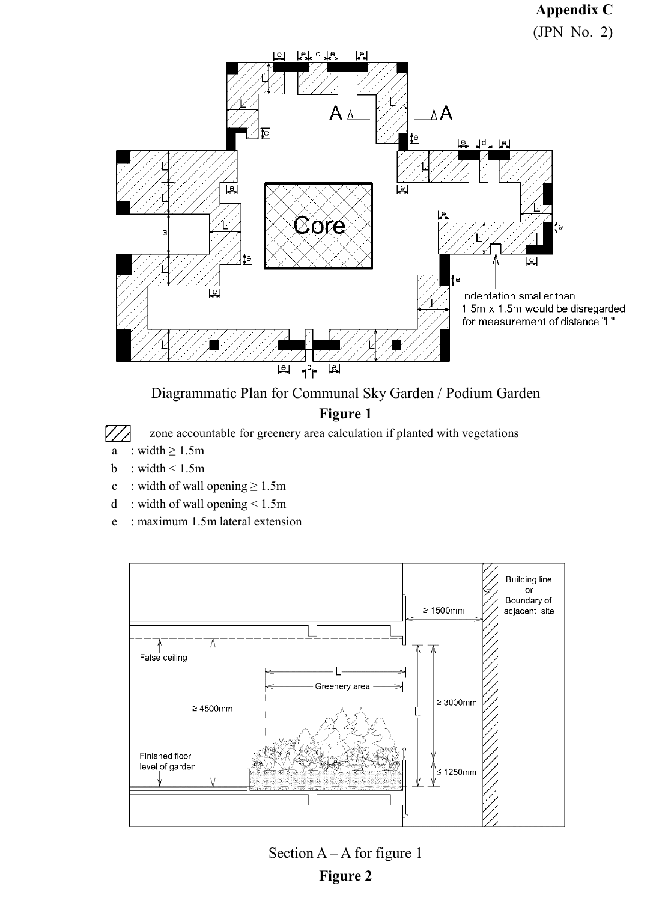
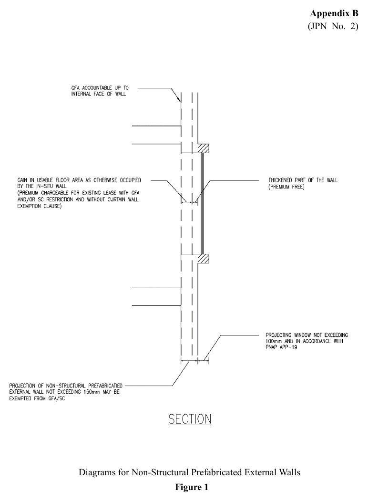
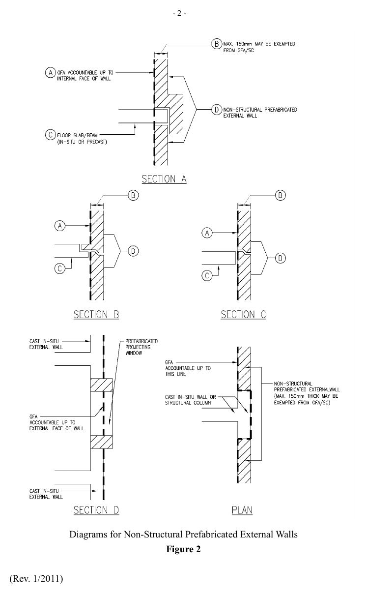

---
tags:
  - JPN
  - GFA concession 樓面面積寬免
  - Green & amenity features 環保及適意設施
  - Balcony & utility platform 露台及工作平台
  - NSPEW 非結構預製外牆
  - Domestic 住用
  - GFA 總樓面面積
  - Structural 結構
  - Maintenance access 維修通道
  - Hotel 酒店
  - Site coverage 上蓋面積
  - Lighting & ventilation 照明及通風
  - Plan submission & approval 呈交及審批
  - Occupation permit 佔用許可證
  - Refuge floor 庇護層
  - Fire safety 消防安全
  - Curtain wall & façade 幕牆及外牆
summary: "NSPEW (up to 150 mm), residential utility platforms (50%, max 0.75 m² per flat), noise barriers and non-residential sky gardens may be exempted from GFA/SC on the Appendix A criteria."
keywords: JPN2, JPN 2, green features, 環保設施, NSPEW, non-structural prefabricated external wall, 非結構預製外牆, utility platform, 工作平台, noise barrier, 隔音屏障, sky garden, 空中花園, 0.75 m2, 150 mm
---

# JPN 2 Second Package of Incentives to Promote Green and Innovative Buildings <small>聯合作業備考第 2 號：推廣環保及創新的樓宇第二批鼓勵措施</small>

!!! info "Document info 文件資料"
    | | |
    |---|---|
    | **Type 類別** | Joint Practice Note 聯合作業備考 (BD 屋宇署 · LandsD 地政總署 · PlanD 規劃署) |
    | **First issue 首次發出** | February 2002 |
    | **Version summarised 本摘要版本** | July 2022 (para. 2(e) and App. A 1(e) deleted, see JPN 8; App. A 1(a)(i) and footnotes amended) |
    | **Official language 官方語言** | English only (Chinese version not available) 只有英文版 |
    | **Source 原文** | [JPN 2 (PDF)](https://www.bd.gov.hk/doc/en/resources/codes-and-references/practice-notes-and-circular-letters/joint/JPN02.pdf) |
    | **Last checked 最後核對** | 2026-11-20 against the July 2022 version |

## At a glance 重點摘要 {#at-a-glance}

=== "English"

    - The **second package** after [JPN 1](jpn-1.md). Same objectives, procedures and three-department approach (BO, lease, Town Planning Ordinance).
    - Four features: **(a) non-structural prefabricated external walls (NSPEW)** · **(b) utility platforms** (residential) · **(c) noise barriers** · **(d) communal sky gardens for non-residential buildings**.
    - **NSPEW**: wall thickness up to **150 mm** exempted (finishes ≤ **75 mm** disregarded). Subject to the APP-151 **pre-requisites and 10% cap**.
    - **Utility platforms**: **50%** of the area exempted, max. **0.75 m² per flat**; platform ≥ **1.5 m²**, ≥ **1.5 m** from a balcony, ≥ **40%** of the perimeter open, ≥ **150 mm** drop, open parapets. Subject to the **pre-requisites and 10% cap**.
    - **Non-residential sky gardens**: max. **1 per 20 storeys**; active recreation allowed (except in industrial buildings); otherwise similar to JPN 1 (≥ 50% net area, ≥ 15% greenery, ≥ 4.5 m clear height).
    - Item 2(e) on **Modular Integrated Construction (MiC)** was deleted in 2022 and moved to **JPN 8**.

=== "中文"

    - [JPN 1](jpn-1.md) 之後的**第二批鼓勵措施**，目標、程序及三部門處理方式（《建築物條例》、地契、《城市規劃條例》）不變。
    - 四項設施：**(a) 非結構預製外牆** · **(b) 工作平台**（住宅）· **(c) 隔音屏障** · **(d) 非住宅建築物的公用空中花園**。
    - **非結構預製外牆**：牆厚最多 **150 毫米**可豁免（≤ **75 毫米**的飾面不計）；須符合 APP-151 **先決條件及 10% 上限**。
    - **工作平台**：豁免面積的 **50%**，每單位最多 **0.75 平方米**；平台 ≥ **1.5 平方米**、距露台 ≥ **1.5 米**、周邊 ≥ **40%** 開敞、下降 ≥ **150 毫米**、欄杆須通透；須符合**先決條件及 10% 上限**。
    - **非住宅空中花園**：每 **20 層最多 1 個**；可作動態康樂用途（工業建築物除外）；其餘與 JPN 1 相若（淨面積 ≥ 50%、綠化 ≥ 15%、淨高 ≥ 4.5 米）。
    - 有關**「組裝合成」建築法**的第 2(e) 項已於 2022 年刪除，改載於 **JPN 8**。

## Key table: the four green features (Appendix A) 四項環保設施（附錄 A） {#key-table-the-four-green-features-appendix-a-a}

| Feature 設施 | Exempted from 豁免 | Key criteria 主要準則 | APP-151 pre-req 先決條件 | 10% cap 上限 |
|---|---|---|:-:|:-:|
| **(a) Non-structural prefabricated external walls (NSPEW)** 非結構預製外牆 | GFA & SC | Non-load-bearing, meets B(C)R 27; max. exempted thickness **150 mm**; within lot; wall portion with a **door opening is accountable**; may include a projecting window per APP-19; finishes / dry-fixed stone ≤ **75 mm** disregarded 非承重；豁免厚度最多 150 毫米；有門洞部分須計算；≤ 75 毫米飾面不計 | ✅ | ✅ |
| **(b) Utility platforms** (residential) 工作平台（住宅） | GFA & SC | **50%** of area exempted; max. **0.75 m²** per flat; platform ≥ **1.5 m²**; ≥ **1.5 m** from balcony; no projecting window in the room leading to it; ≥ **40%** of perimeter open (or longer side open if attached laterally); not in re-entrant < **1.5 m** or light well; ≥ **150 mm** drop; **open parapets** (lowest 400 mm may be solid); no bathroom exhaust into it 豁免 50%，每單位最多 0.75 平方米；平台 ≥ 1.5 平方米；距露台 ≥ 1.5 米；周邊 ≥ 40% 開敞；欄杆通透 | ✅ | ✅ |
| **(c) Noise barriers** 隔音屏障 | GFA & SC | Stand-alone wall or cantilevered acoustic panel from podium; approvals if beyond lot; no other (commercial) use; justified by quantitative assessment; **not** for a non-noise-sensitive building used as a buffer 獨立牆或平台懸挑隔音板；須量化評估；非噪音敏感建築物作緩衝不獲豁免 | ✅ | — |
| **(d) Communal sky gardens** (non-residential) 公用空中花園（非住宅） | GFA | ≤ storeys ÷ **20**; active recreation OK (not industrial); open on **2 opposite sides**; net area ≥ **50%** of floor plate; greenery ≥ **15%** within zone *L*; ≥ **10 storeys** apart; clear height ≥ **4.5 m**; not served by service lifts; common access only; no commercial use 數目 ≤ 樓層 ÷ 20；可作動態康樂（工業除外）；淨面積 ≥ 50%；綠化 ≥ 15%；淨高 ≥ 4.5 米 | ✅ | — |

<small>Hotels are **non-residential** for this JPN, so utility platform concessions do not apply to hotels. 本備考中酒店屬**非住宅**，工作平台寬免不適用於酒店。</small>

!!! tip "Applies / does not apply 適用／不適用"
    **Applies**: new projects **without an OP** (para. 12), on application for **modification** with an **undertaking** (para. 14). Utility platforms: **residential buildings only**, not hotels (treated as non-residential) and not the non-domestic part of composite buildings (App. A para. 1). Sky gardens here: **non-residential** buildings (residential sky gardens are in [JPN 1](jpn-1.md)). 適用於未取得佔用許可證的新項目；工作平台只限住宅；本備考的空中花園只限非住宅。
    **Moved out**: **MiC** is now in [JPN 8](jpn-8.md) (July 2022 revision). 組裝合成已移至 JPN 8。

## Key clauses 主要條文 {#key-clauses-table}

| Para. 段 | Rule 規定 |
|---|---|
| 1 | Second package after JPN 1; same objective, application and conditions. 第二批鼓勵措施。 |
| 2–3 | Under the BO: **(a) NSPEW**, **(b) utility platforms** (residential), **(c) noise barriers**, **(d) communal sky gardens** (non-residential) may be exempted from GFA and/or SC; criteria in **Appendix A**. 四項設施。 |
| 4 | BO exemptions may be given **before** any lease modification or premium, subject to the TPO. 可先於地契修訂。 |
| 5 | **New tender sites**: lease clause allows the same exemption **without premium**, design acceptable to the Director of Lands. 新地契。 |
| 6 | **Existing leases**: same exemptions; if a **storey or height limit** in the lease is breached, a **lease modification** is needed. 現有地契。 |
| 7 | Check the lease; DLO enquiry reply normally **within 30 days**, or the DLO informs the AP within **8 weeks** (**10 weeks** for BC III cases) of a formal submission. 地政處回覆時限。 |
| 8 | Lease exemption needs the **BA's exemption first**; apply for lease modification **in parallel**; send approved plans and the fee receipt to the DLO. 屋宇署先豁免。 |
| 9 | PlanD adopts the same criteria, unless OZP height or SC limits are exceeded (sky gardens may need **minor relaxation** by the TPB). 規劃署。 |
| 10–11 | Previously approved schemes: TPB **Class A / B amendment** guidelines; enquiries to the DPO. 已批准方案。 |
| 12 | Only for projects **without an OP**. 未取得佔用許可證的項目。 |
| 13–15 | Normal submission channels; BO exemption by **modification** with documents and **undertaking**; enquiries to the Chief Building Surveyor. 申請途徑。 |
| 16 | **No OP** until the **undertaking** is registered in the Land Registry. 須先註冊承諾書。 |
| 17 | Enforcement and **prosecution** if: UPs or the area beneath are **enclosed** above parapet height; bathroom exhausts open into UPs; sky gardens not for **exclusive** use. 檢控。 |
| 18 | Developers must warn purchasers about misuse. 提醒買家。 |
| 19–20 | Each department acts in its own capacity; lease rights reserved. 部門權責。 |

## Full criteria by feature 各設施的詳細準則 (Appendix A) {#full-criteria}

=== "(a) NSPEW 非結構預製外牆"

    | Criterion 準則 | Requirement 要求 |
    |---|---|
    | (i) | **Non-load-bearing**; meets the external wall requirements of **B(C)R s.27**; fixed by in-situ RC joints, cast-in anchors, or welding to steel (fn. 1) |
    | (ii) | Maximum exempted thickness **150 mm** |
    | (iii) | Wall and finishes **do not project beyond the lot boundary** |
    | (iv) | The part of the wall with a **door opening** counts for GFA and SC |
    | (v) | NSPEW with a prefabricated **projecting window** may be exempted if the window meets [APP-19](app-19.md) |
    | (vi) | Finishes of nominal thickness or **dry-fixed stone ≤ 75 mm** are ignored when measuring the 150 mm |
    | (vii) | Subject to the **APP-151 pre-requisites and 10 % cap**; submit blown-up sections (fn. 2, Appendix B) |

=== "(b) Utility platforms 工作平台"

    | Criterion 準則 | Requirement 要求 |
    |---|---|
    | (i) | **Residential buildings only** |
    | (ii)–(iii) | At most **50 %** of the platform exempted; at most **0.75 m²** per residential unit |
    | (iv) | Platform at least **1.5 m²** |
    | (v) | At least **1.5 m** from a **balcony** (unless combined per App. B of the [External Maintenance Code](../codes/external-maintenance-2021.md)) |
    | (vi) | **No projecting window** in the room leading to it |
    | (vii) | ≥ **40 %** of the perimeter faces the **open air**, not enclosed above safe parapet height (or the longer side, if attached to another UP) |
    | (viii) | Not in a **re-entrant < 1,500 mm** wide or a **light well** |
    | (ix) | Does not harm **lighting and ventilation** of habitable rooms, kitchens, bathrooms |
    | (x) | Does not project beyond the lot boundary |
    | (xi) | **150 mm drop** from the adjacent interior |
    | (xii) | **Open parapets** (railing, perforated sheet, mesh); the lowest **400 mm** may be solid; fire safety as for balconies ([APP-123](app-123.md)) |
    | (xiii) | Exhausts of internal bathrooms (B(P)R 36 modification) **not** into the UP |
    | (xiv) | Covered area under the **lowest** UP fully exempted if ≥ 40 % of its perimeter is open |
    | (xv) | Subject to the **APP-151 pre-requisites and 10 % cap** |

=== "(c) Noise barriers 隔音屏障"

    | Criterion 準則 | Requirement 要求 |
    |---|---|
    | (i) | **Stand-alone wall** away from the tower, or **cantilevered acoustic panel** from the podium walls |
    | (ii) | Projection beyond the lot needs other departments' approval |
    | (iii) | **No other use**, including commercial |
    | (iv) | Provision and size justified by **quantitative assessment** |
    | (v) | Subject to the **APP-151 pre-requisites** (not the cap); a non-noise-sensitive building used as a **noise buffer** gets **no** exemption; tackle noise at source first (EPD, HyD guidelines) |

=== "(d) Communal sky gardens 公用空中花園"

    | Criterion 準則 | Requirement 要求 |
    |---|---|
    | (i) | Natural ventilation, greenery and recreational space for **communal use** |
    | (ii) | Number of sky gardens ≤ **storeys ÷ 20** (plus any podium garden) |
    | (iii) | Active recreation allowed, except in **industrial** buildings |
    | (iv) | **Open-sided** above safe parapet height on at least **two opposite sides** |
    | (v) | Net garden area ≥ **50 %** of the floor plate; parcels linked by communal circulation |
    | (vi) | **Greenery ≥ 15 %** of the floor plate, planted, within distance **L** of an open external wall, where L = clear height from floor to the top of the opening (Appendix C) |
    | (vii) | Without a podium garden, the first sky garden **≤ 10 storeys** above the lowest ground storey |
    | (viii) | At least **10 storeys** above any lower sky or podium garden |
    | (ix) | **Refuge floors** at the roof or combined with sky gardens, to the fire codes (e.g. a 55-storey building with 2 refuge floors may have 2 combined plus 1 independent sky garden) |
    | (x)–(xi) | Accessible from **common areas only**; **not served by service lifts** |
    | (xii) | Clear height **≥ 4.5 m** |
    | (xiii) | No ventilation **exhaust** facing the garden |
    | (xiv) | Planters, furniture and equipment **fixed** |
    | (xv) | **Notice**: communal use, **no cafés or shops** |
    | (xvi) | Maintenance financially viable; **maintenance manual** for end users |
    | (xvii) | No PlanD concern on building **height** |
    | (xviii) | Subject to the **APP-151 pre-requisites** |
    | fn. 10 | Solid parapet **≤ 1,250 mm**; opening top **≥ 3,000 mm** above the parapet; parapets behind planters or benches ≥ **2/3 free area** above 1,250 mm |

**Conditions on approval** (App. A para. 2): register the **undertaking** before the OP application, designating in the **DMC** the UPs and the area beneath as **"non-enclosed areas"** and sky gardens as **"common areas"**; plus any APP-151 conditions. 批准條件：註冊承諾書並在公契訂明。

<figure markdown>
  { width="620" loading=lazy }
  <figcaption>Appendix C — greenery zone within distance **L** of open walls (Fig. 1) and the section with **≥ 4,500 mm** clear height, solid parapet **≤ 1,250 mm** and opening **≥ 3,000 mm** (Fig. 2). 附錄 C：可計算綠化範圍及剖面。 <small>Source: JPN No. 2, BD / LandsD / PlanD 資料來源：聯合作業備考第 2 號</small></figcaption>
</figure>

## Worked examples 例子 {#worked-example}

| Case 情況 | Working 計算 |
|---|---|
| **Utility platform** 工作平台 | A 2.0 m² UP: 50 % = 1.0 m², but the cap is **0.75 m²** per flat → **0.75 m²** exempted; the other 1.25 m² counts. Platform ≥ 1.5 m² ✔; ≥ 1.5 m from the balcony; 150 mm step down. |
| **NSPEW** 非結構預製外牆 | 175 mm precast panel + 40 mm dry-fixed stone: stone ignored (≤ 75 mm), so 175 mm wall → **150 mm** exempted, **25 mm** counts. |
| **Sky gardens, 45-storey office tower** 寫字樓空中花園 | 45 ÷ 20 = **2.25** → at most **2** sky gardens; first within 10 storeys of ground (no podium garden), the second ≥ 10 storeys above it; floor plate 1,200 m² → garden ≥ **600 m²**, greenery ≥ **180 m²** within L of the open sides; clear height ≥ 4.5 m. |
| **Cap check** 上限 | UPs and NSPEW are **capped** items (APP-151 10 %); noise barriers and sky gardens need the **pre-requisites** but are not capped. |

## Green features in the whole picture 環保設施與其他規定 {#whole-picture}

| Topic 課題 | Where 出處 |
|---|---|
| First package: balconies, wider corridors, residential sky gardens, podium gardens 第一批 | [JPN 1](jpn-1.md) |
| MiC (moved from this JPN) 組裝合成 | [JPN 8](jpn-8.md), [ADV-36](adv-36.md) |
| Pre-requisites and 10 % cap 先決條件及上限 | [APP-151](app-151.md), [APP-152](app-152.md), [APP-156](app-156.md) |
| Projecting windows in NSPEW 窗台 | [APP-19](app-19.md) |
| Precast façade design 預製外牆設計 | [APP-143](app-143.md), [Precast Code](../codes/precast-2016.md) |
| UP and A/C platform maintenance access 維修通道 | [External Maintenance Code](../codes/external-maintenance-2021.md) |
| Refuge floors with sky gardens 庇護層 | [FS Code Part B](../codes/fsc-part-b-means-of-escape.md) |
| Sky gardens and greenery 空中花園及綠化 | [APP-122](app-122.md), [JPN 3](jpn-3.md), [ADV-35](adv-35.md) |
| Lighting and ventilation 照明及通風 | [Lighting & ventilation guide](../guides/lighting-ventilation.md) |
| The whole GFA picture 總樓面面積全貌 | [GFA guide](../guides/gfa.md) |

## Key quotes 原文摘錄 {#key-clauses}

!!! quote "App. A para. 1(a)(ii), (iv) — NSPEW 非結構預製外牆"
    (ii) The maximum thickness of the wall to be exempted is 150mm; … (iv) If a door opening is formed in the wall, that portion of the wall formed with the opening will be accountable for GFA and SC calculations.

    **中譯（非官方）：** (ii) 可獲豁免的牆身最大厚度為 150 毫米；……(iv) 如牆身設有門洞，設有門洞的該部分牆身須計入總樓面面積及上蓋面積。

!!! quote "App. A para. 1(b)(ii)–(v) — Utility platform limits 工作平台限制"
    (ii) Not more than 50% of the area of the utility platform is to be exempted from GFA and SC calculations; (iii) The maximum area to be exempted for such platform including portion of such platform per residential unit is 0.75m²; (iv) The size of any utility platform, including part of which to be exempted from GFA and SC calculations, is not less than 1.5m² in area; (v) The utility platform is at least 1.5m away from a balcony…

    **中譯（非官方）：** (ii) 工作平台面積只有不多於 50% 可獲豁免總樓面面積及上蓋面積；(iii) 每個住宅單位獲豁免的工作平台面積上限為 0.75 平方米；(iv) 任何工作平台（包括獲豁免部分）的面積不少於 1.5 平方米；(v) 工作平台與露台相距最少 1.5 米……

!!! quote "Para. 17 — Misuse 濫用"
    The Government will monitor the use of the features and will take enforcement action, including prosecution, against non-compliance with the following conditions of exemption: (a) Utility platforms and the areas underneath the utility platforms are not to be enclosed above parapet height…; (b) The exhaust outlets for internal bathrooms and lavatories are not to open into the utility platforms…; or (c) Sky gardens are to be for the exclusive use of the owners, tenants and their visitors only…

    **中譯（非官方）：** 政府會監察設施的使用，並會就違反以下豁免條件採取執法行動（包括檢控）：(a) 工作平台及其下的地方不得在欄杆高度以上圍封；(b) 內置浴室及洗手間的排氣口不得通往工作平台；或 (c) 空中花園須只供業主、租客及其訪客專用。

## Figures 圖則 {#figures}

<figure markdown>
  { loading=lazy }
  <figcaption>Appendix B Fig. 1 — Non-structural prefabricated external walls: projection up to 150 mm may be exempted 非結構預製外牆：伸出最多 150 毫米可獲豁免</figcaption>
</figure>

??? abstract "Appendix B Fig. 2 原文圖 2"
    { loading=lazy }

<small>Source: JPN 2 (July 2022), Buildings Department / Lands Department / Planning Department 資料來源：屋宇署、地政總署、規劃署</small>

## Explanation 淺白解釋 {#explanation}

=== "English"

    - **NSPEW** encourages **precast façades**, which mean less site waste and better quality. So that choosing precast walls does not cost the developer GFA, up to **150 mm** of their thickness is not counted. The fixing methods (in-situ RC joints, cast-in anchorage, welding to steel) are listed in footnote 1.
    - **Utility platforms** give flats a small open-air space for laundry and A/C condensers. The limits (**50%**, **0.75 m²**, open parapets) and the enforcement against **enclosure** stop them from turning into extra rooms.
    - **Noise barriers** are only exempted where they genuinely protect **noise-sensitive uses**. The aim is still to tackle noise **at source** (footnote 8).
    - **Non-residential sky gardens** follow the JPN 1 logic but allow **active recreation** and fewer gardens (one per 20 storeys).

=== "中文"

    - **非結構預製外牆**鼓勵使用**預製外牆**，減少工地廢料並提升質素。為免採用預製外牆令發展商損失總樓面面積，其厚度最多 **150 毫米**不計算；接駁方法（現場澆築接頭、預埋錨固、焊接鋼構件）見註腳 1。
    - **工作平台**為單位提供小型露天空間作晾曬及放置冷氣機；**50%**、**0.75 平方米**、通透欄杆等限制，以及針對**圍封**的執法，可防止其變成額外房間。
    - **隔音屏障**只在真正保護**噪音敏感用途**時才獲豁免，目標仍是**從源頭減低噪音**（註腳 8）。
    - **非住宅空中花園**沿用 JPN 1 的原則，但容許**動態康樂用途**，數目亦較少（每 20 層一個）。

## Practical notes 實務提示 {#practical-notes}

=== "English"

    !!! example "Worked example: utility platform"
        Utility platform **1.8 m²** in one flat.

        - 50% × 1.8 = 0.9 m², but max. **0.75 m²** per flat → exempted **0.75 m²**
        - Remaining **1.05 m²** counts as GFA and SC
        - Combined with a balcony under JPN 1, both are subject to the **APP-151 10% cap**.

    !!! tip "Common pitfalls"
        - **Solid parapets** on utility platforms are not allowed. Only the lowest **400 mm** may be solid (footnote 7).
        - NSPEW with a **door opening**: that wall portion **counts** for GFA.
        - Keep utility platforms **≥ 1.5 m** from balconies, unless designed to Appendix B of the Code of Practice on Access for External Maintenance 2021.
        - Lease: the **extra usable area** gained where a precast wall replaces an in-situ wall may attract a **premium** under existing leases (App. B Fig. 1).

=== "中文"

    !!! example "計算例子：工作平台"
        某單位工作平台 **1.8 平方米**。

        - 50% × 1.8 = 0.9 平方米，但每單位上限 **0.75 平方米** → 獲豁免 **0.75 平方米**
        - 其餘 **1.05 平方米**計入總樓面面積及上蓋面積
        - 連同 JPN 1 的露台，兩者均計入 **APP-151 的 10% 上限**。

    !!! tip "常見錯誤"
        - 工作平台不可用**實心欄杆**，只有最底 **400 毫米**可以實心（註腳 7）。
        - 非結構預製外牆設有**門洞**的部分須**計入**總樓面面積。
        - 工作平台須與露台相距 **≥ 1.5 米**，除非按 2021 年《外部維修通道守則》附錄 B 設計。
        - 地契：現有地契下，以預製外牆取代現場澆築牆而**增加的實用面積**，或須**補地價**（附錄 B 圖 1）。

<!-- APSEC START -->
## APSEC clarifications 認可人士及註冊結構工程師委員會討論 {#apsec-clarifications}

BD's responses at the APSEC Discussion Forum that clarify this document, **newest first**. Where the same question came up more than once, only the **latest position** is listed. See [all APSEC items](../apsec/index.md). 屋宇署在討論會上就本文件作出的澄清，新者在前；同一問題只列最新立場。

- **[Registration of Letters of Undertaking in the Land Registry](../apsec/2026.md#i202605085)** <small>ADF 2/2026, 8 May 2026</small> BD advised that the understanding of the HKIA was correct. the Registration in the Land Registry for the following undertaking letters in was required before OP application and might be imposed in the condition of the modification/exemption granted, if applicable: (a) For surrender/dedication of land to permit the site coverage …
- **[Utility Platform](../apsec/2023.md#i2023050518)** <small>ADF 2/2023, 5 May 2023</small> BD advised that AAP’s understanding was correct.
- **[Separation Between Utility Platform and Balcony](../apsec/2021.md#i202105216)** <small>ADF 3/2021, 21 May 2021</small> BD advised that according to JPN2, there was a 1.5 m separation requirement between the UP and balcony. In some circumstances, BD might relax such requirement taking into account the chance of abuse. To this end, the proposed layout as shown on the sketch was considered not acceptable. <small>Latest position; replaces earlier discussion on [22 Jan 2021](../apsec/2021.md#i2021012210) 以此為最新立場</small>
- **[Disposition of AC Platform combined with Balcony and/or UP](../apsec/2020.md#i202009299)** <small>ADF 3/2020, 29 Sep 2020</small> In general, the disposition of AC platforms other than those shown in Figures 1 to 3 in Appendix B of the Code might be considered provided that the design criteria of AC platforms as stated in Appendix B of the Code were complied with; the provision of natural lighting and ventilation of the adjoining habitable space was not …
- **[Exemption of GFA and SC for Covered Areas Underneath Lowest Balcony/Utility Platform](../apsec/2019.md#i201911229)** <small>ADF 5/2019, 22 Nov 2019</small> Pursuant to JPN No. 1 and No. 2 jointly endorsed by BD, LandsD and PlanD, only the covered areas underneath the lowest balcony and utility platform might be fully exempted from GFA and SC calculations but not the covered areas at setback terraces/flat roofs at the upper domestic storeys as shown in the diagram.
- **[Code of Practice on Design for Safety – External Maintenance 2019](../apsec/2019.md#i2019112217)** <small>ADF 5/2019, 22 Nov 2019</small> (i) BD advised that paragraph 1(a) & (c) of the Appendix of the Circular Letter should be included in the GBP while paragraph 1(b) could be in the form of a technical report to be submitted for BD’s approval prior to superstructure consent application. (ii) If AC platform combined with balcony/utility platform had been adopted …
- **[Separation between 2 connecting Utility Platforms](../apsec/2018.md#i201803235)** <small>ADF 2/2018, 23 Mar 2018</small> BD confirmed that AAP’s understanding was correct. BD would take into account the likelihood of abuse after occupation in vetting the submission.
- **[Size of Utility Platform (UP)](../apsec/2018.md#i201801196)** <small>ADF 1/2018, 19 Jan 2018</small> BD advised that the size of UP was determined based on its designed function and should be irrespective of the unit size. The reduction of GFA concession for UP in 2011 was one of the recommendations proposed by the Council for Sustainable Development (SDC) after a public engagement exercise aiming to address the public …

<!-- APSEC END -->

## Related 相關文件 {#related}

| Document 文件 | Relationship 關係 |
|---|---|
| [JPN 1](jpn-1.md) | First package (balconies, sky gardens…) 第一批鼓勵措施 |
| [APP-151](app-151.md) | Items 7, 11–13 in Appendix A; pre-requisites and cap 附錄 A 第 7、11–13 項 |
| [APP-19](app-19.md) | Projecting windows in NSPEW 預製外牆的伸出窗 |
| [JPN 8](jpn-8.md) | Modular Integrated Construction (MiC) 組裝合成建築法 |
| [APP-123](app-123.md) | Balcony parapet / fire safety reference 露台欄杆 |
| [Code of Practice on Access for External Maintenance 2021](../codes/external-maintenance-2021.md) | Utility platform near balcony / A/C platforms 外部維修通道 |

---
<small>Prepared by: _[name]_ · Checked by: _[name]_ · Unofficial summary; refer to the official JPN for the definitive text.</small>
