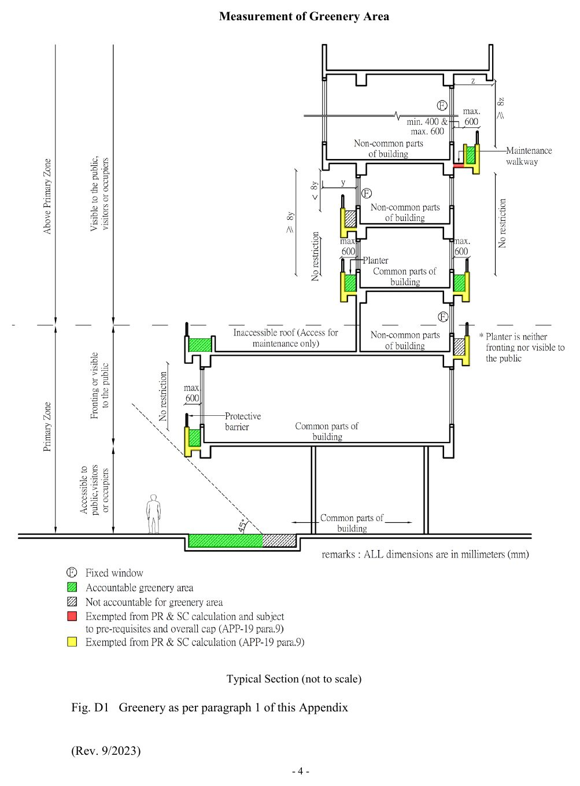

---
tags:
  - JPN
  - Landscape 園景
  - Greenery 綠化
  - Lease 地契
  - Sustainable building design 可持續建築設計
  - Green & amenity features 環保及適意設施
  - Site coverage 上蓋面積
  - Plan submission & approval 呈交及審批
  - Registration 註冊
  - GFA 總樓面面積
  - GFA concession 樓面面積寬免
  - Occupation permit 佔用許可證
  - Site area & classification 地盤面積及分類
  - Drainage 排水
summary: "Landscape plans go to PlanD (planning route) or LandsD (lease only); site coverage of greenery is checked by BD alone on the GBP under APP-152."
keywords: landscape, 園景, LMP, landscape master plan, 園景設計總圖, LP, RLA, 註冊園境師, SCC, site coverage of greenery, SCG, 綠化上蓋面積, greenery, 綠化, tree preservation, 保護樹木, JPN3, JPN 3
---

# JPN 3 Landscape and Site Coverage of Greenery <small>園景及綠化上蓋面積</small>

!!! info "Document info 文件資料"
    | | |
    |---|---|
    | **Type 類別** | Joint Practice Note (BD, LandsD, PlanD) 聯合作業備考（屋宇署、地政總署、規劃署） |
    | **Date of current issue 本版日期** | April 2019 |
    | **Effective date 生效日期** | 15 May 2019 (para. 15) |
    | **Version summarised 本摘要版本** | April 2019 (current issue on BD index, checked 2026-11-23) |
    | **Official language 官方語言** | English only (Chinese version not available) 只有英文版 |
    | **Source 原文** | [JPN 3 (PDF)](https://www.bd.gov.hk/doc/en/resources/codes-and-references/practice-notes-and-circular-letters/joint/JPN03.pdf) |
    | **Last checked 最後核對** | 2026-11-20 against the April 2019 issue |

## At a glance 重點摘要 {#at-a-glance}

=== "English"

    - JPN 3 sets out **who checks what** for two separate things: **landscape submissions** (Landscape Master Plan **LMP** or Landscape Proposal **LP**) and **site coverage of greenery (SCG)** (para. 1).
    - **Landscape under a planning application or condition** → **PlanD** checks at both submission and implementation stages, even if the lease also has a landscape clause. PlanD approval is **deemed** to satisfy the lease clause, if a deemed-approval application is made to LandsD under LAO PN 6/2003 (paras. 3–4(a)).
    - **LMP**: an **RLA** (Registered Landscape Architect) must prepare it. On completion the RLA submits a **Self-Certification of Compliance (SCC)**. PlanD randomly selects SCCs for full checking. Otherwise the works are **deemed complete 2 weeks** after PlanD receives the SCC (para. 4(b)–(c)). For an **LP**, the RLA is optional; without one, the works get full checking (para. 4(d)).
    - **Landscape under the lease only** → **LandsD** (or the department named in the lease) checks. With no request from PlanD or another department, the lease has only a **simple landscape clause** with no submission required (para. 5).
    - **Approval timing**: before **site formation** (lot with a tree preservation clause) or before **superstructure** works (lot without one) (para. 6). At GBP stage, only a **Landscape Layout Plan** to the DPO is needed (para. 8).
    - **SCG**: **BD is the sole authority** under [APP-152](app-152.md). New or modified leases treat BD's acceptance on the GBP as satisfying the lease, with **no separate LandsD submission**. For existing leases the owner may choose this route too (paras. 9–11).

=== "中文"

    - JPN 3 說明兩項不同事宜**由誰審核**：**園景呈交**（園景設計總圖 **LMP** 或園景建議 **LP**）及**綠化上蓋面積**（第 1 段）。
    - **與規劃申請或規劃條件相關的園景** → 由**規劃署**在呈交及落實階段審核，即使地契亦有園景條款；規劃署的批准**當作**已符合地契條款，但須按地政處作業備考第 6/2003 號向地政總署申請當作批准（第 3–4(a) 段）。
    - **園景設計總圖**：必須由**註冊園境師**擬備；完工後由註冊園境師呈交**自行核證符合規定證明書**；規劃署隨機抽選作全面審核，其他個案在規劃署收到證明書 **2 星期**後**當作已完成**（第 4(b)–(c) 段）。**園景建議**可自行選擇是否委任註冊園境師；不委任則須全面審核（第 4(d) 段）。
    - **只屬地契要求的園景** → 由**地政總署**（或地契指明的部門）審核；如規劃署或其他部門沒有要求，地契只載**簡單園景條款**，毋須呈交（第 5 段）。
    - **批准時間**：有保護樹木條款的地段須在**地盤平整**前取得批准，沒有該條款的須在**上蓋工程**前取得（第 6 段）。一般建築圖則階段只須向區域規劃處提交**園景佈局圖**（第 8 段）。
    - **綠化上蓋面積**：**屋宇署是唯一審批機構**（[APP-152](app-152.md)）。新訂或修訂地契以屋宇署在一般建築圖則上的接納作為符合地契，**毋須另向地政總署呈交**；現有地契的業主亦可選擇此途徑（第 9–11 段）。

!!! tip "Applies / does not apply 適用／不適用"
    **Applies**: landscape submissions (**LMP / LP**) required by **planning permission**, statutory plans or the **lease**, within **private lots**; and **site coverage of greenery (SCG)** under [APP-152](app-152.md) as a lease condition or a GFA concession pre-requisite ([APP-151](app-151.md)). 適用於私人地段內的園景呈交及綠化上蓋面積。
    **Not covered**: areas to be **handed back** to the Government or outside the lot (para. 7); **BD does not impose landscape** requirements (footnote 1); building separation and setback are under [JPN 6](jpn-6.md). 交還政府或地段以外的範圍不適用；屋宇署不設園景要求；樓宇間距及後移見 JPN 6。

## Key clauses 主要條文 {#key-clauses}

| Para. 段 | Rule 規定 |
|---|---|
| 1 | Streamlined processing of **landscape** and **SCG** submissions by BD, LandsD and PlanD. 範圍。 |
| 2 | Landscape submissions (**LMP** or **LP**) support planning applications or meet planning or lease conditions; content per **PlanD PN 1/2019**. 園景呈交。 |
| 3 | With a planning application: **PlanD** checks at submission and implementation, even if also a lease condition. Lease-only: **LandsD** (or a named B/D) checks (LAO PN 6/2003). 由誰審核。 |
| 4(a) | Planning route: PlanD approval is **deemed** to meet the lease landscape clause, if a **deemed approval application** is made to LandsD. 當作符合地契。 |
| 4(b) | **LMP**: a **Registered Landscape Architect (RLA)** (Cap. 516) is **mandatory**; LMP approved by the DPO **before landscape works**; on completion an **RLA Self-Certification of Compliance (SCC)** with the approved LMP. 園景設計總圖須由註冊園境師擬備。 |
| 4(c) | DPO acknowledges the SCC; PlanD's Landscape Unit **randomly audits**; not selected = **deemed complete 2 weeks** after receipt; non-compliance can withhold discharge of the planning condition or the **Certificate of Compliance**. 抽查及兩周當作完成。 |
| 4(d) | **LP**: RLA optional; with an RLA, as 4(b)–(c); without, **full compliance check** by PlanD. 園景建議。 |
| 5 | Without a planning application: **LandsD** checks (or a named B/D); LMP/LP put in leases only on request of PlanD or a B/D, which then approves; otherwise a **simple landscape clause** (plant and maintain unbuilt areas) with **no submission**. 非規劃申請。 |
| 6 | **Timing**: landscape approval needed **before site formation** (sites with a **tree preservation** clause) or **before superstructure** (others); see LAO PN 7/2007, 7/2007A. 批准時限。 |
| 7 | Private lots only; hand-back and off-lot areas to the departments in the lease (para. 4 procedures may be used by agreement). 只限私人地段。 |
| 8 | With GBP: submit a **Landscape Layout Plan** to the DPO **before or with the GBP**, showing the design concept is not compromised by the building. 園景佈局圖。 |
| 9 | **SCG** is one of the three SBD elements, **independent** of landscape requirements; in leases and as a GFA concession pre-requisite. 綠化上蓋面積獨立於園景。 |
| 10 | **BD is the sole authority** for SCG under APP-152: accepted on the **GBP**, no separate LandsD submission; **higher %** required by another B/D: BD comments and computes, that B/D decides. 屋宇署為唯一當局。 |
| 11 | **Existing leases**: SCG needs LandsD approval, but the owner may instead show it on the GBP for **BD acceptance**, which LandsD accepts subject to the lease's prescriptive terms; mismatches (e.g. **site area** differences) need a lease modification (premium, fee). 現有地契。 |
| 12 | Approvals do not mean compliance with **other lease conditions**; the LMP/LP and GBP SCG must **tally**. 須互相吻合。 |
| 13 | Requirements imposed for another B/D: that B/D checks, supplemented by this JPN. 其他部門。 |
| 14 | Government's lease rights reserved. 保留權利。 |
| 15 | Effective **15 May 2019**. 生效日期。 |

## Landscape or SCG? Two separate requirements 園景與綠化上蓋面積：兩項獨立要求 {#landscape-vs-scg}

| | Landscape (LMP / LP) 園景 | Site coverage of greenery (SCG) 綠化上蓋面積 |
|---|---|---|
| Source 來源 | Planning permission, OZP, lease 規劃許可、大綱圖、地契 | Lease; GFA concession pre-requisite ([APP-151](app-151.md)) 地契；寬免先決條件 |
| Standard 標準 | PlanD PN 1/2019; LAO PN 6/2003 | [APP-152](app-152.md) paras. 10–11 |
| Prepared by 擬備 | **RLA** (mandatory for LMP) 註冊園境師 | **AP**, on the GBP 認可人士 |
| Checked by 審核 | **PlanD** (planning route) or **LandsD** (lease only) | **BD** (sole authority) |
| Approval timing 時限 | Before site formation or superstructure (para. 6) 地盤平整或上蓋前 | With the GBP; checked at completion 隨圖則；竣工核實 |
| Completion 竣工 | **SCC** by RLA; random audit; deemed in **2 weeks** | BD check before **OP** |

## SCG requirements BD checks (APP-152) 屋宇署審核的綠化要求 {#scg-requirements}

| Site area 地盤面積 | Primary zone 主要區域 | Overall 整體 |
|---|---|---|
| 1,000 m² – 20,000 m² | **10 %** | **20 %** |
| ≥ 20,000 m² | **15 %** | **30 %** |

- **Primary zone**: the **15 m** vertical zone above the abutting street level (pedestrian zone). 主要區域為毗連街面以上 15 米。
- Not for sites with a **single family house** only; sites below **1,000 m²** are not covered (APP-152 para. 11). 只有單一獨立屋的地盤不適用。
- Measure planting as in Fig. D1. **Water features, grass paving and vertical greening** together may make up **no more than 30 %** of the required overall greenery, with reduction factors (e.g. grass paving **50 %**). See [APP-152](app-152.md) for the counting rules and [ADV-35](adv-35.md) for structure, drainage and maintenance of greening. 計算方法見 APP-152；結構及排水見 ADV-35。

<figure markdown>
  { loading=lazy }
  <figcaption>Fig. D1 — Measurement of greenery area: what counts and what does not 綠化面積的量度 <small>Source: PNAP APP-152 (Sep 2023), Buildings Department 資料來源：屋宇署</small></figcaption>
</figure>

<figure markdown>
  { width="760" loading=lazy }
  <figcaption>Two separate routes: landscape (PlanD / LandsD) and SCG (BD). 兩條獨立途徑：園景（規劃署／地政總署）及綠化上蓋面積（屋宇署）。</figcaption>
</figure>

## Key table: who checks what 由誰審核 {#key-table-who-checks-what}

| Situation 情況 | Checking authority 審核部門 | Submission 呈交 | Para. 段 |
|---|---|---|---|
| Landscape required by a **planning application / condition** (with or without a lease clause) 規劃申請／條件 | **PlanD** (submission and implementation) 規劃署 | LMP (RLA mandatory) or LP (RLA optional) to the DPO | 3, 4 |
| Landscape required **only under the lease**, on request of PlanD or another B/D 只屬地契，應部門要求 | PlanD or the B/D named in the lease 地契指明部門 | LMP / LP, procedures as para. 4(b)–(d) | 5(b), 5(d) |
| Lease only, **no** departmental request 只屬地契，沒有部門要求 | LandsD 地政總署 | **None**: simple clause to landscape and plant the unbuilt parts 毋須呈交 | 5(c) |
| Areas to be **handed back** to Government or outside the lot 交回政府或地段外 | The departments named in the lease 地契指明部門 | Per the lease clauses | 7 |
| **SCG**, new / modified lease 綠化上蓋面積（新訂／修訂地契） | **BD** (APP-152) 屋宇署 | On the **GBP**; no separate LandsD submission 於一般建築圖則顯示 | 10 |
| SCG at a **higher %** requested by another B/D 其他部門要求較高百分比 | BD comments and computes; the named B/D decides 屋宇署提意見，指明部門決定 | On the GBP | 10 |
| SCG, **existing** lease 綠化上蓋面積（現有地契） | LandsD, or **BD** if the owner / AP chooses 地政總署或屋宇署 | On the GBP for BD's acceptance; lease modification if prescriptive terms differ 如有差異須修訂地契 | 11 |

## Key table: LMP process 園景設計總圖程序 {#key-table-lmp-process}

| Step 步驟 | What happens 內容 |
|---|---|
| 1. GBP stage 一般建築圖則階段 | **Landscape Layout Plan** (basic concept) to the DPO, before or with the GBP 向區域規劃處提交園景佈局圖 |
| 2. Before works 施工前 | **RLA** prepares the LMP; DPO **approves** before landscape works start (and before site formation / superstructure, para. 6) 註冊園境師擬備，區域規劃處批准 |
| 3. Completion 完工 | RLA submits the **SCC** with the coloured approved LMP to the DPO and PlanD's Landscape Unit 呈交自行核證符合規定證明書 |
| 4. Audit 抽查 | Random **full compliance check**. Non-compliance may hold up discharge of the planning condition or the **Certificate of Compliance** under the lease 隨機全面審核；不符合可押後滿意紙 |
| 5. Deemed complete 當作完成 | If not selected, deemed complete **2 weeks** after PlanD receives the SCC; DPO confirms in writing to the RLA 未被抽選者 2 星期後當作完成 |

## Key clause 主要條文 {#key-clause}

!!! quote "Para. 10 — BD as sole SCG authority 屋宇署為綠化上蓋面積的唯一審批機構"
    As a streamlined measure, BD is the sole authority to interpret the SCG requirement, to accept the relevant proposals and to check compliance upon completion of the private development according to BD's Practice Note for Authorized Persons, Registered Structural Engineers and Registered Geotechnical Engineers (PNAP) APP-152. For the SCG requirement in new or modified leases, such clause will be drafted to the effect that the requirement will be regarded as having been satisfied upon BD's acceptance of the SCG provisions included in the GBP submission to BD. Separate submission to LandsD will not be required.

    **中譯（非官方）：** 作為精簡措施，屋宇署是唯一負責按《認可人士、註冊結構工程師及註冊岩土工程師作業備考》APP-152 詮釋綠化上蓋面積規定、接納相關建議及在私人發展項目完成時審核是否符合規定的機構。新訂或修訂地契中的綠化上蓋面積條款，會訂明在屋宇署接納一般建築圖則所載的綠化上蓋面積後，即當作已符合該規定，毋須另行向地政總署呈交。

## Explanation 淺白解釋 {#explanation}

=== "English"

    Before this JPN, a developer could face **two or three departments** checking the same landscape or greenery, sometimes with different answers. JPN 3 gives **one checker for each item**:

    - **Landscape** follows its source. If it comes from planning, **PlanD** checks it. If it comes from the lease alone, **LandsD** (or the named department) checks it.
    - **Greenery coverage (SCG)** is a building design matter tied to GFA concessions, so **BD** checks it on the GBP.

    Landscape and SCG are **independent** (para. 9). A good LMP does not prove SCG compliance, and the reverse is also true. The AP must make sure the LMP / LP and the SCG on the GBP **tally** with each other and with the lease (para. 12).

=== "中文"

    在本備考之前，發展商可能要面對**兩至三個部門**審核同一園景或綠化，答案有時並不一致。JPN 3 為**每個項目只設一個審核部門**：

    - **園景**按其來源：源自規劃則由**規劃署**審核；只源自地契則由**地政總署**（或指明部門）審核。
    - **綠化上蓋面積**屬建築設計事宜，並與總樓面面積寬免掛鈎，因此由**屋宇署**在一般建築圖則上審核。

    園景與綠化上蓋面積是**互相獨立**的（第 9 段）：園景設計總圖完善並不代表符合綠化上蓋面積要求，反之亦然。認可人士須確保園景設計總圖／園景建議與一般建築圖則上的綠化上蓋面積**互相吻合**，並符合地契（第 12 段）。

## Worked example 例子 {#worked-example}

=== "English"

    A **8,000 m²** residential site, rezoned by a **planning permission** with a landscape condition; new lease with a tree preservation clause and an SCG clause; developer seeks GFA concessions.

    | Step | Requirement | Who | When |
    |---|---|---|---|
    | 1 | **Landscape Layout Plan** to the DPO | Applicant | Before or with the **GBP** (para. 8) |
    | 2 | **SCG on the GBP**: primary zone ≥ **800 m²** (10 %), overall ≥ **1,600 m²** (20 %) | AP → **BD** | With the GBP (para. 10) |
    | 3 | **LMP** by an **RLA**, approved by the DPO; **deemed approval** application to LandsD | RLA → **PlanD** | **Before site formation** (tree preservation clause, para. 6) |
    | 4 | Landscape works built; **SCC** by RLA to DPO and Landscape Unit | RLA | On completion (para. 4(b)) |
    | 5 | Not audited → **deemed complete 2 weeks** later; SCG checked by BD | PlanD / BD | Before OP and the Certificate of Compliance |

    Keep the LMP planting areas and the GBP SCG areas **the same** (para. 12); a planter shown in one and paved in the other causes rejections.

=== "中文"

    一個 **8,000 平方米**住宅地盤，經**規劃許可**改劃並附園景條件；新地契設保護樹木條款及綠化條款；發展商申請總樓面面積寬免：

    | 步驟 | 要求 | 負責 | 時限 |
    |---|---|---|---|
    | 1 | 向地區規劃處提交**園景佈局圖** | 申請人 | 一般建築圖則**之前或同時**（第 8 段） |
    | 2 | **圖則上顯示綠化上蓋面積**：主要區域 ≥ **800 平方米**（10%），整體 ≥ **1,600 平方米**（20%） | 認可人士 → **屋宇署** | 隨圖則（第 10 段） |
    | 3 | 由**註冊園境師**擬備**園景設計總圖**經地區規劃處批准，並向地政總署申請**當作批准** | 註冊園境師 → **規劃署** | **地盤平整前**（有保護樹木條款，第 6 段） |
    | 4 | 完成園景工程，註冊園境師提交**自行證明符合規定** | 註冊園境師 | 竣工時（第 4(b) 段） |
    | 5 | 未被抽查 → **兩周後當作完成**；屋宇署核實綠化 | 規劃署／屋宇署 | 佔用許可證及完成證明書前 |

    園景設計總圖的種植範圍須與圖則上的綠化範圍**一致**（第 12 段）。

## Practical notes 實務提示 {#practical-notes}

=== "English"

    !!! tip "Common pitfalls"
        - Applying for consent to start **superstructure** (or **site formation**, if there is a tree preservation clause) before the LMP / LP is approved (para. 6).
        - Forgetting the **deemed-approval application** to LandsD after PlanD approves the LMP (para. 4(a)).
        - An LMP that **does not match** the SCG layout on the GBP (para. 12).
        - Existing leases with a **prescriptive SCG %** based on a different site area. BD acceptance may not satisfy the lease, and a lease modification (with possible **premium**) may be needed (para. 11).
        - Assuming BD or PlanD approval means compliance with **other lease conditions**. It does not (para. 12).

=== "中文"

    !!! tip "常見錯誤"
        - 園景設計總圖／園景建議未獲批准便申請**上蓋工程**（或有保護樹木條款時的**地盤平整**）同意書（第 6 段）。
        - 規劃署批准園景設計總圖後，忘記向地政總署申請**當作批准**（第 4(a) 段）。
        - 園景設計總圖與一般建築圖則上的綠化上蓋面積佈局**不符**（第 12 段）。
        - 現有地契訂有按不同地盤面積計算的**綠化百分比**：屋宇署接納未必符合地契，或須修訂地契（可能須繳付**補地價**）（第 11 段）。
        - 以為屋宇署或規劃署的批准即表示符合**其他地契條件**：並非如此（第 12 段）。

## Whole picture 整體關係 {#whole-picture}

| Topic 主題 | Where 文件 |
|---|---|
| Greenery percentages 綠化百分比 | [APP-152](app-152.md) |
| Concessions that require SBD 寬免先決條件 | [APP-151](app-151.md) · [GFA guide](../guides/gfa.md) |
| Other SBD elements 其他要求 | [JPN 6](jpn-6.md) |
| Building greening loads and maintenance 樓宇綠化 | [ADV-35](adv-35.md) |
| Sky gardens 空中花園 | [APP-122](app-122.md) · [JPN 1](jpn-1.md) · [JPN 2](jpn-2.md) |
| Three-regime notes 三個制度 | [JPN 4](jpn-4.md) · [JPN 5](jpn-5.md) · [JPN 7](jpn-7.md) |
| Timing of submissions 呈交時間 | [Submission to OP guide](../guides/submission-to-op.md) |

## Related 相關文件 {#related}

| Document 文件 | Relationship 關係 |
|---|---|
| [APP-152](app-152.md) | Sustainable building design guidelines, SCG percentages 可持續建築設計指引、綠化百分比 |
| [APP-151](app-151.md) | GFA concessions conditional on SBD compliance 總樓面面積寬免 |
| [JPN 1](jpn-1.md), [JPN 2](jpn-2.md) | Green and amenity features 環保及適意設施 |
| PlanD PN No. 1/2019 | Landscape submissions under the planning regime 規劃制度下的園景呈交 |
| LandsD LAO PN 6/2003, 7/2007 & 7/2007A | Landscape clause compliance; tree preservation 園景條款；保護樹木 |
| [JPN 6](jpn-6.md) | The other two SBD elements: separation and setback 另外兩項可持續建築設計要求 |
| [JPN 4](jpn-4.md), [JPN 7](jpn-7.md) | GFA and site coverage across the three regimes 總樓面面積及上蓋面積 |
| [ADV-35](adv-35.md) | Greening in buildings: loads, drainage, maintenance 樓宇綠化 |
| [APP-122](app-122.md) | Sky gardens 空中花園 |
| [GFA guide](../guides/gfa.md) | Where SCG fits in the GFA concession pre-requisites 總樓面面積專題 |
| [Submission to OP guide](../guides/submission-to-op.md) | When each submission is due 呈交時間 |

---
<small>Prepared by: _[name]_ · Checked by: _[name]_ · Chinese text is an unofficial translation (中譯（非官方）). Refer to the JPN for the definitive text.</small>
