---
tags:
  - JPN
  - Building height 建築物高度
  - OZP 分區計劃大綱圖
  - Roof-top structures 天台構築物
  - Domestic 住用
  - Plant rooms 機房
  - Signboard 招牌
  - Lift 升降機
  - Site coverage 上蓋面積
  - Plot ratio 地積比率
  - Fire safety 消防安全
  - Lighting & ventilation 照明及通風
  - Maintenance access 維修通道
  - Car park 停車場
summary: "Building height restrictions are set by the OZP and measured from the mean site formation level to the main roof; roof-top structures count only beyond the para. 10 area and height limits."
keywords: BHR, building height restriction, 建築物高度限制, mPD, 主水平基準, OZP, 分區計劃大綱圖, roof-top structures, 天台構築物, mean site formation level, 平均地盤平整水平, architectural feature, 建築裝飾, JPN5, JPN 5
---

# JPN 5 Development Control Parameters — Building Height Restriction <small>聯合作業備考第 5 號：發展管制參數——建築物高度限制</small>

!!! info "Document info 文件資料"
    | | |
    |---|---|
    | **Type 類別** | Joint Practice Note 聯合作業備考 (BD 屋宇署 · LandsD 地政總署 · PlanD 規劃署) |
    | **First issue 首次發出** | April 2019 (effective **15 May 2019**) |
    | **Official language 官方語言** | English only (Chinese version not available) 只有英文版 |
    | **Source 原文** | [JPN 5 (PDF)](https://www.bd.gov.hk/doc/en/resources/codes-and-references/practice-notes-and-circular-letters/joint/JPN05.pdf) |
    | **Last checked 最後核對** | 2026-11-20 against the April 2019 version |

## At a glance 重點摘要 {#at-a-glance}

=== "English"

    - **Building height restriction (BHR)** is a **planning and lease** control (in **mPD**, **metres** or **storeys**). **BD does not impose BHR**. Building height under B(P)R (for PR/SC and fire safety) is a **separate** concept (paras. 2–3).
    - **Streamlined**: BHR, where needed, is controlled by the **statutory town plan** and generally **not** put in new or modified leases (para. 4). **PlanD is the authority** on BHR (para. 13).
    - **Top of building** = highest level of the **main roof** (roof over the highest usable floor space) (para. 5). **Metres** are measured from the **mean site formation level** of the land each building stands on (para. 6). **Storeys** follow the B(P)R definition, and **basements count** unless the OZP/lease says otherwise (para. 7).
    - **Roof-top structures** (plant rooms, lift machine rooms, tanks, architectural features, signboards) **don't count**, unless enclosed structures exceed **50% of the roof area**, or their **height exceeds the limits** below (paras. 9–10).
    - **Storey heights and transfer plates** are checked by BD under **PNAP APP-5** (para. 12).

=== "中文"

    - **建築物高度限制**屬**規劃及地契**管制（以**主水平基準上米數**、**米**或**層數**表示）；**屋宇署不施加高度限制**；B(P)R 下的建築物高度（用於地積比率／上蓋面積及消防）是**另一概念**（第 2–3 段）。
    - **精簡安排**：如需高度限制，由**法定圖則**管制，一般**不會**載入新訂或經修訂的地契（第 4 段）；**規劃署是高度限制的主管當局**（第 13 段）。
    - **建築物頂部** = **主天台**最高水平（最高實用樓面空間之上的屋頂）（第 5 段）；以**米**表示時由該建築物所在土地的**平均地盤平整水平**量度（第 6 段）；以**層數**表示時按 B(P)R 定義，除大綱圖／地契另有規定外**地庫須計算**（第 7 段）。
    - **天台構築物**（機房、升降機機房、水缸、建築裝飾、招牌）**不計入**，除非有蓋構築物超過**天台面積 50%**，或**高度超出**下列限制（第 9–10 段）。
    - **層高及轉換層厚度**由屋宇署按 **PNAP APP-5** 審核（第 12 段）。

!!! tip "Applies / does not apply 適用／不適用"
    **Applies**: building height restrictions (BHR) in **statutory plans** and **leases**, for new building plans or major revisions submitted **on or after 15 May 2019** (para. 17). 適用於法定圖則及地契的高度限制；2019 年 5 月 15 日或之後呈交的新圖則或重大修訂。
    **Does not apply**: **BD's building height under the B(P)R** (for site class, PR, SC and fire safety, para. 3); **NT exempted houses** (Cap. 121, para. 14); leases with different explicit wording, or with no other intensity control (para. 15). 不適用於規例下的建築物高度、新界豁免屋宇，以及另有明文規定的地契。

## Key clauses 主要條文 {#key-clauses}

| Para. 段 | Rule 規定 |
|---|---|
| 1 | Streamlined BHR arrangements among **BD, PlanD and LandsD**. 範圍。 |
| 2 | BHR achieves visual compatibility, visual quality, **air ventilation** and vertical bulk control; expressed in **mPD**, **metres** or **number of storeys**; imposed in statutory plans and leases. 目的及表達方式。 |
| 3 | **BD does not impose BHR**; building height under the B(P)R (for intensity and fire safety) is **not affected** by this JPN. 屋宇署不設高度限制。 |
| 4 | BHR, if needed, is controlled by **statutory plans**; generally **not** in new or modified leases except special circumstances. 以法定圖則管制。 |
| 5 | Top of building = **highest level of the main roof** (roof over the highest **usable floor space**), unless the plan or lease says otherwise. 建築物頂部。 |
| 6 | Height in metres measured from the **mean site formation level** = average of the **highest and lowest formation levels** under the building (incl. basements); for several buildings, each on its own part of the site. 平均地盤平整水平。 |
| 7 | Height in **storeys**: B(P)R definition of storey; **basements counted** unless the plan or lease says otherwise; future OZPs may disregard **fully submerged** basements. 樓層數目。 |
| 8 | BHR referenced to **carport levels**: at least **50 %** of the carport level for parking (incl. driveways and ramps); the rest for reasonable ancillary uses. 停車場樓層。 |
| 9 | Not normally counted: roof-top **building works** (ancillary plant, tanks, lift machine rooms, E&M, solar, wind), **architectural features**, **signboards**. 一般不計的天台構築物。 |
| 10 | **Counted** if (I) enclosed and covered roof structures exceed **50 %** of the roof area below, and/or (II) they exceed the **height limits** in the table below. 須計入的情況。 |
| 11 | Open-air **labour safety facilities** (platforms, cat ladders, parapets, gondolas) and **lightning poles** not counted if reasonably sized. 安全設施及避雷針。 |
| 12 | **Storey heights and transfer plates** add to height; BD interprets them under **APP-5**. 層高及轉換層。 |
| 13 | **PlanD** is the authority on BHR and may advise BD to refuse plans (BO s.16(1)(d), (da)); ask PlanD on ambiguities. 規劃署為主管當局。 |
| 14 | Not for **NT exempted houses** (Cap. 121). 新界豁免屋宇。 |
| 15 | LandsD follows this JPN, except where the lease explicitly differs or has no other intensity control (Director of Lands decides); BHR removal by lease modification with **premium** and fee. 地政總署。 |
| 16 | Government's lease rights reserved. 保留權利。 |
| 17 | Effective **15 May 2019**, for new or major-revision plans submitted on or after that date. 生效日期。 |

## Two different "heights" 兩種「高度」 {#two-heights}

| | BHR under OZP / lease (this JPN) 規劃／地契高度限制 | Building height under B(P)R 規例下的建築物高度 |
|---|---|---|
| Purpose 目的 | Townscape, views, ventilation, bulk 城市景觀、通風 | Site class, **SC and PR** (First Schedule), fire safety 地積比率、上蓋面積、消防 |
| Authority 主管 | **PlanD** (LandsD for leases) | **BD** |
| Measured from 量度起點 | **Mean site formation level** (para. 6), unless mPD | **Mean level of the street** ([B(P)R 23(1)](../regulations/bpr-23-23a.md)) |
| Measured to 量度至 | Highest level of the **main roof** (para. 5) | Mean height of the roof over the highest usable floor |
| Roof-top structures 天台構築物 | Not counted within the **para. 10** limits | Generally not counted |

<figure markdown>
  { width="720" loading=lazy }
  <figcaption>BHR is measured from the mean site formation level to the main roof; roof-top structures count only beyond the para. 10 limits. 高度由平均地盤平整水平量至主天台；天台構築物只在超出第 10 段限制時計入。</figcaption>
</figure>

## Key table: roof-top structures counted towards BHR (para. 10) 計入高度限制的天台構築物（第 10 段） {#key-table-roof-top-structures-counted-towards-bhr-para-10-10}

Roof-top structures are **not counted**, unless: 天台構築物**不計入**，除非：

**I.** Total area of all **enclosed (and covered)** roof-top structures **> 50% of the roof area** of the floor below; and/or 有蓋圍封構築物總面積 > 下層屋頂面積 50%；及／或

**II.** Their **height** exceeds: 其高度超出：

| Structure 構築物 | Building height ≤ threshold 建築物高度 ≤ 門檻 | Building height > threshold 建築物高度 > 門檻 |
|---|---|---|
| **Roof-top ancillary structures** (all buildings) 天台附屬構築物 | ≤ 30 m: **3 m** (or **5.2 m** for lift provision, also for buildings 30–52 m) 3 米（升降機 5.2 米） | > 30 m: **10% of building height or 15 m, whichever is less** 建築物高度 10% 或 15 米（取較小者） |
| **Architectural features**, residential and composite 住宅及綜合用途建築裝飾 | **15% of building height or 7 m, whichever is less** 15% 或 7 米（取較小者） | |
| **Architectural features**, other buildings 其他建築物建築裝飾 | ≤ 35 m: **7 m** | > 35 m: **20%** of building height, plus a slender **spire** up to a further **20%** (cross-section ≤ **5 × 5 m**) 20%，另加尖塔 20% |
| **Roof-top signboards** (incl. LED screens) 天台招牌 | ≤ 30 m: **3 m** | > 30 m: **10% or 15 m, whichever is less** |

<small>Open-air labour safety facilities (working platforms, cat ladders, parapets, gondolas) and lightning poles are not counted if reasonably sized (para. 11). Some OZPs specify that total height **including** roof-top structures must not exceed the BHR (e.g. below Tai Tam Road / Repulse Bay Road levels; footnote 2). 露天工作安全設施及避雷針不計；部分大綱圖規定連天台構築物不得超出限制。</small>

## Key clause 主要條文 {#key-clause}

!!! quote "Paras. 5–6 — Top of building and measurement 建築物頂部及量度"
    …the top of a building for the purpose of measuring height of the building is the highest level of the main roof, unless otherwise specified in the statutory town plans and/or Government Leases. When BHRs are represented in maximum permissible metres, the height of a building should be, unless otherwise specified…, measured from the mean site formation level. Mean site formation level means the average of the sum of the highest and lowest formation levels of the land on which any part of the building stands including basement floors…

    **中譯（非官方）：** ……除法定圖則及／或地契另有規定外，量度建築物高度時，建築物頂部為主天台的最高水平。如高度限制以最高米數表示，除另有規定外，建築物高度應由平均地盤平整水平起計；平均地盤平整水平指建築物任何部分（包括地庫）所在土地的最高及最低平整水平之和的平均數……

## Explanation 淺白解釋 {#explanation}

=== "English"

    There are **two different "heights"**:

    - **B(P)R height** (reg. 23(1), measured from the street) decides the **First Schedule PR/SC** and fire safety provisions. This is BD's business.
    - **BHR** on the **OZP** (often in mPD) controls the **skyline and views**. This is PlanD's business, and JPN 5 says how to measure it.

    The roof-top rules let you put plant, lift rooms and modest features on the roof without breaching the BHR. But a "**crown**" that is too big (> 50% enclosed, or taller than the limits) counts in full.

=== "中文"

    有**兩種不同的「高度」**：

    - **B(P)R 高度**（第 23(1) 條，由街道量度）決定**附表 1 的地積比率／上蓋面積**及消防設施，屬屋宇署範疇。
    - **大綱圖的高度限制**（常以主水平基準上米數表示）管制**天際線及景觀**，屬規劃署範疇，JPN 5 說明如何量度。

    天台規則容許在天台放置機房、升降機房及適度的裝飾而不違反高度限制；但過大的「**頂冠**」（圍封 > 50% 或超出高度限制）便須全數計算。

## Practical notes 實務提示 {#practical-notes}

=== "English"

    !!! example "Worked example: residential tower with BHR"
        Residential tower, main roof at **120 m** above the mean site formation level; OZP BHR expressed in metres.

        - Roof-top plant rooms: allowed up to the lesser of 10% × 120 = 12 m and 15 m → **12 m**, provided enclosed areas ≤ 50% of the roof below.
        - Architectural crown (residential): lesser of 15% × 120 = 18 m and 7 m → **7 m**.
        - Anything taller, or enclosed > 50% → **counted** towards the BHR.

    !!! tip "Common pitfalls"
        - Using the B(P)R **street-level** height for the BHR. BHR in metres uses the **mean site formation level** (para. 6).
        - Forgetting that **basements count as storeys** for storey-based BHR unless the OZP says otherwise (para. 7).
        - Large enclosed **roof-top clubhouses** (> 50% of roof area) treated as roof-top structures.
        - Carport-level BHR: ≥ **50%** of that level must be for car parking (para. 8).

=== "中文"

    !!! example "計算例子：受高度限制的住宅大廈"
        住宅大廈主天台位於平均地盤平整水平以上 **120 米**；大綱圖高度限制以米表示。

        - 天台機房：最高為 10% × 120 = 12 米與 15 米的較小者 → **12 米**，並須圍封面積 ≤ 下層屋頂 50%。
        - 建築裝飾頂冠（住宅）：15% × 120 = 18 米與 7 米的較小者 → **7 米**。
        - 超出上述高度或圍封 > 50% → **計入**高度限制。

    !!! tip "常見錯誤"
        - 以 B(P)R 的**街道水平**高度核對高度限制：以米表示的高度限制由**平均地盤平整水平**起計（第 6 段）。
        - 忘記以層數表示的高度限制下，除大綱圖另有規定外**地庫須計算**（第 7 段）。
        - 把大型圍封的**天台會所**（> 屋頂面積 50%）當作天台構築物。
        - 以停車層表示的高度限制：該層 ≥ **50%** 須作停車用途（第 8 段）。

## Whole picture 整體關係 {#whole-picture}

| Topic 主題 | Where 文件 |
|---|---|
| B(P)R height (for SC / PR) 規例高度 | [B(P)R 23(1)](../regulations/bpr-23-23a.md#clause-by-clause) |
| Height for firefighting (41B, 41C) 消防高度 | [B(P)R 39–49E](../regulations/bpr-39-49e.md#clause-by-clause) · [FS Code Part D](../codes/fsc-part-d-means-of-access.md) |
| Storey heights and transfer plates 層高 | [APP-5](app-5.md) |
| Roof-top structures, signboards 天台構築物 | [APP-42](app-42.md) · [APP-126](app-126.md) |
| Other three-regime notes 其他精簡 | [JPN 4](jpn-4.md) · [JPN 6](jpn-6.md) · [JPN 7](jpn-7.md) |
| MiC relaxation 組裝合成 | [JPN 8](jpn-8.md) |
| Airport height control 機場高度 | [APP-32](app-32.md) |

<!-- APSEC START -->
## APSEC clarifications 認可人士及註冊結構工程師委員會討論 {#apsec-clarifications}

BD's responses at the APSEC Discussion Forum that clarify this document, **newest first**. Where the same question came up more than once, only the **latest position** is listed. See [all APSEC items](../apsec/index.md). 屋宇署在討論會上就本文件作出的澄清，新者在前；同一問題只列最新立場。

- **[JPN No. 5 - Building Height Restriction](../apsec/2020.md#i2020052920)** <small>ADF 2/2020, 29 May 2020</small> BD advised that the query was conveyed to PlanD for direct clarification.
- **[JPN No. 5 - Building Height Restriction](../apsec/2019.md#i2019112221)** <small>ADF 5/2019, 22 Nov 2019</small> Since PlanD was the authority for building height restriction as stipulated in JPN No. 5, the issue would be referred to PlanD for direct clarification.
- **[JPN5 – Building Height Restriction](../apsec/2019.md#i2019082314)** <small>ADF 4/2019, 23 Aug 2019</small> Since PlanD was the authority on building height restriction as stipulated in JPN5, the issue would be referred to PlanD for clarification in the Joint Sub-committee on Streamlining Development Control under LDAC.

<!-- APSEC END -->

## Related 相關文件 {#related}

| Document 文件 | Relationship 關係 |
|---|---|
| [B(P)R 23](../regulations/bpr-23-23a.md) | B(P)R building height (different concept) B(P)R 建築物高度（不同概念） |
| [JPN 4](jpn-4.md), [JPN 7](jpn-7.md) | PR/GFA and SC under the three regimes 地積比率及上蓋面積 |
| [JPN 8](jpn-8.md) | BHR relaxation for MiC 組裝合成的高度放寬 |
| PNAP APP-5 | Storey heights and transfer plates 層高及轉換層 |
| PNAP APP-126 | Signboards 招牌 |

---
<small>Prepared by: _[name]_ · Checked by: _[name]_ · Unofficial summary; refer to the official JPN for the definitive text.</small>
