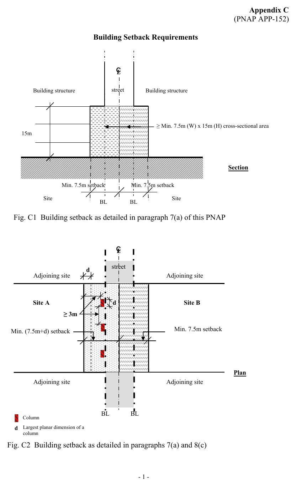
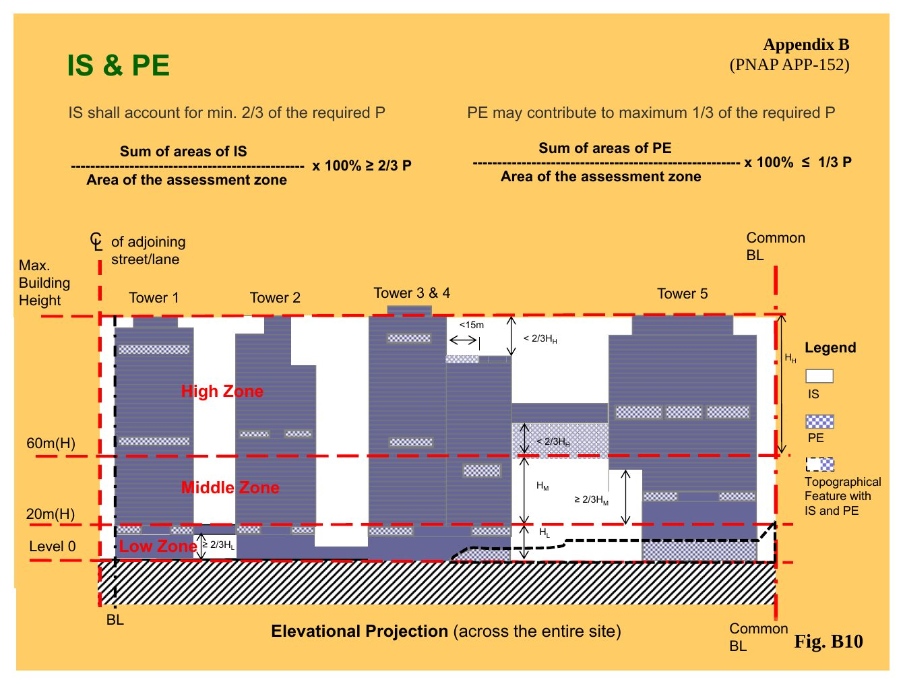

---
tags:
  - JPN
  - Sustainable building design 可持續建築設計
  - Building separation 建築物間距
  - Building setback 建築物後移
  - Lease 地契
  - Plan submission & approval 呈交及審批
  - Green & amenity features 環保及適意設施
  - GFA 總樓面面積
  - GFA concession 樓面面積寬免
  - Site coverage 上蓋面積
  - A&A works 改動及加建工程
  - Lighting & ventilation 照明及通風
  - Plant rooms 機房
  - Balcony & utility platform 露台及工作平台
summary: "BD alone checks building separation and setback under APP-152 on the GBP, whether required by lease, planning permission or GFA concession; no separate LandsD submission."
keywords: SBD, sustainable building design, 可持續建築設計, building separation, 樓宇間距, building setback, 建築物後移, Lp, permeability, 通透度, lease, 地契, JPN6, JPN 6
---

# JPN 6 Sustainable Building Design Guidelines: Building Separation and Building Setback <small>聯合作業備考第 6 號：可持續建築設計指引——樓宇間距及樓宇後移</small>

!!! info "Document info 文件資料"
    | | |
    |---|---|
    | **Type 類別** | Joint Practice Note 聯合作業備考 (BD 屋宇署 · LandsD 地政總署 · PlanD 規劃署) |
    | **First issue 首次發出** | September 2019 (effective **15 October 2019**) |
    | **Official language 官方語言** | English only (Chinese version not available) 只有英文版 |
    | **Source 原文** | [JPN 6 (PDF)](https://www.bd.gov.hk/doc/en/resources/codes-and-references/practice-notes-and-circular-letters/joint/JPN06.pdf) |
    | **Last checked 最後核對** | 2026-11-20 against the September 2019 version |

## At a glance 重點摘要 {#at-a-glance}

=== "English"

    - The SBD Guidelines ([APP-152](app-152.md)) apply through **three routes**: **lease conditions**, **planning permission** advisory clauses, and **APP-151 pre-requisites** for GFA concessions (para. 2). Site coverage of greenery is streamlined separately under **JPN 3** (para. 3).
    - **BD is the sole authority** to interpret, accept and check completion of **building separation and setback** under APP-152, however the requirement arises. The AP **certifies compliance on the GBP**, with **no separate submission to LandsD** (para. 4).
    - **New / modified leases** name the **Director of Buildings** as the approving authority. Compliance = BD's acceptance, and completion to APP-152 (para. 5). Later **A&A** affecting separation/setback also needs BD's satisfaction.
    - **Existing leases** (BD not named): LandsD accepts **BD-accepted** proposals as compliant. A non-compliant proposal needs LandsD consent, possibly with **premium** for setback (para. 6).
    - Where another bureau or department requires **stricter** separation/setback, still show it on the GBP. BD comments to APP-152, and that department decides (para. 7).

=== "中文"

    - 可持續建築設計指引（[APP-152](app-152.md)）透過**三個途徑**實施：**地契條款**、**規劃許可**的指引性條款，以及取得總樓面面積寬免的 **APP-151 先決條件**（第 2 段）；上蓋綠化另按 **JPN 3** 精簡處理（第 3 段）。
    - 不論規定來自何處，**屋宇署是唯一**按 APP-152 詮釋、接納及在竣工時核實**樓宇間距及後移**的部門；認可人士在**一般建築圖則上證明符合**，**毋須另向地政總署呈交**（第 4 段）。
    - **新訂／經修訂地契**指定**屋宇署署長**為批准當局；屋宇署接納並按 APP-152 完成即屬符合（第 5 段）；其後影響間距／後移的**改動加建**亦須獲屋宇署滿意。
    - **現有地契**（未指定屋宇署）：地政總署接受**屋宇署已接納**的方案為符合；不符合者須地政總署同意，後移或須**補地價**（第 6 段）。
    - 如其他政策局或部門要求**更嚴格**的間距／後移，仍須在圖則上顯示；屋宇署按 APP-152 提供意見，由該部門決定（第 7 段）。

!!! tip "Applies / does not apply 適用／不適用"
    **Applies**: building separation and building setback under the SBD Guidelines ([APP-152](app-152.md)) when they come from a **lease**, a **planning permission** or the **APP-151** GFA concession pre-requisite, for new buildings and later A&A works. 適用於源自地契、規劃許可或 APP-151 寬免先決條件的樓宇間距及後移，包括新建築物及其後的改動加建。
    **Not covered**: **site coverage of greenery** (see [JPN 3](jpn-3.md)); requirements made **stricter** by another bureau or department (that department decides, para. 7). 上蓋綠化見 JPN 3；其他部門的更嚴格要求由該部門決定。

## Key clauses 主要條文 {#key-clause}

| Para. 段 | Rule 規定 |
|---|---|
| 1 | Purpose: streamlined checking of **building separation** and **building setback** under the SBD Guidelines by **BD, LandsD and PlanD**. 目的：三個部門精簡審核。 |
| 2 | SBD Guidelines (separation, setback, site coverage of greenery) apply as (a) **lease conditions** of new sale sites, lease modifications and land exchanges; (b) **advisory clauses** in planning permissions; (c) **pre-requisites** for GFA concessions. Details in **APP-152**. 三個實施途徑。 |
| 3 | Site coverage of greenery already streamlined under **JPN 3**. 上蓋綠化見 JPN 3。 |
| 4 | **BD is the sole authority** to interpret, accept and check completion, whatever the route; the **AP certifies on the GBP**; **no separate submission to LandsD**. 屋宇署為唯一當局。 |
| 5 | **New or modified leases** name the **Director of Buildings**: complied with on BD's acceptance of the GBP proposal **and** completion to APP-152. Later **A&A** affecting separation or setback must also satisfy BD, or the lease clause is **not complied with**. 新地契。 |
| 6 | **Existing leases** without the Director of Buildings: LandsD accepts a **BD-accepted** proposal as complying. If it does not meet the prescriptive rules, seek **LandsD approval or consent** under the lease; a setback consent may carry **premium and an administrative fee**. 現有地契。 |
| 7 | **Stricter** separation or setback required by another B/D or an urban design study: still compute and show on the GBP; BD comments against APP-152; **that B/D decides** at design and completion stages. 更嚴格要求。 |
| 8 | Government's rights under the lease are **reserved**; no waiver. 保留權利。 |
| 9 | Effective **15 October 2019**. 生效日期。 |

!!! quote "Para. 4 — BD as sole authority 屋宇署為唯一當局"
    Under the streamlined arrangement, BD is the sole authority to interpret the building separation and building setback requirements under the SBD Guidelines, to accept the relevant proposals and to check compliance upon completion of the private development according to PNAP APP-152, irrespective of how the requirements have kicked in (as a requirement under the lease or pre-requisite for GFA concession under the building control regime). Under the streamlined arrangement, the Authorized Person (AP) should demonstrate and certify on the General Building Plan (GBP) submission compliance with the building separation and building setback requirements to the satisfaction of BD as per PNAP APP-152. Separate submission on these two SBD requirements to LandsD will not be required.

    **中譯（非官方）：** 在精簡安排下，不論規定是源於地契或建築管制下取得總樓面面積寬免的先決條件，屋宇署是唯一按 PNAP APP-152 詮釋可持續建築設計指引中樓宇間距及樓宇後移規定、接納有關方案，以及在私人發展項目竣工時核實是否符合的當局。認可人士須在一般建築圖則呈交中證明並核證符合有關規定，至屋宇署滿意的程度，毋須就這兩項規定另向地政總署呈交。

## Who checks what 由誰核實 {#key-table-who-checks-what}

<figure markdown>
  { width="760" loading=lazy }
  <figcaption>How the requirement arises, and who checks it (paras. 4–7). 規定的來源及由誰核實（第 4–7 段）。</figcaption>
</figure>

| Situation 情況 | Who decides 由誰決定 | Para. 段 |
|---|---|---|
| Building separation / setback under APP-152 (any route) 樓宇間距／後移 | **BD** (GBP certification by the AP) 屋宇署 | 4 |
| New / modified lease clause 新訂／經修訂地契條款 | **Director of Buildings** named; complied with upon BD acceptance and completion to APP-152 屋宇署署長 | 5 |
| Existing lease (BD not named) 現有地契 | LandsD follows BD's acceptance. If not compliant: LandsD consent (setback: premium possible) 地政總署跟隨；不符合須同意及或補地價 | 6 |
| Stricter requirement by another department 其他部門更嚴格要求 | That **department** decides; BD comments to APP-152 該部門決定 | 7 |
| Site coverage of greenery 上蓋綠化 | Streamlined under **JPN 3** 見 JPN 3 | 3 |

## What BD checks under APP-152 屋宇署按 APP-152 審核甚麼 {#what-bd-checks}

JPN 6 only says **who** checks. The requirements themselves are in [APP-152](app-152.md); the key figures are: 本聯合作業備考只說明由誰審核；要求本身載於 APP-152，主要數字如下：

| Requirement 要求 | Rule 規定 | APP-152 |
|---|---|---|
| **Building separation**: continuous projected façade length **Lp** 連續投影立面長度 | Lp along a street ≤ **5 × U** (mean width of the street canyon); otherwise provide **permeability** 不得超過街道峽谷平均闊度的 5 倍 | Design Req. (1) |
| Permeability **P** 通透度 | At least **2/3 intervening space (IS)** + at most **1/3 permeable elements**; P = **20 %** (site < 20,000 m²), up to **33.3 %** (large sites, buildings over 60 m) | Design Req. (2) |
| Intervening space width 間隔空間闊度 | **≥ 7.5 m** to the boundary or street centreline; **≥ 15 m** between two buildings | para. 4 |
| Assessment zones 評估區域 | **Low 0–20 m**, **middle 20–60 m**, **high > 60 m**, each assessed separately | App. B |
| Separation exemption 豁免 | Standalone residential blocks **≤ 15 m** high | para. 6 |
| **Building setback** 建築物後移 | Streets **< 15 m** wide: nothing up to **15 m** above street level within **7.5 m** of the street centreline (a **15 × 15 m** ventilation corridor), or a stepped profile with a cross-ventilated podium garden under a **45°** plane | para. 7 |
| Allowed in the setback area 後移範圍內准許 | Structures above 15 m; B(P)R 10 canopies; minor projections ≤ **600 mm** at ≥ **2.5 m** clear height; single-storey footbridges | para. 8 |
| Setback exemption 豁免 | Building height < **2 × mean street width** | para. 9 |

<figure markdown>
  { loading=lazy }
  <figcaption>Figs. C1 & C2 — Building setback 建築物後移 <small>Source: PNAP APP-152 (Sep 2023), Buildings Department 資料來源：屋宇署</small></figcaption>
</figure>

<figure markdown>
  { loading=lazy }
  <figcaption>Fig. B10 — Intervening space and permeable elements by assessment zone 各評估區域的間隔空間及通透元素 <small>Source: PNAP APP-152 (Sep 2023), Buildings Department 資料來源：屋宇署</small></figcaption>
</figure>

## Explanation 淺白解釋 {#explanation}

=== "English"

    Before JPN 6, an AP might have to show SBD compliance twice: to BD for GFA concessions and to LandsD for the lease. JPN 6 makes **BD the single checker** for separation and setback, so one submission on the GBP does the job for both regimes. Keep in mind that later **A&A works** that eat into the setback or separation can put the **lease** in breach as well.

=== "中文"

    在 JPN 6 之前，認可人士可能須兩次證明符合可持續建築設計指引：向屋宇署（總樓面面積寬免）及向地政總署（地契）。JPN 6 令**屋宇署成為唯一審核者**，在一般建築圖則上呈交一次便可同時滿足兩個制度。須留意，其後佔用後移或間距空間的**改動加建**亦可能令**地契**被違反。

## Worked example 例子 {#worked-example}

=== "English"

    A residential site sold in 2022 has an SBD clause in its **new lease**, and the developer also wants **GFA concessions** for balconies and plant rooms.

    1. Both routes lead to the same check: the AP shows **Lp, permeability and setback** on the GBP and certifies compliance to APP-152 (para. 4).
    2. Because the lease is new, it names the **Director of Buildings** (para. 5): BD's acceptance of the GBP satisfies the lease clause. **No separate SBD submission to LandsD.**
    3. On completion BD checks the as-built building against APP-152; the lease clause is then complied with.
    4. Five years later the owners' corporation proposes to **enclose part of the setback area** at ground level. That A&A proposal must again satisfy BD (para. 5), or the lease SBD clause is breached.

    If instead the lot is on an **old lease** whose SBD clause names LandsD, the same BD-accepted GBP is accepted by LandsD (para. 6). Only if the scheme **falls short** of APP-152 does the owner apply to LandsD for consent, possibly with **premium**.

=== "中文"

    一個 2022 年賣出的住宅地盤，其**新地契**有可持續建築設計條款，發展商亦希望就露台及機房取得**總樓面面積寬免**。

    1. 兩個途徑的審核相同：認可人士在一般建築圖則上顯示 **Lp、通透度及後移**，並證明符合 APP-152（第 4 段）。
    2. 由於是新地契，條款指定**屋宇署署長**（第 5 段）：屋宇署接納圖則即符合地契條款，**毋須另向地政總署呈交**。
    3. 竣工時屋宇署按 APP-152 核實已建成的建築物，地契條款便告符合。
    4. 五年後業主立案法團擬在地面**圍封部分後移範圍**；該改動加建須再獲屋宇署滿意（第 5 段），否則即違反地契條款。

    如地段屬**舊地契**而條款指定地政總署，地政總署同樣接受屋宇署已接納的圖則（第 6 段）；只有方案**未符合** APP-152 時，業主才須向地政總署申請同意，並可能須**補地價**。

## Common pitfalls 常見錯誤 {#common-pitfalls}

- Sending a separate SBD submission to **LandsD**: not needed for separation and setback (para. 4). 另向地政總署呈交。
- Forgetting that **later A&A** in the setback or intervening space must satisfy BD under a new lease, or the **lease** is breached (para. 5). 忽略日後改動加建對地契的影響。
- Assuming BD's acceptance settles a **stricter** requirement from another department: that department decides (para. 7). 以為屋宇署可決定其他部門的較嚴要求。
- Expecting JPN 6 to cover **greenery**: site coverage of greenery is under [JPN 3](jpn-3.md). 以為本備考包括綠化。
- Measuring setback from the **site boundary** instead of the **street centreline** (APP-152 para. 7). 由地界而非街道中線量度後移。

## Whole picture 整體關係 {#whole-picture}

| Topic 主題 | Where 文件 |
|---|---|
| SBD rules being checked 審核的要求 | [APP-152](app-152.md) (separation, setback, greenery) |
| GFA concessions that require SBD 寬免先決條件 | [APP-151](app-151.md) · [GFA guide](../guides/gfa.md) |
| Greenery (third SBD element) 綠化 | [JPN 3](jpn-3.md) · [ADV-35](adv-35.md) |
| Three-regime streamlining 三個制度精簡 | [JPN 4](jpn-4.md) (PR / GFA) · [JPN 5](jpn-5.md) (height) · [JPN 7](jpn-7.md) (SC) |
| Site coverage and open space 上蓋面積及空地 | [B(P)R 18A–22](../regulations/bpr-18a-22.md) · [B(P)R 25](../regulations/bpr-24-37.md#clause-by-clause) · [SC & PR guide](../guides/site-coverage-plot-ratio.md) |
| Plan submission 呈交圖則 | [ADM-2](adm-2.md) · [ADM-19](adm-19.md) · [Submission to OP guide](../guides/submission-to-op.md) |

## Related 相關文件 {#related}

| Document 文件 | Relationship 關係 |
|---|---|
| [APP-152](app-152.md) | SBD Guidelines: separation, setback, greenery 可持續建築設計指引 |
| [APP-151](app-151.md) | SBD as a GFA concession pre-requisite 寬免先決條件 |
| [JPN 3](jpn-3.md) | Site coverage of greenery streamlining 上蓋綠化 |
| [JPN 4](jpn-4.md), [JPN 5](jpn-5.md), [JPN 7](jpn-7.md) | Other three-regime streamlining 其他精簡安排 |

---
<small>Prepared by: _[name]_ · Checked by: _[name]_ · Unofficial summary; refer to the official JPN for the definitive text.</small>
