---
tags:
  - JPN
  - Site coverage 上蓋面積
  - OZP 分區計劃大綱圖
  - Lease 地契
  - GFA 總樓面面積
  - Domestic 住用
  - Plot ratio 地積比率
summary: "The B(P)R site coverage continues to apply; BD alone decides what counts for SC, and PlanD and LandsD follow; new leases normally carry no SC clause."
keywords: site coverage, SC, 上蓋面積, OZP, 分區計劃大綱圖, lease, 地契, First Schedule, 附表一, underground structures, 地下構築物, roofed-over area, JPN7, JPN 7
---

# JPN 7 Development Control Parameters — Site Coverage Restriction <small>聯合作業備考第 7 號：發展管制參數——上蓋面積限制</small>

!!! info "Document info 文件資料"
    | | |
    |---|---|
    | **Type 類別** | Joint Practice Note 聯合作業備考 (BD 屋宇署 · LandsD 地政總署 · PlanD 規劃署) |
    | **First issue 首次發出** | August 2021 (effective **23 August 2021**) |
    | **Official language 官方語言** | English only (Chinese version not available) 只有英文版 |
    | **Source 原文** | [JPN 7 (PDF)](https://www.bd.gov.hk/doc/en/resources/codes-and-references/practice-notes-and-circular-letters/joint/JPN07.pdf) |
    | **Read with 一併參閱** | LandsD LAO PN 3/2020A "Design, Disposition and Height Clause under Lease (Site Coverage)" |
    | **Last checked 最後核對** | 2026-11-20 against the August 2021 version |

## At a glance 重點摘要 {#at-a-glance}

=== "English"

    - SC is controlled under **B(P)R** (First Schedule, by site class, height and use; **100%** for non-domestic up to **15 m**), on **selected OZP sites** (planning purposes: character, air ventilation, permeability), and in **some leases** (old leases with SC / roofed-over area limits) (paras. 2–5).
    - **Streamlined** (para. 6): the **B(P)R SC continues to apply**. A **stricter OZP SC** is used only for specific planning purposes, with its applicability stated clearly on new / amended plans (e.g. only a particular level).
    - **BD is the single agency** for deciding which facilities and features count for SC. **PlanD** and **LandsD** follow BD's treatment (paras. 7–8).
    - **SC restrictions will not normally be put in new or modified leases** (except special circumstances). Applications to **remove SC restrictions** in existing leases may need **premium** (para. 8).
    - **Underground structures** are not counted for SC; **minor projecting features** (APP-19) disregarded by the BA are also disregarded under existing leases **without lease modification**. Larger projections exempted by s.42 may need a minor lease modification and premium (para. 9).
    - Applies only to leases with **max. GFA/PR** provisions; for others see LAO PN 3/2020A (para. 5).

=== "中文"

    - 上蓋面積由 **B(P)R**（附表 1，按地盤類別、高度及用途；非住用 **15 米**以下 **100%**）、**部分大綱圖地盤**（規劃目的：地區特色、空氣流通、通透度）及**部分地契**（設上蓋面積／有蓋面積限制的舊地契）管制（第 2–5 段）。
    - **精簡安排**（第 6 段）：**B(P)R 上蓋面積繼續適用**；只在特定規劃目的下才採用**較嚴格的大綱圖上蓋面積**，並在新訂／經修訂圖則上清楚註明適用範圍（例如只適用於某一樓層）。
    - **屋宇署是唯一**決定哪些設施計入上蓋面積的部門；**規劃署**及**地政總署**跟隨屋宇署的處理方法（第 7–8 段）。
    - **新訂或經修訂地契一般不會設上蓋面積限制**（特殊情況除外）；申請**刪除**現有地契的上蓋面積限制或須**補地價**（第 8 段）。
    - **地下構築物**不計上蓋面積；建築事務監督不計算的**小型伸出物**（APP-19），在現有地契下亦**毋須修訂地契**便可不計；以第 42 條豁免的較大伸出物或須輕微修訂地契及補地價（第 9 段）。
    - 只適用於設有**最高總樓面面積／地積比率**條款的地契；其他地契參閱 LAO PN 3/2020A（第 5 段）。

!!! tip "Applies / does not apply 適用／不適用"
    **Applies**: site coverage control under the **B(P)R**, **statutory plans** (OZP) and **leases with a maximum GFA or PR clause**; the streamlined OZP arrangement is for SC controls on plans gazetted **on or after 23 Aug 2021**. 適用於規例、法定圖則及設有最高總樓面面積／地積比率條款的地契；2021 年 8 月 23 日起刊憲的圖則。
    **Does not apply**: **New Territories exempted houses** (Cap. 121); old leases **without** a GFA or PR clause (follow LandsD LAO PN 3/2020A). 新界豁免屋宇及沒有總樓面面積或地積比率條款的舊地契不適用。

## Key clauses 主要條文 {#key-clause}

| Para. 段 | Rule 規定 |
|---|---|
| 1 | Streamlined SC control among **BD, LandsD and PlanD**. Not for NT exempted houses (Cap. 121); read with **LAO PN 3/2020A** (Design, Disposition and Height clause: SC). 範圍。 |
| 2 | SC controls **building bulk** (building regime) and serves planning aims such as **local character, air ventilation, visual quality and permeability**; also in some **leases** (incl. roofed-over area limits). 目的。 |
| 3 | **B(P)R**: maximum SC in the **First Schedule** by **site class** (reg. 18A), **height** and **use**; **non-domestic up to 100 %** to **15 m** above ground (reg. 20(3)). SC = area of the site covered by the building (reg. 2). 建築規例。 |
| 4 | **Planning**: SC restrictions on selected sites in statutory plans, in tandem with the B(P)R. 法定圖則。 |
| 5 | **Lease**: old leases used SC or roofed-over area with a height limit; modern leases use GFA/PR. Paras. 8–9 apply only to leases **with a maximum GFA and/or PR**. 地契。 |
| 6 | The **B(P)R SC continues to apply**. A **stricter** OZP SC must state its **applicability** (e.g. only a particular level); the rest of the building follows the B(P)R. 規例繼續適用。 |
| 7 | **BD is the single agency** deciding which facilities and features count for SC. PlanD adopts BD's treatment for new or amended plans, and generally for existing plans unless they say otherwise. 屋宇署為唯一部門。 |
| 8 | **No SC clause** in new or modified leases except special circumstances; if included, LandsD uses BD's treatment. Existing lease SC checked by BD's treatment unless the lease forbids; **removal** by lease modification with **premium and administrative fee**. 新地契不再設上蓋面積。 |
| 9 | **Underground structures** are not counted (unless the plan or lease says otherwise). **Minor projections** disregarded by the BA ([APP-19](app-19.md)) are disregarded by LandsD **without lease modification**; larger projections disregarded by **BO s.42** modification may follow, subject to lease modification and premium (a **minor lease modification** if no increase in development intensity). 地下構築物及伸出物。 |
| 10 | Government's lease rights reserved. 保留權利。 |
| 11 | Effective **23 August 2021**. 生效日期。 |

!!! quote "Para. 7 — BD as single agency for SC accountability 屋宇署為唯一部門"
    Under the streamlined arrangements, in addition to its statutory duty to check compliance of the SC restriction under the building control regime, BD is designated as the single agency responsible for determining the accountability of facilities and features for the purpose of SC calculation when assessing compliance with SC restriction. For new or amended statutory plans gazetted on or after the effective date of this JPN, PlanD would adopt BD's treatment of facilities and features for SC control when formulating the appropriate maximum SC permissible for individual site/land use zone, if needed. For the existing statutory plans, PlanD would also generally follow BD's treatment of facilities and features when checking compliance with the SC restriction in those statutory plans, unless the statutory plans provide otherwise.

    **中譯（非官方）：** 在精簡安排下，除了在建築管制下核實上蓋面積限制的法定職責外，屋宇署獲指定為唯一負責在評估是否符合上蓋面積限制時，決定哪些設施及特色須計入上蓋面積的部門。對於本 JPN 生效日期或之後刊憲的新訂或經修訂法定圖則，規劃署在為個別地盤／土地用途地帶訂定最高上蓋面積時（如有需要），會採用屋宇署對設施及特色的處理方法；對於現有法定圖則，除圖則另有規定外，規劃署在核實是否符合上蓋面積限制時，一般亦會跟隨屋宇署的處理方法。

## Key table: SC across the three regimes 三個制度下的上蓋面積 {#key-table-sc-across-the-three-regimes}

| Regime 制度 | Control 管制 | Under JPN 7 精簡後 |
|---|---|---|
| **Building** (B(P)R) 建築 | First Schedule by site class, height and use; non-domestic **100%** up to 15 m 附表 1 | **Continues to apply** (the lead regime); **BD decides accountability** 繼續適用；屋宇署決定計算方法 |
| **Planning** (OZP) 規劃 | Stricter SC on selected sites for planning purposes 部分地盤較嚴格 | Only where needed, with **applicability stated** (e.g. a particular level); follows BD's treatment 只在有需要時並註明適用範圍；跟隨屋宇署 |
| **Lease** 地契 | Old leases: SC / roofed-over area limits 舊地契 | **Not** in new / modified leases normally; existing SC checked to BD's treatment; removal may need **premium** 一般不再設定；刪除或須補地價 |
| Underground structures 地下構築物 | — | **Not counted** in any regime (unless plan/lease says otherwise) 不計算 |
| Minor projections (APP-19) 小型伸出物 | — | Disregarded under existing leases **without lease modification** if the BA disregards them 毋須修訂地契 |

<figure markdown>
  { width="760" loading=lazy }
  <figcaption>BD sets what counts for SC; PlanD and LandsD follow (paras. 6–9). 由屋宇署訂定計算方法，規劃署及地政總署跟隨。</figcaption>
</figure>

## The B(P)R limits that "continue to apply" 繼續適用的規例上限 {#first-schedule}

Extract of the **First Schedule** (maximum SC %) — full table, with plot ratios, on [B(P)R 18A–22](../regulations/bpr-18a-22.md). 附表一節錄（最高上蓋面積百分比）：

| Height of building 建築物高度 | Domestic A 住用甲 | Domestic B 乙 | Domestic C 丙 | Non-domestic A 非住用甲 | Non-domestic B 乙 | Non-domestic C 丙 |
|---|---|---|---|---|---|---|
| ≤ 15 m | 66.6 | 75 | 80 | 100 | 100 | 100 |
| > 15 m, ≤ 18 m | 60 | 67 | 72 | 97.5 | 97.5 | 97.5 |
| > 21 m, ≤ 24 m | 52 | 58 | 63 | 92 | 92 | 92 |
| > 27 m, ≤ 30 m | 46 | 52 | 55 | 85 | 87 | 88 |
| > 36 m, ≤ 43 m | 39 | 44 | 47 | 75 | 77.5 | 80 |
| > 49 m, ≤ 55 m | 35 | 39 | 42 | 64 | 67.5 | 70 |
| > 61 m | 33.33 | 37.5 | 40 | 60 | 62.5 | 65 |

<small>Non-domestic parts up to 15 m may have 100 % SC (reg. 20(3)). Sites not of Class A, B or C: SC set by the BA (reg. 19(3)). 非住用部分 15 米以下可 100%；非甲乙丙類地盤由建築事務監督決定。</small>

## Explanation 淺白解釋 {#explanation}

=== "English"

    JPN 7 does for **site coverage** what JPN 4 does for **GFA** and JPN 5 does for **height**. There is **one rulebook** for what counts, set by **BD**, and the other two departments follow it. In practice: design to the **B(P)R SC**, check whether the **OZP** imposes anything stricter for your site or level, and check whether an **old lease** has an SC or roofed-over-area clause that might need modification.

=== "中文"

    JPN 7 對**上蓋面積**的作用，等同 JPN 4 對**總樓面面積**、JPN 5 對**高度**的作用：計算方法**只有一套**，由**屋宇署**訂定，其餘兩個部門跟隨。實務上：按 **B(P)R 上蓋面積**設計，核對**大綱圖**對該地盤或樓層有否更嚴格的限制，並核對**舊地契**有否可能須修訂的上蓋面積或有蓋面積條款。

## Worked example 例子 {#worked-example}

=== "English"

    A Class A composite site under a 2023 OZP that limits SC to **65 %** "for the podium levels only", with a lease that has a GFA clause and an old SC clause.

    1. **Podium (≤ 15 m)**: B(P)R allows **100 %** non-domestic SC; the OZP limits these levels to **65 %**, so **65 %** governs the podium (para. 6).
    2. **Domestic tower above 61 m**: the OZP is silent, so the **B(P)R 33.33 %** applies (para. 6).
    3. **What counts**: BD's treatment, e.g. **basement** not counted (para. 9), **APP-19 projections** disregarded, and PlanD follows it (para. 7).
    4. **Lease SC clause**: LandsD checks it using BD's treatment (para. 8); the APP-19 minor projections are disregarded without a lease modification (para. 9). To **remove** the old SC clause, apply for a lease modification (premium and fee).

=== "中文"

    甲類綜合用途地盤，2023 年分區計劃大綱圖規定「只限平台樓層」上蓋面積 **65%**，地契有總樓面面積條款及舊的上蓋面積條款：

    1. **平台（15 米以下）**：規例准許非住用 **100%**，但大綱圖限制該等樓層 **65%**，故平台以 **65%** 為準（第 6 段）。
    2. **高於 61 米的住宅大廈**：大綱圖沒有規定，按規例 **33.33%**（第 6 段）。
    3. **計算方法**：按屋宇署做法，例如**地庫**不計（第 9 段）、**APP-19 伸出物**不計，規劃署跟隨（第 7 段）。
    4. **地契上蓋面積條款**：地政總署按屋宇署做法核實（第 8 段）；APP-19 小型伸出物毋須修訂地契即可不計（第 9 段）；如要**刪除**舊條款須申請修訂地契（補地價及行政費）。

## Common pitfalls 常見錯誤 {#common-pitfalls}

- Applying an OZP SC limit to the **whole building** when the plan states it for a **particular level** only (para. 6). 把只限某些樓層的限制套用於整幢建築物。
- Counting **basements** for SC under the OZP or lease (para. 9). 把地庫計入上蓋面積。
- Using JPN 7 for an old lease **without** a GFA/PR clause: follow **LAO PN 3/2020A** instead (para. 5). 把本備考用於沒有地積比率條款的舊地契。
- Assuming a **s.42** projection relaxation is automatically accepted under the lease: it may need a lease modification and **premium** (para. 9). 以為第 42 條變通自動適用於地契。

## Related 相關文件 {#related}

| Document 文件 | Relationship 關係 |
|---|---|
| [B(P)R 18A–22](../regulations/bpr-18a-22.md) | First Schedule SC; reg. 20(3) podium 附表 1；平台 |
| [APP-19](app-19.md) | Minor projections not counted 小型伸出物 |
| [APP-132](app-132.md) | Flexible SC by height 按高度靈活計算上蓋面積 |
| [JPN 4](jpn-4.md), [JPN 5](jpn-5.md), [JPN 6](jpn-6.md) | Other three-regime streamlining 其他精簡安排 |
| LandsD LAO PN 3/2020A | SC clause under lease 地契上蓋面積條款 |

---
<small>Prepared by: _[name]_ · Checked by: _[name]_ · Unofficial summary; refer to the official JPN for the definitive text.</small>
