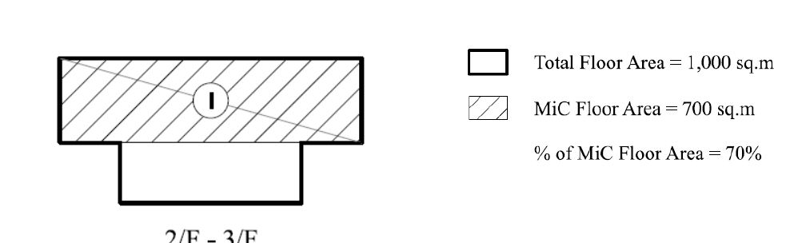

---
tags:
  - JPN
  - MiC 組裝合成
  - GFA concession 樓面面積寬免
  - Building height 建築物高度
  - Green & amenity features 環保及適意設施
  - GFA 總樓面面積
  - Balcony & utility platform 露台及工作平台
  - Site coverage 上蓋面積
  - Curtain wall & façade 幕牆及外牆
  - Plant rooms 機房
  - Plan submission & approval 呈交及審批
  - Site supervision 地盤監督
  - Domestic 住用
  - Structural 結構
summary: "MiC buildings get 10% of the MiC floor area off GFA (outside the 10% cap) and 10% off SC at each floor, plus up to 4% of MiC storey height as minor height relaxation."
keywords: MiC, modular integrated construction, 組裝合成, 組合合成建築法, prefabricated module, 預製組件, GFA concession, 樓面面積寬免, building height relaxation, 放寬高度, 4%, JPN8, JPN 8
---

# JPN 8 Enhanced Facilitation Measures for Buildings Adopting Modular Integrated Construction <small>聯合作業備考第 8 號：推廣環保及創新的樓宇鼓勵措施——進一步促進建築物採用「組裝合成」建築法的措施</small>

!!! info "Document info 文件資料"
    | | |
    |---|---|
    | **Type 類別** | Joint Practice Note 聯合作業備考 (BD 屋宇署 · LandsD 地政總署 · PlanD 規劃署) |
    | **First issue 首次發出** | July 2022 (effective **1 August 2022**) |
    | **Version summarised 本摘要版本** | July 2022 |
    | **Official language 官方語言** | English only (Chinese version not available) 只有英文版 |
    | **Source 原文** | [JPN 8 (PDF)](https://www.bd.gov.hk/doc/en/resources/codes-and-references/practice-notes-and-circular-letters/joint/JPN08.pdf) |
    | **Last checked 最後核對** | 2026-11-20 against the July 2022 version |

## At a glance 重點摘要 {#at-a-glance}

=== "English"

    - **Modular Integrated Construction (MiC)**: free-standing **volumetric modules**, finished and fitted out **off-site**, then assembled on site. It improves quality, shortens construction and reduces nuisance and waste (para. 2).
    - Because MiC needs **double walls, thicker walls, longer corridors and thicker slabs**, the three departments give two incentives (para. 3): **GFA/SC concessions** and support for **minor relaxation of building height (BH)**.
    - **GFA**: **10% of the MiC floor area** may be disregarded, and this is **not subject to the APP-151 10% cap** (para. 5(a)). **SC**: **10%** of the MiC floor area **at each floor** is not counted (para. 5(b)).
    - **Building height**: favourable consideration for an increase of up to **4% of the total storey height of MiC floors**. A MiC floor is one where MiC floor area is **≥ 50%** of the floor (para. 10).
    - **PlanD** follows BD's exemption and **supports s.16 minor relaxation** applications, usually needing only a **simple visual appraisal** (para. 11). **LandsD** offers a **fast-track** lease modification at **standard premium rates** where needed (paras. 9, 14).
    - Concessions are **revoked** if MiC is not adopted, and **adjusted** if the MiC floor area is reduced (para. 16).

=== "中文"

    - **「組裝合成」建築法（MiC）**：在**廠房**預先製造並完成裝修的獨立**立體組件**，再運到工地裝嵌，可提升質素、縮短工期、減少滋擾及廢料（第 2 段）。
    - 由於 MiC 需要**雙重牆、較厚牆身、較長走廊及較厚樓板**，三個部門提供兩項鼓勵措施（第 3 段）：**總樓面面積／上蓋面積寬免**，以及支持**略為放寬建築物高度限制**。
    - **總樓面面積**：**MiC 樓面面積的 10%** 可不計算，且**不受 APP-151 的 10% 上限限制**（第 5(a) 段）；**上蓋面積**：**每層** MiC 樓面面積的 **10%** 不計（第 5(b) 段）。
    - **建築物高度**：可考慮放寬最多 **MiC 樓層總層高的 4%**；MiC 樓層指 MiC 樓面面積 **≥ 該層面積 50%** 的樓層（第 10 段）。
    - **規劃署**跟隨屋宇署的豁免，並**支持第 16 條略為放寬申請**，一般只需**簡單視覺評估**（第 11 段）；**地政總署**在需要時以**標準補地價**的**快速**方式處理修訂地契（第 9、14 段）。
    - 若沒有採用 MiC，寬免會被**撤銷**；若 MiC 樓面面積減少，寬免會被**調整**（第 16 段）。

!!! tip "Applies / does not apply 適用／不適用"
    **Applies**: **new buildings** adopting MiC, for new or major-revision building plans submitted **on or after 1 Aug 2022** (para. 17). 適用於 2022 年 8 月 1 日或之後呈交的新建築物。
    **Not covered**: plans approved before then may follow the **Sep 2019 JPN 2** and repealed **APP-161** (para. 18). Concessions are **revoked or adjusted** if MiC is not used, or the MiC floor area falls (para. 16). Precast components that are not volumetric modules are not MiC: see the [Precast Code](../codes/precast-2016.md). 較早批准的圖則按 2019 年版 JPN 2；如不採用 MiC 會撤回寬免。

## Key table: MiC incentives MiC 鼓勵措施 {#key-table-mic-incentives-mic}

| Regime 制度 | Incentive 措施 | Key conditions 主要條件 | Para. 段 |
|---|---|---|---|
| **BO** (BD) 《建築物條例》 | **10% of MiC floor area** disregarded from **GFA** 10% MiC 樓面面積不計總樓面面積 | By s.42 exemption; **not** subject to the APP-151 10% cap 以第 42 條豁免；不受 10% 上限 | 5(a) |
| | **10% of MiC floor area at each floor** not counted for **SC** 每層 10% 不計上蓋面積 | — | 5(b) |
| **TPO** (PlanD) 《城市規劃條例》 | Follows BD's GFA/SC exemption 跟隨屋宇署豁免 | Unless contrary to specific OZP/DPAP restrictions 除非違反大綱圖特定限制 | 7 |
| | Supports **s.16 minor relaxation of BH** (and s.16A minor amendments) 支持略為放寬高度 | Simple **visual appraisal**; AVA only for major breezeways; no traffic/environment/infrastructure assessments if PR/GFA unchanged 簡單視覺評估 | 11 |
| **Lease** (LandsD) 地契 | Exemption on plans where the lease has a green-feature exemption clause 地契有豁免條款 | No premium or admin fee 毋須補地價 | 8 |
| | **Fast-track** lease modification / consent otherwise 否則快速修訂地契 | Premium (if any) at **standard rates** 標準補地價 | 9, 14 |
| **Building height** 建築物高度 | Increase up to **4% of total storey height of MiC floors** 最多 MiC 樓層總層高 4% | MiC floor = MiC area **≥ 50%** of the floor; AP certification (Appendix A) MiC 樓層 ≥ 50%；認可人士證明 | 10–14 |

## Key clauses 主要條文 {#key-clauses}

!!! quote "Para. 5 — GFA and SC concessions 總樓面面積及上蓋面積寬免"
    Under the building regime, BD is prepared to grant the following GFA and/ or SC concessions upon submission of an application for exemption under section 42 of the Buildings Ordinance (BO): (a) 10% of the MiC floor area of a new building may be disregarded from calculation of GFA of the development. The granting of such GFA concession is not subject to the overall GFA cap of 10% stipulated in… PNAP APP-151; and (b) 10% of the MiC floor area at each floor level need not be counted for SC.

    **中譯（非官方）：** 在建築規管制度下，屋宇署願意在收到根據《建築物條例》第 42 條提出的豁免申請後，給予以下總樓面面積及／或上蓋面積寬免：(a) 新建築物 MiC 樓面面積的 10% 可不計入發展項目的總樓面面積，此寬免不受 APP-151 訂明的 10% 整體上限限制；及 (b) 每層 MiC 樓面面積的 10% 毋須計入上蓋面積。

!!! quote "Para. 6 — What is MiC floor area 何謂 MiC 樓面面積"
    …the MiC floor area is the floor area contained within the external walls of the combined MiC modules, together with the floor areas of associated construction joints and including the thickness of such walls. If MiC is adopted for plant room or similar services, or green/ amenity features such as balcony, utility platform, common corridor and lift lobby, or non-structural prefabricated external wall, the floor areas of such rooms or features which may already have been exempted or disregarded from GFA calculations under the BO may also be included in the MiC floor area… features not forming part of the MiC floor, for example minor projecting features as described in paragraph 3 of PNAP APP-19, acoustic fin, noise barrier, curtain wall and cladding, should be excluded…

    **中譯（非官方）：** ……MiC 樓面面積指組合 MiC 組件外牆以內的樓面面積，連同相關施工接縫的樓面面積，並包括該等牆身的厚度。如機房或相類設施，或露台、工作平台、公用走廊及升降機大堂等環保／適意設施，或非結構預製外牆採用 MiC，即使其面積已根據《建築物條例》獲豁免或不計算，亦可計入 MiC 樓面面積……不構成 MiC 樓面一部分的設施（例如 APP-19 第 3 段所述的小型伸出物、隔音鰭、隔音屏障、幕牆及覆蓋層）則不應計算……

!!! quote "Para. 10 — Building height relaxation 放寬建築物高度"
    …favourable consideration may be given to an increase of BH up to 4% of the total storey height of MiC floors. In this regard, MiC floor is taken as a floor of a building where the MiC floor area is not less than 50% of the total area on that floor.

    **中譯（非官方）：** ……可從寬考慮把建築物高度增加最多 MiC 樓層總層高的 4%。就此而言，MiC 樓層指 MiC 樓面面積不少於該層總面積 50% 的樓層。

## What counts in MiC floor area MiC 樓面面積的計算 {#what-counts-in-mic-floor-area-mic}

| Included ✅ 計入 | Excluded ❌ 不計入 |
|---|---|
| Area within the external walls of the combined MiC modules, incl. wall thickness 組合組件外牆以內面積（包括牆厚） | Minor projecting features under APP-19 para. 3 小型伸出物 |
| Associated construction joints 相關施工接縫 | **A/C platforms**, even if combined with balconies / utility platforms (footnote 1) 冷氣機平台 |
| MiC plant rooms, balconies, utility platforms, common corridors, lift lobbies, NSPEW, **even if already exempted** 已獲豁免的 MiC 機房、露台、工作平台、走廊、預製外牆 | Acoustic fins, noise barriers 隔音鰭、隔音屏障 |
| | Curtain walls and cladding 幕牆及覆蓋層 |

## Building height relaxation: the official format 放寬高度：官方格式 (Appendix A) {#appendix-a}

The AP certifies the MiC floors and storey heights on the **Appendix A form**, submitted with the GBP to PlanD (and LandsD if the lease limits height) through centralised processing (paras. 13–14). 認可人士以附錄 A 表格證明 MiC 樓層及層高，連同圖則經中央處理呈交。

<figure markdown>
  { width="620" loading=lazy }
  <figcaption>Appendix A, part I — on 2/F–3/F, MiC floor area 700 m² of 1,000 m² total = **70 %** (≥ 50 % → an MiC floor). 附錄 A 第 I 部：MiC 樓面佔 70%，屬 MiC 樓層。 <small>Source: JPN No. 8 (Jul 2022), BD / LandsD / PlanD 資料來源：聯合作業備考第 8 號</small></figcaption>
</figure>

| Floor 樓層 | % of MiC floor area MiC 樓面百分比 | Storey height counted 計算層高 |
|---|---|---|
| G/F | 100 % | 5 m |
| 1/F | 100 % | 5 m |
| 2/F–3/F | 70 % | 4 m × 2 = 8 m |
| 4/F–10/F | 50 % | 4 m × 7 = 28 m |
| 11/F–15/F | 30 % (below 50 %: not an MiC floor) | N.A. |
| **(a) Total storey height of MiC floors** MiC 樓層總層高 | | **46 m** |
| **(b) Maximum eligible BH relaxation** (4 % × 46 m) 最多可放寬高度 | | **1.84 m** |

<small>Storey height measured from the lowest to the highest level of the MiC module, including slabs and the construction joints below (fn. 4). A floor is an MiC floor if MiC floor area ≥ **50 %** of the floor's site coverage area (para. 10, fn. 5). 層高由組件最低點量至最高點；MiC 樓面 ≥ 50% 才屬 MiC 樓層。</small>

## Worked example: GFA, SC and height 例子：總樓面面積、上蓋面積及高度 {#worked-example}

A residential tower, **20 MiC floors** of **600 m²** MiC floor area each (including balconies and utility platforms built as modules), typical MiC storey height **3.15 m**; OZP height limit **100 mPD**. 住宅大廈 20 層 MiC 樓層，每層 MiC 樓面 600 平方米，層高 3.15 米：

| Item 項目 | Working 計算 | Para. 段 |
|---|---|---|
| MiC floor area 組件樓面面積 | 20 × 600 = **12,000 m²** (balconies / UPs included even though already exempted; **A/C platforms**, fins, curtain walls excluded) | 6, fn. 1 |
| GFA concession 總樓面面積寬免 | 10 % × 12,000 = **1,200 m²** disregarded by **s.42** application; **not** in the APP-151 **10 % cap** | 5(a) |
| SC concession 上蓋面積寬免 | 10 % × 600 = **60 m²** not counted at each MiC floor | 5(b) |
| Height relaxation 放寬高度 | 20 × 3.15 = 63 m of MiC floors → up to 4 % × 63 = **2.52 m** above 100 mPD, via **s.16** minor relaxation (simple visual appraisal) | 10–12 |
| Lease 地契 | Lease with a green-feature clause → approved at plan checking; otherwise **fast-track** lease modification, premium at **standard rates** | 8–9, 14 |
| Certification 證明 | AP signs **Appendix A** with the GBP | 13 |

## MiC in the whole picture 組裝合成與其他規定 {#whole-picture}

| Topic 課題 | Rule 規定 | Source 出處 |
|---|---|---|
| **Early acceptance** 預先接納 | Pre-submission enquiry (45 days) and **in-principle acceptance** of MiC systems | [ADV-36](adv-36.md), [ADM-19](adm-19.md) |
| **Structural design** 結構設計 | Volumetric precast design, lifting, erection, tolerances, joint testing | [Precast Code 2016](../codes/precast-2016.md), [APP-143](app-143.md) |
| **Other green features** 其他環保設施 | Balconies, UPs, NSPEW, sky gardens: JPN 1 / JPN 2, **within** the 10 % cap | [JPN 1](jpn-1.md), [JPN 2](jpn-2.md), [APP-151](app-151.md) |
| **Height limits** 高度限制 | How BHR is measured and what roof structures count | [JPN 5](jpn-5.md) |
| **GFA control across regimes** 三個制度的總樓面面積 | One GFA figure shared by BD, PlanD, LandsD | [JPN 4](jpn-4.md), [GFA guide](../guides/gfa.md) |
| **Supervision** 監督 | MiC and precast need **qualified supervision** and quality audits (heat soak and MiC circular letters) | [Site Supervision Code](../codes/site-supervision-2009.md) |
| **Storey heights** 層高 | Domestic storey height limits still apply | [APP-5](app-5.md) |

## Explanation 淺白解釋 {#explanation}

=== "English"

    MiC modules are built like boxes. Where two boxes meet you get **two walls and two slabs** instead of one. That "eats" floor area and adds height. JPN 8 **compensates**: a flat 10% of the MiC floor area is free of GFA (and 10% of SC per floor), and up to 4% extra height is supported. The GFA concession is **outside the APP-151 10% cap**, so it does not compete with balconies or clubhouses.

    The three departments align their regimes. BD exempts under the BO, PlanD follows and supports the BH relaxation (with light assessment requirements), and LandsD fast-tracks any lease modification.

    The incentive is tied to **actually building with MiC**. If the design changes away from MiC, the concessions fall away.

=== "中文"

    MiC 組件像箱子，兩個箱子相接處會有**兩道牆及兩塊樓板**，「蠶食」樓面面積並增加高度。JPN 8 作出**補償**：MiC 樓面面積的 10% 不計總樓面面積（每層上蓋面積亦豁免 10%），並支持最多 4% 的額外高度。此總樓面面積寬免**不計入 APP-151 的 10% 上限**，因此不會與露台或會所爭奪額度。

    三個部門協調各自的制度：屋宇署按《建築物條例》豁免；規劃署跟隨並支持放寬高度（評估要求簡單）；地政總署快速處理修訂地契。

    鼓勵措施與**實際採用 MiC** 掛鈎；若設計不再採用 MiC，寬免便會失效。

## Practical notes 實務提示 {#practical-notes}

=== "English"

    !!! example "Worked example: MiC residential tower"
        **30 MiC floors**, each with MiC floor area **600 m²** (> 50% of the floor). Storey height of each MiC floor **3.15 m**.

        - GFA concession = 10% × 600 × 30 = **1,800 m²** (outside the APP-151 cap)
        - SC: 10% × 600 = **60 m²** per floor not counted
        - BH relaxation = 4% × (30 × 3.15) = 4% × 94.5 = up to **3.78 m**
        - The AP certifies the MiC floors and storey heights using the **Appendix A** form, submitted with the GBP to PlanD / LandsD.

    !!! tip "Common pitfalls"
        - Including **A/C platforms, curtain walls or cladding** in the MiC floor area.
        - Counting floors where MiC is **less than 50%** of the floor area towards the BH relaxation.
        - Storey height of a MiC floor is measured from the **lowest to the highest level of the MiC module**, including slabs and the construction joints below (footnote 4).
        - Plans approved **before 1 Aug 2022** follow the Sept 2019 version of JPN 2 and the repealed APP-161 (para. 18).

=== "中文"

    !!! example "計算例子：MiC 住宅大廈"
        **30 層 MiC 樓層**，每層 MiC 樓面面積 **600 平方米**（> 該層 50%），每層 MiC 層高 **3.15 米**。

        - 總樓面面積寬免 = 10% × 600 × 30 = **1,800 平方米**（不受 APP-151 上限）
        - 上蓋面積：每層 10% × 600 = **60 平方米**不計
        - 高度放寬 = 4% × (30 × 3.15) = 4% × 94.5 = 最多 **3.78 米**
        - 認可人士以**附錄 A** 表格證明 MiC 樓層及層高，連同一般建築圖則提交規劃署／地政總署。

    !!! tip "常見錯誤"
        - 把**冷氣機平台、幕牆或覆蓋層**計入 MiC 樓面面積。
        - 把 MiC 面積**少於 50%** 的樓層計入高度放寬。
        - MiC 樓層層高由 **MiC 組件最低至最高水平**量度，包括樓板及其下的施工接縫（註腳 4）。
        - **2022 年 8 月 1 日前**已批核的圖則，參考 2019 年 9 月版 JPN 2 及已廢除的 APP-161（第 18 段）。

## Related 相關文件 {#related}

| Document 文件 | Relationship 關係 |
|---|---|
| [JPN 1](jpn-1.md), [JPN 2](jpn-2.md) | Earlier green feature packages (MiC moved here from JPN 2) 早前的環保設施措施 |
| [APP-151](app-151.md) item 38 | MiC listed; not subject to pre-requisites / cap 列於附錄 A，不受先決條件及上限 |
| [APP-19](app-19.md) | Minor projecting features (excluded) 小型伸出物（不計入） |
| [B(P)R 18A–22](../regulations/bpr-18a-22.md) | Building height and SC/PR tables 建築物高度及上蓋面積／地積比率 |
| [ADV-36](adv-36.md) | MiC pre-acceptance and guidelines 組裝合成預先接納 |
| [Precast Code 2016](../codes/precast-2016.md) | Design and erection of precast and volumetric units 預製混凝土守則 |
| [JPN 5](jpn-5.md) | Building height restriction 高度限制 |
| TPB Guidelines for Class A and Class B Amendments | Minor amendments to approved schemes 核准方案的輕微修訂 |

---
<small>Prepared by: _[name]_ · Checked by: _[name]_ · Unofficial summary; refer to the official JPN for the definitive text.</small>
