---
tags:
  - JPN
  - Plot ratio 地積比率
  - Redevelopment 重建
  - Lease 地契
  - Land premium 補地價
  - Domestic 住用
  - GFA 總樓面面積
  - Plan submission & approval 呈交及審批
  - Occupation permit 佔用許可證
  - Site area & classification 地盤面積及分類
  - GFA concession 樓面面積寬免
  - Sustainable building design 可持續建築設計
  - Hotel 酒店
  - Heritage 文物
  - Balcony & utility platform 露台及工作平台
summary: "Old residential buildings (OP 50+ years) on sites of 700 m² or more in 7 designated areas can get 20% premium-free bonus PR, built in kind or encashed, via a lease modification by 31 Aug 2031."
keywords: bonus plot ratio, 額外地積比率, pilot scheme, 先導計劃, redevelopment, 重建, encashment, 兌換, land premium, 補地價, Sham Shui Po, 深水埗, Mong Kok, 旺角, To Kwa Wan, 土瓜灣, Yau Ma Tei, 油麻地, JPN9, JPN 9
---

# JPN 9 Bonus Plot Ratio Pilot Scheme <small>額外地積比率先導計劃</small>

!!! info "Document info 文件資料"
    | | |
    |---|---|
    | **Type 類別** | Joint Practice Note (BD, LandsD, PlanD) 聯合作業備考（屋宇署、地政總署、規劃署） |
    | **First issue 首次發出** | **August 2026** (new) 2026 年 8 月（新發出） |
    | **Pilot period 先導期** | **1 September 2026 – 31 August 2031** (five years) 五年 |
    | **Version summarised 本摘要版本** | August 2026 (current issue on BD index, checked 2026-11-23) |
    | **Official language 官方語言** | English only for now (Chinese version to follow) 暫只有英文版 |
    | **Source 原文** | [JPN 9 (PDF)](https://www.bd.gov.hk/doc/en/resources/codes-and-references/practice-notes-and-circular-letters/joint/JPN09.pdf) |
    | **Last checked 最後核對** | 2026-11-20 against the August 2026 issue |

## At a glance 重點摘要 {#at-a-glance}

=== "English"

    - A **2025 Policy Address** measure to speed up private redevelopment in old districts. An owner who **pulls down an old residential building** on an eligible site in **7 designated areas** and redevelops it **mainly for residential use** gets **20% extra PR / GFA, free of land premium** (the **bonus PR**) (paras. 1–2).
    - **Eligible site** (para. 5): in the 7 areas (OZPs of **Cheung Sha Wan / Sham Shui Po, Ma Tau Kok / Kowloon City and To Kwa Wan, Mong Kok, Sai Ying Pun and Sheung Wan, Tsuen Wan, Wan Chai, Yau Ma Tei**); building(s) with residential elements whose **OP is ≥ 50 years old**; redeveloped with **> 50% of GFA residential**; site area **≥ 700 m²** (one or more lots).
    - **Bonus = 20% of the maximum domestic PR** under the OZP, the "R(A)" zone of that OZP, or the **B(P)R First Schedule** (domestic > 61 m) where the OZP has no PR limit (para. 6 and Appendix).
    - **Two options, not both** (para. 8): **(i) build it in kind** in-situ, with TPB s.16 planning permission (premium reduced by the bonus value); or **(ii) encash** it as a land premium credit for the in-situ redevelopment and / or other land deals (e.g. in the **Northern Metropolis**).
    - Effected by **lease modification** with a "**minimum necessary**" set of conditions and a **building covenant**. The lease modification letter must be executed within **3 years** of a valid application (para. 16(a)).
    - **BD's role**: if the overall PR approved by the TPB exceeds the **B(P)R First Schedule**, apply under **BO s.42**; BD will consider it **favourably** with reference to [JPN 4](jpn-4.md) (para. 12).
    - Encashed credits are valid for **10 years**, non-transferable except to associated companies; no interest or refund (para. 15).

=== "中文"

    - **2025 年施政報告**措施，旨在推動舊區私人重建。業主如在 **7 個指定地區**的合資格地盤**拆卸舊住宅樓宇**並**主要作住宅用途**重建，可獲**額外 20% 地積比率／總樓面面積，毋須補地價**（**額外地積比率**）（第 1–2 段）。
    - **合資格地盤**（第 5 段）：位於 7 個地區（**長沙灣／深水埗、馬頭角／九龍城及土瓜灣、旺角、西營盤及上環、荃灣、灣仔、油麻地**分區計劃大綱圖）；建有住宅成分的建築物，其**佔用許可證已發出 ≥ 50 年**；重建後**住宅佔總樓面面積 > 50%**；地盤面積 **≥ 700 平方米**（可由一個或多個地段組成）。
    - **額外地積比率 = 最高住用地積比率的 20%**，按分區計劃大綱圖、該圖「住宅（甲類）」地帶，或（如沒有地積比率限制）**B(P)R 附表 1**（高逾 61 米的住用建築物）計算（第 6 段及附錄）。
    - **兩個選項，只可選一**（第 8 段）：**(i) 原址興建**，須取得城規會第 16 條規劃許可（補地價扣減額外地積比率的價值）；或 **(ii) 兌換**為補地價抵免，用於原址重建及／或其他土地交易（例如**北部都會區**）。
    - 以**修訂地契**落實，只加入「**最低所需**」條款及**建築規約**；修訂地契函件須在有效申請後 **3 年**內簽立（第 16(a) 段）。
    - **屋宇署角色**：如城規會批准的整體地積比率超過 **B(P)R 附表 1**，須根據**《建築物條例》第 42 條**申請；屋宇署會參照 [JPN 4](jpn-4.md) **從寬考慮**（第 12 段）。
    - 兌換的抵免有效期 **10 年**，除轉讓予相聯公司外不可轉讓，不設利息或退款（第 15 段）。

!!! tip "Applies / does not apply 適用／不適用"
    **Applies**: redevelopment of **old residential buildings** (OP **50+ years**) on sites **≥ 700 m²** in the **7 designated areas**, mainly for residential use, with a **lease modification** applied for **1 Sep 2026 – 31 Aug 2031**. 適用於 7 個指定地區、樓齡 50 年以上、地盤 ≥ 700 平方米、以住宅為主的重建。
    **Excluded**: hotels and guesthouses; hostels, dormitories, staff quarters, student hostels and **care homes**; **NT exempted houses** (footnote 3); government land in the site does **not** earn bonus PR (footnote 6). 酒店、宿舍、院舍及新界豁免屋宇不包括在內；政府土地不計額外地積比率。

## Key clauses 主要條文 {#key-clauses}

| Para. 段 | Rule 規定 |
|---|---|
| 1 | Key points for the **Bonus PR Pilot Scheme** (2025 Policy Address) to push private redevelopment in old districts. 額外地積比率先導計劃。 |
| 2 | Pull down an **old residential building** in a **designated area** and redevelop mainly for residential: **+20 % land premium-free PR/GFA**, used **in kind** (TPB approval) or **encashed** as a premium credit (in-situ, Northern Metropolis or elsewhere); effected by **lease modification** with a **building covenant**. 額外 20% 免補地價地積比率。 |
| 3 | Five-year window **1 Sep 2026 – 31 Aug 2031** for the lease modification application; any **s.16 planning permission** must come **first** (extensions possible with DEVB, footnote 2). 五年期。 |
| 4 | "Lease modification" includes **land exchange**. 包括換地。 |
| 5 | Eligibility (all): (a) in the **7 designated areas**; (b) building(s) with **residential elements** with an **OP at least 50 years old** (at planning or lease application); (c) redeveloped **mainly residential** (> 50 % GFA); (d) site **≥ 700 m²** (one or more lots). 資格。 |
| 6 | Bonus = 20 % of the **max. domestic PR/GFA on the OZP**; non-residential zones needing permission for 'Flat': the **"R(A)"** PR of that OZP; no OZP limit: **B(P)R First Schedule, domestic > 61 m** (Appendix). 計算基礎。 |
| 7 | Premium value from **standard rates** (one per designated area, updated yearly); **no appeal**. 標準價率。 |
| 8 | Choose **Option (i)** in kind **or** **Option (ii)** encashment; **no hybrid**; unused in-kind bonus is **lost**. 二選一。 |
| 9 | Option (i): state in the **s.16 application** that the bonus is built in-situ; then lease modification within the 5-year period; premium **reduced** by the bonus value. 原址興建。 |
| 10 | **Minimum necessary** lease terms: building covenant, user, min/max PR or GFA, alienation and **pre-sale consent**, DMC, essential TPB conditions; B/Ds add only essential (e.g. safety) terms. 最少需要的地契條款。 |
| 11 | Premium = normal before-and-after assessment **minus** bonus value at the standard rate on the **BBTO** date. 補地價計算。 |
| 12 | PR above the **B(P)R First Schedule** needs a **BO s.42** application, considered **favourably** with reference to [JPN 4](jpn-4.md); in 'Flat'-by-permission zones, PR above the zone or "R(A)" limit counts as using the bonus in kind. 第 42 條申請。 |
| 13 | Option (ii): lease modification for the 100 % in-situ scheme stating **encashment**; minimum necessary terms. 兌換選項。 |
| 14 | BBTO states the bonus value; may offset the in-situ premium; LandsD records the **remaining value** after execution. 記錄價值。 |
| 15 | LandsD **register**; unused value valid **10 years** from the lease modification letter; no interest or refund; **non-transferable** except to associated companies (Cap. 622). 十年有效。 |
| 16(a) | Apply to the **DLO**; lease modification to be **executed within 3 years** of a valid application. 三年內簽立。 |
| 16(b) | DLO **enquiry service** on eligibility and estimated bonus value; PlanD advice on planning matters. 查詢服務。 |
| 16(c) | Full ownership not needed for the s.16 application, but **needed before** the lease modification application or **building plan submission**; joint ownership allowed. 業權。 |
| 16(d) | Voluntary **planning gains** encouraged: community facilities, **setback beyond the SBD Guidelines** ([APP-152](app-152.md)), canopies, **public passageways** ([APP-108](app-108.md)); see URA District Studies. 規劃增益。 |
| 16(e) | Other GFA concessions ([APP-151](app-151.md), [JPN 1](jpn-1.md), [JPN 2](jpn-2.md), heritage bonus) remain available but are **not counted** in the 20 %. 其他寬免不受影響。 |
| 16(f) | Government may **recover** the bonus value if the redevelopment is not built per the lease (**Deed of Undertaking**). 追討。 |
| 16(g) | Sites in a **Transfer of Plot Ratio** scheme may also apply, following the TPB TPR Guidelines. 地積比率轉移。 |
| 16(h) | LandsD **administrative fee** (and LACO fee for land exchange). 行政費。 |
| 17–19 | Engage professionals; each case on its merits; no expectation of approval; rights to modify reserved. 其他。 |

## The 7 designated areas 7 個指定地區 (footnote 1) {#designated-areas}

| Area 地區 | OZP 分區計劃大綱圖 |
|---|---|
| Sham Shui Po 深水埗 | Cheung Sha Wan OZP **S/K5/39** |
| Kowloon City and To Kwa Wan 九龍城及土瓜灣 | Ma Tau Kok OZP **S/K10/30** |
| Mong Kok 旺角 | Mong Kok OZP **S/K3/36** |
| Sai Ying Pun and Sheung Wan 西營盤及上環 | **S/H3/34** |
| Tsuen Wan 荃灣 | **S/TW/35** |
| Wan Chai 灣仔 | **S/H5/31** |
| Yau Ma Tei 油麻地 | **S/K2/24** |

<small>The areas in the Schedule to the **Land (Compulsory Sale for Redevelopment) (Specification of Lower Percentage) Notice, Cap. 545A**. 即《土地（為重新發展而強制售賣）（指明較低百分比）公告》附表所列地區。</small>

## Timeline 時間表 {#timeline}

<figure markdown>
  { width="760" loading=lazy }
  <figcaption>From eligibility check to building plans, with the two options. 由資格查詢至呈交建築圖則，兩個選項的流程。</figcaption>
</figure>

| Milestone 里程碑 | Limit 期限 | Para. 段 |
|---|---|---|
| Lease modification application window 申請期 | **1 Sep 2026 – 31 Aug 2031** | 3 |
| Building age 樓齡 | OP **≥ 50 years** before the planning (or lease) application | 5(b) |
| Execute the lease modification 簽立修訂地契 | Within **3 years** of a valid application | 16(a) |
| Use the encashed value 使用兌換價值 | Within **10 years** of the lease modification letter | 15 |
| Full ownership 全部業權 | Before the lease application or **building plan submission** | 16(c) |

## Key table: bonus PR eligibility (para. 5) 額外地積比率資格（第 5 段） {#key-table-bonus-pr-eligibility-para-5-5}

| Criterion 條件 | Requirement 要求 |
|---|---|
| (a) Location 位置 | Within one of the **7 designated areas** (areas in the Schedule to Cap. 545A) 7 個指定地區 |
| (b) Existing building 現有建築物 | Building(s) with **residential elements** (incl. composite; excl. hotels, guesthouses, hostels, dormitories, RCHEs, NTEHs) with an **OP issued ≥ 50 years** before the planning (or lease modification) application 佔用許可證 ≥ 50 年 |
| (c) Future use 重建用途 | **Mainly residential**: **> 50%** of total GFA residential, whatever the zoning 住宅 > 50% |
| (d) Site area 地盤面積 | **≥ 700 m²**, one or more lots. Government land to be granted is not counted; non-building areas count for the 700 m² but not for the bonus ≥ 700 平方米 |

## Key table: how the 20% bonus PR is calculated (Appendix) 額外地積比率計算方法（附錄） {#key-table-how-the-20-bonus-pr-is-calculated-appendix}

| Situation 情況 | Basis 依據 | Example (700 m² site) 例子 |
|---|---|---|
| Zone permits 'Flat'; OZP gives max. **domestic** PR 准許「分層住宅」，大綱圖訂明住用地積比率 | Max. domestic PR on the OZP | "R(A)", Mong Kok, PR 8.5 → 700 × 8.5 × 0.2 = **1 190 m²** |
| Zone permits 'Flat'; OZP gives only **total** PR 只訂明總地積比率 | Max. total PR on the OZP | "R(B)", Ma Tau Kok, PR 5 → 700 × 5 × 0.2 = **700 m²** |
| Zone permits 'Flat'; **no PR limit** on the OZP 沒有地積比率限制 | **B(P)R First Schedule**, domestic > 61 m | "OU(MU)", Wan Chai, Class A PR 8 → 700 × 8 × 0.2 = **1 120 m²** |
| 'Flat' needs **planning permission** (e.g. "C", "G/IC", "R(E)") 須申請規劃許可 | Max. domestic PR of the **"R(A)" zone** of that OZP | "G/IC", Yau Ma Tei, R(A) 8.5 → **1 190 m²** |
| As above, but "R(A)" has **no PR limit** 「住宅（甲類）」亦沒有限制 | **B(P)R First Schedule**, domestic > 61 m | "C", Wan Chai, Class B PR 9 → 700 × 9 × 0.2 = **1 260 m²** |

<small>The existing building's PR is not used, even if the OZP allows redevelopment to the existing PR. Other GFA concessions (green features, heritage bonus) remain available but are not counted in the bonus. B(P)R First Schedule: see [B(P)R 18A–22](../regulations/bpr-18a-22.md). 不以現有建築物的地積比率計算；其他寬免仍適用但不計入額外地積比率。</small>

## Key table: Option (i) vs Option (ii) 選項比較 {#key-table-option-i-vs-option-ii}

| | **Option (i) In kind 原址興建** | **Option (ii) Encashment 兌換** |
|---|---|---|
| What you get 所得 | Build **120%** of the OZP PR on site 原址興建 120% | Land premium **credit** = bonus PR × standard rate 補地價抵免 |
| Planning 規劃 | TPB **s.16 permission** needed, stating the bonus will be built 須取得第 16 條規劃許可 | Only if 'Flat' needs permission in the zone 只在須規劃許可的地帶 |
| Premium 補地價 | Full premium assessed, **minus** bonus value at the BBTO standard rate 扣減額外價值 | Credit offsets the in-situ premium and / or other land deals (incl. **Northern Metropolis**) 可抵銷其他土地交易 |
| BD 屋宇署 | **s.42** application if PR exceeds the B(P)R First Schedule (favourable, per JPN 4) 第 42 條申請 | Normal B(P)R limits 一般限制 |
| Unused bonus 未用部分 | **Lost**: no encashment, transfer or cash 不可兌換 | Valid **10 years**; no interest, no refund 有效 10 年 |
| Hybrid 混合 | **Not allowed** 不容許 | **Not allowed** 不容許 |

## Explanation 淺白解釋 {#explanation}

=== "English"

    Many old buildings in these districts are too small and too dense for redevelopment to pay. JPN 9 adds a **premium-free 20% PR** to tip the balance, but only for **sizeable sites (≥ 700 m²)** with **old (≥ 50-year) residential buildings**, so that owners assemble sites and rebuild at scale.

    For the **AP**, the key steps are:

    - Check **eligibility** early, using the DLO **enquiry service** (para. 16(b)), before buying out owners.
    - Choose **Option (i) or (ii)**. For (i), the planning application must state the bonus will be built.
    - If the TPB-approved PR exceeds the B(P)R First Schedule, include a **BO s.42 modification** in the GBP submission.

    The scheme is **time-limited**: lease modification applications only between **1 Sep 2026 and 31 Aug 2031**.

=== "中文"

    這些地區很多舊樓面積細、密度高，重建難以回本。JPN 9 提供**毋須補地價的 20% 額外地積比率**作誘因，但只適用於**具規模的地盤（≥ 700 平方米）**及**舊（≥ 50 年）住宅樓宇**，以鼓勵業主合併地盤並作較大規模重建。

    對**認可人士**而言，關鍵步驟是：

    - 及早核實**資格**：在收購業權前使用地政處的**查詢服務**（第 16(b) 段）。
    - 選擇**選項 (i) 或 (ii)**：如選 (i)，規劃申請須註明會興建額外樓面面積。
    - 如城規會批准的地積比率超過 B(P)R 附表 1，一般建築圖則須連同**第 42 條變通**申請。

    計劃**設有時限**：只接受 **2026 年 9 月 1 日至 2031 年 8 月 31 日**期間提交的修訂地契申請。

## Worked example: Option (i) from planning to building plans 例子：選項 (i) 由規劃至建築圖則 {#worked-example}

A **900 m²** Class A site zoned "R(A)" on the **Mong Kok OZP** (max. domestic PR **8.5**), with two 1960s tenement blocks (OPs over 50 years old). 旺角「住宅（甲類）」甲類地盤 900 平方米，兩幢 1960 年代唐樓：

| Step 步驟 | Working 計算／行動 |
|---|---|
| Eligibility 資格 | Designated area ✔ · OP ≥ 50 years ✔ · mainly residential ✔ · ≥ 700 m² ✔ (para. 5) |
| Base GFA 基本 | 900 × 8.5 = **7,650 m²** domestic |
| Bonus 額外 | 7,650 × 20 % = **1,530 m²** → total **9,180 m²** (PR **10.2**) |
| Planning 規劃 | **s.16** application stating the bonus is built in-situ (para. 9) |
| B(P)R check 規例 | First Schedule domestic, Class A, > 61 m: PR **8**. 10.2 > 8 → **BO s.42** application, considered favourably under [JPN 4](jpn-4.md) (para. 12) |
| Premium 補地價 | Normal assessment minus 1,530 m² × standard rate for Mong Kok at the BBTO date (para. 11) |
| Other concessions 其他寬免 | Balconies, utility platforms and plant rooms under [APP-151](app-151.md) still available, on top of 9,180 m² and **within the 10 % cap**; they are not part of the bonus (para. 16(e)) |
| Lease 地契 | Execute within **3 years**; full ownership before **GBP** (para. 16(a), (c)) |
| Height 高度 | The extra PR must still fit the **OZP height** limit ([JPN 5](jpn-5.md)) and SBD rules ([APP-152](app-152.md)) |

Under **Option (ii)** the same site would build **7,650 m²** and receive a premium credit worth **1,530 m²** at the standard rate, valid **10 years**. 如選擇選項 (ii)，只建 7,650 平方米，並獲相當於 1,530 平方米的補地價抵免，有效 10 年。

## Practical notes 實務提示 {#practical-notes}

=== "English"

    !!! tip "Common pitfalls"
        - Counting **Government land** to be granted towards the **700 m²** (it is not counted, para. 5 fn. 6).
        - Using the **existing building's PR** as the bonus basis (Appendix fn. 2).
        - Planning to build part of the bonus and encash the rest. **No hybrid** (para. 8, fn. 8).
        - Submitting building plans before the **lease modification** is executed, where the TPB requires it (fn. 9).
        - Not having **full ownership** before the lease modification application or GBP submission (para. 16(c)).
        - Forgetting the **s.42** application when the overall PR exceeds the B(P)R First Schedule.

=== "中文"

    !!! tip "常見錯誤"
        - 把將批出的**政府土地**計入 **700 平方米**（不計算，第 5 段註 6）。
        - 以**現有建築物的地積比率**計算額外地積比率（附錄註 2）。
        - 計劃部分興建、部分兌換：**不容許混合**（第 8 段、註 8）。
        - 在城規會要求簽立**修訂地契**前便呈交建築圖則（註 9）。
        - 在申請修訂地契或呈交一般建築圖則前未取得**全部業權**（第 16(c) 段）。
        - 整體地積比率超過 B(P)R 附表 1 時忘記申請**第 42 條變通**。

## Related 相關文件 {#related}

| Document 文件 | Relationship 關係 |
|---|---|
| [JPN 4](jpn-4.md) | PR / GFA control; s.42 for PR above the B(P)R 地積比率管制 |
| [B(P)R 18A–22](../regulations/bpr-18a-22.md) | First Schedule PR (domestic > 61 m) 附表 1 |
| [BO s.42](../regulations/bo-parts-4-9-schedules.md) | Modification of B(P)R PR limits 變通 |
| [APP-151](app-151.md), [JPN 1](jpn-1.md), [JPN 2](jpn-2.md) | Other GFA concessions still available 其他寬免 |
| [JPN 5](jpn-5.md) | Building height limits on the extra GFA 高度限制 |
| [APP-152](app-152.md), [APP-108](app-108.md) | Setback and public passage as voluntary planning gains 後移及公眾通道 |
| [ADM-19](adm-19.md) | Pre-submission enquiry and approval process 呈交前查詢 |
| [Site coverage and PR guide](../guides/site-coverage-plot-ratio.md), [GFA guide](../guides/gfa.md) | The whole picture on PR and GFA 地積比率及總樓面面積專題 |
| Land (Compulsory Sale for Redevelopment) (Specification of Lower Percentage) Notice, Cap. 545A | Defines the 7 designated areas 7 個指定地區 |

---
<small>Prepared by: _[name]_ · Checked by: _[name]_ · English only for now; Chinese text is an unofficial translation (中譯（非官方）). Refer to the JPN for the definitive text.</small>
