---
tags:
  - Regulation
  - B(A)R
  - Plan submission 圖則呈交
  - Approval and consent 批准及同意
  - Certificates 證明書
---

# B(A)R Building (Administration) Regulations, Cap. 123A <small>《建築物（管理）規例》（第 123A 章）</small>

!!! info "Document info 文件資料"
    | | |
    |---|---|
    | **Type 類別** | Regulation 規例: Building (Administration) Regulations, Cap. 123A 《建築物（管理）規例》（第 123A 章） |
    | **Provisions 條文** | Parts 1–7, regs. 1–48 and the fee table under reg. 42 第 1–7 部、第 1–48 條及第 42 條費用表 |
    | **Official language 官方語言** | English and Chinese (equally authentic) 中英文本同等真確 |
    | **Source 原文** | [eLegislation Cap. 123A](https://www.elegislation.gov.hk/hk/cap123A) |
    | **Last checked 最後核對** | 2026-11-20 against the version on eLegislation (version date 30/06/2024) |

## At a glance 重點摘要

=== "English"

    - The B(A)R sets the **procedure** behind BO s.14–21: what plans to submit, who signs them, which notices and certificates are due, the **processing periods**, the duties of AP / RSE / RGE and contractors, and **fees**.
    - **Reg. 8 prescribed plans**: floor and roof plans, elevations, sections, site formation and ELS plans (with geotechnical reports), foundation plan, drainage plan, block and key plans, **diagrammatic plan** (height, SC, PR, open space), structural details and calculations, projections over streets, sanitary fitments, GI plan in scheduled areas, and BFA provisions. Demolition plans and stability reports under reg. 8(3)–(4).
    - **Reg. 12 signing**: the **AP** signs plans; the **RSE** signs foundation and structural plans (an AP may sign simple works ≤ **10 m** high, spans ≤ **6 m**, spread footings ≤ **300 kPa** at ≤ **2 m** depth); the **RGE** signs geotechnical plans and reports. **Scales**: plans ≥ **1:100** (1:200 for very extensive works), block plans ≥ **1:500**.
    - **Processing periods** (regs. 30, 32, 33): plans deemed approved after **60 days** (first submission or major revision) or **30 days** (other resubmissions); consent deemed after **28 days**; amendments after consent: **28 days**.
    - **Notices**: AP notifies contractor appointment and commencement date **≥ 7 days** before works start (reg. 20); changes of AP / RSE / RGE / contractor / TCP within **7 days** (regs. 22–24); change of business address within **14 days** (reg. 45).
    - **Completion certificates**: contractor within **7 days**, AP (with RSE / RGE) within **14 days** of completion (regs. 25, 26); emergency works certified within **48 hours** (reg. 28); water supply certificates for new buildings (reg. 25A).
    - **Supervision**: AP / RSE / RGE give **periodical supervision**; contractors give **continuous supervision**, keep approved and supervision plans **on site**, appoint **technically competent persons (TCPs)**, and keep records for **12 months** after completion (regs. 36–41).

=== "中文"

    - 《建築物（管理）規例》訂明《建築物條例》第 14–21 條背後的**程序**：須呈交甚麼圖則、由誰簽署、須提交哪些通知及證明書、**審批期限**、認可人士／註冊結構工程師／註冊岩土工程師及承建商的職責，以及**費用**。
    - **第 8 條訂明圖則**：各樓層及天台平面圖、立面圖、剖面圖、地盤平整及挖掘側向支撐圖則（附岩土報告）、地基圖則、排水圖則、地盤平面圖及位置圖、**圖解**（高度、上蓋面積、地積比率、空地）、結構細節及計算、伸出街道的伸出物、衞生設備、附表所列地區的土地勘測圖則，以及無障礙設施；拆卸工程圖則及穩定性報告見第 8(3)–(4) 條。
    - **第 12 條簽署**：**認可人士**簽署圖則；**註冊結構工程師**簽署地基及結構圖則（簡單工程：高 ≤ **10 米**、跨度 ≤ **6 米**、擴展式基礎承托力 ≤ **300 千帕**及深 ≤ **2 米**，可由認可人士簽署）；**註冊岩土工程師**簽署岩土圖則及報告。**比例**：圖則 ≥ **1:100**（大型工程 1:200），地盤平面圖 ≥ **1:500**。
    - **審批期限**（第 30、32、33 條）：圖則在 **60 天**（首次呈交或重大修訂）或 **30 天**（其他再呈交）後當作批准；同意 **28 天**；同意後的修訂 **28 天**。
    - **通知**：認可人士須在開工**最少 7 天前**通知承建商委任及開工日期（第 20 條）；更換認可人士／結構工程師／岩土工程師／承建商／技術合格人員須在 **7 天**內通知（第 22–24 條）；業務地址變更須在 **14 天**內通知（第 45 條）。
    - **完工證明書**：承建商於完工後 **7 天**內、認可人士（連同結構／岩土工程師）於 **14 天**內提交（第 25、26 條）；緊急工程須在 **48 小時**內核證（第 28 條）；新建築物須提交供水證明書（第 25A 條）。
    - **監督**：認可人士等須作**定期監督**；承建商須作**不斷監督**、在**地盤**存放已批准圖則及監工計劃書、委任**技術合格人員**，並在完工後保存紀錄 **12 個月**（第 36–41 條）。

## Workflow / timeline 流程及時間表

<figure markdown>
  { width="760" loading=lazy }
  <figcaption>B(A)R deadlines at a glance. 《建築物（管理）規例》期限一覽。 Summary diagram prepared for this site; check the source text for exact wording.</figcaption>
</figure>

## Key table: processing periods 審批期限

| Submission 呈交 | Deemed after 當作批准／同意期限 | Reg. 條 |
|---|---|---|
| Plans submitted **for the first time** 首次呈交的圖則 | **60 days** 60 天 | 30(3)(a) |
| Resubmission that is a **major revision** (BA notifies within 30 days) 重大修訂 | **60 days** from last submission 60 天 | 30(3)(b), 30(4) |
| **Other resubmissions** 其他再呈交 | **30 days** from last submission 30 天 | 30(3)(c) |
| **Consent** to commence 同意展開工程 | **28 days** 28 天 | 32(3) |
| **Alterations / additions** after consent (approval and consent together) 同意後的改動或加建 | **28 days** 28 天 | 33(2) |
| Resumption of suspended work (BO s.20) 恢復暫停工程 | Renewal endorsed on the consent notice 在同意通知上加簽 | 34 |

<small>Resubmissions after refusal under BO s.16(1)(i) count as a **fresh application** (reg. 29(3)). Centralised processing and referrals: see [ADM-2](../pnap/adm-2.md). 因需要進一步資料而被拒後的再呈交當作新申請。</small>

## Key table: deadlines for notices and certificates 通知及證明書期限

| Item 項目 | By whom 由誰 | Deadline 期限 | Reg. 條 |
|---|---|---|---|
| Notice of contractor appointment and commencement date 承建商委任及開工日期通知 | AP (signed acceptance by contractor) 認可人士 | **≥ 7 days before** works start 開工前 7 天 | 20(1) |
| Appointment of TCPs (where a supervision plan is required) 技術合格人員委任 | AP / RSE / RGE; RGBC / RSC | **≥ 7 days before** works start | 20(2)–(3) |
| Change of AP, RSE, RGE, contractor, TCP 人員更換 | The person concerned / AP | **Within 7 days** 7 天內 | 22–24 |
| Contractor's notice on ceasing → AP passes to BA 承建商停止受聘通知 | Contractor → AP 承建商 → 認可人士 | 7 days; AP submits within **7 days** of receipt | 24, 38 |
| Completion certificate 完工證明書 | Contractor 承建商 | **Within 7 days** of completion | 25(1), 26(1) |
| Completion certificate 完工證明書 | AP (and RSE / RGE) 認可人士 | **Within 14 days** of completion | 25(2)–(4), 26(2) |
| Emergency works certificate 緊急工程證明書 | AP / RSE / RGE / contractor | **Within 48 hours** 48 小時內 | 28 |
| Water supply certificate (new building) 供水證明書 | AP (WSD issues within 10 days) | With the completion certificate 連同完工證明書 | 25A |
| Change of business address 業務地址變更 | All registered persons 所有註冊人士 | **Within 14 days** 14 天內 | 45 |
| Change of use notice (BO s.25) 更改用途通知 | Person changing use 更改用途的人 | With a **block plan** 附地盤平面圖 | 47 |

## Regulation by regulation 逐條摘要

| Reg. 條 | Title 標題 | Summary 摘要 |
|---|---|---|
| 1–2 | Citation; interpretation 引稱；釋義 | — |
| 3–4A | Registration requirements 註冊規定 | Qualifications and application requirements for registers of AP, RSE, RGE, RI and contractors. 註冊資格。 |
| 5, 5A | Disclosure of interests 披露利益 | AP / RSE / RGE must not act as contractor or deal in materials, and RIs must not deal in building materials, without **disclosure to the client**. 須向客戶披露。 |
| 6–7 | Delivery and completion of notices and plans 通知及圖則的交付 | Delivery methods (incl. electronic); forms completed and signed. 交付方式。 |
| 8 | Prescribed plans: building works 建築工程訂明圖則 | Full list (see At a glance); demolition plans and stability reports. 圖則清單。 |
| 9 | Prescribed plans: street works 街道工程訂明圖則 | Key plan, layout, sections, road sections, foundations. 街道工程圖則。 |
| 10 | Additional plans 額外圖則 | BA may require more plans, details and particulars. 可要求額外資料。 |
| 11, 11A | Submission; foundation plan with site formation plan 呈交 | Hard copies in **duplicate**; in Scheduled Area No. 1 the foundation plan goes with the site formation plan. 一式兩份。 |
| 12 | Plans signed by preparer 圖則由擬備人簽署 | AP / RSE / RGE signatures = assumption of responsibility; AP may sign simple structures (reg. 12(4)). 簽署即承擔責任。 |
| 13 | Ratio of plans 圖則比例 | Building plans ≥ **1:100** (1:200 if very extensive); block plan ≥ **1:500**; street works scales. 比例。 |
| 14 | Plans clear and on suitable material 圖則清晰 | One copy **coloured** to show existing vs new work. 須着色區分新舊工程。 |
| 15 | Refuse plans from 2+ APs 拒絕多名認可人士的圖則 | BA may refuse plans from two or more APs / RSEs / RGEs for the same premises. 同一處所。 |
| 18 | Stability certificate 穩定性證明書 | For repairs / A&A: AP (or RSE, countersigned by AP) certifies stability when submitting plans (Form BA6). 改動加建穩定性證明。 |
| 18A | Certificate with plans 呈交圖則時的證明書 | AP / RSE / RGE certify plans were prepared under their supervision and comply with the BO. 符合法例證明。 |
| 19 | Notice on ceasing to be engaged 停止受聘通知 | Preparer of plans notifies BA if no longer acting. 通知建築事務監督。 |
| 20 | Notification before commencement 開工前通知 | ≥ **7 days** before: contractor appointment, start date, undertaking; TCP appointments. 開工前 7 天。 |
| 22–24 | Changes of appointments 委任變更 | Notify within **7 days**; works supervised by a departing TCP must stop; ceasing contractor reports to the AP. 7 天內通知。 |
| 25, 25A, 26 | Completion certificates; water supply 完工證明書；供水 | Contractor 7 days; AP 14 days; demolition: remaining structures safe; WSD certificate within 10 days. 完工證明書。 |
| 28 | Emergency work certificate 緊急工程證明書 | Within **48 hours** (BO s.19). 48 小時內。 |
| 29 | Application for approval 申請批准 | Specified form, fee; plans may be submitted separately; resubmission after s.16(1)(i) refusal is a fresh application. 申請方式。 |
| 30 | Approval of plans 批准圖則 | Notice and stamped, signed, dated plans; separate approvals; **60 / 60 / 30-day** periods. 審批期限。 |
| 31, 32 | Consent 同意 | Specified form; demolition: powered plant operator particulars; part consent possible; **28 days**. 同意期限。 |
| 33 | Alterations or additions 改動或加建 | Amendment plans after consent; **28 days**. 28 天。 |
| 34 | Resumption of suspended work 恢復暫停工程 | Renewal endorsed on the consent notice. 加簽。 |
| 35–39 | Duties of AP / RSE / RGE 認可人士等的職責 | Supply stamped plans and supervision plan to contractors; **periodical supervision**; appoint TCPs (BA may reject); fees for additional final inspections. 定期監督。 |
| 40–41 | Duties of registered contractors 註冊承建商的職責 | Keep plans on site; **continuous supervision**; appoint TCPs; keep supervision records for **12 months** after the final completion certificate. 不斷監督；保存紀錄 12 個月。 |
| 42 | Fees 費用 | Registration fees; plan fees by GFA (new buildings) or by A1 sheet (A&A); resubmissions **free**; copies of records. 費用表。 |
| 44–48 | Miscellaneous 雜項 | Supply information to BA; address changes in 14 days; BA may require as-built plans; s.25 notice with block plan; B(A)R does **not apply to minor works** under simplified requirements. 雜項。 |

## Key table: plan processing fees (reg. 42, items 7–7A) 圖則審核費用

| Type 類別 | Fee 費用 |
|---|---|
| Resubmission (further submission, or amendment plan of an approved plan) 再呈交 | **Free** 免費 |
| New industrial building, GFA ≤ 20 000 m² 新工業建築物 | $2,740 per 100 m² (min. $10,400) |
| New industrial building, GFA > 20 000 m² | $2,200 per 100 m² (min. $547,100) |
| New non-industrial building, GFA ≤ 10 000 m² 新非工業建築物 | $4,340 per 100 m² (min. $10,350) |
| New non-industrial building, GFA > 10 000 m² | $3,480 per 100 m² (higher minimum, see the table) |
| A&A or other works not resulting in a new building 改動加建 | $14,200 per A1 sheet (841 × 594 mm) or part |

<small>Figures from the current table; check the fee schedule and [APP-55](https://www.bd.gov.hk/en/resources/codes-and-references/practice-notes-and-circular-letters/index_pnap.html) before paying. 繳費前請核對最新費用表。</small>

## Key clauses 主要條文

!!! quote "Reg. 30(3) — Deemed approval periods 當作批准期限"
    For the purposes of section 15 of the Ordinance, the period after which the Building Authority shall be deemed to have given his approval of plans submitted to him shall be— (a) in relation to plans which are submitted for the first time to the Building Authority for approval, 60 days from the date on which the plans were submitted; (b) in relation to plans which, having been previously submitted to the Building Authority for approval, are submitted to him again for approval so extensively revised as to constitute, in the opinion of the Building Authority, a major revision of such plans, 60 days from the date on which the plans were last submitted; (c) in relation to any other plans which, having been previously submitted to the Building Authority for approval, are submitted to him again for approval, 30 days from the date on which the plans were last submitted.

    **官方中文本：** 就本條例第15條而言，在以下期限過後須當作建築事務監督已批准向他呈交的圖則 —— (a) 如屬首次呈交建築事務監督批准的圖則，則為自呈交圖則的日期起計60天；(b) 如任何圖則以往曾呈交建築事務監督批准，在再次呈交他批准時經大幅度修訂，以致建築事務監督認為該等圖則經重大修訂，則為自最近一次呈交該等圖則的日期起計60天；(c) 如屬以往曾呈交建築事務監督批准而再次呈交他批准的任何其他圖則，則為自最近一次呈交該等圖則的日期起計30天。

!!! quote "Reg. 32(3) — Deemed consent period 當作同意期限"
    The period referred to in section 15 of the Ordinance in connexion with consent being deemed to have been given shall be 28 days.

    **官方中文本：** 本條例第15條所提述的關於當作已給予同意的期限為28天。

## Explanation 淺白解釋

=== "English"

    If the BO says *what* must be approved, the B(A)R says *how*. It is the AP's procedural checklist: the right plans, signed by the right person, at the right scale, with the right certificates, and notices filed on time.

    The **60 / 30 / 28-day** clocks drive BD's workflow. BD must refuse within the period, with reasons, or the plans are deemed approved. This is why submissions are often "disapproved" with a list of comments rather than left pending.

    The **7-day** and **14-day** deadlines are easy to miss. Late notices can block consent or the OP, and the failures can lead to disciplinary action.

=== "中文"

    如果說《建築物條例》規定*甚麼*須獲批准，《建築物（管理）規例》則規定*如何*批准。它是認可人士的程序清單：合適的圖則、由合適的人簽署、按合適的比例、附上合適的證明書，並準時提交通知。

    **60／30／28 天**的期限推動屋宇署的工作流程：屋宇署須在期限內述明理由拒絕，否則圖則當作已獲批准。因此呈交的圖則往往會連同意見被「拒批」，而不會被擱置。

    **7 天**及 **14 天**的期限很容易錯過；逾期通知可能阻礙同意書或佔用許可證，亦可能導致紀律處分。

## Practical notes 實務提示

=== "English"

    !!! tip "Common pitfalls"
        - Starting works **less than 7 days** after the reg. 20 notice (or without TCP notifications).
        - Structural plans signed by an AP for works **outside** the reg. 12(4) limits (over 10 m high, spans over 6 m, other foundations).
        - Forgetting the **coloured copy** distinguishing existing and new work (reg. 14(3)).
        - A&A plans submitted without the **Form BA6 stability certificate** (reg. 18).
        - Missing the **7-day / 14-day** completion certificate deadlines (reg. 25).
        - Contractors not keeping **supervision records for 12 months** (reg. 41(6)).

=== "中文"

    !!! tip "常見錯誤"
        - 在第 20 條通知後**不足 7 天**便開工（或未通知技術合格人員委任）。
        - 超出第 12(4) 條限制（高逾 10 米、跨度逾 6 米、其他地基）的結構圖則由認可人士簽署。
        - 忘記提交區分新舊工程的**着色副本**（第 14(3) 條）。
        - 改動加建圖則沒有附**表格 BA6 穩定性證明書**（第 18 條）。
        - 錯過 **7 天／14 天**完工證明書期限（第 25 條）。
        - 承建商沒有**保存監督紀錄 12 個月**（第 41(6) 條）。

<!-- APSEC START -->
## APSEC clarifications 認可人士及註冊結構工程師委員會討論 {#apsec-clarifications}

BD's responses at the APSEC Discussion Forum that clarify this document, **newest first**. Where the same question came up more than once, only the **latest position** is listed. See [all APSEC items](../apsec/index.md). 屋宇署在討論會上就本文件作出的澄清，新者在前；同一問題只列最新立場。

- **[Demolition of Retaining Walls](../apsec/2026.md#i2026050814)** <small>ADF 2/2026, 8 May 2026</small> BD advised that if a retaining wall did not support a building to be as demolished and was to be removed as part of site formation works or ELS works, the demolition of the retaining wall might be incorporated into the site formation plan or ELS plan for BA’s approval. …
- **[Separate RSE for Cladding/Curtain Wall/Façade Works](../apsec/2025.md#i2025080824)** <small>ADF 3/2025, 8 Aug 2025</small> BD advised that the project AP/RSE/RC should sign the Form BA13 to certify the completion of building works resulting in a new building and to apply for the OP of such building. …
- **[Minor Amendments – PNAP ADM-19](../apsec/2025.md#i2025080815)** <small>ADF 3/2025, 8 Aug 2025</small> BD advised that for (1), the modification would generally be granted concurrently with the first consent. BD advised that for (2), although there was no statutory period for the processing the application for modification of the said regulation, BD would endeavour to process the application within the period of 28 days as … <small>Latest position; replaces earlier discussion on [4 Aug 2023](../apsec/2023.md#i202308044) 以此為最新立場</small>
- **[Consent for Initial Stage ELS Works](../apsec/2025.md#i2025050910)** <small>ADF 2/2025, 9 May 2025</small> BD advised that the streamlining measure for carrying out the initial stage of excavation works not exceeding 1.5 m below ground level and erection of the first layer of lateral support was promulgated via BD’s Circular Letter dated 27 February 2023 and revised PNAP APP-18 issued in October 2024 (paragraph 18 and footnote 3 of …
- **[Streamlining the Application for Modification of Regulation 33(1) of the](../apsec/2024.md#i2024080914)** <small>ADF 3/2024, 9 Aug 2024</small> BD advised that PNAP ADM-19 was under review to streamline the procedures of the application for modification of B(A)R 33(1) for secondary structural elements.
- **[Cast-in Embed](../apsec/2024.md#i202402238)** <small>ADF 1/2024, 23 Feb 2024</small> BD welcomed the proposed streamlining measure. BD advised that structural details, design standards, material specifications, design load and general locations of the cast-in embeds should be clearly indicated in the first submission of superstructure plans, while their exact locations, layout and setting-out could be provided …
- **[Shortening of the 7-day Notification Period before the Commencement](../apsec/2023.md#i2023050525)** <small>ADF 2/2023, 5 May 2023</small> BD would consider the suggestion.
- **[Minor Amendments for Deferring Submission](../apsec/2023.md#i2023050512)** <small>ADF 2/2023, 5 May 2023</small> BD reminded that amendments not listed in Appendix G to PNAP ADM-19 were qualified as minor amendments for deferring submission. Foundation Works BD advised that except item (vii), other items in the list were generally acceptable to be qualified as minor amendments. …

??? note "8 more APSEC items 更多項目"

    - **[Minor Amendment with Modification to regulation 33(1) of B(A)R for Superstructure Works](../apsec/2022.md#i2022031813)** <small>ADF 2/2022, 18 Mar 2022</small> BD advised that deferred submission of minor amendment might be favourably considered only if the first approval of the relevant details and calculations of the cast-in embeds for curtain wall, glass wall, balustrade etc. had been obtained. …
    - **[Proposed Amendments to Form BA5](../apsec/2022.md#i202203189)** <small>ADF 2/2022, 18 Mar 2022</small> BD advised the following:- For (i), the applicant might be the building owner and hence it was necessary for the applicant to indicate his/her HKID no. or business registration no., as the case might be. …
    - **[Acceptance of Hoarding Plan Prior to Approval of Demolition Plan](../apsec/2022.md#i202201146)** <small>ADF 1/2022, 14 Jan 2022</small> BD advised that according to paragraph 1(a) of Appendix D to PNAP ADM-19, precautionary measures particularly the hoarding, covered walkways and any necessary propping and shoring were the fundamental issues to be considered in processing demolition plans. …
    - **[Building (Minor Works) Regulation (B(MW)R) – Height of Construction](../apsec/2021.md#i2021111216)** <small>ADF 5/2021, 12 Nov 2021</small> BD advised that for the interpretation of section 37(4)(a) of the B(MW)R, BD took the height of the minor works concerned be the height of the construction, i.e. the height of the pole in this case. Regulation 12(4) of the Building (Administration) Regulations also referred. …
    - **[Deferring Submission of Minor Amendments for Ground Investigation Works within Scheduled Areas](../apsec/2019.md#i201901182)** <small>ADF 1/2019, 18 Jan 2019</small> BD advised that paragraph 18 of PNAP ADM-19 regarding deferring submission of minor amendments was NOT applicable to Ground Investigation Works within Scheduled Areas since it normally involves complex ground condition, major underground utilities or existing railway facilities, etc. …
    - **[Minor Amendments for Phased Development](../apsec/2018.md#i201805259)** <small>ADF 3/2018, 25 May 2018</small> BD advised that application for modification of regulation 33(1) of the B(A)R would be considered in accordance with PNAP ADM-19 provided that the extent of application had been clearly demarcated on plan. 11
    - **[Submission of Foundation and Superstructure Plans by Different RSE](../apsec/2018.md#i201803236)** <small>ADF 2/2018, 23 Mar 2018</small> BD advised that different RSEs might submit foundation and superstructure plans separately on case-by-case basis provided that the two plans would be compatible and the responsibilities of the RSEs at the interface of design were clearly demarcated. …
    - **[Temporary Acting during Absence of AP/RSE/RGE According to BO Section 4(2) and B(A)R 23(2), if AP/RSE/RGE is absent](../apsec/2018.md#i201803233)** <small>ADF 2/2018, 23 Mar 2018</small> administration works. The AP/RSE/RGE in temporary absence of less than 24 hours would still be responsible for the supervision of their projects. BD replied that there were no provisions under the BO that the submission of Form BA21 could be waived for a short period of temporary absence from Hong Kong. …

<!-- APSEC END -->

## Related 相關文件

| Document 文件 | Relationship 關係 |
|---|---|
| [BO s.14–21](bo-part-2-building-works.md) | Approval, consent and OP 批准、同意及佔用許可證 |
| [BO s.1–13A](bo-part-1-registration.md) | Registration and duties 註冊及職責 |
| [ADM-2](../pnap/adm-2.md), [ADM-19](../pnap/adm-19.md) | Plan processing and approval process 審批程序 |
| [ADV-33](../pnap/adv-33.md) | Essential information in plan submissions 呈交圖則重要資料 |
| [APP-25](../pnap/app-25.md) | Geotechnical assessment, reg. 8(1)(ba) 岩土評估 |

---
<small>Prepared by: _[name]_ · Checked by: _[name]_ · Quotes from the official English and Chinese texts on eLegislation.</small>
