---
tags:
  - Regulation
  - Appeal 上訴
  - Appeal Tribunal 上訴審裁小組
  - Statutory period 法定期限
  - Site supervision 地盤監督
---

# Cap. 123L Building (Appeal) Regulation <small>《建築物（上訴）規例》（第 123L 章）</small>

!!! info "Document info 文件資料"
    | | |
    |---|---|
    | **Type 類別** | Regulation 規例: Cap. 123L 《建築物（上訴）規例》（第 123L 章） |
    | **Provisions 條文** | Sections 2–14 第 2–14 條 |
    | **In force 生效** | 16 November 1994 |
    | **Official language 官方語言** | English and Chinese (equally authentic) 中英文本同等真確 |
    | **Source 原文** | [eLegislation Cap. 123L](https://www.elegislation.gov.hk/hk/cap123L) |
    | **Last checked 最後核對** | 2026-11-21 against the version on eLegislation (version date 13/05/2021) |

## At a glance 重點摘要

=== "English"

    - Procedure for appeals to the **Appeal Tribunal (Buildings)** under BO s.44–53 (see [BO s.40–56](bo-parts-4-9-schedules.md)).
    - **Notice of appeal** in writing to the **Secretary**, with a copy on the BA within the BO s.47 period (s.3).
    - **Statement of particulars** within **28 days** of the notice: decision appealed, grounds, description, documents, property interest, witnesses; copy to BA (s.4).
    - BA replies with representations and documents within **28 days** of receiving the statement (s.5). Either side may ask for **further particulars** within **14 days**, answered within **14 days** (s.6).
    - Hearing notified **≥ 21 days** ahead (s.7); witness summons (s.8); hearings **in public** unless ordered private (s.9); withdrawal by notice (s.10); appeal may be **dismissed** for failing to serve or furnish (s.11); decision with reasons served on both sides and may be published (s.12); the Tribunal or Chairman may **extend** time limits (s.13).

=== "中文"

    - 規管根據條例第 44–53 條向**上訴審裁小組（建築物）**提出上訴的程序（見[條例第 40–56 條](bo-parts-4-9-schedules.md)）。
    - **上訴通知**以書面送達**秘書**，並在條例第 47 條期限內把副本送達建築事務監督（第 3 條）。
    - 在發出通知後 **28 天**內提交**詳情陳述書**：被上訴的決定、理由、描述、文件、物業權益及證人；副本送建築事務監督（第 4 條）。
    - 建築事務監督在收到陳述書後 **28 天**內提交申述及文件（第 5 條）；任何一方可在 **14 天**內要求**進一步詳情**，對方須在 **14 天**內回應（第 6 條）。
    - 聆訊須在 **≥ 21 天前**通知（第 7 條）；可發出證人傳票（第 8 條）；聆訊**公開**進行，除非下令閉門（第 9 條）；可以通知撤回（第 10 條）；未有送達或提交文件，上訴可被**駁回**（第 11 條）；決定及理由送達雙方並可公布（第 12 條）；審裁小組或主席可**延展**期限（第 13 條）。

## Workflow / timeline 流程及時間表

<figure markdown>
  { width="460" loading=lazy }
  <figcaption>Appeal timeline under Cap. 123L. 上訴時間表。 Summary diagram prepared for this site; check the source text for exact wording.</figcaption>
</figure>

## Key clause 主要條文

!!! quote "Section 4(1) Statement of particulars 第 4(1) 條"
    The appellant shall, within 28 days beginning on the date notice of appeal is given or, where appropriate, within the extended period, furnish to the Secretary a statement containing— (a) the particulars of the decision to which the appeal relates; (b) the grounds of appeal…

    **官方中文本：** 上訴人須在上訴通知發出日期起計28天內或(如適當)在經延展的期限內，向秘書提交陳述書，載明 —— (a)上訴所關乎的決定的詳情；(b)上訴理由……

## Practical notes 實務提示

=== "English"

    !!! tip "Common pitfalls"
        - Lodging the notice with the Secretary but forgetting to serve a copy on the BA.
        - Missing the 28-day statement deadline; ask for an extension before it expires.

=== "中文"

    !!! tip "常見錯誤"
        - 已向秘書遞交通知，但忘記把副本送達建築事務監督。
        - 錯過 28 天提交陳述書的限期；應在屆滿前申請延展。

## Related 相關文件

| Document 文件 | Relationship 關係 |
|---|---|
| [BO s.40–56](bo-parts-4-9-schedules.md) | Appeals s.44–53 上訴 |

---
<small>Prepared by: _[name]_ · Checked by: _[name]_ · Quotes from the official English and Chinese texts on eLegislation; refer to the Regulation for the definitive text.</small>
