---
tags:
  - Regulation
  - Demolition 拆卸
  - Site safety 地盤安全
---

# Cap. 123C Building (Demolition Works) Regulations <small>《建築物（拆卸工程）規例》（第 123C 章）</small>

!!! info "Document info 文件資料"
    | | |
    |---|---|
    | **Type 類別** | Regulation 規例: Cap. 123C 《建築物（拆卸工程）規例》（第 123C 章） |
    | **Provisions 條文** | Regs. 1–13 第 1–13 條 |
    | **In force 生效** | 1 October 1962; main amendments L.N. 358 of 1980, L.N. 515 of 1997 |
    | **Official language 官方語言** | English and Chinese (equally authentic) 中英文本同等真確 |
    | **Source 原文** | [eLegislation Cap. 123C](https://www.elegislation.gov.hk/hk/cap123C) |
    | **Last checked 最後核對** | 2026-11-21 against the version on eLegislation (version date 13/05/2021) |

## At a glance 重點摘要

=== "English"

    - Applies to demolition of a building or any **substantial or significant part** of one (reg. 2).
    - **Before demolition** (reg. 3): the **AP** has meters removed and gas and electricity disconnected, and fittings for trams, street lighting and other services removed; the **RSC** erects **fans or catch platforms** at 1/F level over streets and lanes and at **≤ 10 m vertical intervals** (top one ≤ 10 m below the working level), **dust screens** over the whole wall, seals drains, and removes glazed sashes and doors.
    - **Shoring** to prevent accidental collapse of the building or neighbours (reg. 4); demolish in **reverse order of construction**, with any planned collapse designed in the plans and controlled (reg. 4A).
    - No live cables (reg. 5); guard against **fire, explosion and flooding** (reg. 6); safe chutes (reg. 7); no overloading floors or hoardings with debris or plant (reg. 10); precautions when cutting steel or removing framing (regs. 11–12).
    - **Supervision** (regs. 8–9): a **TCP** appointed by the RSC personally supervises, with a notice on site naming them; frame, floor, wall and roof demolition, cutting RC or steel, and **powered plant** need TCP supervision; plant operators need **≥ 3 years** experience.
    - **Offences** (reg. 13): reg. 3 breaches level 4 fine; most other breaches **level 6 fine and 2 years** imprisonment for the RSC and anyone directly concerned.

=== "中文"

    - 適用於建築物或其任何**頗大部分或重要部分**的拆卸（第 2 條）。
    - **拆卸前**（第 3 條）：**認可人士**安排移去錶具及截斷氣體和電力供應，並移去電車、街燈等設施的裝置；**註冊專門承建商**在臨街或臨巷外牆的一樓水平豎設**斜柵或墜台**，並按 **≤ 10 米垂直間距**加設（最高一層距工作水平 ≤ 10 米），以**防塵網**覆蓋整幅牆、封閉渠管及移去玻璃窗扇及門。
    - 須以**支撐**等方法防止建築物或鄰樓意外倒塌（第 4 條）；按**與建造相逆的次序**拆卸，任何預定的坍塌須在圖則中預作籌謀並受控制（第 4A 條）。
    - 電纜不得帶電（第 5 條）；防範**火警、爆炸及水浸**（第 6 條）；垃圾槽須安全（第 7 條）；不得以碎料或機械令樓面或圍板超載（第 10 條）；切割鋼材或移除框架時須採取預防措施（第 11–12 條）。
    - **監督**（第 8–9 條）：由註冊專門承建商委任的**適任技術人員**親自監督，並在地盤張貼通知；拆卸框架、樓板、牆、屋頂，切割鋼筋混凝土或鋼材，以及使用**機動機械**須在其監督下進行；機械操作員須有 **≥ 3 年**經驗。
    - **罪行**（第 13 條）：違反第 3 條可處第 4 級罰款；其他大部分違規可處**第 6 級罰款及監禁 2 年**，承建商及直接有關人士均須負責。

## Workflow / timeline 流程及時間表

<figure markdown>
  { width="464" loading=lazy }
  <figcaption>Demolition workflow. 拆卸工程流程。 Summary diagram prepared for this site; check the source text for exact wording.</figcaption>
</figure>

## Key table: who does what before and during demolition 拆卸前及期間的責任

| Duty 責任 | Who 負責人 | Reg. 條 |
|---|---|---|
| Remove meters; disconnect gas and electricity; remove service fittings 移去錶具、截斷供應 | AP 認可人士 | 3(1) |
| Fans / catch platforms at 1/F and every ≤ 10 m; dust screens; seal drains; remove glazing 斜柵／墜台、防塵網、封渠、移去玻璃 | RSC 註冊專門承建商 | 3(2) |
| Shoring against collapse 支撐 | RSC and persons concerned | 4 |
| Reverse-order demolition; designed and controlled collapse 逆序拆卸 | RSC | 4A |
| TCP supervision and site notice 適任技術人員監督及告示 | RSC | 8 |
| Plant operator ≥ 3 years experience 機械操作員經驗 | RSC | 9(3) |

## Key clause 主要條文

!!! quote "Reg. 4A Sequence of carrying out demolition works 第 4A 條"
    A registered specialist contractor appointed in respect of demolition works is required to ensure that the demolition works are carried out— (a) in the reverse order of construction of the building to be demolished unless it is not appropriate; and (b) so that any collapse or fall of a part of the building is designed for in the plans for demolition works and controlled so as not to endanger any person.

    **官方中文本：** 就某項拆卸工程而委任的註冊專門承建商須確保 —— (a)該項拆卸工程按與須予拆卸建築物的建造次序相逆的次序進行(除非按此次序進行並不合適)；及 (b)在該項拆卸工程進行過程中，該建築物任何部分坍塌或墮下俱已在拆卸工程圖則之中預作籌謀，並加以控制以免危及任何人。

## Practical notes 實務提示

=== "English"

    !!! tip "Common pitfalls"
        - Starting demolition before services are disconnected and fans and screens are up.
        - Overloading floors with debris or with excavators placed on upper floors.

=== "中文"

    !!! tip "常見錯誤"
        - 未截斷設施供應及未裝妥斜柵和防塵網便開始拆卸。
        - 碎料堆積或在上層樓面放置挖掘機令樓面超載。

<!-- APSEC START -->
## APSEC clarifications 認可人士及註冊結構工程師委員會討論 {#apsec-clarifications}

BD's responses at the APSEC Discussion Forum that clarify this document, **newest first**. Where the same question came up more than once, only the **latest position** is listed. See [all APSEC items](../apsec/index.md). 屋宇署在討論會上就本文件作出的澄清，新者在前；同一問題只列最新立場。

- **[Application for Consent to Commencement of A&A works involving Removal of Structure](../apsec/2024.md#i2024022313)** <small>ADF 1/2024, 23 Feb 2024</small> BD advised that the Building (Demolition Works) Regulations applied to the demolition of a building or of any substantial or significant part of a building. For A&A works involving demolition of any substantial or significant part of a building, precautionary and other protective measures including propping and temporary …

<!-- APSEC END -->

## Related 相關文件

| Document 文件 | Relationship 關係 |
|---|---|
| [APP-21](../pnap/app-21.md) | Demolition procedures 拆卸程序 |
| [APP-170](../pnap/app-170.md) | Demolition Code 2004 拆卸守則 |
| [APP-70](../pnap/app-70.md) | Scaffold sheeting 棚架膠布 |

---
<small>Prepared by: _[name]_ · Checked by: _[name]_ · Quotes from the official English and Chinese texts on eLegislation; refer to the Regulation for the definitive text.</small>
