---
tags:
  - Regulation
  - B(I&R)R
  - MBIS 強制驗樓
  - MWIS 強制驗窗
  - Building maintenance 樓宇維修
  - Statutory period 法定期限
  - Registration 註冊
  - Fire safety 消防安全
  - Plan submission & approval 呈交及審批
  - Minor works 小型工程
  - Structural 結構
  - Signboard 招牌
  - Site supervision 地盤監督
  - Drainage 排水
  - Protective barrier 防護欄障
  - Balcony & utility platform 露台及工作平台
  - Curtain wall & façade 幕牆及外牆
summary: "Building (Inspection and Repair) Regulation Cap. 123P: scope and standard of prescribed inspections and repairs under MBIS and MWIS, documents and time limits."
keywords: Cap. 123P, B(I&R)R, MBIS, MWIS, 強制驗樓, 強制驗窗, prescribed inspection, prescribed repair, registered inspector
---

# B(I&R)R Building (Inspection and Repair) Regulation, Cap. 123P <small>《建築物（檢驗及修葺）規例》（第 123P 章）</small>

!!! info "Document info 文件資料"
    | | |
    |---|---|
    | **Type 類別** | Regulation 規例: Building (Inspection and Repair) Regulation, Cap. 123P 《建築物（檢驗及修葺）規例》（第 123P 章） |
    | **In force 生效** | 30 June 2012 (L.N. 83 of 2012) |
    | **Provisions 條文** | Parts 1–5, ss. 1–36; Schedule 1 (common parts), Schedule 2 (external walls) 第 1–5 部、第 1–36 條；附表 1（公用部分）、附表 2（外牆） |
    | **Official language 官方語言** | English and Chinese (equally authentic) 中英文本同等真確 |
    | **Source 原文** | [eLegislation Cap. 123P](https://www.elegislation.gov.hk/hk/cap123P) |
    | **Last checked 最後核對** | 2026-11-20 against the version on eLegislation (version date 31/03/2022) |

## At a glance 重點摘要 {#at-a-glance}

=== "English"

    - This regulation gives the detail behind **BO Part 2A** ([MBIS and MWIS](bo-part-2a-inspection.md)): **what** a prescribed inspection and a prescribed repair must cover, **to what standard**, **which documents** go to BD and **when**, and the duties of RIs, QPs and contractors.
    - **Scope of inspection** (s.4): common parts (Schedules 1 and 2 items), external walls (Schedule 2), prescribed **projections** (s.9: balconies, verandahs, planter boxes, drying racks, window canopies, supports for building services, associated pipes / ducts), **signboards**, and **windows** (MWIS).
    - **Standard** (s.5): by reference to the **approved plans**, minor works plans, FS(CP)O / FS(B)O improvement works, or the standard prevalent at the time of construction, whichever is **latest**. Repairs must render the building **safe** (s.8).
    - **Deadlines**: notify appointment of RI / QP within **7 days** (s.11). RI submits the **inspection report** within **7 days** after inspection, and the **completion report** within **14 days** after repair (ss. 12–13). QP window certificates within **14 days** (s.14).
    - **Detailed investigation** (ss. 17–21): if serious defects or unknown causes, the RI submits a proposal for BD **endorsement** (BD replies within **28 days**) before investigating, and may engage a specialist.
    - **Independence**: the RI supervising repairs certifies that they are **not a partner, director or authorized signatory** of the repair contractor (s.13(2)(c)). RI representatives: notify BD **7 days before** appointment (s.24).

=== "中文"

    - 本規例為《建築物條例》**第 2A 部**（[強制驗樓及驗窗](bo-part-2a-inspection.md)）提供細節：訂明檢驗及訂明修葺須涵蓋**甚麼**、達到**甚麼標準**、須在**何時**向屋宇署呈交**哪些文件**，以及註冊檢驗人員、合資格人士及承建商的職責。
    - **檢驗範圍**（第 4 條）：公用部分（附表 1 及 2 項目）、外牆（附表 2）、訂明**伸出物**（第 9 條：露台、外廊、花槽、晾衣架、窗簷篷、屋宇裝備支承構築物及相關喉管／管道）、**招牌**及**窗戶**（強制驗窗）。
    - **標準**（第 5 條）：參照**已批准圖則**、小型工程圖則、《消防安全（商業處所）條例》／《消防安全（建築物）條例》改善工程，或建造時的通行標準，以**最新**者為準；修葺須使建築物**安全**（第 8 條）。
    - **期限**：委任註冊檢驗人員／合資格人士後 **7 天**內通知（第 11 條）；註冊檢驗人員在檢驗完成後 **7 天**內呈交**檢驗報告**，修葺完成後 **14 天**內呈交**完工報告**（第 12–13 條）；合資格人士的窗戶證明書 **14 天**內呈交（第 14 條）。
    - **詳細調查**（第 17–21 條）：如發現嚴重欠妥或原因不明，註冊檢驗人員須先提交建議書供屋宇署**認許**（屋宇署 **28 天**內回覆），並可聘用專家。
    - **獨立性**：監督修葺的註冊檢驗人員須證明自己**並非**修葺承建商的合夥人、董事或獲授權簽署人（第 13(2)(c) 條）；委任代表須在 **7 天前**通知屋宇署（第 24 條）。

## Workflow / timeline 流程及時間表 {#workflow-timeline}

<figure markdown>
  { width="343" loading=lazy }
  <figcaption>MBIS / MWIS: inspection and repair timeline. 強制驗樓／驗窗時間表。 Summary diagram prepared for this site; check the source text for exact wording.</figcaption>
</figure>

## Key table: inspection items 檢驗項目 {#key-table-inspection-items}

| Schedule 附表 | Area 範圍 | Items 項目 |
|---|---|---|
| **Schedule 1** | Common parts (other than external walls) 公用部分（外牆除外） | 1. Building structures incl. **transfer structures, cantilevered structures, exposed pile caps** 結構；2. **Fire safety provisions**: means of escape, means of access for firefighting, fire resisting construction 消防安全設施；3. **Common drain pipes** (aboveground and underground) and fixings 公用排水管；4. Fixtures: metal gates, fence walls, **protective barriers, parapets, balustrades, skylights** 固定裝置 |
| **Schedule 2** | External walls 外牆 | 1. Structures incl. transfer and cantilevered structures 結構；2. Non-structural items: **fins, grilles, metal louvres** 非結構項目；3. **Curtain walls** 幕牆；4. Appendages, architectural projections, fixtures (gates, barriers, parapets, balustrades) 附加物及伸出物 |
| s.9 | Prescribed projections 訂明伸出物 | Balconies, verandahs, **planter boxes**, **drying racks**, **window canopies**, supports for building services (not drainage), associated pipes / ducts 露台、花槽、晾衣架、窗簷篷、支架 |
| s.4(1)(d) | Signboards 招牌 | Display surfaces, fixings, supporting structures 展示面、固定件及支承構築物 |
| s.4(1)(e) | Windows (MWIS) 窗戶 | All components of the window 窗戶所有組件 |

<small>"Finish" (tiling, rendering, cladding, false ceilings) is part of every item (s.4(4)). Windows are excluded from MBIS items (s.4(2)–(3)). 所有項目包括飾面；窗戶不屬強制驗樓項目。</small>

## Key table: documents and deadlines 文件及期限 {#key-table-documents-and-deadlines}

| Document 文件 | By 由誰 | Deadline 期限 | s. 條 |
|---|---|---|---|
| Notification of appointment 委任通知 | RI / QP, signed with the owner 註冊檢驗人員／合資格人士連同業主 | **Within 7 days** of appointment 委任後 7 天內 | 11 |
| Inspection report + certificate (building) 檢驗報告及證明書（樓宇） | RI (inspection) 註冊檢驗人員 | **Within 7 days** after inspection 檢驗後 7 天內 | 12(2) |
| Detailed investigation proposal 詳細調查建議書 | RI | Before investigating; BD decides **within 28 days** 調查前；屋宇署 28 天內決定 | 18–20 |
| Completion report + certificates (building) 完工報告及證明書（樓宇） | RI (repair) 註冊檢驗人員 | **Within 14 days** after repair 修葺後 14 天內 | 13 |
| Certificate (window, no repair needed) 證明書（窗戶毋須修葺） | QP | **Within 14 days** after inspection | 14(1) |
| Certificate (window, after repair) 證明書（窗戶修葺後） | QP | **Within 14 days** after repair | 14(2), (5) |
| Inspection report (window, different QPs) 檢驗報告（不同合資格人士） | QP (inspection) | **Within 7 days** after inspection | 14(4) |
| Appointment of RI's representative 委任代表 | RI (repair) | Notify **≥ 7 days before**; changes within 7 days | 24 |

## Detailed investigation 詳細調查 (ss. 17–21) {#detailed-investigation-ss-1721}

=== "English"

    - **When**: the RI finds a **serious defect** (structural instability or serious health hazard), or cannot find the **extent or cause** of a defect (s.17).
    - **How**: notify BD and submit a **proposal** (purpose, scope, method, justification, defect summary with annotated photos and marked-up plans) for **endorsement** (s.18). BD decides **within 28 days** (s.19).
    - **Do not start before endorsement**, unless the owner has been told of BD's refusal and still decides to proceed (s.20). The RI may engage and supervise a **specialist** (s.21).

=== "中文"

    - **何時**：註冊檢驗人員發現**嚴重欠妥**（結構不穩或嚴重危害健康），或未能確定欠妥的**範圍或成因**（第 17 條）。
    - **如何**：通知屋宇署並提交**建議書**（目的、範圍、方法、理據、附註明照片及標示圖則的欠妥摘要）以供**認許**（第 18 條）；屋宇署須在 **28 天**內決定（第 19 條）。
    - **未獲認許不得開始**，除非已告知業主屋宇署拒絕認許而業主仍決定進行（第 20 條）；註冊檢驗人員可聘用及監督**專家**（第 21 條）。

## Part by part 逐部摘要 {#part-by-part}

| Part 部 | s. 條 | Subject 主題 | Summary 摘要 |
|---|---|---|---|
| 1 | 2 | Interpretation 釋義 | Authorized signatory of RGBC / RMWC. 獲授權簽署人。 |
| 2 | 3–10 | Prescribed inspection and repair; projections; QP representative 訂明檢驗及修葺 | Scope and standard of inspection and repair; prescribed projections; authorized signatory as QP representative. 範圍及標準。 |
| 3 | 11–14 | Documents to BD 呈交文件 | Appointment notices; inspection and completion reports and certificates for buildings and windows. 報告及證明書。 |
| 4 | 15–32 | Duties 職責 | Detailed investigation with BD endorsement; specialists; repair to the (revised) proposal; RI representatives (BA may reject); duties on change of appointment; no repair without an appointed RI / QP; copies of documents; contractor keeps the inspection report **on site**. 職責。 |
| 5 | 33–36 | Miscellaneous 雜項 | Completion of documents; form of reports and proposals; signatures; duties not prejudicing other duties. 雜項。 |

## Key clauses 主要條文 {#key-clauses}

!!! quote "s.5 — Standard of prescribed inspection 訂明檢驗的標準"
    (1) An examination or assessment mentioned in section 3 must be carried out by reference to the standards specified in subsection (2) to— (a) ascertain whether a building is safe or liable to become dangerous, or has been rendered dangerous; (b) identify any defect or deficiency of a building; and (c) make proposal for any prescribed repair. (2) The standards referred to in subsection (1) are— (a) the standard of works as shown in any plan approved by the Building Authority in respect of the building, according to which the building was completed; (b) the standard of works as shown in any plan in respect of the building submitted to the Building Authority under the Building (Minor Works) Regulation …; (c) the standard of improvement works completed in respect of the building in accordance with the Fire Safety (Commercial Premises) Ordinance … or the Fire Safety (Buildings) Ordinance …; and (d) the standard of building design and construction prevalent at the time of construction of the building. (3) If more than one standard specified in subsection (2) is applicable to a building, reference is to be made to the latest of the applicable standards.

    **官方中文本：** (1) 第3條所述的檢查或評估，須參照第(2)款指明的標準進行，以 —— (a) 確定建築物是否安全，或是否可變得危險或已變得危險；(b) 找出建築物的任何欠妥或不完備之處；及 (c) 提出任何訂明修葺的建議。(2) 第(1)款提述的標準是 —— (a) (凡有關建築物是按照經建築事務監督就該建築物批准的圖則建成的)該圖則所顯示的工程標準；(b) 根據《建築物(小型工程)規例》(第123章，附屬法例N)向建築事務監督呈交的、關於有關建築物的圖則所顯示的工程標準；(c) 按照《消防安全(商業處所)條例》(第502章)或《消防安全(建築物)條例》(第572章)就有關建築物完成的改善工程的標準；及 (d) 建造時的通行標準……

## Explanation 淺白解釋 {#explanation}

=== "English"

    MBIS does **not** require an old building to be upgraded to today's codes. The yardstick is the building's **own approved standard** (or the latest lawful upgrade, such as minor works or fire safety improvement works). The aim is to make the building **safe**, not new.

    The inspection covers what typically fails: **concrete spalling** on structures and cantilevers, **fire safety** items (escape routes, fire doors), **drains**, **barriers**, external **finishes and appendages**, signboards and windows.

    The **independence rule** is important. The RI who supervises the repair must not be part of the contractor's firm, to avoid self-certification.

=== "中文"

    強制驗樓**並不**要求舊樓提升至現今的守則標準；衡量準則是建築物**本身的批准標準**（或最新的合法改善，例如小型工程或消防安全改善工程）。目的是使建築物**安全**，而非全新。

    檢驗涵蓋常見的失效項目：結構及懸臂構件的**石屎剝落**、**消防安全**項目（走火通道、防火門）、**排水管**、**欄障**、外牆**飾面及附加物**、招牌及窗戶。

    **獨立性規定**很重要：監督修葺的註冊檢驗人員不得屬承建商公司的一部分，以避免自我核證。

## Practical notes 實務提示 {#practical-notes}

=== "English"

    !!! tip "Common pitfalls"
        - Late **appointment notice** (more than 7 days) or late **inspection report** (more than 7 days).
        - Starting a **detailed investigation** (e.g. coring, opening up) before BD's endorsement, without informing the owner of any refusal (s.20).
        - Leaving out **planters, window canopies, drying racks or A/C supports** (prescribed projections) from the inspection.
        - Contractors not keeping the **inspection report on site** during repairs (s.32).
        - RI not independent of the repair contractor (s.13(2)(c)).

=== "中文"

    !!! tip "常見錯誤"
        - 逾期（多於 7 天）提交**委任通知**或**檢驗報告**。
        - 在屋宇署認許前開始**詳細調查**（例如鑽取樣本、鑿開），又沒有把拒絕決定告知業主（第 20 條）。
        - 檢驗遺漏**花槽、窗簷篷、晾衣架或冷氣機支架**（訂明伸出物）。
        - 承建商在修葺期間沒有在**地盤存放檢驗報告**（第 32 條）。
        - 註冊檢驗人員並非獨立於修葺承建商（第 13(2)(c) 條）。

<!-- APSEC START -->
## APSEC clarifications 認可人士及註冊結構工程師委員會討論 {#apsec-clarifications}

BD's responses at the APSEC Discussion Forum that clarify this document, **newest first**. Where the same question came up more than once, only the **latest position** is listed. See [all APSEC items](../apsec/index.md). 屋宇署在討論會上就本文件作出的澄清，新者在前；同一問題只列最新立場。

- **[Proof Tests for Repair of Reinforced Concrete – Code of Practice for the Mandatory Building Inspection Scheme and the Mandatory Window Inspection Scheme 2012 (2023 Edition) (MBIS Code)](../apsec/2025.md#i2025050912)** <small>ADF 2/2025, 9 May 2025</small> BD advised that the pull-off test was a quality control test to evaluate the bond strength between the repair mortar and the existing concrete substrate, while the hammer-tapping test was to ascertain the integrity of …
- **[Replacement of Windows under MWIS](../apsec/2019.md#i201905246)** <small>ADF 3/2019, 24 May 2019</small> BD advised that the project AP could submit the corresponding specified form of MWIS upon completion of the windows replacement works to MBI Sections for compliance with the MWIS Notice. If necessary, the project AP …

<!-- APSEC END -->

<!-- CL START -->
## Related circular letters 相關通告函件 {#circular-letters}

- 🟢 [Timely Submission of Notification and Certificate by Qualified Person](../circulars/2026.md#cl-tsncqp2026) <small>7 Jan 2026 · 合資格人士按時呈交通知書及證明書</small>
- 🟢 [Mandatory Window Inspection Scheme (MWIS) Submission of Notification and Certificate](../circulars/2025.md#cl-mwissnc2025) <small>15 May 2025 · 強制驗窗計劃呈交通知書及證明書</small>
- 🟢 [Mandatory Building Inspection Scheme (MBIS) Submission of Notification and Certificate](../circulars/2021.md#cl-mbissnc-2021) <small>9 Feb 2021 · 強制驗樓計劃呈交通知書及證明書</small>
<!-- CL END -->

## Related 相關文件 {#related}

| Document 文件 | Relationship 關係 |
|---|---|
| [BO s.30A–30F](bo-part-2a-inspection.md) | MBIS and MWIS duties and notices 強制驗樓及驗窗 |
| [BO s.40](bo-parts-4-9-schedules.md) | Offences for non-compliance and personal inspection 罪行 |
| [B(MW)R](bmwr-123n.md) | Minor works standard referenced in s.5(2)(b) 小型工程標準 |
| Code of Practice for MBIS and MWIS | Technical guidance 技術指引 |

---
<small>Prepared by: _[name]_ · Checked by: _[name]_ · Quotes from the official English and Chinese texts on eLegislation.</small>
