---
tags:
  - Ordinance
  - Buildings Ordinance
  - Approval and consent 批准及同意
  - Occupation permit 佔用許可證
  - Plan submission 圖則呈交
---

# BO s.14–21 Approval and consent, grounds of refusal, conditions, urgent works and occupation permits <small>《建築物條例》第 14–21 條：批准及同意、拒絕理由、條件、緊急工程及佔用許可證</small>

!!! info "Document info 文件資料"
    | | |
    |---|---|
    | **Type 類別** | Ordinance 條例: Buildings Ordinance, Cap. 123 《建築物條例》（第 123 章） |
    | **Provisions 條文** | Part 2, s.14–21 第 2 部第 14–21 條 |
    | **Official language 官方語言** | English and Chinese (equally authentic) 中英文本同等真確 |
    | **Source 原文** | [eLegislation Cap. 123](https://www.elegislation.gov.hk/hk/cap123) |
    | **Last checked 最後核對** | 2026-11-20 against the version on eLegislation (point in time 01/03/2026) |

## At a glance 重點摘要

=== "English"

    - **s.14**: no building works or street works may start without the BA's written **approval of plans** and written **consent to commence**. Approval does **not** give land title, waive lease terms, or permit breaches of the BO or other laws. **Minor works** under simplified requirements are exempt (s.14AA).
    - **s.15**: approval / consent is **deemed** given unless refused in writing within the period in the [B(A)R](bar-123a.md) (**60 days** for a first submission or major revision, **30 days** for other resubmissions, **28 days** for consent), with reasons. Grounds are not exhaustive.
    - **s.16** lists the **grounds of refusal**: plans not as prescribed; no **FSD certificate**; contravention of the BO, other laws or **town plans** (OZP / draft plans, CDA master layout plans); building differing in **height, design, type or use** from the neighbourhood (s.16(1)(g)); dangerous access to streets; further particulars needed; risk of **collapse** of adjoining buildings, streets or land; hand-dug caissons (only ≤ 3 m deep and ≥ 1.5 m dia., or no alternative). Consent may be refused if conditions unmet, no supervision plan, or **more than 2 years** since approval.
    - **s.17**: the BA may impose **conditions** for items in the table, e.g. A&A creating a new building, access roads, structural and site formation works (loads, tests, instrumentation, supervision, **performance review**).
    - **s.19**: **urgent works** (shoring, underpinning, demolition after an accident or emergency) may start without consent on notice to the BA. **s.20**: consent **lapses** if works do not start within **3 months** or are suspended for 3 months.
    - **s.21**: a **new building** may not be occupied (except by ≤ **2 caretakers**) without an **occupation permit (OP)** or **temporary OP**. The OP is deemed issued **14 days** after application unless refused (e.g. contraventions, street works incomplete, lift not installed, no FSD certificate, no water supply, inadequate performance review).

=== "中文"

    - **第 14 條**：未取得建築事務監督書面**批准圖則**及書面**同意展開工程**，不得展開或進行任何建築工程或街道工程；批准**不**賦予土地業權、不免除地契條款，亦不准許違反本條例或其他法例。按簡化規定進行的**小型工程**獲豁免（第 14AA 條）。
    - **第 15 條**：除非在《建築物（管理）規例》訂明的期限內（首次呈交或重大修訂 **60 天**、其他再呈交 **30 天**、同意書 **28 天**）以書面述明理由拒絕，否則**當作**已批准／同意；拒絕理由並非詳盡無遺。
    - **第 16 條**列出**拒絕理由**：圖則不符合訂明；沒有**消防處證明書**；違反本條例、其他法例或**城市規劃圖則**（分區計劃大綱圖／草圖、綜合發展區總綱發展藍圖）；建築物在**高度、設計、類型或用途**上與鄰近建築物不同（第 16(1)(g) 條）；通往街道的出入口危險；需要進一步資料；可能令毗鄰建築物、街道或土地**倒塌**；人工挖掘沉箱（只限深 ≤ 3 米及直徑 ≥ 1.5 米，或沒有其他方法）。如未符合條件、未遞交監工計劃書或批准後已**超過 2 年**，可拒絕給予同意。
    - **第 17 條**：建築事務監督可就附表所列項目施加**條件**，例如改動加建導致成為新建築物、通路、結構及地盤平整工程（荷載、測試、監測儀器、監督、**表現檢討**）。
    - **第 19 條**：意外或緊急情況下的**緊急工程**（撐柱、托換基礎、拆卸）可在通知建築事務監督後毋須同意即展開。**第 20 條**：如在 **3 個月**內未展開或暫停 3 個月，同意即**失效**。
    - **第 21 條**：**新建築物**未取得**佔用許可證**或**臨時佔用許可證**，除不多於 **2 名管理員**外不得佔用；申請後 **14 天**如未被拒絕即當作已發出（拒絕理由例如違規、街道工程未完成、未裝升降機、沒有消防證明書、未接駁供水、表現檢討不足）。

## Workflow / timeline 流程及時間表

<figure markdown>
  { width="366" loading=lazy }
  <figcaption>Statutory periods from plan submission to occupation (BO s.14–21, B(A)R 30–33). 由呈交圖則至佔用的法定期限。 Summary diagram prepared for this site; check the source text for exact wording.</figcaption>
</figure>

## Section by section 逐條摘要

| s. 條 | Title 標題 | Summary 摘要 |
|---|---|---|
| 14 | Approval and consent required 須取得批准及同意 | Written approval of documents and written consent to commence before any building / street works; approval confers no title, no lease waiver, no exemption from other laws. 先批准後同意。 |
| 14A | No deemed consent without supervision plan 沒有監工計劃書不當作同意 | No deemed consent if the AP has not lodged a required supervision plan; preparer must follow the current technical memorandum and is responsible for its content. 須遞交監工計劃書。 |
| 14AA | Minor works 小型工程 | s.14(1) does not apply to minor works commenced under the simplified requirements. 小型工程毋須批准及同意。 |
| 15 | Deemed approval / consent 當作批准／同意 | Deemed given unless refused in writing within the prescribed period, with grounds (and the further plans / particulars needed); grounds not exhaustive; refusal does not imply approval of any part. 期限內未拒絕即當作批准。 |
| 16 | Grounds of refusal 拒絕理由 | (1) plans; (2) street works; (3)–(5) consent (see table below). 見下表。 |
| 17 | Conditions 條件 | Table of 7 items with matching powers (see table below). 見下表。 |
| 17A | Incompatibility with sewage tunnel works 與污水隧道工程不相容 | BA may refuse, withdraw approval / consent or impose conditions where works conflict with (proposed) sewage tunnels. 可拒絕或撤回批准。 |
| 18 | Authority to erect shoring 豎設撐柱 | Person whose works need shoring (under s.16(5) or s.17 conditions) may erect it on the building or, with BD permission, on a street; must make good damage and pay compensation; entry powers with magistrate's warrant. 撐柱及補償。 |
| 18A | Claims for compensation 申索補償 | Claims to the **Lands Tribunal** within **3 years** (extendable). 3 年內向土地審裁處申索。 |
| 19 | Urgent work 緊急工程 | After an accident / emergency, shoring, underpinning, demolition or making safe may start without consent on notice to the BA; BA may stop it when the emergency ends; AP notifies deviations from the supervision plan and a revised plan. 毋須同意可先展開。 |
| 20 | Resumption of suspended work 恢復暫停的工程 | Consent **lapses** if works not commenced within **3 months**, or suspended for 3 months; renewal may be granted with conditions. 3 個月未展開即失效。 |
| 21 | Occupation of new building 新建築物的佔用 | No occupation (except ≤ 2 caretakers) without an **OP** or valid **TOP**; TOP may have conditions and time limit; OP revokes TOPs; refusal grounds (see table); deemed issued after **14 days**; if a performance review is submitted, the application is deemed received **60 days** after it. 佔用許可證。 |

## Key table: s.16 grounds of refusal 第 16 條拒絕理由

| s.16 | Ground 理由 |
|---|---|
| (1)(a), (c), (e), (f) | Plans, application form, documents or **fees** not as prescribed 圖則、表格、文件或費用不符 |
| (1)(b) | No **Director of Fire Services certificate** (no FSI needed, or FSI plans approved to the FSI Code) 沒有消防處長證明書 |
| (1)(d), (da) | Works would contravene the **BO or any other enactment**, an approved / draft **town plan**, or an approved **CDA master layout plan** 違反法例或城市規劃圖則 |
| (1)(g) | Building would **differ in height, design, type or intended use** from buildings in the **immediate neighbourhood** or previously on the site 與鄰近建築物不同 |
| (1)(h) | Access or opening to a street **dangerous** to traffic 出入口對交通構成危險 |
| (1)(i), (j) | **Further particulars** or other prescribed plans needed, or those supplied unsatisfactory 需要進一步資料 |
| (1)(k) | Plans differ materially from those approved for exemption under the Landlord and Tenant (Consolidation) Ordinance 與業主與租客條例下獲批圖則不同 |
| (1)(l), (m) | Demolition, site formation, piling, excavation or foundation works likely to cause **collapse or danger** to adjoining buildings, streets or land 可能導致倒塌 |
| (1)(n) | Use would contravene **B(P)R 49** (dangerous trades in domestic buildings) 違反 B(P)R 第 49 條 |
| (1)(o) | Land under a **resumption** notice 土地已被通知收回 |
| (1)(p) | No adequate **street connection** to a public street 沒有足夠街道連接 |
| (1)(q) | Scheduled Area No. 1: building not designed to **resist landslip debris** 附表所列地區第 1 號：須抵禦山泥傾瀉碎屑 |
| (1A) | **Hand-dug caissons** refused unless ≤ **3 m** deep and ≥ **1.5 m** inscribed diameter, or the only practical / safe method 人工挖掘沉箱 |
| (3) | **Consent** refused if: plans not all approved; documents missing; s.17 conditions unmet; demolition precautions inadequate; **no supervision plan**; fees unpaid; **> 2 years** since approval 拒絕同意的理由 |
| (4), (5) | Consent refused if works likely to cause **collapse**; demolition consent withheld until adequate **precautions** 可能倒塌；拆卸須有預防措施 |

## Key table: s.17 conditions 第 17 條條件

| Item 項目 | Application 申請 | BA may 建築事務監督可 |
|---|---|---|
| 1 | A&A to an existing building **resulting in a new building** 改動導致成為新建築物 | Require additional works so the new building meets current **structural and health** standards 要求額外工程 |
| 2 | New building using a non-compliant existing **access road** 使用不合規通路 | Require street works plans and works 要求街道工程 |
| 3 | Street works with weak ground or heavy traffic 地基承載力不足或交通量大 | Prescribe carriageway construction 訂明車路建造方式 |
| 4 | Access / opening to a street 通往街道的出入口 | Require safe construction and siting 安全建造及位置 |
| 5 | Consent on land fronting a **new private street** / access road 新私家街道 | Require street works plans first 先批准街道工程 |
| 6 | **Structural works**, site formation, excavation, piling, foundations, GI in scheduled areas 結構及地盤平整工程 | Conditions on **loads and stresses, tests, materials, instrumentation, workmanship, qualified supervision, sequence** (Area No. 1), **performance review** (scheduled areas, uncertain geology, groundwater impact, unconventional designs) 荷載、測試、監測、監督、表現檢討 |
| 7 | Site formation, piling, excavation, foundations 地盤平整、打樁、挖掘、地基 | Conditions to prevent **collapse or danger** to adjoining buildings, streets or land 防止倒塌 |

## Key clauses 主要條文

!!! quote "s.14 — Approval and consent 批准及同意"
    (1) Save as otherwise provided, no person shall commence or carry out any building works or street works without having first obtained from the Building Authority— (a) his approval in writing of documents submitted to him in accordance with the regulations; and (b) his consent in writing for the commencement of the building works or street works shown in the approved plan. (2) Subject to section 28B(4), neither the approval of any plans nor the consent to the commencement of any building works or street works shall be deemed— (a) to confer any title to land; (b) to act as a waiver of any term in any lease or licence; or (c) to grant any exemption from or to permit any contravention of any of the provisions of this Ordinance or of any other enactment.

    **官方中文本：** (1) 除非另有規定，否則任何人未事先獲得建築事務監督下述的批准及同意，不得展開或進行任何建築工程或街道工程 —— (a) 對按規例向他呈交的文件的書面批准；及 (b) 對經批准的圖則所顯示的建築工程或街道工程的展開的書面同意。(2) 除第28B(4)條另有規定外，批准任何圖則或同意任何建築工程或街道工程的展開，均不得當作 —— (a) 賦予任何土地業權；(b) 免除任何租契或特許的任何條款；或 (c) 豁免受本條例或任何其他成文法則的任何條文的規限，或准許違反任何該等條文。

!!! quote "s.16(1)(g) — Building differing from the neighbourhood 與鄰近建築物不同"
    the carrying out of the building works shown thereon would result in a building differing in height, design, type or intended use from buildings in the immediate neighbourhood or previously existing on the same site;

    **官方中文本：** 進行該等圖則所顯示的建築工程而建成的建築物，在高度、設計、類型或擬作用途方面，會與緊鄰的建築物或先前在同一地點存在的建築物不同；

!!! quote "s.21(1) — Occupation of new building 新建築物的佔用"
    No new building shall be occupied in any way except by not more than 2 caretakers unless— (a) in respect of such building the Building Authority has issued an occupation permit; or (b) in respect of the whole or any part of the building which is being occupied there is a temporary occupation permit, issued by the Building Authority, which temporary occupation permit has not expired and has not been revoked by the Building Authority.

    **官方中文本：** 任何新建築物除被不多於2名管理員佔用外，不得以任何其他方式佔用，但如 —— (a) 建築事務監督已就該建築物發出佔用許可證；或 (b) 建築事務監督已就整幢建築物或其中正被佔用的任何部分發出臨時佔用許可證，而該臨時佔用許可證的有效期尚未屆滿，亦未被建築事務監督撤銷，則屬例外。

## Explanation 淺白解釋

=== "English"

    The approval process has **three gates**: **approval** of plans (s.14(1)(a)), **consent** to start (s.14(1)(b)), and the **occupation permit** at the end (s.21). Each has a statutory time limit, after which it is **deemed** granted if not refused. This is why BD refuses within the period, with reasons, rather than leaving plans pending.

    s.16 is the list of reasons BD can use. The most commonly seen are (d) contravention of regulations or town plans, (i) further particulars, and (g) "differing from the neighbourhood". s.16(1)(g) is a **discretionary** power, used sparingly, mainly where the regulations give no other control.

    Remember s.14(2): **BD approval is not lease approval**. Lease matters (GFA, height, design and disposition) are for LandsD.

=== "中文"

    審批程序有**三道關口**：**批准**圖則（第 14(1)(a) 條）、**同意**展開工程（第 14(1)(b) 條）及完工時的**佔用許可證**（第 21 條）。每道關口均有法定期限，期限內未拒絕即**當作**已批准。因此屋宇署會在期限內述明理由拒絕，而不會把圖則擱置。

    第 16 條是屋宇署可用的理由清單。最常見的是 (d) 違反規例或城市規劃圖則、(i) 需要進一步資料，以及 (g)「與鄰近建築物不同」。第 16(1)(g) 條屬**酌情**權力，甚少使用，主要用於規例沒有其他管制的情況。

    緊記第 14(2) 條：**屋宇署批准並不等於地契批准**。地契事宜（總樓面面積、高度、設計及佈局）由地政總署處理。

## Practical notes 實務提示

=== "English"

    !!! tip "Common pitfalls"
        - Starting works after **approval** but before **consent**. Both are required.
        - Letting consent **lapse** by not starting within **3 months** (s.20). A renewal application is needed.
        - Applying for consent more than **2 years** after plan approval (s.16(3)(d)).
        - Occupying a new building (or part of it) **before the OP / TOP**, even for fitting-out by future tenants, beyond the 2-caretaker allowance.
        - Not lodging the **supervision plan** with the consent application (s.14A, s.16(3)(bc)).
        - Forgetting the **performance review** required by s.17 conditions, which delays the OP (s.21(6)(f), (8)).

=== "中文"

    !!! tip "常見錯誤"
        - 取得**批准**但未取得**同意**便開工：兩者缺一不可。
        - 在 **3 個月**內未開工，令同意**失效**（第 20 條），須申請續期。
        - 圖則批准後超過 **2 年**才申請同意（第 16(3)(d) 條）。
        - 在取得**佔用許可證／臨時佔用許可證前**佔用新建築物（或其中部分），例如讓租戶裝修，超出 2 名管理員的容許。
        - 申請同意時沒有遞交**監工計劃書**（第 14A、16(3)(bc) 條）。
        - 忘記第 17 條條件所要求的**表現檢討**，令佔用許可證延誤（第 21(6)(f)、(8) 條）。

## Related 相關文件

| Document 文件 | Relationship 關係 |
|---|---|
| [ADM-19](../pnap/adm-19.md) | Building approval process 審批程序 |
| [ADM-2](../pnap/adm-2.md) | Centralised processing and referrals 中央處理 |
| [ADV-33](../pnap/adv-33.md) | Essential information in plan submissions 呈交圖則重要資料 |
| [APP-25](../pnap/app-25.md) | Geotechnical assessment (s.16(1)(m)) 岩土評估 |
| [BO s.22–30](bo-part-2-enforcement.md) | Enforcement powers 執法權力 |
| [BO s.42](bo-parts-4-9-schedules.md) | Modification / exemption from regulations 修改及豁免 |

---
<small>Prepared by: _[name]_ · Checked by: _[name]_ · Quotes from the official English and Chinese texts on eLegislation. Processing periods: B(A)R regs. 30 and 32.</small>
