---
tags:
  - Regulation
  - Oil storage 貯油
  - Licence 牌照
  - Inspection 檢驗
  - Structural 結構
  - Site supervision 地盤監督
summary: "Building (Oil Storage Installations) Regulations Cap. 123K: design to minimise pollution, fire and explosion, licensing, operation instructions and inspections."
keywords: Cap. 123K, oil storage installations, 油庫, licence, operation instructions, petroleum products, Standing Advisory Committee
---

# Cap. 123K Building (Oil Storage Installations) Regulations <small>《建築物（貯油裝置）規例》（第 123K 章）</small>

!!! info "Document info 文件資料"
    | | |
    |---|---|
    | **Type 類別** | Regulation 規例: Cap. 123K 《建築物（貯油裝置）規例》（第 123K 章） |
    | **Provisions 條文** | Regs. 1–12 第 1–12 條 |
    | **In force 生效** | 1 May 1978; Parts III–IV revised by L.N. 41 of 1993 |
    | **Official language 官方語言** | English and Chinese (equally authentic) 中英文本同等真確 |
    | **Source 原文** | [eLegislation Cap. 123K](https://www.elegislation.gov.hk/hk/cap123K) |
    | **Last checked 最後核對** | 2026-11-21 against the version on eLegislation (version date 21/10/2021) |

## At a glance 重點摘要 {#at-a-glance}

=== "English"

    - Installations and **associated works** (bunded area, drainage, pipelines to jetties) must be designed and built to **minimise pollution, fire and explosion** (reg. 3); a **Standing Advisory Committee** advises the BA (reg. 4).
    - **Licence required** to store petroleum products (reg. 5). Apply in the specified form with **operation instructions**; granted only if built to approved plans, tested, and with satisfactory instructions (reg. 6); revocable for breaches.
    - Operation instructions cannot be amended without BA authorisation and must be followed (regs. 6A–6B).
    - Licence lasts **12 months**; apply for renewal **≥ 2 months** before expiry with **tank settlement records** and an **RSE statement**; RSE recommendations must have been done (reg. 7).
    - **RSE inspections** (reg. 8): internal inspection by the **10th year** of each tank, then **every 5 years**; external shell and shell-to-bottom joint **annually**; associated works **annually**; certificates go to the BA at once. BA may require extra inspections.
    - BA may order a defective tank **emptied or restricted**, and seize oil on non-compliance (reg. 9); repairs, A&A need BA authorisation except emergencies, and licence endorsement afterwards (regs. 10–10A); **report leaks** (reg. 11). Offences: **level 6 fine and 2 years** (reg. 12).

=== "中文"

    - 貯油裝置及**相關設施**（堤壆保護區、排水、通往碼頭的管道）的設計及建造須**減低污染、火警及爆炸風險**（第 3 條）；**常務諮詢委員會**向建築事務監督提供意見（第 4 條）。
    - 貯存石油產品**須領牌**（第 5 條）；以指明表格連同**操作指示**申請；必須按核准圖則建造、經測試並有令人滿意的操作指示才獲發牌（第 6 條）；違規可撤銷。
    - 操作指示未經建築事務監督授權不得修改，並須遵從（第 6A–6B 條）。
    - 牌照有效 **12 個月**；須在屆滿前 **≥ 2 個月**申請續牌，附**貯油缸沉降紀錄**及**註冊結構工程師聲明**，並須已落實其建議（第 7 條）。
    - **註冊結構工程師檢驗**（第 8 條）：每個貯油缸在**第 10 年**前作內部檢驗，其後**每 5 年**一次；外殼及殼底接縫**每年**檢驗；相關設施**每年**檢驗；檢驗證明書須即時交建築事務監督；建築事務監督可要求額外檢驗。
    - 建築事務監督可命令**清空或限制使用**有問題的貯油缸，不遵從可檢走油品（第 9 條）；維修及改動加建除緊急情況外須獲授權，其後須在牌照上加簽（第 10–10A 條）；**漏油須報告**（第 11 條）；罪行可處**第 6 級罰款及監禁 2 年**（第 12 條）。

## Workflow / timeline 流程及時間表 {#workflow-timeline}

<figure markdown>
  { width="520" loading=lazy }
  <figcaption>Oil storage licence and inspection cycle. 貯油裝置牌照及檢驗周期。 Summary diagram prepared for this site; check the source text for exact wording.</figcaption>
</figure>

## Key table: licence and inspection cycle 牌照及檢驗周期 {#key-table-licence-and-inspection-cycle}

| Item 項目 | Requirement 要求 | Reg. 條 |
|---|---|---|
| Licence period 牌照期 | **12 months** | 7(1) |
| Renewal application 續牌申請 | **≥ 2 months** before expiry, with 12 months of settlement records and RSE statement | 7(3), (4) |
| Internal tank inspection 內部檢驗 | By **10th year** of tank life, then **every 5 years** | 8(1)(a) |
| External shell and bottom joint 外殼及底部接縫 | **Annually** 每年 | 8(1)(b) |
| Associated works 相關設施 | **Annually** 每年 | 8(1)(c) |
| Certificate of inspection 檢驗證明書 | Delivered to BA **forthwith** 即時 | 8(3) |

## Regulation by regulation (full) 逐條詳解 {#regulation-detail}

| Reg. 條 | Subject 主題 | Requirement 規定 |
|---|---|---|
| 2 | Definitions 釋義 | **Associated works** 相關設施: bunded area, drainage system, pipelines in the bund, receipt / issue pipelines to jetties, related surface water drainage. **Bunded area** 堤壆保護區: area enclosed by bund walls to retain tank spillage. **Operation instructions** 操作指示: operation and management instructions. |
| 3 | Design objective 設計目標 | Installation, associated works and any A&A designed and built to **minimise risk of pollution, fire and explosion**. 盡量減低污染、火警及爆炸風險。 |
| 4 | **Standing Advisory Committee** 常務諮詢委員會 | Appointed by BA to advise on pollution / fire / explosion prevention, remedial measures and regular review. |
| 5 | **Licence required** 須領牌照 | No storage of petroleum products in an installation **without a licence** or contrary to its conditions. |
| 6(1) | Application 申請 | Specified form **[BA23](../forms/nb-aa.md#ba23)** with one copy of the **operation instructions**. |
| 6(3) | Fee 費用 | **$47,000** for grant; BA may impose conditions. |
| 6(4) | Conditions for grant 批出條件 | Built to the BO and **approved plans**; built to reg. 3 and **tests** prove it; operation instructions satisfactory. |
| 6(5) | Revocation 撤銷 | For contravention of the regulations or licence conditions. |
| 6A | Operation instructions 操作指示 | Not amended **without BA's written authorisation**. |
| 6B | Operation 運作 | Operated per the latest accepted operation instructions. |
| 7(1) | **Expiry** 有效期 | **12 months** from grant / renewal. |
| 7(2) | Renewal fee 續期費 | **$30,300**. |
| 7(3) | Renewal timing 續期時間 | Apply on the specified form **≥ 2 months before expiry**. 屆滿前最少兩個月。 |
| 7(4) | Renewal documents 續期文件 | **Tank settlement records** for the past 12 months and an **RSE statement** of findings and recommendations; RSE recommendations carried out — otherwise BA (after the Committee's advice) may refuse. 沉降紀錄及註冊結構工程師報告。 |
| 8(1)(a) | **Internal inspection** 內部檢驗 | By / under an **RSE**: first general internal inspection **by the 10th year** of each tank, then **every 5 years**. 第 10 年內首次，其後每 5 年。 |
| 8(1)(b) | External shell 外殼 | **Annual** inspection of the external shell and shell-to-bottom joint. 每年。 |
| 8(1)(c) | Associated works 相關設施 | **Annual** inspection. |
| 8(1), (3) | Certificate 證明書 | RSE issues a **certificate of inspection** with results and repair recommendations; licensee **delivers it to BA forthwith**. |
| 8(2) | Extra inspections | BA may require an inspection at any time. |
| 9 | Defective tanks 有缺陷油缸 | BA may order emptying, prohibit or restrict use; may **seize and remove** products; powers of entry (forcible in emergency). |
| 10 | **A&A and repairs** 改動及修葺 | Need BA's **written authorisation** (plans may be required); in an emergency, works to reduce risk may proceed with **written notice to BA as soon as possible**. |
| 10A | Endorsement 加簽 | After A&A during a licence, apply for **endorsement** and return the licence; conditions as for grant. |
| 11 | **Leaking tanks** 油缸洩漏 | Report to BA in writing; in an emergency take remedial measures **forthwith** and report immediately. |
| 12 | **Offences** 罪行 | Storing without licence, amending instructions, unauthorised A&A, missing inspections / certificates, failing remedial measures or notices, **wilful spillage** polluting outside the site or raising fire risk, false information: **level 6 fine and 2 years' imprisonment**. 第 6 級罰款及監禁 2 年。 |

Related: [Oil storage & caverns codes](../codes/oil-storage-caverns.md) · [BA23 form](../forms/nb-aa.md#ba23) · [APP-71 caverns](../pnap/app-71.md).

## Key clause 主要條文 {#key-clause}

!!! quote "Reg. 5 Licensing of oil storage installations 第 5 條"
    No person shall store or cause or permit to be stored any petroleum products in any oil storage installation without a licence in respect thereof or otherwise than in accordance with the terms or conditions of such licence.

    **官方中文本：** 任何人如沒有貯油裝置牌照或不按照牌照的條款或條件行事，則不得在任何貯油裝置貯存或安排貯存或准許他人貯存任何石油產品。

## Related 相關文件 {#related}

| Document 文件 | Relationship 關係 |
|---|---|
| [APP-10](../pnap/app-10.md) | Oil storage installations 貯油裝置 |
| [BO s.2, 14](bo-part-2-building-works.md) | Approval and consent 批准及同意 |

---
<small>Prepared by: _[name]_ · Checked by: _[name]_ · Quotes from the official English and Chinese texts on eLegislation; refer to the Regulation for the definitive text.</small>
