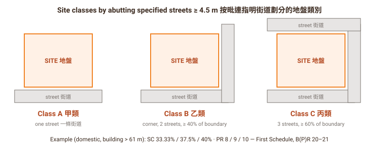
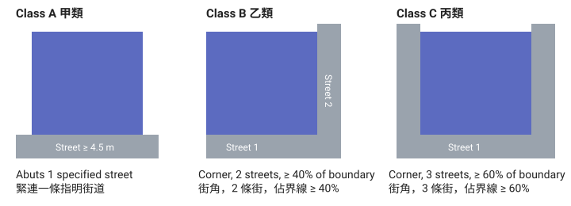

---
tags:
  - Regulation
  - B(P)R
  - Site coverage 上蓋面積
  - Plot ratio 地積比率
  - Site area & classification 地盤面積及分類
  - Domestic 住用
  - GFA 總樓面面積
  - Building height 建築物高度
  - Hotel 酒店
  - Sustainable building design 可持續建築設計
  - GFA concession 樓面面積寬免
summary: "B(P)R 18A–22: site classes A, B and C by specified streets, maximum site coverage and plot ratio from the First Schedule, and open space."
keywords: B(P)R 18A-22, site classification, 地盤級別, site coverage, 上蓋面積, plot ratio, 地積比率, First Schedule, specified street
---

# B(P)R 18A–22 Site classification, site coverage and plot ratio <small>《建築物（規劃）規例》第 18A–22 條：地盤分類、上蓋面積及地積比率</small>

!!! info "Document info 文件資料"
    | | |
    |---|---|
    | **Type 類別** | Regulation 規例: Building (Planning) Regulations, Cap. 123F 《建築物（規劃）規例》（第 123F 章） |
    | **Provisions 條文** | reg. 18A, 19, 20, 21, 22 and the First Schedule 第 18A、19、20、21、22 條及附表 1 |
    | **Official language 官方語言** | English and Chinese (equally authentic) 中英文本同等真確 |
    | **Source 原文** | [eLegislation Cap. 123F](https://www.elegislation.gov.hk/hk/cap123F) |
    | **Last checked 最後核對** | 2026-11-20 against the version on eLegislation |

## At a glance 重點摘要 {#at-a-glance}

=== "English"

    - **Site class** depends on how many **specified streets ≥ 4.5 m wide** the site abuts: **Class A** (one street), **Class B** (corner, 2 streets, ≥ 40% of boundary), **Class C** (corner, 3 streets, ≥ 60% of boundary). See reg. 18A.
    - **Maximum site coverage (SC)** and **plot ratio (PR)** come from the **First Schedule**. They depend on the **site class**, the **building height** and whether the building is **domestic or non-domestic** (regs. 20, 21).
    - The taller the building, the **lower the SC** but the **higher the PR**.
    - **Non-domestic** buildings may have **100% SC up to 15 m** above ground (podium), whatever the height (reg. 20(3)).
    - **Composite buildings** use a formula to share the PR between the domestic and non-domestic parts (reg. 21(2)).
    - **Bonus SC/PR** may be granted for **dedicating land for public passage** or **surrendering land for street widening**. The PR bonus is capped at **20%** (reg. 22).

=== "中文"

    - **地盤類別**視乎地盤緊連多少條**闊度不少於 4.5 米的指明街道**：**甲類**（一條街）、**乙類**（街角，2 條街，佔界線 ≥ 40%）、**丙類**（街角，3 條街，佔界線 ≥ 60%）。見第 18A 條。
    - **最大上蓋面積**及**最高地積比率**按**附表 1** 釐定，視乎**地盤類別**、**建築物高度**及屬**住用或非住用**建築物（第 20、21 條）。
    - 建築物越高，**上蓋面積百分率越低**，但**地積比率越高**。
    - **非住用**建築物在地面以上 **15 米**內可達 **100% 上蓋面積**（平台），不論建築物高度（第 20(3) 條）。
    - **綜合用途建築物**以公式分配住用及非住用部分的地積比率（第 21(2) 條）。
    - 如**撥地作公眾通道**或**交地擴闊街道**，可獲**額外上蓋面積／地積比率**，地積比率增幅上限為 **20%**（第 22 條）。

## Diagram 圖解 {#diagram}

<figure markdown>
  { width="760" loading=lazy }
  <figcaption>Site classes A, B and C (B(P)R 18A) with a First Schedule example. 地盤類別。 Diagram prepared for this site; check the source text for exact wording.</figcaption>
</figure>

## Key table: First Schedule 附表 1 — Percentage site coverages and plot ratios 上蓋面積百分率及地積比率 {#key-table-first-schedule-1-percentage-site-coverages-and-plot-ratios}

### Domestic buildings 住用建築物

| Height of building 建築物高度 | SC Class A 甲 (%) | SC Class B 乙 (%) | SC Class C 丙 (%) | PR Class A 甲 | PR Class B 乙 | PR Class C 丙 |
|---|--:|--:|--:|--:|--:|--:|
| ≤ 15 m 不超逾15米 | 66.6 | 75 | 80 | 3.3 | 3.75 | 4.0 |
| > 15 m, ≤ 18 m | 60 | 67 | 72 | 3.6 | 4.0 | 4.3 |
| > 18 m, ≤ 21 m | 56 | 62 | 67 | 3.9 | 4.3 | 4.7 |
| > 21 m, ≤ 24 m | 52 | 58 | 63 | 4.2 | 4.6 | 5.0 |
| > 24 m, ≤ 27 m | 49 | 55 | 59 | 4.4 | 4.9 | 5.3 |
| > 27 m, ≤ 30 m | 46 | 52 | 55 | 4.6 | 5.2 | 5.5 |
| > 30 m, ≤ 36 m | 42 | 47.5 | 50 | 5.0 | 5.7 | 6.0 |
| > 36 m, ≤ 43 m | 39 | 44 | 47 | 5.4 | 6.1 | 6.5 |
| > 43 m, ≤ 49 m | 37 | 41 | 44 | 5.9 | 6.5 | 7.0 |
| > 49 m, ≤ 55 m | 35 | 39 | 42 | 6.3 | 7.0 | 7.5 |
| > 55 m, ≤ 61 m | 34 | 38 | 41 | 6.8 | 7.6 | 8.0 |
| > 61 m 超逾61米 | 33.33 | 37.5 | 40 | 8.0 | 9.0 | 10.0 |

### Non-domestic buildings 非住用建築物

| Height of building 建築物高度 | SC Class A 甲 (%) | SC Class B 乙 (%) | SC Class C 丙 (%) | PR Class A 甲 | PR Class B 乙 | PR Class C 丙 |
|---|--:|--:|--:|--:|--:|--:|
| ≤ 15 m 不超逾15米 | 100 | 100 | 100 | 5 | 5 | 5 |
| > 15 m, ≤ 18 m | 97.5 | 97.5 | 97.5 | 5.8 | 5.8 | 5.8 |
| > 18 m, ≤ 21 m | 95 | 95 | 95 | 6.7 | 6.7 | 6.7 |
| > 21 m, ≤ 24 m | 92 | 92 | 92 | 7.4 | 7.4 | 7.4 |
| > 24 m, ≤ 27 m | 89 | 90 | 90 | 8.0 | 8.1 | 8.1 |
| > 27 m, ≤ 30 m | 85 | 87 | 88 | 8.5 | 8.7 | 8.8 |
| > 30 m, ≤ 36 m | 80 | 82.5 | 85 | 9.5 | 9.9 | 10.2 |
| > 36 m, ≤ 43 m | 75 | 77.5 | 80 | 10.5 | 10.8 | 11.2 |
| > 43 m, ≤ 49 m | 69 | 72.5 | 75 | 11.0 | 11.6 | 12.0 |
| > 49 m, ≤ 55 m | 64 | 67.5 | 70 | 11.5 | 12.1 | 12.6 |
| > 55 m, ≤ 61 m | 60 | 62.5 | 65 | 12.2 | 12.5 | 13.0 |
| > 61 m 超逾61米 | 60 | 62.5 | 65 | 15 | 15 | 15 |

<small>SC = percentage site coverage 上蓋面積百分率 (%); PR = plot ratio 地積比率. Source: Cap. 123F First Schedule, copied from eLegislation. 資料來源：第 123F 章附表 1。</small>

## Diagram: site classes 圖解：地盤類別 {#diagram-site-classes}

<figure markdown>
  { loading=lazy }
<figcaption>Simplified diagram of reg. 18A (not to scale) 第 18A 條簡圖（不按比例）</figcaption>
</figure>

## Key clauses 主要條文 {#key-clauses}

!!! quote "Reg. 18A(1) — Site classification 地盤分類"
    **class A site** means a site, not being a class B site or class C site, that abuts on one specified street not less than 4.5 m wide or on more than one such street;
    **class B site** means, subject to paragraph (2), a corner site that abuts on 2 specified streets neither of which is less than 4.5 m wide;
    **class C site** means, subject to paragraph (2), a corner site that abuts on 3 specified streets none of which is less than 4.5 m wide.

    **官方中文本：** **甲類地盤**指緊連一條闊度不少於4.5米的指明街道或緊連多於一條該類街道的、並非乙類地盤或丙類地盤的地盤。**乙類地盤**在第(2)款的規限下，指緊連2條闊度均不少於4.5米的指明街道的街角地盤；**丙類地盤**在第(2)款的規限下，指緊連3條闊度均不少於4.5米的指明街道的街角地盤。

!!! quote "Reg. 18A(2) — Corner site thresholds 街角地盤門檻"
    (a) a corner site shall not be regarded as abutting on 2 specified streets unless at least 40 per cent of the boundary of the site abuts on the streets; and
    (b) a corner site shall not be regarded as abutting on 3 specified streets unless at least 60 per cent of the boundary of the site abuts on the streets.

    **官方中文本：** (a)除非街角地盤的界線中有最少百分之四十緊連2條指明街道，否則該地盤不得視作緊連該2條指明街道；及 (b)除非街角地盤的界線中有最少百分之六十緊連3條指明街道，否則該地盤不得視作緊連該3條指明街道。

!!! quote "Reg. 19(3) — Sites that are not class A, B or C 非甲、乙、丙類地盤"
    The height of a building or buildings on a site that is not a class A site, class B site or class C site, and the maximum site coverage and maximum plot ratio permitted in respect of such a building or buildings, shall be determined by the Building Authority.

    **官方中文本：** 位於並非屬甲類地盤、乙類地盤或丙類地盤的地盤上的一幢或多於一幢的建築物的高度，以及就該幢或該等建築物而准許的最大上蓋面積及最高地積比率，均須由建築事務監督釐定。

!!! quote "Reg. 20(3) — Non-domestic podium up to 15 m 非住用平台 15 米"
    …the site coverage for a non-domestic building, or for the non-domestic part of a composite building, on a class A, B or C site may, whatever the height of the building, exceed the permitted percentage site coverage to a height not exceeding 15 m above ground level.

    **官方中文本：** ……位於甲、乙或丙類地盤上的非住用建築物或綜合用途建築物非住用部分，不論建築物的高度為何，其上蓋面積在地面水平以上不超逾15米的高度內，可超逾准許上蓋面積百分率。

!!! quote "Reg. 21(2)–(3) — Composite buildings; definition of plot ratio 綜合用途建築物；地積比率定義"
    (2) …the plot ratio for the domestic part of a composite building shall not exceed the product of the difference between the permitted plot ratio for the building if it were a non-domestic building and the actual plot ratio of the non-domestic part of the building and the permitted plot ratio for the building if it were a domestic building divided by the permitted plot ratio for the building if it were a non-domestic building.
    (3) …the plot ratio of a building shall be obtained by dividing the gross floor area of the building by the area of the site on which the building is erected.

    **官方中文本：** (2)……綜合用途建築物住用部分的地積比率不得超逾以下數字：該建築物若屬非住用建築物而會獲准許的地積比率，與該建築物非住用部分的實際地積比率之間的差距，與該建築物若屬住用建築物而會獲准許的地積比率相乘的積，再除以該建築物若屬非住用建築物而會獲准許的地積比率所得的商數。(3)……建築物的地積比率為建築物總樓面面積除以建有該建築物的地盤佔有面積所得的商數。

!!! quote "Reg. 22(1) — Bonus for dedication to public passage 撥作公眾通道的額外面積（節錄）"
    Where, between ground level and a height of not less than 5.5 m or, where the Building Authority is satisfied that there will be no obstruction to vehicular traffic using the street, 3.3 m above ground level, a building… is set back from a boundary of the lot… that abuts on a street, and, with the consent of the Government, the part of the lot that is thereby not built upon is dedicated to the public for the purposes of passage— (a) the site coverage… may exceed the permitted percentage site coverage… (b) the plot ratio… may exceed the permitted plot ratio, so, however, that the plot ratio therefor is not greater than the permitted plot ratio… by more than 20 per centum or does not exceed the sum of the permitted plot ratio… and the figure obtained by dividing the product of 5 and the area of the lot so dedicated to the public by the area of the site…, whichever is the less.

    **官方中文本（節錄）：** 位於甲、乙或丙類地盤上的任何建築物，如在地面水平至其上不少於5.5米或(如建築事務監督信納不會阻礙使用街道的車輛交通)3.3米的高度之間，自建有該建築物的地段與街道緊連的界線向後退入，而在政府同意下，該部分不興建建築物的地段撥供公眾作通道用途 —— (a)……上蓋面積可超逾准許上蓋面積百分率……(b)……地積比率可超逾准許地積比率，但其地積比率仍不得較……准許地積比率大百分之二十以上，或超逾以下總和：……准許地積比率，以及將5與如此撥供公眾的地段面積相乘的積除以建有該建築物的地盤面積所得的數字，兩者相加所得的總和，兩個比率以較小者為準。

Reg. 22(2) gives the same bonus formulas where land is **acquired by the Government for street widening**. 第 22(2) 條：政府為擴闊街道徵用土地時，適用相同公式。

## Bonus formulas (reg. 22) 額外面積公式（第 22 條） {#bonus-formulas-reg-22-22}

| | Formula 公式 |
|---|---|
| **Bonus SC** 額外上蓋面積 (% points 百分點) | **1 500 × Ad ÷ (Asite × H)** |
| **Bonus PR** 額外地積比率 | the **lesser** of **20% × permitted PR** and **5 × Ad ÷ Asite** 兩者取較小者 |

Ad = area dedicated / surrendered 撥出或交回的面積 (m²); Asite = site area 地盤面積 (m²); H = building height 建築物高度 (m).

## Explanation 淺白解釋 {#explanation}

=== "English"

    These regulations set the **"building envelope" allowed under the Buildings Ordinance**. Work it out in this order:

    1. **Classify the site.** Count the specified streets (≥ 4.5 m wide) it abuts. For a corner site, check what share of the site boundary fronts those streets: 40% for class B, 60% for class C. More frontage means more light and air, so higher SC and PR are allowed.
    2. **Decide domestic or non-domestic.** Non-domestic buildings get much higher figures. Hotels may be treated as non-domestic (reg. 23A).
    3. **Find the height band** (height measured as in reg. 23(1)) and read the SC and PR from the First Schedule.
    4. **Composite building?** Use reg. 21(2) to find how much domestic PR is left after the non-domestic part.
    5. **Bonus?** If you dedicate land at ground level for public passage or surrender it for street widening, apply reg. 22.

    Remember that these are only the **Buildings Ordinance maxima**. The **Outline Zoning Plan** and **lease conditions** often set lower limits, and the most restrictive one governs.

=== "中文"

    這些規例訂明**《建築物條例》下准許的「建築物體積」**，可按以下次序計算：

    1. **地盤分類**：數算地盤緊連多少條闊度 ≥ 4.5 米的指明街道。街角地盤須核對臨街界線所佔比例：乙類 40%、丙類 60%。臨街越多，採光及通風越好，故准許的上蓋面積及地積比率越高。
    2. **住用或非住用**：非住用建築物的數字高得多。酒店可被視為非住用（第 23A 條）。
    3. **找出高度級別**（高度按第 23(1) 條量度），從附表 1 讀出上蓋面積及地積比率。
    4. **綜合用途建築物？** 用第 21(2) 條計算非住用部分用去後，住用部分尚餘的地積比率。
    5. **額外面積？** 如在地面撥地作公眾通道或交地擴闊街道，按第 22 條計算。

    請記住，這些只是**《建築物條例》下的上限**。**分區計劃大綱圖**及**地契條款**往往限制更嚴，須以最嚴格者為準。

## Practical notes 實務提示 {#practical-notes}

=== "English"

    !!! example "Worked example 1: domestic tower"
        Class A site, **1,000 m²**, domestic building **over 61 m** high.

        - Max SC = **33.33%** → 333.3 m² per floor (above any podium)
        - Max PR = **8.0** → max GFA = 8 × 1,000 = **8,000 m²**

    !!! example "Worked example 2: composite building, reg. 21(2)"
        Class A site, building over 61 m. Permitted PR: domestic **8**, non-domestic **15**.
        The non-domestic podium uses an actual PR of **3**.

        Domestic PR ≤ (15 − 3) × 8 ÷ 15 = **6.4**

        Total PR = 3 + 6.4 = 9.4. Every unit of non-domestic PR "costs" 8/15 of a unit of domestic PR.

    !!! example "Worked example 3: bonus for dedication, reg. 22(1)"
        Site 1,000 m², permitted PR 8, building height 100 m, **50 m²** dedicated for public passage.

        - 5 × 50 ÷ 1,000 = 0.25; 20% × 8 = 1.6 → bonus PR = **0.25** (the lesser) → PR **8.25**
        - Bonus SC = 1,500 × 50 ÷ (1,000 × 100) = **0.75** percentage points

    !!! tip "Common pitfalls"
        - A **corner site** below the 40% / 60% frontage threshold is treated as class A.
        - The street must be a **specified street** (reg. 18A(3)): government street, lease street, right-of-way, etc. Width must be **≥ 4.5 m**.
        - **Site area excludes streets and service lanes** but **includes** areas dedicated for public passage (reg. 23(2)).
        - The **non-domestic 100% SC** only goes up to **15 m**. Above that, the normal SC applies.

=== "中文"

    !!! example "計算例子 1：住宅大廈"
        甲類地盤，面積 **1,000 平方米**，住用建築物高度**超逾 61 米**。

        - 最大上蓋面積 = **33.33%** → 每層 333.3 平方米（平台以上）
        - 最高地積比率 = **8.0** → 最大總樓面面積 = 8 × 1,000 = **8,000 平方米**

    !!! example "計算例子 2：綜合用途建築物（第 21(2) 條）"
        甲類地盤，建築物高度超逾 61 米。准許地積比率：住用 **8**、非住用 **15**。
        非住用平台的實際地積比率為 **3**。

        住用地積比率 ≤ (15 − 3) × 8 ÷ 15 = **6.4**

        總地積比率 = 3 + 6.4 = 9.4。每用 1 個單位非住用地積比率，便「扣減」8/15 個單位住用地積比率。

    !!! example "計算例子 3：撥地作公眾通道（第 22(1) 條）"
        地盤 1,000 平方米，准許地積比率 8，建築物高 100 米，撥出 **50 平方米**作公眾通道。

        - 5 × 50 ÷ 1,000 = 0.25；20% × 8 = 1.6 → 額外地積比率 = **0.25**（取較小者）→ 地積比率 **8.25**
        - 額外上蓋面積 = 1,500 × 50 ÷ (1,000 × 100) = **0.75** 個百分點

    !!! tip "常見錯誤"
        - **街角地盤**臨街界線未達 40%／60% 門檻，只會被視為甲類地盤。
        - 街道必須屬**指明街道**（第 18A(3) 條），例如政府街道、地契街道、通行權街道等，闊度須 **≥ 4.5 米**。
        - **地盤面積不包括街道及通道巷**，但**包括**撥作公眾通道的面積（第 23(2) 條）。
        - **非住用 100% 上蓋面積**只適用於 **15 米**以下，15 米以上須按一般上蓋面積計算。

<!-- APSEC START -->
## APSEC clarifications 認可人士及註冊結構工程師委員會討論 {#apsec-clarifications}

BD's responses at the APSEC Discussion Forum that clarify this document, **newest first**. Where the same question came up more than once, only the **latest position** is listed. See [all APSEC items](../apsec/index.md). 屋宇署在討論會上就本文件作出的澄清，新者在前；同一問題只列最新立場。

- **[Site Coverage Flexibility under PNAP APP-132 – Minor Projecting Features](../apsec/2023.md#i202311172)** <small>ADF 4/2023, 17 Nov 2023</small> BD advised that according to footnote 3 of PNAP APP-132, the projections under PNAP APP-19 was excluded from the calculation of the total covered area of the buildings on the site for the purpose of determining whether …
- **[Future Road / Street in New Development Areas (NDA)](../apsec/2022.md#i2022031821)** <small>ADF 2/2022, 18 Mar 2022</small> Members welcomed the pragmatic approaches. As regards whether similar guidelines and approaches would be set out for open spaces and pedestrian walkways required under lease of NDAs and also served as EVA or for the …
- **[Application for Consent to Commence Superstructure Works involving Bonus PR/SC for Dedication/Surrender of Land under B(P)R 22](../apsec/2021.md#i2021031919)** <small>ADF 2/2021, 19 Mar 2021</small> BD advised that AAP’s understanding was correct.

<!-- APSEC END -->

<!-- CL START -->
## Related circular letters 相關通告函件 {#circular-letters}

- 🟢 [Application for Approval of General Building Plans Proof of Realistic Prospect of Control of the Land Forming a Site](../circulars/2021.md#cl-aagbpprpclfs-2021) <small>27 Sep 2021 · 建築圖則審批申請有實際機會控制組成地盤的土地的證明文件</small>
<!-- CL END -->

## Related 相關文件 {#related}

| Document 文件 | Relationship 關係 |
|---|---|
| [B(P)R 23 & 23A — GFA, height and hotels 總樓面面積、高度及酒店](bpr-23-23a.md) | Definitions used here 本頁所用定義 |
| [APP-151](../pnap/app-151.md) | GFA concessions and 10% cap 總樓面面積寬免及 10% 上限 |
| [APP-152](../pnap/app-152.md) | Setback / surrender for SBD 可持續建築設計的後移 |
| APP-108 | Bonus GFA for dedication 撥地的額外總樓面面積 |
| B(P)R 25 & Second Schedule | Open space about domestic buildings 住用建築物周圍的空地 |

---
<small>Prepared by: _[name]_ · Checked by: _[name]_ · Quotes from eLegislation; refer to the official text for the definitive wording.</small>
