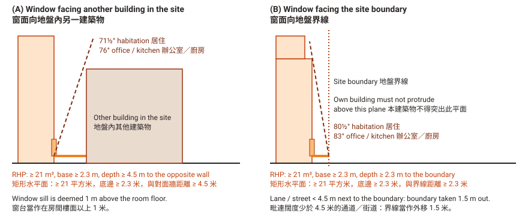

---
tags:
  - Regulation
  - B(P)R
  - Storey height 層高
  - Open space 休憩用地
  - Lighting & ventilation 照明及通風
  - Prescribed window 訂明的窗
  - Domestic 住用
  - Balcony & utility platform 露台及工作平台
  - Hotel 酒店
  - Sustainable building design 可持續建築設計
---

# B(P)R 24–37 Storey heights, open space, lanes, telecom access, lighting and ventilation <small>《建築物（規劃）規例》第 24–37 條：樓層高度、空地、通道、電訊接達設施、照明與通風</small>

!!! info "Document info 文件資料"
    | | |
    |---|---|
    | **Type 類別** | Regulation 規例: Building (Planning) Regulations, Cap. 123F 《建築物（規劃）規例》（第 123F 章） |
    | **Provisions 條文** | Part III regs. 24–28, Part IIIA reg. 28A, Part IV regs. 29–37, Second Schedule 第 III 部第 24–28 條、第 IIIA 部第 28A 條、第 IV 部第 29–37 條、附表 2 |
    | **Official language 官方語言** | English and Chinese (equally authentic) 中英文本同等真確 |
    | **Source 原文** | [eLegislation Cap. 123F](https://www.elegislation.gov.hk/hk/cap123F) |
    | **Last checked 最後核對** | 2026-11-20 against the version on eLegislation |

## At a glance 重點摘要

=== "English"

    - **Reg. 24**: rooms for habitation or offices are at least **2.5 m** floor to ceiling, **2.3 m** under beams; sloping ceilings are measured at the mean height, and no part may be under **2 m**. (Maximum heights for GFA purposes are in [APP-5](../pnap/app-5.md).)
    - **Reg. 25 + Second Schedule**: domestic buildings need **open space at the rear** (or rear and side): **½** of the roofed-over area on a Class A site, **⅓** on Class B, **¼** on Class C. No part of a domestic building within **1.5 m** of the rear boundary.
    - **Reg. 26**: on an existing street **< 4.5 m** wide, a new building must be at least **2.25 m** from the street centre line. **Reg. 27**: keep a clear space of **¼ of the cutting height, min. 2.5 m**, from the toe of a cutting. **Reg. 28**: domestic buildings need a **service lane** at the rear or side, unless exempt.
    - **Reg. 28A**: commercial, industrial, residential (other than single-family) and hotel buildings need **telecom and broadcasting access facilities** ([APP-84](../pnap/app-84.md)).
    - **Regs. 29–33**: rooms for habitation, offices and kitchens need **natural light and ventilation** through a **prescribed window**: glass ≥ **1/10** of floor area, openable ≥ **1/16**, with the top of the opening ≥ **2 m** above floor. It must face a street ≥ **4.5 m** wide or a clear **rectangular horizontal plane** (≥ **21 m²**), with obstruction angles **71½° / 76°** and **80½° / 83°**. No part of a habitable room more than **9 m** from the window.
    - **Reg. 34**: offices that cannot meet reg. 31 may use **mechanical ventilation (≥ 5 air changes / hour)** and approved artificial light. **Reg. 36**: rooms with a WC or urinal need a window with glass ≥ 1/10 and opening ≥ 1/10 of the floor area, and must not open directly into food rooms. **Reg. 37**: do not reduce the light and air of other buildings below the B(P)R standard.

=== "中文"

    - **第 24 條**：居住或辦公室房間由樓面至天花最少 **2.5 米**，至樑底最少 **2.3 米**；斜天花按平均高度量度，任何部分不得低於 **2 米**。（計算總樓面面積的最高層高見 [APP-5](../pnap/app-5.md)。）
    - **第 25 條及附表 2**：住用建築物須在**後面**（或後面及側面）設空地：甲類地盤為有蓋面積的 **½**，乙類 **⅓**，丙類 **¼**；住用建築物任何部分不得建於後界線 **1.5 米**範圍內。
    - **第 26 條**：位於闊度**少於 4.5 米**現有街道的新建築物，須距街道中心線最少 **2.25 米**。**第 27 條**：與路塹腳之間須留有**路塹高度 ¼（最少 2.5 米）**的空間。**第 28 條**：住用建築物須在後面或側面設**通道**（除非獲豁免）。
    - **第 28A 條**：商業、工業、住宅（單一家庭住宅除外）及旅館建築物須設**電訊及廣播接達設施**（[APP-84](../pnap/app-84.md)）。
    - **第 29–33 條**：居住房間、辦公室及廚房須以**訂明的窗**提供**天然照明與通風**：玻璃 ≥ 樓面面積 **1/10**，可開啟 ≥ **1/16**，開口頂部在樓面以上 ≥ **2 米**；須面向闊 ≥ **4.5 米**的街道或無遮擋的**矩形水平面**（≥ **21 平方米**），並符合 **71½°／76°** 及 **80½°／83°** 的傾斜面；居住房間任何部分距窗不得多於 **9 米**。
    - **第 34 條**：未能符合第 31 條的辦公室可用**機械通風（每小時換氣 ≥ 5 次）**及經批准的人工照明。**第 36 條**：設有水廁或尿廁的房間須有窗，玻璃及可開啟面積各 ≥ 樓面面積 1/10，且不得直接通往處理食物的房間。**第 37 條**：不得使其他建築物的光線及空氣減至低於本規例的標準。

## Regulation by regulation 逐條摘要

| Reg. 條 | Title 標題 | Summary 摘要 |
|---|---|---|
| 24 | Height of storeys 樓層高度 | Office / habitation rooms ≥ **2.5 m** floor to ceiling, ≥ **2.3 m** to underside of beams; sloping ceiling: mean height, nowhere < **2 m**. 2.5 米；樑底 2.3 米；斜天花任何部分 ≥ 2 米。 |
| 25 | Space about domestic buildings 住用建築物周圍的空地 | Rear (or rear + side) open space per **Second Schedule**, at ≤ 150 mm below the lowest floor; building ≥ **1.5 m** from the open space's far boundary and from the rear boundary; A&A must not reduce existing open space below the requirement; guarding where a level drop > **600 mm**; access to every open space. 後面空地；距後界線 ≥ 1.5 米。 |
| 26 | Set back on streets < 4.5 m 窄街後移 | New building ≥ **2.25 m** from the centre line of an existing street < 4.5 m wide. 距中心線 ≥ 2.25 米。 |
| 27 | Cuttings 路塹 | No building abutting a cutting; clear space ≥ **¼ of the cutting height**, min. **2.5 m**; height measured with a **30°** line from the top. 空間 ≥ 路塹高度 ¼，最少 2.5 米。 |
| 28 | Service lanes 通道 | Domestic buildings need a rear / side service lane, except where a lane ≥ **3 m** or a street exists, for detached / semi-detached buildings, or if exempted; BA fixes alignment, width and levels. 住用建築物須設後巷。 |
| 28A | Access facilities for telecommunications and broadcasting 電訊及廣播接達設施 | Required in commercial, industrial, residential (not single-family) and hotel buildings to BA's design requirements. 須按建築事務監督的設計規定提供。 |
| 29 | Lighting and ventilation 照明與通風 | Every office / habitation storey needs effectual lighting and ventilation. 須有有效的照明與通風。 |
| 30 | Rooms for habitation, office or kitchen 居住、辦公室或廚房房間 | Natural light and ventilation by windows: glass ≥ **1/10** floor area; openable ≥ **1/16**, top of opening ≥ **2 m** above floor (**1.9 m** for detached / semi-detached); the **prescribed window** faces directly into the external air. 玻璃 ≥ 1/10；可開啟 ≥ 1/16。 |
| 31 | Minimum requirements of window 對窗的起碼規定 | Window faces a street ≥ **4.5 m**, or a clear **rectangular horizontal plane** (≥ **21 m²**, base ≥ **2.3 m**, depth ≥ **4.5 m** to an opposite wall or ≥ **2.3 m** to the boundary) with inclined planes not obstructed (see diagram); sill deemed **1 m** above floor. 矩形水平面及傾斜面（見圖）。 |
| 32 | Distance from prescribed window 與訂明的窗的距離 | No part of a habitable room more than **9 m** from the prescribed window (or from the outer edge of a verandah / balcony it opens onto). 居住房間任何部分距窗 ≤ 9 米。 |
| 33 | Windows opening on to enclosed verandah, etc. 向圍封外廊等開啟的窗 | Allowed if the verandah / balcony / conservatory window meets regs. 30–31 for the **combined floor area**, and the inner window meets reg. 30(2)(a) on the same basis. 以合併面積計算。 |
| 34 | Mechanical ventilation and artificial lighting of offices 辦公室的機械通風與人工照明 | Where reg. 31 cannot be met: mechanical ventilation ≥ **5 air changes / hour** and approved artificial lighting. 每小時換氣 ≥ 5 次。 |
| 35 | Additional vent may be required 可規定加設通風口 | BA may require an extra vent: aperture / airshaft ≥ **0.015 m²**, fanlight to a ventilated lobby, or other approved means. Laundries count as habitation. 通風口 ≥ 0.015 平方米。 |
| 35A | Room-sealed gas water heater 密封式氣體熱水爐 | Every bathroom needs provision (an external wall aperture with a removable cover) for a room-sealed gas water heater, unless plans approved by 20 May 1983 or central hot water is provided. 浴室須預留熱水爐開口。 |
| 36 | Rooms containing soil fitments 內有便溺污水設備的房間 | Window or lantern light: glass ≥ **1/10**, opening ≥ **1/10** of floor area directly to open air; top of opening ≥ **2 m**; must not open directly into food rooms or a PPE auditorium / waiting space. 玻璃及開啟面積各 ≥ 1/10。 |
| 37 | Light and air not to be diminished 光線及空氣不得減少 | A new building must not reduce another compliant building's light and air below the B(P)R requirements. 不得減少其他建築物的光線及空氣。 |

## Key table: Second Schedule — open space about domestic buildings 附表 2：住用建築物周圍的空地

| Class of site 地盤類別 | Open space required 規定空地 |
|---|---|
| **Class A** 甲類 | Not less than **one-half** of the roofed-over area of the building 不少於建築物有蓋面積的**二分之一** |
| **Class B** 乙類 | Not less than **one-third** of the roofed-over area 不少於有蓋面積的**三分之一** |
| **Class C** 丙類 | Not less than **one-quarter** of the roofed-over area 不少於有蓋面積的**四分之一** |

<small>Site classes are defined in [reg. 18A](bpr-18a-22.md). For flexibility on SC and open space see [APP-132](../pnap/app-132.md). 地盤類別見第 18A 條。</small>

## Key table: prescribed window (regs. 30–32) 訂明的窗

| Requirement 規定 | Habitation 居住 | Office / kitchen 辦公室／廚房 |
|---|---|---|
| Glass area 玻璃面積 | ≥ **1/10** of floor area | ≥ **1/10** of floor area |
| Openable area 可開啟面積 | ≥ **1/16** of floor area, top of opening ≥ **2 m** (1.9 m detached / semi-detached) | Same 同上 |
| Faces 面向 | Street ≥ **4.5 m** wide, or a rectangular horizontal plane ≥ **21 m²** (base ≥ **2.3 m**) 街道或矩形水平面 | Same 同上 |
| Inclined plane over the RHP (other buildings in the site) 矩形水平面上的傾斜面 | **71½°** | **76°** |
| Inclined plane from the boundary (own building) 由界線起計的傾斜面 | **80½°** | **83°** |
| Max. distance in room 房間內最大距離 | **9 m** (reg. 32) | — (office: mechanical ventilation alternative, reg. 34) |

<figure markdown>
  { loading=lazy }
  <figcaption>Reg. 31, simplified section (not to scale, prepared for this site). (A) obstruction by other buildings in the site; (B) the building's own face near a boundary. 第 31 條簡化剖面（非按比例，本網站繪製）。</figcaption>
</figure>

## Key clauses 主要條文

!!! quote "Reg. 24(1) — Height of storeys 樓層高度"
    Every room used or intended to be used for the purpose of an office or for habitation in any building shall have a height of not less than 2.5 m measured from floor to ceiling: Provided that there shall be not less than 2.3 m measured from the floor to the underside of any beam.

    **官方中文本：** 任何建築物內每個用作或擬用作辦公室或居住用途的房間，由樓面量度至天花板的高度須不少於2.5米：但由樓面量度至任何梁的底面的高度須不少於2.3米。

!!! quote "Reg. 30(2) — Prescribed window 訂明的窗"
    Such natural lighting and ventilation shall be provided by means of one or more windows which shall be— (a) so constructed that— (i) the aggregate superficial area of glass in the window or windows is not less than one-tenth of the area of the floor of the room; and (ii) the windows can, to an extent at least equal in the aggregate to one-sixteenth of the area of the floor of the room, be opened in such manner that the top of the opening of each window is at least 2 m above the level of the floor or, in the case of detached and semi-detached buildings, at least 1.9 m above the level of the floor; and (b) such that not less than the area required by subparagraph (a)(i) (hereinafter referred to as the prescribed window) faces directly into the external air.

    **官方中文本：** 該等天然照明與通風須藉一扇或多於一扇符合以下規定的窗而提供 —— (a) 窗的建造須使 —— (i) 窗玻璃的表面總面積不少於房間樓面面積的十分之一；及 (ii) 該等窗總共最少有相等於房間樓面面積的十六分之一的面積能開啟，而開啟方式須使每扇窗的開口的頂部在樓面水平之上最少2米，如屬獨立和半獨立建築物，則在樓面水平之上最少1.9米；及 (b) 有不少於(a)(i)段所規定的面積(以下稱為訂明的窗)直接面對室外。

!!! quote "Reg. 32 — 9 m rule 9 米規定"
    No part of any room used for habitation shall be more than 9 m, measured within the room, from a prescribed window which faces directly into the external air …

    **官方中文本：** 任何用作居住用途的房間的任何部分，距離直接面對室外的訂明的窗，在房間內量度，不得多於9米……

## Explanation 淺白解釋

=== "English"

    These rules are the core **health** standards of the B(P)R: enough **headroom**, **daylight**, **fresh air** and **space around homes**.

    - The **prescribed window** test is a geometric check. Imagine a clear "yard" outside the window (the rectangular horizontal plane). Then check that nothing in the site rises above a steep imaginary plane (71½° for homes), and that your own building does not crowd the boundary (80½°). Streets of 4.5 m or more pass automatically.
    - The **9 m rule** limits deep rooms: daylight does not reach far into a room.
    - Today many designs use the **performance-based approach** for lighting and ventilation (PNAP APP-130), which can replace the prescriptive regs. 30–31.
    - **Open space and service lanes** (regs. 25, 28) reflect older street-block planning. They still apply to domestic buildings unless modified or exempted.

=== "中文"

    這些規定是本規例的核心**衞生**標準：足夠的**淨高**、**日光**、**新鮮空氣**及**住宅周圍的空間**。

    - **訂明的窗**是幾何測試：想像窗外有一塊無遮擋的「空地」（矩形水平面），然後檢查地盤內沒有東西高於一個陡峭的假想平面（居住為 71½°），以及本身建築物沒有太接近界線（80½°）。面向 4.5 米或以上的街道則自動符合。
    - **9 米規定**限制房間深度，因為日光照不到房間深處。
    - 現時很多設計採用照明及通風的**以表現為本方法**（作業備考 APP-130），可代替第 30–31 條的訂明規定。
    - **空地及後巷**（第 25、28 條）反映較舊的街區規劃，除非獲修改或豁免，仍適用於住用建築物。

## Practical notes 實務提示

=== "English"

    !!! tip "Common pitfalls"
        - Counting **fixed glass only** and forgetting the **1/16 openable** area, or openings whose top is below **2 m**.
        - A bay window or balcony **above** the prescribed window that cuts the 71½° plane.
        - Bedrooms in deep flats more than **9 m** from the window (common with enclosed balconies, reg. 33).
        - Toilets with mechanical ventilation only, without a reg. 36 window, and no modification granted.
        - Forgetting the **rear open space** and **1.5 m rear setback** for domestic buildings (reg. 25).
        - Forgetting the **2.25 m from centre line** setback on narrow streets (reg. 26).

=== "中文"

    !!! tip "常見錯誤"
        - 只計算**固定玻璃**而忘記 **1/16 可開啟**面積，或開口頂部低於 **2 米**。
        - 訂明的窗**上方**的窗台或露台切過 71½° 平面。
        - 深單位的睡房距窗多於 **9 米**（常見於圍封露台，第 33 條）。
        - 洗手間只有機械通風而沒有第 36 條的窗，又沒有申請修改。
        - 住用建築物忘記**後面空地**及**後界線 1.5 米**的規定（第 25 條）。
        - 窄街忘記**距中心線 2.25 米**的後移（第 26 條）。

<!-- APSEC START -->
## APSEC clarifications 認可人士及註冊結構工程師委員會討論 {#apsec-clarifications}

BD's responses at the APSEC Discussion Forum that clarify this document, **newest first**. Where the same question came up more than once, only the **latest position** is listed. See [all APSEC items](../apsec/index.md). 屋宇署在討論會上就本文件作出的澄清，新者在前；同一問題只列最新立場。

- **[Hostels in the City Scheme – Provision of Access Facilities Telecommunications and Broadcasting Services](../apsec/2026.md#i2026050813)** <small>ADF 2/2026, 8 May 2026</small> for BD advised that student hostel was a specified building where access facilities for telecommunications and broadcasting services should be provided under regulation 28A of the B(P)R. …
- **[TBE Room for Buildings other than the Specified Building in Regulation 28A of the B(P)R](../apsec/2025.md#i2025080813)** <small>ADF 3/2025, 8 Aug 2025</small> BD advised that TBE rooms proposed in other types of buildings covered by the said Code (e.g. hospital, universities, etc.) were not considered as essential plant rooms under the B(P)R and hence the concerned areas should be included in GFA calculations. …
- **[Rooms Containing Soil Fitments – Regulation 36(2) of the B(P)R](../apsec/2025.md#i202508086)** <small>ADF 3/2025, 8 Aug 2025</small> BD advised that the concerned modification of regulation 36 of the B(P)R could be applied to either the lighting or ventilation requirement.
- **[Mechanical Ventilation in Kiosks or Guard Rooms](../apsec/2025.md#i202505094)** <small>ADF 2/2025, 9 May 2025</small> BD advised that whenever AP submitted a Form BA16 treating kiosks or guard rooms as ancillary offices and applying for modification of regulation 30 of the Building (Planning) Regulations (B(P)R), BD would favourably consider such applications and impose relevant mechanical ventilation and lighting requirements specified in …
- **[Prescribed Window facing Street with Overhanging Building Structure](../apsec/2025.md#i202502147)** <small>ADF 1/2025, 14 Feb 2025</small> BD advised that according to regulation 30(2)(b) of the B(P)R, prescribed windows were required to face directly into external air. In this regard, BD would consider the scenario put forward by HKIA on case basis, in particular the depth of the overhanging structure and its obstruction to the provision of natural lighting and …
- **[Provision of Telecommunications and Broadcasting (TBE) Room in Existing Shopping Arcade](../apsec/2024.md#i202405031)** <small>ADF 2/2024, 3 May 2024</small> For existing buildings without the provision of TBE room in the original approved design, BD advised that unless the proposed A&A works would result in a new building where not less than one half measured by volume was rebuilt or the building was altered to such an extent as to necessitate the reconstruction of not less than …
- **[Lighting and Ventilation of Rooms used as Office – Regulation 30 of the B(P)R](../apsec/2023.md#i2023111718)** <small>ADF 4/2023, 17 Nov 2023</small> BD advised that the simplified assessment method on natural ventilation requirement stipulated in PNAP APP-130 was not applicable to office. Meanwhile, the applicability of the said PNAP was under review.
- **[Provision of Open Space](../apsec/2023.md#i2023050510)** <small>ADF 2/2023, 5 May 2023</small> BD advised that pursuant to regulation 25(1) of the B(P)R, open space for a domestic building should be provided at the rear, or partly at the rear and partly at the side, at a level of not less than 150 mm below the floor of the lowermost storey. …

??? note "10 more APSEC items 更多項目"

    - **[Ventilation Requirement for Open Kitchen under Performance-based Approach](../apsec/2021.md#i2021111214)** <small>ADF 5/2021, 12 Nov 2021</small> BD advised that paragraph 4.1 of Appendix A to PNAP APP-130 referred to a room used for habitation or as a kitchen on the performance standard of ventilation. It was not referring to open kitchen design. …
    - **[Requirements on Fresh Air Intake of Mechanical Ventilation System](../apsec/2021.md#i2021081313)** <small>ADF 4/2021, 13 Aug 2021</small> BD advised that in granting of modification on B(P)R 30 in relation to kitchens in licensed premises, relevant conditions as specified in Annexes 1 and 2 of PNAP ADM-2 would be imposed including: (i) Provision of mechanical ventilation at a rate of not less than 20 ACH; and (ii) Fresh air intake complying the requirements set …
    - **[Top-Hung Openable Window](../apsec/2021.md#i202105213)** <small>ADF 3/2021, 21 May 2021</small> BD advised that following the responses to item 23 of ADF 5/2019 held on 22 November 2019 and item 15 of ADF 1/2020 held on 10 January 2020, the openable window area should be calculated based on the elevation area of such window if the openable extent of the window was not less than 600 mm, and the area obstructed by the …
    - **[Height of Balustrade for Balcony & Utility Platform (UP)](../apsec/2021.md#i2021031918)** <small>ADF 2/2021, 19 Mar 2021</small> For (1), BD advised that AAP’s understanding was correct. B(P)R 31(1)(a) referred. For (2) and (3), BD advised that AAP’s understanding was correct. The deemed level of sill as stipulated under B(P)R 31(3)(b) was for the purpose of assessing RHP mentioned in B(P)R 31(1)(b). …
    - **[PNAP APP-130](../apsec/2021.md#i202103195)** <small>ADF 2/2021, 19 Mar 2021</small> BD advised that HKIA’s understanding was correct.
    - **[Service Lane](../apsec/2021.md#i202103192)** <small>ADF 2/2021, 19 Mar 2021</small> BD advised that as per B(P)R 28, 1.5m service lane should be provided within the site of the building. The proposed setback of only 1.2m from the site boundary was considered not acceptable. <small>Latest position; replaces earlier discussion on [26 Nov 2020](../apsec/2020.md#i2020112615) 以此為最新立場</small>
    - **[Lighting & Ventilation – B(P)R 30 & 31](../apsec/2020.md#i2020052916)** <small>ADF 2/2020, 29 May 2020</small> AAP raised that there was still misinterpretation on the post-meeting notes for item 2 of ADF 5/2017. In this regard, BD reaffirmed that the deemed-to-be level of window sill as stipulated under B(P)R 31(3)(b) was solely for the purpose of assessing the rectangular horizontal plan as mentioned in B(P)R 31(1)(b). …
    - **[Minimum Requirements of Window – B(P)R 31](../apsec/2020.md#i2020052915)** <small>ADF 2/2020, 29 May 2020</small> BD advised that the scenario is acceptable provided that the space above the rectangular horizontal plane measuring 2.3m x 9.2m is uncovered and unobstructed and no part of any building protrudes above the inclined plane according to B(P)R 31(1)(b) & (c). 11
    - **[Provision of Reduced Size Light Well to Enhance Natural Ventilation](../apsec/2018.md#i2018011912)** <small>ADF 1/2018, 19 Jan 2018</small> BD advised that CFD analysis indicated that ventilation performance of reduced size light well (1:18) with bottom opened would be generally better than the standard size light well (1:6). …
    - **[Lighting and Ventilation – B(P)R 30 and 31](../apsec/2017.md#i201711172)** <small>ADF 5/2017, 17 Nov 2017</small> BD advised that B(P)R 31(3)(b) regarding sill level of a prescribed window should also be applicable to B(P)R 31(1)(a). In other words, the requirement of just counting the portion of glazing area at 1m A.F.F.L. …

<!-- APSEC END -->

## Related 相關文件

| Document 文件 | Relationship 關係 |
|---|---|
| [APP-5](../pnap/app-5.md) | Storey heights (min. and max.) 樓層高度 |
| [B(P)R 18A–22](bpr-18a-22.md) | Site classes used by the Second Schedule 地盤類別 |
| [APP-84](../pnap/app-84.md) | Telecom and broadcasting access facilities (reg. 28A) 電訊設施 |
| [APP-132](../pnap/app-132.md) | SC and open space flexibility 上蓋面積及空地 |
| [B(P)R Part X](bpr-71-73.md) | Reg. 71: windows facing unenclosed verandahs 第 71 條 |
| PNAP APP-130 | Lighting and ventilation: performance-based approach 照明及通風以表現為本方法 |

---
<small>Prepared by: _[name]_ · Checked by: _[name]_ · Quotes from the official English and Chinese texts on eLegislation. The reg. 31 diagram is a simplified illustration.</small>
