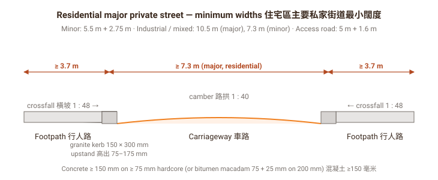

---
tags:
  - Regulation
  - Private street 私家街道
  - Access road 通路
  - Street works 街道工程
  - Domestic 住用
  - Site area & classification 地盤面積及分類
  - Site supervision 地盤監督
---

# Cap. 123G Building (Private Streets and Access Roads) Regulations <small>《建築物（私家街道及通路）規例》（第 123G 章）</small>

!!! info "Document info 文件資料"
    | | |
    |---|---|
    | **Type 類別** | Regulation 規例: Cap. 123G 《建築物（私家街道及通路）規例》（第 123G 章） |
    | **Provisions 條文** | Regs. 1–28 第 1–28 條 |
    | **In force 生效** | 1 January 1960 |
    | **Official language 官方語言** | English and Chinese (equally authentic) 中英文本同等真確 |
    | **Source 原文** | [eLegislation Cap. 123G](https://www.elegislation.gov.hk/hk/cap123G) |
    | **Last checked 最後核對** | 2026-11-21 against the version on eLegislation (version date 09/09/2021) |

## At a glance 重點摘要 {#at-a-glance}

=== "English"

    - Definitions (reg. 2): **private street**, **cul-de-sac** (closed at one end), **access road**, **pedestrian way**, **footpath**, **carriageway**; areas are **residential**, **industrial** or **mixed usage**, as BA determines (reg. 5(2)).
    - Every new street, cul-de-sac and access road must connect to an existing or new street (reg. 3); footpaths on **both sides** of streets and cul-de-sacs, **at least one side** of access roads (reg. 4).
    - **Widths** (regs. 5–7): see table. A cul-de-sac **> 120 m** long is treated as a private street. **Access roads** need a 5 m carriageway and 1.6 m footpath, reducible to **2.75 m / 1.5 m** for ≤ **12 buildings or 24 flats**, ≤ **3 500 m²** total floor area and **passing places every ≤ 60 m**. Pedestrian ways **≥ 3.5 m**, protected from vehicles.
    - **Geometry** (regs. 8–15): kerb radius ≥ footpath width; **right-angle junctions** continuing **30 m** (streets) or **7.5 m** (access roads); gradient **≤ 1:6**, and **≤ 1:30** for the first 30 m / 7.5 m; horizontal curves **≥ 30 m** radius (access roads 9 m); **40 m** sight distance on vertical curves; turning space at dead ends.
    - **Construction** (regs. 16–25): carriageway **150 mm concrete on 75 mm hardcore**, or 75 mm + 25 mm bitumen macadam on 200 mm hardcore; granite kerbs **150 × 300 × ≥ 750 mm**, kerb upstand **75–175 mm**; camber **1:40**, footpath crossfall **1:48**; drainage for **150 mm/h** rainfall (100 mm/h if concentration time ≥ 30 min); channels **≥ 300 mm wide**, fall ≥ 1:100.
    - Works in a **public street** are done by the **BA at the owner's cost** (reg. 26); BA may **waive** junction, gradient, curve and sight-line rules where impracticable (reg. 27), or surfacing rules on test results (reg. 28).

=== "中文"

    - 定義（第 2 條）：**私家街道**、**盡頭路**（一端封閉）、**通路**、**行人徑**、**行人路**、**車路**；地區分為**住宅區**、**工業區**或**混合用途區**，由建築事務監督決定（第 5(2) 條）。
    - 所有新街道、盡頭路及通路須接駁現有或新街道（第 3 條）；街道及盡頭路**兩旁**須設行人路，通路**最少一旁**（第 4 條）。
    - **闊度**（第 5–7 條）見下表；長度 **> 120 米**的盡頭路視為私家街道；**通路**車路 5 米、行人路 1.6 米，如服務 ≤ **12 幢建築物或 24 個單位**、總樓面面積 ≤ **3 500 平方米**並**每 ≤ 60 米設讓車處**，可減至 **2.75 米／1.5 米**；行人徑 **≥ 3.5 米**並防止車輛駛入。
    - **幾何設計**（第 8–15 條）：路緣半徑 ≥ 行人路闊度；**直角交界**並延續 **30 米**（街道）或 **7.5 米**（通路）；坡度 **≤ 1:6**，交界首 30 米／7.5 米 **≤ 1:30**；水平彎道半徑 **≥ 30 米**（通路 9 米）；豎曲線視距 **40 米**；盡頭須有迴旋處。
    - **建造**（第 16–25 條）：車路 **150 毫米混凝土鋪於 75 毫米碎石**上，或 75 + 25 毫米瀝青碎石鋪於 200 毫米碎石上；花崗岩路緣石 **150 × 300 × ≥ 750 毫米**，高出水溝 **75–175 毫米**；路拱 **1:40**、行人路橫坡 **1:48**；排水按 **每小時 150 毫米**雨量設計（集流時間 ≥ 30 分鐘則 100 毫米）；水溝 **≥ 300 毫米闊**，縱坡 ≥ 1:100。
    - **公眾街道**內的工程由**建築事務監督進行並向業主收費**（第 26 條）；如不切實可行，可**豁免**交界、坡度、彎道及視距規定（第 27 條），或按測試結果豁免路面規定（第 28 條）。

## Key table: minimum widths 最小闊度 {#key-table-minimum-widths}

| Street type 類別 | Area 地區 | Carriageway 車路 | Footpath (each side) 行人路 |
|---|---|---|---|
| Major private street 主要私家街道 | Residential 住宅區 | **7.3 m** | **3.7 m** |
| Minor private street 次要私家街道 | Residential 住宅區 | **5.5 m** | **2.75 m** |
| Cul-de-sac 盡頭路 | Residential 住宅區 | **5 m** | **2.75 m** |
| Major private street 主要私家街道 | Industrial / mixed 工業／混合 | **10.5 m** | **3.7 m** |
| Minor private street 次要私家街道 | Industrial / mixed 工業／混合 | **7.3 m** | **2.75 m** |
| Cul-de-sac 盡頭路 | Industrial / mixed 工業／混合 | **7.3 m** | **2.75 m** |
| Access road 通路 | Any 任何 | **5 m** (2.75 m if small) | **1.6 m** (1.5 m), one side |
| Pedestrian way 行人徑 | Any 任何 | **3.5 m** overall 總闊 | — |

<small>"Small" access road: ≤ 12 buildings or ≤ 24 flats, total floor area ≤ 3 500 m², passing places at ≤ 60 m (reg. 6(2)). 小型通路條件見第 6(2) 條。</small>

<figure markdown>
  { width="700" loading=lazy }
  <figcaption>Cross-section of a residential major private street with the minimum widths, kerb, camber and crossfall (regs. 5, 19–21). 住宅區主要私家街道剖面。 Diagram prepared for this site.</figcaption>
</figure>

## Key table: geometry 幾何要求 {#key-table-geometry}

| Item 項目 | Private street / cul-de-sac 私家街道／盡頭路 | Access road 通路 |
|---|---|---|
| Straight approach at junction 交界直線段 | **30 m** | **7.5 m** |
| Max. gradient 最大坡度 | **1 in 6**; **1 in 30** within 30 m of junction | **1 in 6**; **1 in 30** within 7.5 m |
| Min. horizontal curve radius 最小彎道半徑 | **30 m** (centre line) | **9 m** |
| Sight distance 視距 | 1 m eye to 1 m object at **40 m** | same 相同 |
| Turning space 迴旋處 | At closed end of cul-de-sac | At far end if not a thoroughfare |

## Key clause 主要條文 {#key-clause}

!!! quote "Reg. 6(1) Width of access roads 第 6(1) 條"
    Save as provided in paragraph (2), the width of the carriageway of every access road shall be not less than 5 m and the width of the footpath therein shall be not less than 1.6 m.

    **官方中文本：** 除第(2)款另有規定外，每條通路的車路的闊度須不少於5米，而其行人路的闊度須不少於1.6米。

## Practical notes 實務提示 {#practical-notes}

=== "English"

    !!! tip "Common pitfalls"
        - Using the access-road reduction (2.75 m) without checking all three conditions, including passing places.
        - Forgetting that work in the adjoining public street is carried out by the BA at the owner's cost.

=== "中文"

    !!! tip "常見錯誤"
        - 未核實三項條件（包括讓車處）便採用通路減闊（2.75 米）。
        - 忽略毗鄰公眾街道的工程須由建築事務監督進行並向業主收費。

<!-- APSEC START -->
## APSEC clarifications 認可人士及註冊結構工程師委員會討論 {#apsec-clarifications}

BD's responses at the APSEC Discussion Forum that clarify this document, **newest first**. Where the same question came up more than once, only the **latest position** is listed. See [all APSEC items](../apsec/index.md). 屋宇署在討論會上就本文件作出的澄清，新者在前；同一問題只列最新立場。

- **[Driveway / EVA within a Proposed Development](../apsec/2021.md#i202105214)** <small>ADF 3/2021, 21 May 2021</small> BD advised that HKIA’s understanding was correct. If the EVA also served as a private street/access road, footpath(s) should be provided according to Building (Private Streets and Access Roads) Regulation 4. Response to item 17 of ADF 3/2016 held on 27 May 2016 was also relevant.

<!-- APSEC END -->

## Related 相關文件 {#related}

| Document 文件 | Relationship 關係 |
|---|---|
| [APP-44](../pnap/app-44.md) | Streets and site area 街道與地盤面積 |
| [APP-124](../pnap/app-124.md) | Specified streets 指明街道 |
| [APP-144](../pnap/app-144.md) | Run-ins 車輛進出口 |
| [B(P)R 18A–22](bpr-18a-22.md) | Site classification 地盤分類 |

---
<small>Prepared by: _[name]_ · Checked by: _[name]_ · Quotes from the official English and Chinese texts on eLegislation; refer to the Regulation for the definitive text.</small>
